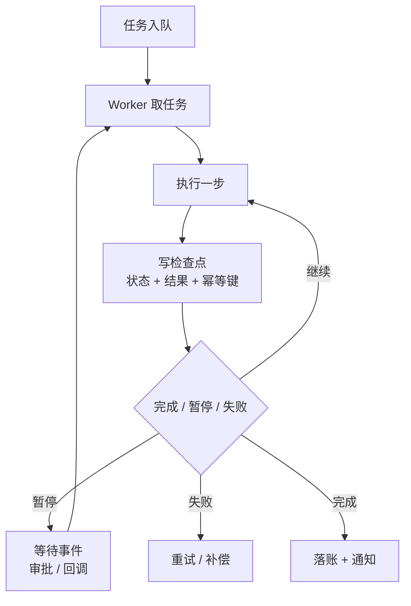
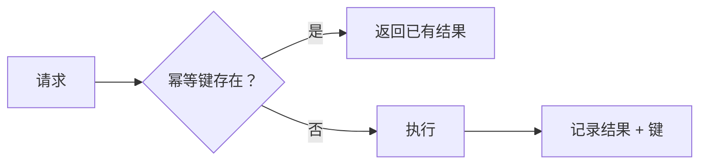

# 长任务与可靠执行：进程会死，任务不能

短任务可以“跑到结束”。长任务不行：进程会被重启、机器会被回收、用户会关页面、审批要等一天。**可靠执行的本质，是把一个长时间的内存过程，改写成一系列可重放的小步骤。**

## 一图看懂



<p class="diagram-caption"><strong>一图看懂</strong> · 每一步都持久化，崩溃后从最近检查点恢复；等待事件不等于占着线程</p>

## 一、长任务带来的四个新问题

| 问题 | 短任务 | 长任务 |
| --- | --- | --- |
| 进程生命周期 | 内存足够 | 进程会重启，必须外部化状态 |
| 副作用 | 一次 | 可能重复执行，必须幂等 |
| 等待 | 同步阻塞 | 等审批/回调可能几小时，必须异步 |
| 失败 | 直接报错 | 要能续跑、回滚、人工接管 |

判断标准：**任务运行时间是否可能超过一次部署窗口？** 是，就必须按长任务设计。

## 二、事件日志 + 重放

Durable execution 的核心思想只有一句：**把“做了什么”写成不可变事件，重启后按事件重建状态。**

```text
1. TaskStarted     {goal, constraints, budget}
2. ModelCalled     {step:1, tokens, decision}
3. ToolExecuted    {step:1, tool:"refund.create", idempotency_key:"t1:refund:1"}
4. ApprovalWaited  {step:1, approver:"user:123", decision:"approved"}
5. ToolExecuted    {step:2, ...}
6. TaskCompleted   {output, cost}
```

重放的三个好处：

- **可恢复**：崩溃后不需要从头再跑（也不需要重复扣费）。
- **可审计**：任何一步都能回答“谁在什么时候做了什么”。
- **可测试**：把事件序列当 fixture，重放即可复现。

## 三、什么必须持久化

| 内容 | 为什么 |
| --- | --- |
| 目标与约束 | 恢复时要知道在做什么 |
| 已执行的工具调用与结果 | 避免重复副作用、避免重复计费 |
| 幂等键 | 去重的唯一依据 |
| 审批状态 | 等待中的任务不能丢 |
| 版本号（模型/提示/策略） | 恢复后行为要一致 |
| 预算用量 | 防止恢复后成本失控 |

**最容易漏的是版本号**：恢复时如果模型或提示已经升级，同一个任务会跑出不同结果，排查时完全对不上。

## 四、幂等：重复执行不能重复生效

见**图 1**：



<p class="diagram-caption"><strong>图 1</strong> · 去重表是最后一道防线；没有它，重试就是事故</p>

三种实现，按可靠性排序：

1. **工具侧天然幂等**：PUT 覆盖、按业务主键 upsert。
2. **幂等键 + 去重表**：键由 task_id、步骤号、工具名组成，执行前查、执行后写。
3. **只靠“尽量不重试”**：不算方案。

对于不可逆动作（转账、发邮件、删除），**幂等键必须由系统生成**，不能让模型生成——模型每次可能给出不同的键。

## 五、重试要分类

| 错误类型 | 例子 | 策略 |
| --- | --- | --- |
| 瞬时 | 429、连接重置、网关超时 | 指数退避 + 抖动，有限次数 |
| 依赖故障 | 下游 5xx、数据库主从切换 | 退避 + 熔断，可能跨分钟 |
| 逻辑错误 | 参数非法、权限不足 | **不重试**，修正或上报 |
| 内容拦截 | 审核拒绝 | **不重试**，改路径或转人工 |
| 未知 | 未捕获异常 | 重试一次，然后带着 trace 上报 |

重试预算：**单个任务的总重试次数与总时长都要有上限**，否则一个坏依赖会把队列拖死。

## 六、超时分层

| 层级 | 例子 | 失败后的动作 |
| --- | --- | --- |
| 连接超时 | 1~3s | 重试下一个连接 |
| 单次调用 | 30s | 记事件、按策略重试 |
| 单步（含模型+工具） | 2~5min | 中断该步，检查点保留 |
| 整个任务 | 按业务（分钟~小时） | 标记 partial，输出已完成部分 |
| 租约 | Worker 心跳 | 超时后任务可被其他 Worker 接管 |

没有租约（lease）的队列，Worker 崩溃后任务会永远卡在“执行中”。

## 七、队列与调度

| 关注点 | 做法 |
| --- | --- |
| 优先级 | 交互式任务优先于批处理；避免饥饿 |
| 公平性 | 按租户限并发，防止单租户打满 |
| 背压 | 队列深度触发拒绝或降级，而不是无限堆积 |
| 并发上限 | 按下游配额设，不按机器数设 |
| 死信 | 超过重试上限进 DLQ，人工处理 |

**交互式与批处理必须分池**，否则一个批量任务能让所有对话变慢。

## 八、补偿：不可逆动作的回滚

```text
订票成功 → 扣款成功 → 出票失败
        ↓
补偿：退款（而不是"撤销扣款"）
```

补偿不是回滚，而是**用一个新动作抵消旧动作**。设计要点：

- 每个不可逆动作都要有对应的补偿动作。
- 补偿本身也要幂等。
- 补偿失败要告警，不能静默。
- 顺序是逆序：先补最后一步。

## 九、把审批变成事件

“等人审批”不该占着线程。

```text
任务状态：waiting_approval
  → 写入待办 + 通知审批人
  → Worker 释放
  → 审批回调产生事件 ApprovalDecided
  → 任务重新入队，从检查点继续
```

这套模型顺带解决了“审批人等了一天才点”的问题：任务不会超时，也不会丢。

## 十、故障演练

上线前必须做：

- **杀进程**：任务执行到一半 kill -9，重启后能否继续且不重复扣费？
- **断网**：下游不可达 5 分钟，是否进入退避而不是疯狂重试？
- **重复投递**：同一任务投递两次，是否只产生一次副作用？
- **时钟跳变**：租约与超时是否还正确？
- **人工中断**：用户点“停止”后，任务是否真的停止，且已完成部分可见？

## 常见问题速查

**Q：用工作流引擎就自动可靠了吗？**
引擎解决调度与状态，解决不了**副作用幂等**。幂等键必须你自己设计。

**Q：检查点存多细？**
按“最贵的重复成本”决定。模型调用贵就每步存，纯计算可以粗一点。

**Q：任务恢复后模型变了怎么办？**
锁版本。恢复用原版本，新版本只对新任务生效。

**Q：一定要分布式队列吗？**
小规模可以用数据库表 + 轮询，关键是**状态外部化 + 幂等**，而不是中间件选型。

## 落地清单

::: tip 可复制模板
本章的清单有对应的结构化版本：[`trace_step.json`](../../examples/templates/trace_step.json)。全部模板见 [examples/templates/README.md](../../examples/templates/README.md)。
:::

- [ ] 状态是否外部化，进程崩溃后可恢复？
- [ ] 每步都有检查点，且包含版本号？
- [ ] 不可逆动作都有幂等键与去重表？
- [ ] 重试按错误类型分类，且有总预算？
- [ ] 超时分层，Worker 有租约与心跳？
- [ ] 交互式与批处理分池，有背压？
- [ ] 不可逆动作有补偿方案？
- [ ] 审批是事件，不占用 Worker？
- [ ] 做过杀进程/断网/重复投递演练？

## 来源

- Temporal, **Workflows：确定性重放**——事件日志 + 重放的工程范式。[链接](https://docs.temporal.io/workflows)
- Apache Kafka, **Semantics：Exactly-Once 与幂等生产者**——幂等键在 broker 侧的实现。[链接](https://kafka.apache.org/documentation/#semantics)
- AWS, **Exponential Backoff and Jitter**——为什么重试必须带抖动。[链接](https://aws.amazon.com/blogs/architecture/exponential-backoff-and-jitter/)
- Garcia-Molina & Salem, **Sagas**（1987）——补偿事务的原始论文。[链接](https://dl.acm.org/doi/10.1145/38713.38742)

完整清单见[推荐来源](/appendix/sources#长任务与可靠执行)。

## 练习

1. 把一次“退款 + 通知 + 归档”的任务拆成可重放的步骤，标出每步的幂等键。
2. 设计一个租约机制：Worker 崩溃后多久任务可被接管？怎么避免两个 Worker 同时执行？
3. 为一个不可逆动作写补偿方案，并说明补偿失败时怎么告警。

::: details 参考答案与自检
**1. “退款 + 通知 + 归档”的幂等键**
要点：每步的幂等键应当**由同一业务实体推导**（如 `refund:{order_id}`、`notify:{refund_id}`、`archive:{task_id}`），而不是随机生成；这样重放时能真正去重。
自检：如果每步的键都是“时间戳 + 随机数”，重放时会重复执行——等于没有幂等。

**2. 租约机制**
要点：租约 = 任务持有者 + 过期时间 + 续约心跳。接管条件：租约过期且心跳停止 N 个周期。避免双执行需要**围栏令牌**（fencing token）：每次接管递增版本号，旧 Worker 的写入被下游拒绝。
自检：如果只说“超时后别人可以接”，没有围栏令牌，两个 Worker 仍可能同时写成功——这正是本章第六节强调的那一点。

**3. 不可逆动作的补偿**
要点：补偿是“用新动作抵消旧动作”（退款而不是撤销扣款），且补偿本身也要幂等；补偿失败必须告警并进入人工队列，不能静默重试到死。
自检：如果你的补偿方案里没有“补偿失败怎么办”这一支，说明只设计了顺利路径。
:::

下一步：[前沿与趋势](/advanced/frontier)；想看这套机制在工业界的成熟版本，见[框架对照](/advanced/frameworks)里的 Temporal 一节。
