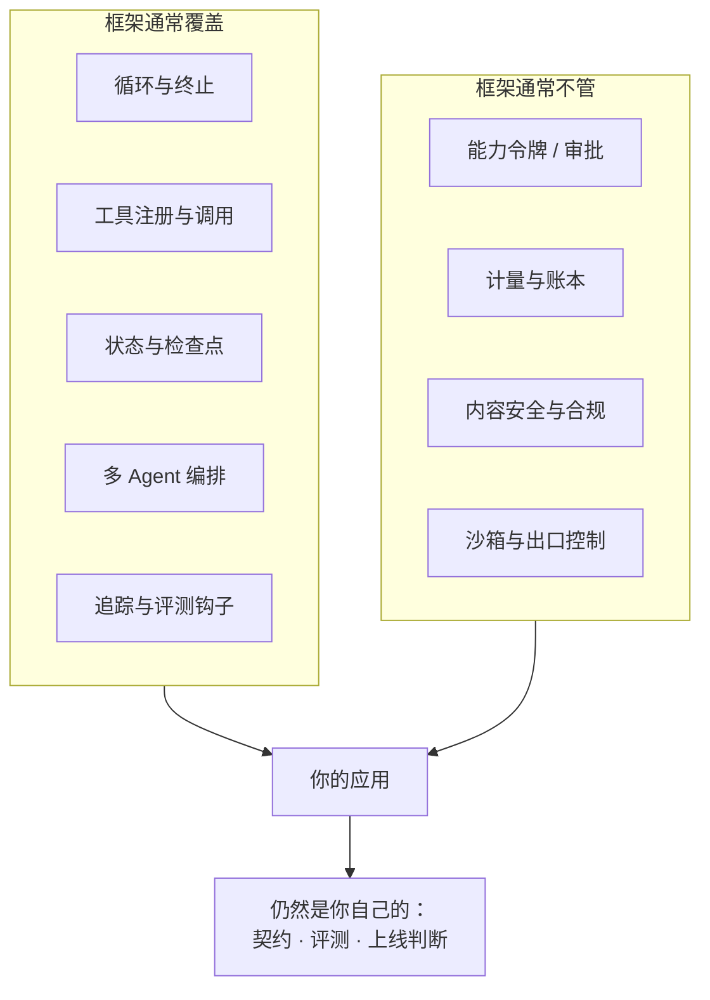
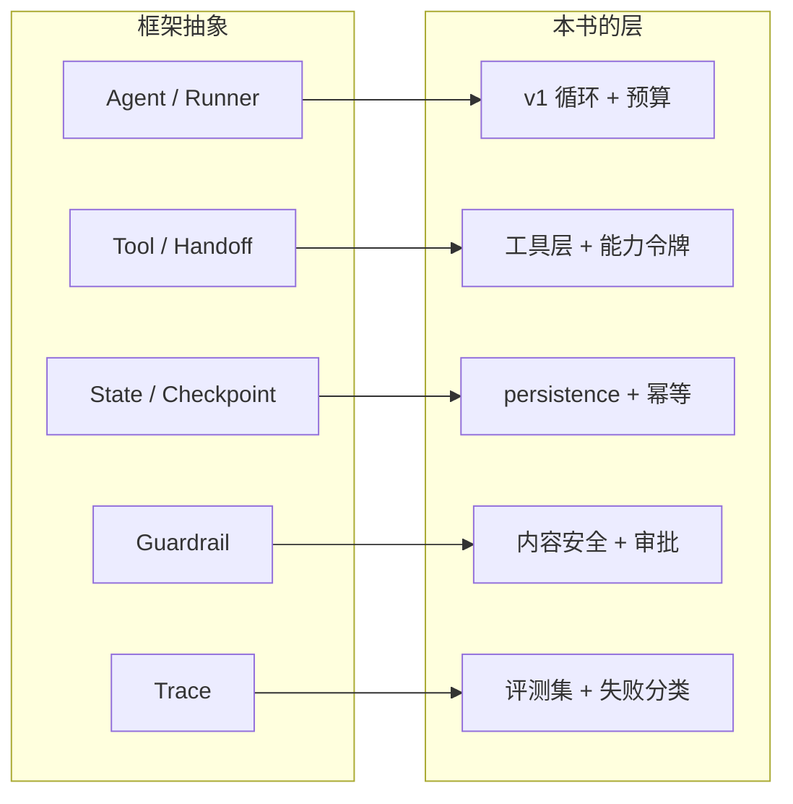

# 框架对照：它们替你做了什么，又藏起了什么

## 为什么这本书刻意“不用框架”

前面的 v1–v3 是手写的，这不是反框架，而是一个判断：**框架的价值只有在你知道它在做什么时才能兑现**。

- 不知道循环怎么终止 → 框架的 `max_turns` 你会设成默认值，然后线上开始无限重试；
- 不知道工具错误契约 → 框架抛出的异常你会直接透给用户；
- 不知道上下文怎么组装 → 框架的“记忆”会给你的模型塞进 20 轮对话和一条过期偏好。

所以这一章的目标不是教你用某个框架，而是给你一副**对照镜**：看到框架的每个概念，能立刻说出它对应本书的哪一层、省掉了哪段代码、又把哪个责任留给了你。

::: warning 时效性
框架迭代很快，**具体 API 会变，抽象和边界不会变**。本章只对“它解决哪类问题”做断言，具体的函数名、参数请以官方文档为准（每节都给了链接）。
:::

## 一图看懂



<p class="diagram-caption"><strong>一图看懂</strong> · 框架覆盖上半部分（编排），下半部分（治理）几乎总是留给你</p>

## 框架概念与本书组件的映射

见**图 1**：



<p class="diagram-caption"><strong>图 1</strong> · 映射之后你会发现：框架给的是“上半截”，每一层下半截的契约仍然在你手里</p>

## 二、先给一张总表

| 框架 | 它最擅长的 | 它给你但容易误用的 | 它基本不管 | 本项目的对照 |
| --- | --- | --- | --- | --- |
| **OpenAI Agents SDK** | 极简基元：Agent / Handoff / Guardrail + 内置循环与 tracing | 内置 tracing 容易当成“可观测已经做完了” | 计量、租户、能力令牌、内容合规 | v1 的循环 + `guard.py` |
| **LangGraph** | 用图表达控制流、持久化、检查点、可恢复与人为中断 | “能恢复”容易误读为“能可靠重试副作用” | 授权、计费、跨系统审计 | v3 的 `persistence.py` |
| **Claude Agent SDK** | 面向 Claude 的 Agent 循环封装与工具/MCP 接入 | 供应商绑定 | 同上 | v1 + MCP 接入点 |
| **AutoGen / CrewAI 类** | 多 Agent 角色协作、对话式委派 | 角色提示 ≠ 契约；错误会顺着对话传播 | 权限边界、成本控制 | v3 的 `agent_task_packet.json` 思想 |
| **Dify / Coze 等平台** | 低代码编排、可视化调试、内置 RAG 与发布 | 平台替你做的选择看不见，出问题难定位 | 你的业务约束与合规义务 | v1–v3 的分层 |
| **Temporal（非 Agent 框架）** | 持久执行：确定性重放、活动、补偿 | 需要把 Agent 改造成“可重放的步骤” | 模型调用本身 | v3 的租约与检查点 |

## 三、逐个看：映射到哪里，责任留在哪

### 1. OpenAI Agents SDK

官方给出的基元很少，这是它的设计原则（“少到能快速学会”）：

- **Agents**：带 instruction 和 tools 的 LLM；
- **Handoffs / Agents as tools**：委派给子 Agent；
- **Guardrails**：并行校验输入输出，失败即中断；
- **内置循环**：一直跑到任务完成；
- **内置 tracing**。

**映射**：

| SDK 概念 | 本书位置 | 你仍然要补的 |
| --- | --- | --- |
| Agent loop | [核心循环](/foundations/loop)、v1 `agent.py` | 预算、停滞检测、部分结果语义 |
| Function tools | [工具层](/layers/tools)、v1 `tools.py` | 错误契约字段、幂等、审批 |
| Guardrails | [内容安全](/layers/content-safety)、v1 `guard.py` | 分级处置（allow/rewrite/review/block）、人审队列 |
| Handoffs | [多 Agent](/evolution/multi-agent) | 子 Agent 契约、预算继承、失败回传 |
| Tracing | [评测与可观测](/layers/evaluation) | 指标定义、失败分类、评测集 |

**最容易踩的坑**：把“有 tracing”当成“有可观测性”。tracing 告诉你**发生了什么**，不告诉你**这是不是好的**——后者需要评测集和指标，框架不会替你定义。

来源：[OpenAI Agents SDK 官方文档](https://openai.github.io/openai-agents-python/)

### 2. LangGraph

它把控制流表达成图：节点、边、状态；并提供了持久化、检查点、流式事件与中断（interrupt）。官方文档里这些是独立的“能力”页，而不是示例技巧。

**映射**：

| LangGraph 概念 | 本书位置 | 你仍然要补的 |
| --- | --- | --- |
| State / Node / Edge | [编排层](/layers/orchestration) | 每个节点的契约（读哪些字段、写哪些字段） |
| Checkpointer / Persistence | [长任务与可靠执行](/advanced/durability)、v3 `persistence.py` | **幂等**：检查点恢复 ≠ 副作用不重复 |
| Interrupt | [交互与信任设计](/practice/ux) 的审批 | 审批单绑定 action+resource，且只能用一次 |
| Time travel | 失败复盘 | 复盘要能定位到“最早出错的一步”，而不是最后一帧 |

**最容易踩的坑**：以为“支持检查点”就等于“长任务可靠”。检查点只保证**状态能恢复**，不保证**副作用不重复发生**。v3 里这两件事是分开实现的：`persistence.py` 管状态，`idempotency` 管副作用，测试分别覆盖。这也是本书反复强调“重试要分类”的原因。

来源：[LangGraph 概览](https://docs.langchain.com/oss/python/langgraph/overview)、[Persistence](https://docs.langchain.com/oss/python/langgraph/persistence)、[Checkpointers](https://docs.langchain.com/oss/python/langgraph/checkpointers)

### 3. Claude Agent SDK 与 MCP

以 Claude 为中心的封装，提供 Agent 循环、工具执行、MCP 接入和权限回调等能力。

**映射**：它基本等价于“v1 的循环 + [工具层](/layers/tools) 的 MCP 接入”。真正的差异在**供应商绑定**：模型层被固定后，[模型网关](/evolution/model-gateway) 的路由/回退/成本策略就要重新设计。

**判断**：如果你的产品已经深度绑定单一模型供应商，这类 SDK 能省掉很多胶水代码；如果你需要多模型路由或数据出境合规要求，那[模型网关](/evolution/model-gateway)那一层必须自己做，SDK 帮不上。

### 4. AutoGen / CrewAI 类多 Agent 框架

核心卖点是“让多个角色协作”。它们的抽象是**对话**和**角色**。

**映射**：对应[多 Agent](/evolution/multi-agent)章，但要注意本书的一个反直觉结论——**多 Agent 的失败大多不是“不聪明”，而是“错误被复制”**。

| 框架的抽象 | 本书的要求 | 差距 |
| --- | --- | --- |
| 角色提示（“你是一个资深评审”） | 输出 schema + 成功标准 + 证据字段 | 提示是概率，schema 是契约 |
| 自由对话 | 结构化任务包（见 `templates/agent_task_packet.json`） | 自由对话会让错误在角色间传播 |
| 默认无预算 | 委派深度、并行数、总 token 上限 | 成本爆炸的常见来源 |

**实操建议**：先在单 Agent 上把工具和评测做扎实，只有当子任务**确实独立**或**需要不同权限/工具集**时，再引入多 Agent。判断标准在[多 Agent](/evolution/multi-agent)章的“三个适用场景”。

### 5. Dify / Coze 等低代码平台

这类平台的真实价值是**缩短从想法到可演示的距离**：可视化编排、内置 RAG、内置发布。

代价是**一部分决策被隐藏**：它怎么切分文档、怎么拼上下文、默认温度是多少、失败怎么重试。这些恰好在出问题时决定你能不能定位。

**用法建议**：

- 用平台做**验证阶段**（一周内验证需求是否存在）；
- 迁移时，用本书的分层做**检查表**：逐层确认平台替你做了什么；
- RAG 相关至少核对[检索层](/layers/retrieval)的五个问题：切分、embedding 与索引、混合检索、重排、权限过滤。

### 6. Temporal（不是 Agent 框架，但值得对照）

Temporal 解决的是“持久执行”：把长流程写成可重放的确定性步骤。它和本书 v3 的关系是**同一类问题的不同成熟度**：

```text
v3 的 persistence.py:  检查点 + 租约 + 围栏令牌
Temporal:             事件日志 + 确定性重放 + 活动重试策略
```

如果你的 Agent 需要跑几小时、跨天等待审批、必须保证“不重复扣款”，用 Temporal 这类基础设施比自己写检查点靠谱得多。v3 的代码价值在于**让你看懂它在解决什么**，而不是替代它。

来源：[Temporal Workflows](https://docs.temporal.io/workflows)

## 四、可迁移检查表

换框架时，逐条回答；答不上来的那一条，就是你会踩的坑。

### 循环与终止

- [ ] 默认最大轮数是多少？超限后的返回是什么（异常 / 部分结果）？
- [ ] 有没有“无进展检测”？还是只靠轮数兜底？
- [ ] 预算（token / 时间 / 工具次数）分别在哪里设置？

### 工具

- [ ] 工具错误的结构是什么？模型能看到哪些字段？
- [ ] 写操作有幂等键吗？由谁生成？
- [ ] 权限检查发生在**执行前**还是工具内部？
- [ ] 工具返回的内容会被当作可信数据吗？

### 状态与持久化

- [ ] 状态在哪？重启后还在吗？
- [ ] 检查点与副作用的幂等是分开实现的吗？
- [ ] 两个 worker 同时跑同一个任务时会发生什么？

### 多 Agent

- [ ] 子 Agent 的输出有 schema 吗？
- [ ] 委派深度和总预算有上限吗？
- [ ] 子 Agent 失败时，父 Agent 拿到的信息够不够做决策？

### 治理（框架通常不管）

- [ ] 能力令牌 / 权限模型是谁的职责？
- [ ] 计量与计费在哪一层？
- [ ] 审计日志记录了**被拒绝**的调用吗？
- [ ] 内容审核的卡点覆盖几处（输入/工具返回/输出/记忆写入）？
- [ ] 谁能回答“这个月哪个租户花了多少钱”？

### 发布

- [ ] 模型、提示、工具 schema 分别怎么版本化？
- [ ] 灰度期间看哪些护栏指标？
- [ ] 回滚需要多久？数据层能回滚吗？

## 来源

- OpenAI, **Agents SDK 文档**——Agent / Handoffs / Guardrails / Tracing 的官方定义。[链接](https://openai.github.io/openai-agents-python/)
- LangChain, **LangGraph 概览**——图、状态、持久化与中断。[链接](https://docs.langchain.com/oss/python/langgraph/overview)
- LangChain, **LangGraph Persistence 与 Checkpointers**——检查点不等于幂等这一区别的官方说明入口。[链接](https://docs.langchain.com/oss/python/langgraph/persistence)
- Temporal, **Workflows**——持久执行的工业级实现。[链接](https://docs.temporal.io/workflows)
- Anthropic, **Model Context Protocol**——跨框架的工具接入标准。[链接](https://modelcontextprotocol.io/)

完整清单见[推荐来源](/appendix/sources#框架对照与迁移)。
