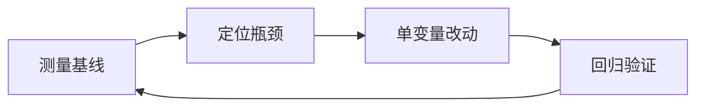

# 优化手册：先测量，再动手

## 一图看懂



<p class="diagram-caption"><strong>一图看懂</strong> · 优化不是“换个更强的模型”，而是测量—定位—改动—回归的闭环</p>


Agent 的优化很容易变成“感觉驱动”：换个更大的模型、加一段提示、再上一个 Agent。结果往往是成本翻倍、延迟变差，成功率却没动。

这一章给一套可执行的顺序：

```text
定义目标 → 建基线 → 定位瓶颈 → 单变量改动 → 回归验证 → 固化
```

## 一、先定义“更好”

“更好”至少包含五个维度，且经常互相冲突：

| 维度 | 典型指标 | 常见代价 |
| --- | --- | --- |
| 质量 | 任务通过率、rubric 分 | 更多 token/更强模型 |
| 成本 | 每任务成本、每成功任务成本 | 小模型/更少步骤可能降质 |
| 延迟 | P50/P95 端到端 | 并行/缓存/流式可能增本 |
| 可靠性 | `pass^k`、错误率、方差 | 重试/验证增加延迟 |
| 安全 | 越权/注入/泄露 | 审批/限制降低自动化 |

一个实用指标：**每次成功任务成本**。

```text
cost_per_success = 总成本 / 成功任务数
```

它比“每任务成本”更诚实：一个便宜但经常失败的 Agent，实际更贵。

同样，延迟要看 **P95**，因为用户感知的是长尾。

## 二、建立基线

没有基线，一切优化都是玄学。基线至少包含：

```json
{
  "date": "2026-10-23",
  "commit": "abc123",
  "model": "…",
  "prompt_version": "p7",
  "dataset": "eval-v3 (60 cases)",
  "pass@1": 0.72,
  "pass^3": 0.48,
  "avg_steps": 8.4,
  "p50_latency_ms": 6200,
  "p95_latency_ms": 21000,
  "cost_per_task_usd": 0.042,
  "cost_per_success_usd": 0.058,
  "tool_error_rate": 0.11
}
```

要求：

- 固定评测集与评测脚本。
- 记录模型/提示/工具/代码版本。
- 多次运行，报告方差。
- 分桶（任务类型、难度、租户），避免平均值掩盖问题。

## 三、按层定位瓶颈

看到症状，先查对应的层，而不是先改 prompt。

| 症状 | 优先查 | 常见根因 | 改动 |
| --- | --- | --- | --- |
| 任务理解错 | L7/L5 | 目标/约束不清 | 明确成功标准、补上下文 |
| 选错工具 | L4 | 描述重叠、工具太多 | 改描述、命名空间、工具检索 |
| 参数错 | L4/L2 | schema 复杂、模型弱 | 简化 schema、加示例、校验重试 |
| 工具失败后不恢复 | L4/L6 | 错误不可行动、无重试策略 | 结构化错误、换策略、降级 |
| 越跑越慢/越贵 | L5/L6 | 上下文膨胀、循环 | 压缩、预算、停滞检测 |
| 长任务中途丢状态 | L6/L3 | 无检查点、状态在上下文 | 结构化状态、持久化 |
| 结果不可信 | L2/L6 | 无验证、模型自评 | 外部验证器、证据要求 |
| 线上偶发失败 | L1/L3 | 超时、限流、环境漂移 | 重试、熔断、快照、监控 |

一个原则：**先修“信息/契约”问题，再换模型。** 很多“模型不够强”其实是上下文没给对、工具描述不清楚。

## 四、质量优化

### 1. 把任务收窄

最有效的优化往往不是技术，而是产品：

- 明确输入格式与边界。
- 把开放式任务改成可验证的子任务。
- 对不确定的情况提供“我不知道/需要人工”的出口。

一个收窄了范围的中等模型，常常胜过一个范围模糊的强模型。

### 2. 外部验证器

- 代码：跑测试、lint、类型检查。
- 数据：schema 校验、业务规则。
- 研究：引用可访问、结论被证据支持。
- 客服：政策引擎校验。

验证器要独立于生成器。**让同一个模型“检查自己”通常只能发现表面错误。**

### 3. 分解与并行

- 大任务拆成可独立验证的子任务。
- 互不依赖的子任务并行。
- 每个子任务有明确输入/输出契约。

代价：合并逻辑、通信开销、错误传播。只在子任务确实独立时使用。

### 4. 采样与投票

对高不确定性的判断任务，可以多次采样再投票/综合：

```text
answers = [llm(prompt, temperature=0.7) for _ in range(5)]
final = majority(answers)  # 或让 judge 综合
```

成本线性上升，适合低并发、高价值的决策点。不要对每个工具调用都投票。

### 5. 反思的边界

反思（让模型检查自己的输出）对**有明确错误信号**的任务有效，比如代码测试失败、schema 不合法。对开放式写作，容易变成“自我表扬”。

用独立 verifier、测试或人工反馈替代纯自我反思。

## 五、成本优化

### 1. 算清 token 账

```text
每任务成本 ≈ Σ (输入 token × 单价 + 输出 token × 单价)
          + 工具/沙箱/检索成本
          + 重试与失败成本
```

先找最大的项。常见是**输入 token**，而不是输出。

### 2. 减少上下文

- 工具结果分页/截断，大结果外置。
- 历史折叠成结构化状态。
- 检索只放高相关片段。
- 去掉重复的工具定义和示例。

### 3. 路由与级联

```python
def route(task):
    if task.is_simple:
        return "small"
    if task.needs_deep_reasoning:
        return "reasoning"
    return "general"

def run(task):
    model = route(task)
    result = call(model, task)
    if not valid(result) and model != "reasoning":
        result = call("reasoning", task)  # 只对失败样本升级
    return result
```

关键：**升级要有条件**，否则等于全量用大模型。

### 4. 缓存

- Prompt cache：稳定前缀。
- 结果缓存：相同请求（注意时效/权限）。
- 工具缓存：相同查询短 TTL。
- 语义缓存：慎用，必须加业务键与抽检。

### 5. 批处理与异步

- 非实时任务走队列/批处理，利用更低价格。
- 并行工具调用减少墙钟时间。
- 流式输出改善感知延迟（不减少总成本）。

## 六、延迟优化

延迟通常由三部分组成：

```text
总延迟 = 模型时间 + 工具时间 + 编排/排队时间
```

### 模型时间

- 路由到更小/更快的模型。
- 减少输入 token（prefill 更短）。
- 限制输出长度/thinking 预算。
- 流式返回首 token。

### 工具时间

- 并行化独立调用。
- 设置超时与熔断，避免长尾拖死。
- 预热沙箱/连接池。
- 缓存高频查询。

### 编排时间

- 减少不必要的轮次（能一次决策就不要多轮）。
- 用确定性代码替代模型调用（分类、格式化、简单规则）。
- 异步执行非关键路径（日志、记忆写入）。

## 七、可靠性优化

### 1. 错误分类

| 错误 | 策略 |
| --- | --- |
| 瞬态（超时/429/5xx） | 指数退避重试 |
| 参数错 | 回传错误让模型修正，最多 1–2 次 |
| 权限/政策 | 不重试，升级/拒绝 |
| 任务理解错 | 重新规划或问用户 |
| 环境错 | 修复环境/换沙箱 |

### 2. 熔断与降级

当下游持续失败时，继续重试只会放大故障：

```text
连续 N 次失败 → 打开熔断 → 快速失败/走备用
冷却一段时间 → 半开试探 → 恢复
```

降级路径要提前设计：换模型、换工具、返回部分结果、转人工。

### 3. 检查点与幂等

长任务要能恢复：

- 每步后持久化状态。
- 写操作带幂等键。
- 失败重放时跳过已完成步骤。

### 4. 减少方差

- 降低 temperature（但不保证确定）。
- 固定工具版本/环境。
- 对关键决策做多次采样 + 一致性检查。
- 记录模型版本，变更时跑回归。

## 八、安全与体验的优化

- 默认只读，写操作分级授权。
- 高风险动作 dry-run + 人工确认。
- 输出前做敏感信息检测。
- 失败时给用户**可行动的下一步**，而不是“出错了”。
- 提供“为什么这么做”的证据/引用。

安全措施会增加摩擦，要用风险分级来平衡：低风险自动化，高风险人工。

## 九、一次完整的优化实验

假设基线：`pass@1=72%`，`cost_per_success=$0.058`，`P95=21s`。目标是降本不降质。

### 实验 1：上下文压缩

- 改动：工具结果超过 2KB 时截断为摘要 + 引用。
- 预期：输入 token 下降，成功率不变或略升。
- 结果：`cost_per_success` 降到 `$0.041`，`pass@1=73%`，`P95=18s`。
- 结论：保留。

### 实验 2：小模型路由

- 改动：分类/抽取类子任务走小模型。
- 结果：成本再降 15%，但 `pass@1` 降到 69%（路由错分）。
- 分析：路由置信度阈值太低。
- 调整：只在高置信时路由，低置信走通用模型。
- 结果：`pass@1=72%`，成本降 10%。
- 结论：保留，但监控路由错分率。

### 实验 3：并行工具调用

- 改动：读文件/搜索并行。
- 结果：`P95` 降到 13s，成本不变。
- 风险：写操作不能盲目并行。
- 结论：只对只读工具启用。

每次只改一个变量，记录“什么没变、什么变差了”。**负结果也是结果。**

## 十、常见反模式

::: danger 反模式一：Prompt 越加越长
用大段提示修补个别失败，最终上下文膨胀、指令冲突、成本上升。优先改结构、工具和验证。
:::

::: danger 反模式二：一出问题就上多 Agent
多 Agent 增加通信和错误传播。先问：单 Agent + 更好的工具/上下文能否解决？
:::

::: danger 反模式三：无差别重试
对语义错误重试只会重复烧钱。先分类错误。
:::

::: danger 反模式四：只测成功案例
评测集要包含边界、对抗、缺信息、工具失败。否则线上会教你做人。
:::

::: danger 反模式五：语义缓存当万能药
相似问题答案可能不同，尤其在政策、时效、权限场景。必须加业务键与抽检。
:::

::: danger 反模式六：用平均值掩盖长尾
P95 延迟、失败率、最差任务类型，才是用户体验的真相。
:::

## 十一、优化检查清单

::: tip 可复制模板
本章的清单有对应的结构化版本：[`eval_case.json`](../../examples/templates/eval_case.json)、[`usage_event.json`](../../examples/templates/usage_event.json)。全部模板见 [examples/templates/README.md](../../examples/templates/README.md)。
:::

- [ ] 有固定评测集和基线（质量/成本/延迟/可靠性）。
- [ ] 指标分桶，不只看平均值。
- [ ] 知道最大的成本项和延迟项。
- [ ] 先修信息/契约，再换模型。
- [ ] 每次只改一个变量，有回归对比。
- [ ] 有失败分类和回归用例。
- [ ] 有降级、熔断、人工升级路径。
- [ ] 高风险动作有权限与审批。
- [ ] 改动可回滚（模型/提示/工具独立版本）。

## 来源

- Sculley et al., **Hidden Technical Debt in Machine Learning Systems**（2015）——为什么“先测量、再优化”。[链接](https://papers.nips.cc/paper/5656-hidden-technical-debt-in-machine-learning-systems.pdf)
- Google, **SRE Book：Monitoring Distributed Systems**——P95 与告警阈值的工程惯例。[链接](https://sre.google/sre-book/monitoring-distributed-systems/)
- Zheng et al., **MT-Bench / LLM-as-a-Judge**（2023）——评审者的偏差与校准。[链接](https://arxiv.org/abs/2306.05685)
- Yao et al., **Tree of Thoughts**（2023）——采样与投票的收益边界。[链接](https://arxiv.org/abs/2305.10601)

完整清单见[推荐来源](/appendix/sources#优化手册)。

## 练习

1. 给你的 Agent 建一份基线报告，包含 `cost_per_success` 和 `pass^3`。
2. 选一个失败案例，按“症状 → 层 → 根因 → 改动 → 验证”写一份优化记录。
3. 设计一个路由策略：什么条件下升级到大模型？如何衡量路由错分率？

::: details 参考答案与自检
**1. 基线报告：`cost_per_success` 与 `pass^3`**
要点：`cost_per_success = 总成本 / 成功任务数`——它比“每任务成本”更真实，因为失败任务也在烧钱。`pass^3` 用同一用例跑三次。
参考实现：`examples/mini_agent/eval.py` 已输出 `pass@1`、`pass^3`、`avg_steps`、`avg_tokens`，可在此基础上加成本字段。
自检：如果报告里只有“通过率”，没有“失败任务花了多少钱”，优化的方向会偏——降本最快的往往是减少失败重试。

**2. “症状 → 层 → 根因 → 改动 → 验证”记录**
要点：每一栏都要能指到一个具体证据（trace 的某一步、某次评测结果）。验证栏要有**对比数字**，并且只改一个变量。
自检：如果“改动”一栏同时改了提示词和模型，验证结果无法归因——这是最常见的优化错误（本章第一节“单变量改动”）。

**3. 路由策略与错分率**
要点：升级条件通常是“首次结果未通过验证 + 任务被判定为复杂”；错分率要分两个方向测——该升级没升级（质量损失）、不该升级却升级（成本损失），两者代价不同，不能只报一个总数。
参考：本章“质量优化”的级联实现，以及[模型层](/layers/model)的级联路由图。
自检：如果只统计“路由准确率”，不区分两个方向，调阈值时就没有依据。
:::

下一步：[框架对照与迁移](/advanced/frameworks) 或 [前沿与趋势](/advanced/frontier)。
