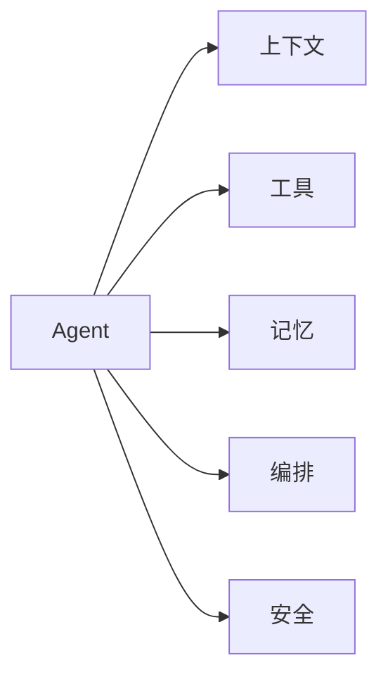

# 术语表

## 一图看懂

<strong>一图看懂</strong> · 术语不是孤立定义：它们都挂在 Agent 的同一张架构图上

::: tip 全书中英对照约定
本书对三个网关采用**统一写法**：

- 中文正文用「**模型网关**」「**工具网关**」「**API 网关**」；
- 首次出现时在括号里给出英文（模型网关 / Model Gateway），之后不再重复；
- **架构图、时序图、JSON 字段、配置项、表格中的产品/组件名**保留英文原文，因为这些是要直接写进代码和图里的。

按这套约定检索不会漏：搜「模型网关」能找到论述，搜「Model Gateway」能找到图与代码。
:::

按主题分组。带 ★ 的是最容易混淆、建议优先掌握的概念。

## 基础

| 术语 | 英文 | 解释 |
| --- | --- | --- |
| Agent | Agent | 以目标为输入，能自主决定下一步动作、通过环境反馈持续调整的系统 |
| 工作流 | Workflow | 控制流由代码预先编排，模型只填充某些节点 |
| 自主性 | Autonomy | 模型对“下一步做什么”的决定权；越高越灵活，也越难控制 |
| 策略 | Policy | 从上下文到下一步动作的映射，通常由 LLM 实现 |
| 动作空间 | Action space | Agent 可以执行的所有动作集合（工具、命令、点击等） |
| 环境 | Environment | Agent 动作作用的对象及其反馈（文件系统、浏览器、API） |
| 轨迹 | Trajectory | 一次任务中所有决策、动作、观察的序列 |
| 终止条件 | Termination condition | 判断任务完成/失败/需要人工的规则 |
| 人在回路 | Human-in-the-loop (HITL) | 在关键节点引入人工审批、纠错或接管 |

## 推理与行动

| 术语 | 英文 | 解释 |
| --- | --- | --- |
| ★ ReAct | Reason + Act | 交替进行推理与动作，用观察结果指导下一步 |
| 思维链 | Chain-of-Thought (CoT) | 让模型先展开中间推理再给答案 |
| 工具调用 | Tool Use / Function Calling | 模型返回结构化工具调用，由宿主执行 |
| 结构化输出 | Structured Output | 按 JSON Schema 等格式约束模型输出 |
| 规划 | Planning | 把目标拆成步骤/子任务，并在执行中调整 |
| 反思 | Reflection | 让模型检查自己的输出/轨迹并修正 |
| 验证器 | Verifier | 独立判断结果是否满足标准的组件（测试、schema、规则、模型） |
| 路由器 | Router | 根据任务类型选择模型/流程/工具 |
| 级联 | Cascade | 先用小模型/便宜路径，失败或低置信时升级 |

## 上下文与记忆

| 术语 | 英文 | 解释 |
| --- | --- | --- |
| ★ 上下文窗口 | Context Window | 模型一次能接收的最大 token 数 |
| ★ 上下文工程 | Context Engineering | 在预算内选择、排序、压缩、隔离上下文 |
| 提示缓存 | Prompt Caching | 复用相同前缀的 KV 计算，降低延迟/成本 |
| 上下文腐烂 | Context Rot | 上下文越长/噪声越多，模型有效推理能力下降 |
| 中间遗忘 | Lost in the Middle | 长上下文中间位置的信息更容易被忽略 |
| 工作记忆 | Working Memory | 当前任务的状态与最近观察 |
| 情景记忆 | Episodic Memory | 过去发生的事件/轨迹 |
| 语义记忆 | Semantic Memory | 稳定事实、偏好、概念 |
| 程序记忆 | Procedural Memory | 可复用的技能、步骤、代码 |
| ★ RAG | Retrieval-Augmented Generation | 检索外部知识并拼进上下文再生成 |
| Agentic RAG | Agentic RAG | 由 Agent 决定何时检索、检索什么、是否继续 |
| 重排 | Reranking | 对召回候选做更精细的相关性排序 |
| 混合检索 | Hybrid Search | 向量召回 + 关键词召回（如 BM25）并行，再融合 |
| ★ RRF | Reciprocal Rank Fusion | 只用名次融合多路召回，避免分数不可比 |
| 查询改写 | Query Rewriting | 把对话问题改写成可检索的独立查询 |
| HyDE | Hypothetical Document Embeddings | 先生成假想答案再检索，缓解问法与文档风格差异 |
| 父子块 | Parent-Child Chunks | 用小块召回、用大块补充上下文 |
| Recall@k | Recall at k | 正确证据出现在前 k 条候选中的比例，检索的核心指标 |
| 记忆污染 | Memory Poisoning | 错误/恶意信息被写入长期记忆并跨会话传播 |

## 编排与多 Agent

| 术语 | 英文 | 解释 |
| --- | --- | --- |
| 编排 | Orchestration | 控制循环、分支、并行、状态、终止 |
| 状态机 | State Machine | 用显式状态与转移表达控制流 |
| 图编排 | Graph Orchestration | 用节点/边/共享状态表达 Agent 流程 |
| 检查点 | Checkpoint | 持久化任务状态，支持恢复/重放 |
| 子 Agent | Sub-agent | 由父 Agent 委派、拥有独立上下文/预算的 Agent |
| 主管模式 | Supervisor | 一个 Agent 分配任务并汇总子 Agent 结果 |
| 交接 | Handoff | 把任务/会话控制权转给另一个 Agent 或人 |
| 辩论 | Debate | 多角色提出/批评，由裁判综合 |
| ★ 多 Agent 系统 | Multi-Agent System (MAS) | 多个 Agent 通过消息/共享状态协作 |

## 运行时与协议

| 术语 | 英文 | 解释 |
| --- | --- | --- |
| 沙箱 | Sandbox | 限制代码/工具可见资源与副作用的隔离环境 |
| 容器 | Container | 基于 namespace/cgroup 的隔离，共享宿主内核 |
| 微虚拟机 | MicroVM | 更轻量的 VM 级隔离（如 Firecracker） |
| gVisor | gVisor | 用户态内核，拦截系统调用，增强容器隔离 |
| seccomp | seccomp | 限制进程可用的系统调用 |
| 出口控制 | Egress Control | 限制/审计沙箱可访问的网络目标 |
| ★ MCP | Model Context Protocol | 标准化模型应用与工具/资源服务器之间的协议 |
| A2A | Agent-to-Agent | Agent 间发现、委派、协作的协议方向 |
| 计算机操作 | Computer Use | 通过截图、鼠标、键盘操作图形界面 |
| 幂等 | Idempotency | 同一操作重复执行不产生额外副作用 |
| 试运行 | Dry Run | 只展示将要执行的动作，不真正产生副作用 |

## 评测与可观测性

| 术语 | 英文 | 解释 |
| --- | --- | --- |
| 端到端评测 | End-to-end Eval | 只看最终任务结果 |
| 轨迹评测 | Trajectory Eval | 检查中间步骤的工具选择、参数、观察处理 |
| 通过率 | pass@1 | 单次运行成功的比例 |
| 可靠性 | pass^k | k 次运行都成功的比例 |
| LLM 评审 | LLM-as-Judge | 用模型按 rubric 打分/比较 |
| 追踪 | Trace | 一次任务中所有 span 的因果链 |
| 跨度 | Span | 一次模型调用/工具调用/节点的记录 |
| 金丝雀 | Canary | 小流量发布新版本，观察指标后扩大 |
| 影子流量 | Shadow Traffic | 新版本只观察不生效，用于对比 |
| 契约测试 | Contract Test | 断言跨边界的数据结构与错误语义不变 |
| 场景回放 | Record & Replay | 录制真实轨迹并断言工具序列与行为边界 |
| 护栏指标 | Guardrail Metric | 灰度期触发自动回滚的线上指标 |
| 补偿 | Compensation | 用新动作抵消已发生的不可逆动作 |
| 租约 | Lease | Worker 心跳凭证，超时后任务可被接管 |
| 幂等键 | Idempotency Key | 由系统生成、用于去重的唯一键 |

## 安全

| 术语 | 英文 | 解释 |
| --- | --- | --- |
| ★ 提示注入 | Prompt Injection | 恶意内容诱导模型偏离原指令 |
| 间接注入 | Indirect Prompt Injection | 注入藏在网页/文档/工具返回中 |
| ★ 致命三要素 | Lethal Trifecta | 私有数据 + 不可信内容 + 对外通信同时具备 |
| 混淆代理 | Confused Deputy | 有权限的 Agent 被诱导替攻击者执行越权操作 |
| 能力令牌 | Capability Token | 绑定主体、动作、资源、有效期的授权凭证 |
| 最小权限 | Least Privilege | 只授予完成任务所需的最小权限 |
| 数据防泄漏 | DLP | 检测/阻止敏感数据外传 |
| 红队 | Red Teaming | 主动模拟攻击，寻找系统弱点 |
| 指令层级 | Instruction Hierarchy | 明确系统/开发者/用户/数据内容的优先级 |
| 护栏 | Guardrail | 在输入/输出/工具边界上强制执行的检查与限制 |
| 内容审核 | Content Moderation | 判断文本/图像/音频是否违规并决定处置 |
| 误杀 | False Positive | 正常内容被判定为违规并拦截 |
| 漏杀 | False Negative | 违规内容未被拦截而流出 |
| 分级处置 | Graded Response | allow / rewrite / review / block / escalate，而不是二选一 |
| 增量审核 | Streaming Moderation | 对流式输出按句/窗口做审核，未通过则断流 |
| 内容标识 | Content Provenance | 显式提示 + 隐式水印/元数据，标明 AI 生成 |
| 备案 | Service Registration | 面向公众提供生成式 AI 服务的登记与算法备案要求 |

## 数据与隐私

| 术语 | 英文 | 解释 |
| --- | --- | --- |
| ★ 个人信息 | Personal Data / PII | 可识别到具体个人的信息，含可关联的假名化数据 |
| 数据分级 | Data Classification | 按敏感度划分公开/内部/敏感/高风险并规定处理方式 |
| 脱敏 | Masking / Redaction | 用占位符替换敏感字段，保留结构 |
| 假名化 | Pseudonymization | 用映射替换标识，仍可通过映射还原，仍属个人信息 |
| 匿名化 | Anonymization | 不可还原、不可关联，才可能脱离个人信息范围 |
| 数据地图 | Data Map | 记录数据在哪、谁负责、怎么删的清单 |
| 保留期限 | Retention Period | 数据允许保存的时长，到期必须删除 |
| 数据出境 | Cross-border Transfer | 数据离开所在司法辖区的传输，通常需要评估或合同约束 |

## 模型与推理

| 术语 | 英文 | 解释 |
| --- | --- | --- |
| token | Token | 模型处理文本的基本单位 |
| 温度 | Temperature | 采样随机性参数；低温度更确定，但不保证事实正确 |
| 推理模型 | Reasoning Model | 在回答前使用更多测试时计算进行推理的模型 |
| 测试时计算 | Test-time Compute | 推理阶段投入更多算力（更长思考、采样、搜索） |
| 语义缓存 | Semantic Cache | 按语义相似度复用历史答案，需谨慎使用 |
| 上下文长度 | Context Length | 模型支持的输入 token 上限 |
| 微调 | Fine-tuning | 用领域数据继续训练，改变行为与格式，不擅长注入新知识 |
| SFT | Supervised Fine-Tuning | 用 (输入, 输出) 对做监督微调 |
| LoRA | Low-Rank Adaptation | 只训练低秩适配器，成本低、可按租户加载 |
| 偏好优化 | Preference Optimization | 用成对比较数据优化“哪种回答更好”，如 DPO |
| 蒸馏 | Distillation | 用大模型输出训练小模型，换取更低成本与延迟 |
| 灾难性遗忘 | Catastrophic Forgetting | 微调后通用能力下降 |
| 数据飞轮 | Data Flywheel | 线上失败 → 标注 → 训练 → 评测 → 上线的闭环 |

## 来源

术语的英文命名与定义以官方文档为准，本章的取舍是“按工程职责归类”，定义本身尽量贴合原文：

- Anthropic, **Glossary**——Agent、tool use、MCP 等术语的官方释义。[链接](https://docs.anthropic.com/en/docs/build-with-claude/glossary)
- Lilian Weng, **LLM Powered Autonomous Agents**——规划/记忆/工具三分法，本章分组的来源。[链接](https://lilianweng.github.io/posts/2023-06-23-agent/)
- OpenAI, **Prompt Engineering Guide**——提示工程与上下文相关术语。[链接](https://platform.openai.com/docs/guides/prompt-engineering)
- Chen et al., **HumanEval**（2021）——`pass@k` 的官方定义。[链接](https://arxiv.org/abs/2107.03374)

完整清单见[推荐来源](/appendix/sources#术语表)。

## 一句话记住

- **Agent = 模型 + 循环 + 工具 + 状态 + 环境。**
- **上下文是工作台，不是仓库。**
- **工具的错误信息是给模型看的接口。**
- **记忆的难点在写、取、忘，不在存。**
- **多 Agent 是手段，不是目标。**
- **评测是 Agent 工程的地基。**
- **安全不能靠提示词，要靠系统边界。**
- **内容安全管“说什么”，安全权限管“做什么”。**
- **审核不是二选一，是分级处置。**
- **数据进得越多，删除就越难；先分级，再采集。**
- **知识用检索，行为用微调。**
- **召回决定上限，重排只是改善排序。**
- **先看 Recall@50，再看 Recall@5。**
- **发布不是一次动作，而是一条带闸门的通道。**
- **长任务的关键不是跑得快，而是崩了能接着跑。**
- **信任来自可预期、可干预、可解释。**
