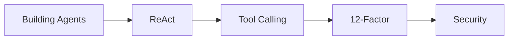

# 延伸阅读

## 一图看懂



<p class="diagram-caption"><strong>一图看懂</strong> · 建议阅读顺序：先建立系统观，再补核心论文、工程原则与安全</p>


按主题整理，标注了“先读哪篇”和“解决什么问题”。链接为外部资源，访问时请注意时效。

## 入门与综述

- **Lilian Weng, LLM Powered Autonomous Agents**（2023）
  [lilianweng.github.io/posts/2023-06-23-agent](https://lilianweng.github.io/posts/2023-06-23-agent/)
  经典的 Agent 综述：规划、记忆、工具使用。适合建立第一张地图。

- **Anthropic, Building Effective Agents**（2024）
  [anthropic.com/research/building-effective-agents](https://www.anthropic.com/research/building-effective-agents)
  区分 workflow 与 agent，给出五种编排模式。工程判断非常务实。

- **Chip Huyen, Agents**（2025）
  [huyenchip.com/2025/01/07/agents.html](https://huyenchip.com/2025/01/07/agents.html)
  从系统角度讲 Agent 的规划、工具、失败模式与评测。

- **12-Factor Agents**
  [github.com/humanlayer/12-factor-agents](https://github.com/humanlayer/12-factor-agents)
  把 Agent 当成软件系统来设计的十二条原则，适合从 demo 走向生产。

## 核心论文

### 推理与行动

- **Chain-of-Thought Prompting**（2022）
  [arxiv.org/abs/2201.11903](https://arxiv.org/abs/2201.11903)
  为什么让模型展开中间步骤能提升多步推理。

- **ReAct: Synergizing Reasoning and Acting**（2022）
  [arxiv.org/abs/2210.03629](https://arxiv.org/abs/2210.03629)
  Agent 循环的奠基作之一：推理与动作交替，用观察纠偏。

- **MRKL Systems**（2022）
  [arxiv.org/abs/2205.00445](https://arxiv.org/abs/2205.00445)
  模块化推理 + 外部工具的路由思想。

- **Toolformer**（2023）
  [arxiv.org/abs/2302.04761](https://arxiv.org/abs/2302.04761)
  模型自学何时/如何调用工具。

- **Reflexion**（2023）
  [arxiv.org/abs/2303.11366](https://arxiv.org/abs/2303.11366)
  用语言化反思和情景记忆改进行为。

- **Voyager**（2023）
  [arxiv.org/abs/2305.16291](https://arxiv.org/abs/2305.16291)
  技能库 + 自动课程 + 迭代提示，程序性记忆的代表。

### 记忆与检索

- **RAG**（2020）
  [arxiv.org/abs/2005.11401](https://arxiv.org/abs/2005.11401)
  检索增强生成的原始论文。

- **MemGPT**（2023）
  [arxiv.org/abs/2310.08560](https://arxiv.org/abs/2310.08560)
  把上下文当内存、外部存储当磁盘的分层记忆管理。

- **Generative Agents**（2023）
  [arxiv.org/abs/2304.03442](https://arxiv.org/abs/2304.03442)
  记忆流、检索打分、反思与规划的经典组合。

### 检索与排序

- **BEIR: A Heterogeneous Benchmark for Zero-shot IR**（2021）
  [arxiv.org/abs/2104.08663](https://arxiv.org/abs/2104.08663)
  告诉你“换数据集后检索模型会掉多少”，是做选型时的清醒剂。

- **MTEB: Massive Text Embedding Benchmark**（2022）
  [arxiv.org/abs/2210.07316](https://arxiv.org/abs/2210.07316)
  embedding 选型的公开榜单来源，注意榜单分数与你的领域往往不一致。

- **ColBERT: Efficient and Effective Passage Search**（2020）
  [arxiv.org/abs/2004.12832](https://arxiv.org/abs/2004.12832)
  延迟交互（late interaction）思路，理解“召回精度 vs 索引成本”的第三条路。

- **HyDE: Precise Zero-Shot Dense Retrieval**（2022）
  [arxiv.org/abs/2212.10496](https://arxiv.org/abs/2212.10496)
  先生成假想答案再检索，缓解“用户问法”与“文档写法”不匹配。

- **Reciprocal Rank Fusion**（Cormack et al., 2009）
  多路召回融合的经典方法，只用名次不用分数，工程上最稳。

### 多 Agent

- **CAMEL**（2023）
  [arxiv.org/abs/2303.17760](https://arxiv.org/abs/2303.17760)
  角色扮演式多 Agent 协作。

- **AutoGen**（2023）
  [arxiv.org/abs/2308.08155](https://arxiv.org/abs/2308.08155)
  可对话、可编排的多 Agent 框架。

- **MetaGPT**（2023）
  [arxiv.org/abs/2308.00352](https://arxiv.org/abs/2308.00352)
  用 SOP 和角色分工模拟软件公司。

### 评测

- **SWE-bench**（2023）
  [arxiv.org/abs/2310.06770](https://arxiv.org/abs/2310.06770)
  真实 GitHub issue 修复评测，Coding Agent 的主战场之一。

- **WebArena**（2023）
  [arxiv.org/abs/2307.13854](https://arxiv.org/abs/2307.13854)
  可复现的网页操作环境与评测。

- **GAIA**（2023）
  [arxiv.org/abs/2311.12983](https://arxiv.org/abs/2311.12983)
  通用助手任务 benchmark，强调工具使用与多步推理。

- **OSWorld**（2024）
  [arxiv.org/abs/2404.07972](https://arxiv.org/abs/2404.07972)
  真实桌面环境中的 Computer Use 评测。

- **τ-bench**（2024）
  [arxiv.org/abs/2406.12045](https://arxiv.org/abs/2406.12045)
  工具 + 政策遵循的客服场景评测。

## 协议与工程

- **Model Context Protocol**
  [modelcontextprotocol.io](https://modelcontextprotocol.io/)
  工具/资源接入的开放协议。先读架构与安全章节。

- **OpenAI Function Calling**
  [platform.openai.com/docs/guides/function-calling](https://platform.openai.com/docs/guides/function-calling)
  结构化工具调用的参考实现。

- **OpenTelemetry GenAI Semantic Conventions**
  [opentelemetry.io/docs/specs/semconv/gen-ai](https://opentelemetry.io/docs/specs/semconv/gen-ai/)
  LLM/Agent 追踪的字段约定，适合自建可观测性。

- **OWASP Top 10 for LLM Applications**
  [genai.owasp.org/llm-top-10](https://genai.owasp.org/llm-top-10/)
  LLM 应用的主要风险清单，含提示注入、供应链、过度代理等。

## 安全

- **Simon Willison, The Lethal Trifecta**（2025）
  [simonwillison.net/2025/Jun/16/the-lethal-trifecta](https://simonwillison.net/2025/Jun/16/the-lethal-trifecta/)
  私有数据 + 不可信内容 + 对外通信的组合风险。

- **Prompt Injection 相关研究**
  可从 OWASP LLM01 与各厂商安全博客入手，关注“间接注入”和“工具调用注入”。

## 内容安全与合规

- **Llama Guard**（2023）
  [arxiv.org/abs/2312.06674](https://arxiv.org/abs/2312.06674)
  用分类模型做输入/输出审核的参考实现，重点是类目体系与提示模板。

- **Microsoft Presidio**
  [microsoft.github.io/presidio](https://microsoft.github.io/presidio/)
  开源的 PII 识别与脱敏工具，可对照它的识别器设计自己的规则集。

- **NIST AI Risk Management Framework**
  [nist.gov/itl/ai-risk-management-framework](https://www.nist.gov/itl/ai-risk-management-framework)
  风险治理框架：治理、映射、度量、管理四个职能，适合做合规自查的骨架。

- **EU AI Act 官方页面**
  [digital-strategy.ec.europa.eu](https://digital-strategy.ec.europa.eu/en/policies/regulatory-framework-ai)
  风险分级思路（不可接受 / 高 / 有限 / 最小）值得借鉴，即使不在欧盟运营。

- **《生成式人工智能服务管理暂行办法》**（国家网信办等，2023）
  国内生成式 AI 服务的基础性规定，涉及备案、标识、数据与内容责任。请以官方发布版本为准。

## 微调与数据

- **LoRA: Low-Rank Adaptation**（2021）
  [arxiv.org/abs/2106.09685](https://arxiv.org/abs/2106.09685)
  低成本适配的主流方法，多租户场景几乎必读。

- **InstructGPT**（2022）
  [arxiv.org/abs/2203.02155](https://arxiv.org/abs/2203.02155)
  用人类反馈对齐行为的奠基工作，理解 SFT 与偏好优化的关系。

- **DPO: Direct Preference Optimization**（2023）
  [arxiv.org/abs/2305.18290](https://arxiv.org/abs/2305.18290)
  不用强化学习也能做成对偏好优化，工程上更容易落地。

- **Distilling Step-by-Step**（2023）
  [arxiv.org/abs/2305.02301](https://arxiv.org/abs/2305.02301)
  用大模型的推理过程蒸馏小模型，数据效率高于纯标注。

## 可靠执行

- **Temporal 文档：Durable Execution**
  [docs.temporal.io](https://docs.temporal.io/)
  事件日志 + 重放的工程实现，适合对照检查自己的检查点与幂等设计。

- **Sagas**（Garcia-Molina & Salem, 1987）
  长事务补偿的经典论文，解释了为什么“回滚”在分布式系统里要写成补偿。

## 怎么读论文

1. 先读摘要、图和结论，判断是否与你的问题相关。
2. 看实验设置：任务分布、工具、模型、步数预算。**很多“提升”来自不同的评测协议。**
3. 看失败分析：作者承认的局限，往往比结论更有信息量。
4. 问：这篇论文解决的是模型能力问题，还是工程问题？前者可能随模型升级失效，后者更持久。
5. 在自己的评测集上复现关键结论，不要只看论文数字。

## 建议的阅读顺序

```text
Building Effective Agents
  → ReAct
  → Function Calling 文档
  → RAG / MemGPT
  → 12-Factor Agents
  → 你的任务对应的 benchmark
  → OWASP / 注入相关
```

读完之后，回到[实战](/practice/mini-agent)写一遍，再回来看这些材料，理解会完全不同。
