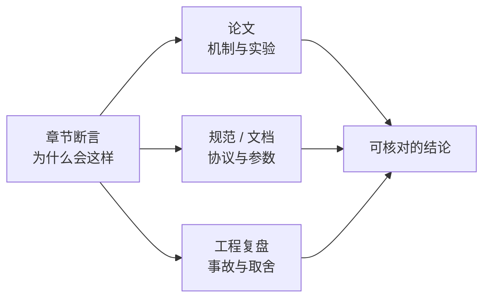

# 推荐来源：每章引用的原始材料

这份附录把全书 38 章的**主要断言**对应到原始来源：论文、协议规范、官方文档。每章正文只带 3–5 个最关键的链接，完整清单集中在这里。

## 一图看懂

<strong>一图看懂</strong> · 三类来源各有分工：论文解释机制，规范锁定事实，复盘给出代价

::: tip 怎么用这份清单
- 读某一章时，先看正文的「来源」小节（3–5 个），它覆盖该章最重要的断言。
- 想深入时，回到这里看该章的完整来源。
- 链接失效或版本变更时，请提 [Issue](https://github.com/hyper-open/diagram-first-agent/issues)——这类反馈对后来人最有价值（线上版与离线版都能打开）。
:::

::: warning 关于时效性
模型、价格、上下文窗口、协议版本都在变化。本书只对**机制**做断言；凡是具体数字和参数，请以来源页面上的最新版本为准。
:::

## 开始

### [学习路线](/start/roadmap)

- Anthropic, **Building Effective Agents**（2024）——workflow 与 agent 的分界、五种编排模式。
  [anthropic.com/research/building-effective-agents](https://www.anthropic.com/research/building-effective-agents)
- OpenAI, **A Practical Guide to Building Agents**——组成部分与适用性判断。
  [cdn.openai.com/business-guides-and-resources/a-practical-guide-to-building-agents.pdf](https://cdn.openai.com/business-guides-and-resources/a-practical-guide-to-building-agents.pdf)
- Schick et al., **Toolformer**（2023）——模型自学何时调工具。
  [arxiv.org/abs/2302.04761](https://arxiv.org/abs/2302.04761)
- Lilian Weng, **LLM Powered Autonomous Agents**（2023）——规划、记忆、工具的第一张全景图。
  [lilianweng.github.io/posts/2023-06-23-agent](https://lilianweng.github.io/posts/2023-06-23-agent/)

### [什么是 Agent](/start/what-is-agent)

- Anthropic, **Building Effective Agents**——workflow 与 agent 的分界。
  [anthropic.com/research/building-effective-agents](https://www.anthropic.com/research/building-effective-agents)
- OpenAI, **A Practical Guide to Building Agents**——Agent 的组成部分与适用性判断。
  [cdn.openai.com/business-guides-and-resources/a-practical-guide-to-building-agents.pdf](https://cdn.openai.com/business-guides-and-resources/a-practical-guide-to-building-agents.pdf)
- Schick et al., **Toolformer**（2023）。
  [arxiv.org/abs/2302.04761](https://arxiv.org/abs/2302.04761)
- Lilian Weng, **LLM Powered Autonomous Agents**（2023）。
  [lilianweng.github.io/posts/2023-06-23-agent](https://lilianweng.github.io/posts/2023-06-23-agent/)

## 架构演进主线

### [00 架构总览](/evolution/overview)

- Google Cloud, **API Gateway 模式**——接入层与后端服务的边界。
  [cloud.google.com/api-gateway/docs/architecture-overview](https://cloud.google.com/api-gateway/docs/architecture-overview)
- AWS, **Well-Architected Framework：Operational Excellence Pillar**——控制面/数据面与运维边界。
  [docs.aws.amazon.com/wellarchitected/latest/operational-excellence-pillar](https://docs.aws.amazon.com/wellarchitected/latest/operational-excellence-pillar/welcome.html)
- HumanLayer, **12-Factor Agents**——把 Agent 当成软件系统的十二条原则。
  [github.com/humanlayer/12-factor-agents](https://github.com/humanlayer/12-factor-agents)
- Raisch et al., **Agentic AI Needs a Systems Theory**（2025）——多组件系统的复杂度守恒。
  [arxiv.org/abs/2503.00237](https://arxiv.org/abs/2503.00237)

### [01 ReAct](/evolution/react)

- Yao et al., **ReAct: Synergizing Reasoning and Acting in Language Models**（2022）——原始论文，含解析失败的实验记录。
  [arxiv.org/abs/2210.03629](https://arxiv.org/abs/2210.03629)
- Wei et al., **Chain-of-Thought Prompting**（2022）——ReAct 的推理前身。
  [arxiv.org/abs/2201.11903](https://arxiv.org/abs/2201.11903)
- Shinn et al., **Reflexion**（2023）——用语言化反思改进行为。
  [arxiv.org/abs/2303.11366](https://arxiv.org/abs/2303.11366)

### [02 工具调用与注册](/evolution/tool-calling)

- OpenAI, **Function Calling 文档**——`tool_calls` 结构与并行调用的官方定义。
  [platform.openai.com/docs/guides/function-calling](https://platform.openai.com/docs/guides/function-calling)
- Anthropic, **Tool use 文档**——`tool_use` / `tool_result` 块与错误回传方式。
  [docs.anthropic.com/en/docs/build-with-claude/tool-use](https://docs.anthropic.com/en/docs/build-with-claude/tool-use/overview)
- JSON Schema, **Specification（Draft 2020-12）**——工具参数声明的语义来源。
  [json-schema.org/specification](https://json-schema.org/specification)
- Patil et al., **Gorilla**（2023）——函数调用准确率与参数幻觉的实测。
  [arxiv.org/abs/2305.15334](https://arxiv.org/abs/2305.15334)

### [03 模型网关与路由](/evolution/model-gateway)

- LiteLLM, **Router 文档**——多模型路由、回退、重试与预算的工程参考实现。
  [docs.litellm.ai/docs/routing](https://docs.litellm.ai/docs/routing)
- OpenRouter, **Provider Routing**——跨供应商路由的现实做法与顺序定义。
  [openrouter.ai/docs/provider-routing](https://openrouter.ai/docs/provider-routing)
- OpenTelemetry, **Semantic Conventions for GenAI**——模型调用要记录哪些字段。
  [opentelemetry.io/docs/specs/semconv/gen-ai](https://opentelemetry.io/docs/specs/semconv/gen-ai/)
- Chen et al., **FrugalGPT**（2023）——级联路由的成本/质量权衡。
  [arxiv.org/abs/2305.05176](https://arxiv.org/abs/2305.05176)

### [04 工具网关](/evolution/tool-gateway)

- OWASP, **Top 10 for LLM Applications：LLM06 Excessive Agency**——为什么“给 Agent 超级账号”是危险的。
  [genai.owasp.org/llm-top-10](https://genai.owasp.org/llm-top-10/)
- OWASP, **ASVS v5：Access Control**——鉴权的验证要求。
  [owasp.org/www-project-application-security-verification-standard](https://owasp.org/www-project-application-security-verification-standard/)
- IETF, **RFC 8693 OAuth 2.0 Token Exchange**——代表用户获取短期、限权凭证。
  [datatracker.ietf.org/doc/html/rfc8693](https://datatracker.ietf.org/doc/html/rfc8693)
- IETF, **RFC 8707 Resource Indicators**——为什么 token 必须绑定目标资源。
  [datatracker.ietf.org/doc/html/rfc8707](https://datatracker.ietf.org/doc/html/rfc8707)

### [05 RAG](/evolution/rag)

- Lewis et al., **Retrieval-Augmented Generation**（2020）——原始论文。
  [arxiv.org/abs/2005.11401](https://arxiv.org/abs/2005.11401)
- Gao et al., **Retrieval-Augmented Generation for Large Language Models: A Survey**（2023）——管线式/高级/Agentic 三阶段。
  [arxiv.org/abs/2312.10997](https://arxiv.org/abs/2312.10997)
- Asai et al., **Self-RAG**（2023）——让模型自己决定何时检索。
  [arxiv.org/abs/2310.11511](https://arxiv.org/abs/2310.11511)
- Trivedi et al., **IRCoT**（2022）——检索与推理交替的多跳做法。
  [arxiv.org/abs/2212.10509](https://arxiv.org/abs/2212.10509)

### [06 意图识别与路由](/evolution/intent)

- Anthropic, **Building Effective Agents：Routing**——最简单的路由器与兜底设计。
  [anthropic.com/research/building-effective-agents](https://www.anthropic.com/research/building-effective-agents)
- Botpress, **Intent 与实体文档**——意图体系的分层设计与训练数据。
  [botpress.com/docs](https://botpress.com/docs)
- Casanueva et al., **Intent Detection 综述（IntentGPT，2024）**——小样本/开放意图分类。
  [arxiv.org/abs/2410.01651](https://arxiv.org/abs/2410.01651)
- AWS, **Well-Architected：Reliability Pillar**——降级与兜底的设计原则。
  [docs.aws.amazon.com/wellarchitected/latest/reliability-pillar](https://docs.aws.amazon.com/wellarchitected/latest/reliability-pillar/welcome.html)

### [07 多 Agent](/evolution/multi-agent)

- Wu et al., **AutoGen**（2023）——可对话的多 Agent 编排框架。
  [arxiv.org/abs/2308.08155](https://arxiv.org/abs/2308.08155)
- Hong et al., **MetaGPT**（2023）——SOP 式分工。
  [arxiv.org/abs/2308.00352](https://arxiv.org/abs/2308.00352)
- Cemri et al., **Why Do Multi-Agent LLM Systems Fail?**（2025）——MAST 失败分类法，多 Agent 失败的系统实证。
  [arxiv.org/abs/2503.13657](https://arxiv.org/abs/2503.13657)
- A2A Project, **Agent2Agent Protocol 规范**——跨系统委派与发现。
  [a2a-protocol.org](https://a2a-protocol.org/latest/specification/)

### [08 平台化与治理](/evolution/platform)

- OpenTelemetry, **GenAI 语义约定**——trace 字段的标准来源。
  [opentelemetry.io/docs/specs/semconv/gen-ai](https://opentelemetry.io/docs/specs/semconv/gen-ai/)
- Cloudflare, **Workers AI Pricing 与 usage 口径**——token 计量与缓存计价的现实差异。
  [developers.cloudflare.com/workers-ai/platform/pricing](https://developers.cloudflare.com/workers-ai/platform/pricing/)
- AWS, **Well-Architected：Cost Optimization**——成本归因与配额。
  [docs.aws.amazon.com/wellarchitected/latest/cost-optimization-pillar](https://docs.aws.amazon.com/wellarchitected/latest/cost-optimization-pillar/welcome.html)
- NIST, **AI RMF 1.0**——风险治理框架，平台控制面的对照物。
  [nist.gov/itl/ai-risk-management-framework](https://www.nist.gov/itl/ai-risk-management-framework)

## 基础参考

### [核心循环](/foundations/loop)

- Yao et al., **ReAct**（2022）——循环的原始形态。
  [arxiv.org/abs/2210.03629](https://arxiv.org/abs/2210.03629)
- Yao et al., **Tree of Thoughts**（2023）——搜索式扩展的对照。
  [arxiv.org/abs/2305.10601](https://arxiv.org/abs/2305.10601)
- Zhou et al., **WebArena**（2023）——长循环任务的实测失败模式。
  [arxiv.org/abs/2307.13854](https://arxiv.org/abs/2307.13854)
- Anthropic, **Building Effective Agents**——循环与工作流的取舍。
  [anthropic.com/research/building-effective-agents](https://www.anthropic.com/research/building-effective-agents)

### [七层职责模型](/foundations/architecture)

- Clean Architecture（Robert C. Martin）——依赖方向与层间契约的思想来源。
  [blog.cleancoder.com/uncle-bob/2012/08/13/the-clean-architecture.html](https://blog.cleancoder.com/uncle-bob/2012/08/13/the-clean-architecture.html)
- C4 Model（Simon Brown）——分层描述系统的工程惯例。
  [c4model.com](https://c4model.com/)
- OpenTelemetry, **Architecture**——横切能力（观测）如何不占业务层。
  [opentelemetry.io/docs/specs/otel/overview](https://opentelemetry.io/docs/specs/otel/overview/)
- HumanLayer, **12-Factor Agents**——职责切分的十二条对照。
  [github.com/humanlayer/12-factor-agents](https://github.com/humanlayer/12-factor-agents)

### [技术演进史](/foundations/evolution)

- Wei et al., **Chain-of-Thought**（2022）。
  [arxiv.org/abs/2201.11903](https://arxiv.org/abs/2201.11903)
- Yao et al., **ReAct**（2022）。
  [arxiv.org/abs/2210.03629](https://arxiv.org/abs/2210.03629)
- Schick et al., **Toolformer**（2023）。
  [arxiv.org/abs/2302.04761](https://arxiv.org/abs/2302.04761)
- Anthropic, **Model Context Protocol 规范**（2024 年末）。
  [modelcontextprotocol.io](https://modelcontextprotocol.io/)
- Wang et al., **Voyager**（2023）——技能库与自动课程的代表。
  [arxiv.org/abs/2305.16291](https://arxiv.org/abs/2305.16291)

## 分层深入

### [模型层](/layers/model)

- OpenAI, **Chat Completions / Responses API 参数说明**——`temperature`、`top_p`、`max_tokens` 的官方语义。
  [platform.openai.com/docs/api-reference](https://platform.openai.com/docs/api-reference/chat)
- Anthropic, **Prompt Caching 文档**——缓存命中与计价的官方口径。
  [docs.anthropic.com/en/docs/build-with-claude/prompt-caching](https://docs.anthropic.com/en/docs/build-with-claude/prompt-caching)
- Wei et al., **Chain-of-Thought**（2022）；Wang et al., **Self-Consistency**（2022）——`temperature` 与采样的取舍依据。
  [arxiv.org/abs/2203.11171](https://arxiv.org/abs/2203.11171)
- Great Expectations / Pydantic, **结构化输出校验**——服务端校验的工程做法。
  [docs.pydantic.dev/latest/concepts/models](https://docs.pydantic.dev/latest/concepts/models/)

### [模型适配](/layers/model-adaptation)

- Hu et al., **LoRA**（2021）——低秩适配器，多租户方案的基础。
  [arxiv.org/abs/2106.09685](https://arxiv.org/abs/2106.09685)
- Ouyang et al., **InstructGPT / RLHF**（2022）——偏好优化的起点。
  [arxiv.org/abs/2203.02155](https://arxiv.org/abs/2203.02155)
- Rafailov et al., **DPO**（2023）——比 RLHF 更可落地的偏好优化。
  [arxiv.org/abs/2305.18290](https://arxiv.org/abs/2305.18290)
- Hinton et al., **Distilling the Knowledge in a Neural Network**（2015）——蒸馏的原始思路。
  [arxiv.org/abs/1503.02531](https://arxiv.org/abs/1503.02531)

### [多模态与实时交互](/layers/multimodal)

- OpenAI, **Vision 文档**——图片 token 的计算方式与尺寸上限。
  [platform.openai.com/docs/guides/vision](https://platform.openai.com/docs/guides/vision)
- Anthropic, **Vision 文档**——分辨率与 tile 的计费口径。
  [docs.anthropic.com/en/docs/build-with-claude/vision](https://docs.anthropic.com/en/docs/build-with-claude/vision)
- Li et al., **DocBank / LayoutLMv3**（2022）——版面分析为何决定文档问答上限。
  [arxiv.org/abs/2204.08387](https://arxiv.org/abs/2204.08387)
- Ruan et al., **TOAST / OSWorld**（2024）——Computer Use 的可复现评测环境。
  [arxiv.org/abs/2404.07972](https://arxiv.org/abs/2404.07972)

### [上下文层](/layers/context)

- Liu et al., **Lost in the Middle**（2023）——位置效应，支撑“中间信息容易被忽略”。
  [arxiv.org/abs/2307.03172](https://arxiv.org/abs/2307.03172)
- Anthropic, **Prompt Caching**——cache-friendly 布局的官方建议。
  [docs.anthropic.com/en/docs/build-with-claude/prompt-caching](https://docs.anthropic.com/en/docs/build-with-claude/prompt-caching)
- Packer et al., **MemGPT**（2023）——分层记忆与上下文管理的代表。
  [arxiv.org/abs/2310.08560](https://arxiv.org/abs/2310.08560)
- Shi et al., **LLMLingua**（2023）——提示压缩与保留率评估。
  [arxiv.org/abs/2310.05736](https://arxiv.org/abs/2310.05736)

### [检索层](/layers/retrieval)

- Robertson & Zaragoza, **BM25（Probabilistic Relevance Framework）**——稀疏检索的基线。
  [dl.acm.org/doi/10.1561/1500000019](https://dl.acm.org/doi/10.1561/1500000019)
- Cormack et al., **Reciprocal Rank Fusion**（2009）——RRF 的原始出处，书中 `k=60` 的来历。
  [dl.acm.org/doi/10.1145/1571941.1572114](https://dl.acm.org/doi/10.1145/1571941.1572114)
- Malkov & Yashunin, **HNSW**（2016）——摘要索引参数 M 与 ef 的语义。
  [arxiv.org/abs/1603.09320](https://arxiv.org/abs/1603.09320)
- Nogueira & Cho, **Passage Re-ranking with BERT**（2019）——重排的经典做法。
  [arxiv.org/abs/1901.04085](https://arxiv.org/abs/1901.04085)

### [工具层](/layers/tools)

- Anthropic, **Writing effective tools for agents**——工具描述与粒度的官方建议。
  [anthropic.com/engineering/writing-tools-for-agents](https://www.anthropic.com/engineering/writing-tools-for-agents)
- Anthropic, **Model Context Protocol 规范**——MCP 的传输、能力协商与资源暴露。
  [modelcontextprotocol.io/specification](https://modelcontextprotocol.io/specification/2025-06-18)
- OpenAPI Initiative, **OpenAPI Specification 3.1**——工具 schema 的另一种描述来源。
  [spec.openapis.org/oas/v3.1.0](https://spec.openapis.org/oas/v3.1.0)
- OWASP, **Top 10 for LLM Applications：LLM01 Prompt Injection**——间接注入为何绕过工具校验。
  [genai.owasp.org/llmrisk/llm01-prompt-injection](https://genai.owasp.org/llmrisk/llm01-prompt-injection/)

### [记忆层](/layers/memory)

- Park et al., **Generative Agents**（2023）——记忆流、检索打分、反思与规划。
  [arxiv.org/abs/2304.03442](https://arxiv.org/abs/2304.03442)
- Packer et al., **MemGPT**（2023）——把上下文当内存的分层管理。
  [arxiv.org/abs/2310.08560](https://arxiv.org/abs/2310.08560)
- Zheng et al., **MemBench**（2025）——记忆系统的系统评测。
  [arxiv.org/abs/2506.21605](https://arxiv.org/abs/2506.21605)

### [编排层](/layers/orchestration)

- Anthropic, **Building Effective Agents**——五种编排模式的原始描述。
  [anthropic.com/research/building-effective-agents](https://www.anthropic.com/research/building-effective-agents)
- LangGraph, **Concepts：State、Nodes、Edges、Checkpointing**——图编排的对照实现。
  [langchain-ai.github.io/langgraph/concepts](https://langchain-ai.github.io/langgraph/concepts/low_level/)
- Temporal, **Workflow：确定性重放与活动**——持久执行的工程范式。
  [docs.temporal.io/workflows](https://docs.temporal.io/workflows)
- Cemri et al., **Why Do Multi-Agent LLM Systems Fail?**（2025）——多 Agent 失败分类。
  [arxiv.org/abs/2503.13657](https://arxiv.org/abs/2503.13657)

### [运行时与沙箱](/layers/runtime)

- gVisor, **Architecture**——用户态内核的隔离边界。
  [gvisor.dev/docs/architecture_guide](https://gvisor.dev/docs/architecture_guide/)
- Firecracker, **Design**——微虚拟机的启动开销与隔离强度。
  [firecracker-microvm.github.io](https://firecracker-microvm.github.io/)
- OCI, **Runtime Specification**——容器隔离的实际配置项。
  [github.com/opencontainers/runtime-spec](https://github.com/opencontainers/runtime-spec/blob/main/config.md)
- NIST, **SP 800-190 Application Container Security Guide**——容器安全的检查项。
  [csrc.nist.gov/pubs/sp/800/190/final](https://csrc.nist.gov/pubs/sp/800/190/final)

### [测试与验证](/layers/testing)

- Google, **Testing on the Toilet：Flaky Tests**——flaky 要修不要重跑。
  [testing.googleblog.com](https://testing.googleblog.com/2016/05/flaky-tests-at-google-and-how-we.html)
- Hamel, **Property-Based Testing with Hypothesis**——用性质替代样例。
  [hypothesis.readthedocs.io](https://hypothesis.readthedocs.io/en/latest/)
- pact-foundation, **Consumer-Driven Contract Testing**——契约测试的工程实践。
  [docs.pact.io](https://docs.pact.io/)
- pytest, **pytest 参数化与 fixture**——本书 Mini Agent 测试所用机制。
  [docs.pytest.org/en/stable](https://docs.pytest.org/en/stable/)

### [评测与可观测性](/layers/evaluation)

- Chen et al., **HumanEval / pass@k**（2021）——`pass@k` 的定义与统计口径。
  [arxiv.org/abs/2107.03374](https://arxiv.org/abs/2107.03374)
- Jimenez et al., **SWE-bench**（2023）——真实仓库级任务评测。
  [arxiv.org/abs/2310.06770](https://arxiv.org/abs/2310.06770)
- Mialon et al., **GAIA**（2023）——通用助手任务基准。
  [arxiv.org/abs/2311.12983](https://arxiv.org/abs/2311.12983)
- OpenTelemetry, **GenAI 语义约定**——trace 字段。
  [opentelemetry.io/docs/specs/semconv/gen-ai](https://opentelemetry.io/docs/specs/semconv/gen-ai/)

### [版本与发布](/layers/release)

- Martin Fowler, **BlueGreenDeployment 与 CanaryRelease**——灰度发布的模式定义。
  [martinfowler.com/bliki/CanaryRelease.html](https://martinfowler.com/bliki/CanaryRelease.html)
- Google, **SRE Workbook：Canarying Releases**——护栏指标与自动回滚。
  [sre.google/workbook/canarying-releases](https://sre.google/workbook/canarying-releases/)
- OpenFeature, **Feature Flag 规范**——开关的标准化，支撑秒级回滚。
  [openfeature.dev/specification](https://openfeature.dev/specification/)
- LaunchDarkly, **Progressive Rollout 实践**——分桶与稳定哈希。
  [launchdarkly.com/blog](https://launchdarkly.com/blog/a-complete-guide-to-feature-flag-targeting/)

### [安全与权限](/layers/security)

- OWASP, **Top 10 for LLM Applications**——注入、过分代理、数据外泄等风险条目。
  [genai.owasp.org/llm-top-10](https://genai.owasp.org/llm-top-10/)
- Greshake et al., **Not what you've signed up for: Compromising Real-World LLM-Integrated Applications with Indirect Prompt Injection**（2023）——间接注入的原始实证。
  [arxiv.org/abs/2302.12173](https://arxiv.org/abs/2302.12173)
- Simon Willison, **The lethal trifecta for AI agents**——私有数据 + 不可信内容 + 外发通道。
  [simonwillison.net/2025/Jun/16/the-lethal-trifecta](https://simonwillison.net/2025/Jun/16/the-lethal-trifecta/)
- NIST, **AI 600-1 Generative AI Profile**——生成式 AI 的风险与缓解措施目录。
  [nvlpubs.nist.gov/nistpubs/ai/NIST.AI.600-1.pdf](https://nvlpubs.nist.gov/nistpubs/ai/NIST.AI.600-1.pdf)

### [内容安全与审核](/layers/content-safety)

- OpenAI, **Moderation 文档**——审核接口的类目与阈值语义。
  [platform.openai.com/docs/guides/moderation](https://platform.openai.com/docs/guides/moderation)
- OpenAI, **Moderation 免费开放公告**——审核成本为何可以前置到每次调用。
  [openai.com/index/new-embedding-models-and-api-updates](https://openai.com/index/new-embedding-models-and-api-updates/)
- Google, **Perspective API**——伤害评分与阈值的实践。
  [perspectiveapi.com](https://perspectiveapi.com/)
- 国家互联网信息办公室,《**生成式人工智能服务管理暂行办法**》——内容标识与责任要求（境内业务）。
  [cac.gov.cn](https://www.cac.gov.cn/2023-07/13/c_1690898327029107.htm)

### [隐私与数据治理](/layers/privacy)

- Microsoft, **Presidio**——PII 识别与脱敏的开源实现。
  [microsoft.github.io/presidio](https://microsoft.github.io/presidio/)
- NIST, **Privacy Framework 1.0**——识别、治理、保护、通信、保护中数据处理。
  [nist.gov/privacy-framework](https://www.nist.gov/privacy-framework)
- ICO, **Right to erasure 指南**——删除义务的边界与例外。
  [ico.org.uk/for-organisations/uk-gdpr-guidance-and-resources/individual-rights/individual-rights/right-to-erasure](https://ico.org.uk/for-organisations/uk-gdpr-guidance-and-resources/individual-rights/individual-rights/right-to-erasure/)
- 全国人大常委会,《**个人信息保护法**》——境内业务的处理规则。
  [npc.gov.cn](http://www.npc.gov.cn/npc/c2/c30834/202108/t20210820_313088.html)

### [合规与法律](/layers/compliance)

- 国家互联网信息办公室,《**互联网信息服务深度合成管理规定**》——深度合成标识义务。
  [cac.gov.cn](https://www.cac.gov.cn/2022-12/11/c_1672221949354811.htm)
- 国家互联网信息办公室,《**生成式人工智能服务管理暂行办法**》——备案、训练数据来源与内容责任。
  [cac.gov.cn](https://www.cac.gov.cn/2023-07/13/c_1690898327029107.htm)
- 国家互联网信息办公室等,《**人工智能生成合成内容标识办法**》——显式与隐式标识的落地要求。
  [cac.gov.cn](https://www.cac.gov.cn/2025-03/14/c_1743654684782215.htm)
- 全国人大常委会,《**网络安全法**》——日志留存与等级保护的上位依据。
  [npc.gov.cn](http://www.npc.gov.cn/npc/c30834/201611/270b43e8b35e4f7ea98502b6f0e26f8a.shtml)

## 动手

### [从零实现 Mini Agent](/practice/mini-agent)

- CPython, **`ast` 模块文档**——书中计算器为何用 AST 白名单而不是 `eval`。
  [docs.python.org/3/library/ast.html](https://docs.python.org/3/library/ast.html)
- CPython, **`subprocess` 文档**（超时与进程组）——沙箱执行器的取舍依据。
  [docs.python.org/3/library/subprocess.html](https://docs.python.org/3/library/subprocess.html)
- OpenAI, **Function Calling**——`--live` 模式所用协议。
  [platform.openai.com/docs/guides/function-calling](https://platform.openai.com/docs/guides/function-calling)
- OpenAI, **tiktoken**——token 计数的参考实现。
  [github.com/openai/tiktoken](https://github.com/openai/tiktoken)

### [真实案例拆解](/practice/cases)

- Jimenez et al., **SWE-bench**（2023）——Coding Agent 的评测协议。
  [arxiv.org/abs/2310.06770](https://arxiv.org/abs/2310.06770)
- Yang et al., **SWE-agent**（2024）——Agent-Computer Interface 的设计取舍。
  [arxiv.org/abs/2405.15793](https://arxiv.org/abs/2405.15793)
- OpenAI, **Deep Research 系统卡**——研究型 Agent 的流程与失败模式。
  [openai.com/index/deep-research](https://openai.com/index/deep-research/)
- Ruan et al., **OSWorld**（2024）——Computer Use 的可复现评测。
  [arxiv.org/abs/2404.07972](https://arxiv.org/abs/2404.07972)

### [部署形态](/practice/deployment)

- Docker, **Dockerfile reference**——`HEALTHCHECK`、`USER`、多阶段构建。
  [docs.docker.com/reference/dockerfile](https://docs.docker.com/reference/dockerfile/)
- The Twelve-Factor App, **Config**——配置来自环境。
  [12factor.net/config](https://12factor.net/config)
- Kubernetes, **Liveness / Readiness / Startup Probes**——探针语义。
  [kubernetes.io/docs/tasks/configure-pod-container/configure-liveness-readiness-startup-probes](https://kubernetes.io/docs/tasks/configure-pod-container/configure-liveness-readiness-startup-probes/)
- OWASP, **Docker Security Cheat Sheet**——容器安全基线。
  [cheatsheetseries.owasp.org/cheatsheets/Docker_Security_Cheat_Sheet.html](https://cheatsheetseries.owasp.org/cheatsheets/Docker_Security_Cheat_Sheet.html)

### [交互与信任设计](/practice/ux)

- Nielsen Norman Group, **Response Times: The 3 Important Limits**——0.1s / 1s / 10s 三个阈值。
  [nngroup.com/articles/response-times-3-important-limits](https://www.nngroup.com/articles/response-times-3-important-limits/)
- Google PAIR, **People + AI Guidebook**——人机协作中的可控与可解释。
  [pair.withgoogle.com/guidebook](https://pair.withgoogle.com/guidebook/)
- Microsoft HAX, **Guidelines for Human-AI Interaction**——18 条交互准则。
  [microsoft.com/en-us/haxtoolkit/ai-guidelines](https://www.microsoft.com/en-us/haxtoolkit/ai-guidelines/)
- Amershi et al., **Guidelines for Human-AI Interaction**（CHI 2019）——上述准则的论文版。
  [dl.acm.org/doi/10.1145/3290605.3300233](https://dl.acm.org/doi/10.1145/3290605.3300233)

## 进阶

### [优化手册](/advanced/optimization)

- Sculley et al., **Hidden Technical Debt in Machine Learning Systems**（NeurIPS 2015）——为什么先测量再优化。
  [papers.nips.cc/paper/5656-hidden-technical-debt-in-machine-learning-systems](https://papers.nips.cc/paper/5656-hidden-technical-debt-in-machine-learning-systems.pdf)
- Google, **Site Reliability Engineering：Monitoring Distributed Systems**——P95 与告警阈值。
  [sre.google/sre-book/monitoring-distributed-systems](https://sre.google/sre-book/monitoring-distributed-systems/)
- Zheng et al., **Judging LLM-as-a-Judge with MT-Bench**（2023）——评审者的偏差。
  [arxiv.org/abs/2306.05685](https://arxiv.org/abs/2306.05685)
- Yao et al., **Tree of Thoughts**（2023）——采样与投票的收益边界。
  [arxiv.org/abs/2305.10601](https://arxiv.org/abs/2305.10601)

### [长任务与可靠执行](/advanced/durability)

- Temporal, **Workflow：确定性重放**——事件日志 + 重放的工程范式。
  [docs.temporal.io/workflows](https://docs.temporal.io/workflows)
- Apache Kafka, **Exactly-Once 语义与幂等生产者**——幂等键的 broker 侧实现。
  [kafka.apache.org/documentation/#semantics](https://kafka.apache.org/documentation/#semantics)
- AWS, **Exponential Backoff and Jitter**——重试抖动为什么必要。
  [aws.amazon.com/blogs/architecture/exponential-backoff-and-jitter](https://aws.amazon.com/blogs/architecture/exponential-backoff-and-jitter/)
- Saga 模式（Garcia-Molina & Salem, 1987）——补偿事务的原始论文。
  [dl.acm.org/doi/10.1145/38713.38742](https://dl.acm.org/doi/10.1145/38713.38742)

### [框架对照与迁移](/advanced/frameworks)

- OpenAI, **Agents SDK**——Agent、Handoff、Guardrail、Tracing 的基元定义。
  [openai.github.io/openai-agents-python](https://openai.github.io/openai-agents-python/)
- LangChain, **LangGraph Persistence / Checkpointers**——状态持久化与恢复。
  [docs.langchain.com/oss/python/langgraph/persistence](https://docs.langchain.com/oss/python/langgraph/persistence)
- Temporal, **Workflows**——确定性重放。
  [docs.temporal.io/workflows](https://docs.temporal.io/workflows)
- Anthropic, **MCP**——跨框架工具协议。
  [modelcontextprotocol.io](https://modelcontextprotocol.io/)
- HumanLayer, **12-Factor Agents**——框架无关的工程原则。
  [github.com/humanlayer/12-factor-agents](https://github.com/humanlayer/12-factor-agents)

### [前沿与趋势](/advanced/frontier)

- Anthropic, **Model Context Protocol**——协议与生态方向。
  [modelcontextprotocol.io](https://modelcontextprotocol.io/)
- A2A Project, **Agent2Agent Protocol**——Agent 间协作的标准化尝试。
  [a2a-protocol.org](https://a2a-protocol.org/)
- DeepSeek-AI, **DeepSeek-R1**（2025）——可验证奖励的推理训练。
  [arxiv.org/abs/2501.12948](https://arxiv.org/abs/2501.12948)
- Cemri et al., **Why Do Multi-Agent LLM Systems Fail?**（2025）——仍然没有答案的问题。
  [arxiv.org/abs/2503.13657](https://arxiv.org/abs/2503.13657)

## 附录

### [术语表](/appendix/glossary)

- Anthropic, **Glossary（Agent 相关术语）**。
  [docs.anthropic.com/en/docs/build-with-claude/glossary](https://docs.anthropic.com/en/docs/build-with-claude/glossary)
- OpenAI, **Prompt Engineering Guide：术语**。
  [platform.openai.com/docs/guides/prompt-engineering](https://platform.openai.com/docs/guides/prompt-engineering)
- Lilian Weng, **LLM Powered Autonomous Agents**——规划/记忆/工具三分法的术语来源。
  [lilianweng.github.io/posts/2023-06-23-agent](https://lilianweng.github.io/posts/2023-06-23-agent/)

### [延伸阅读](/appendix/reading)

分主题的书单与论文索引，见[延伸阅读](/appendix/reading)（已整理 39 条外部资源，按“先读哪篇”排序）。
