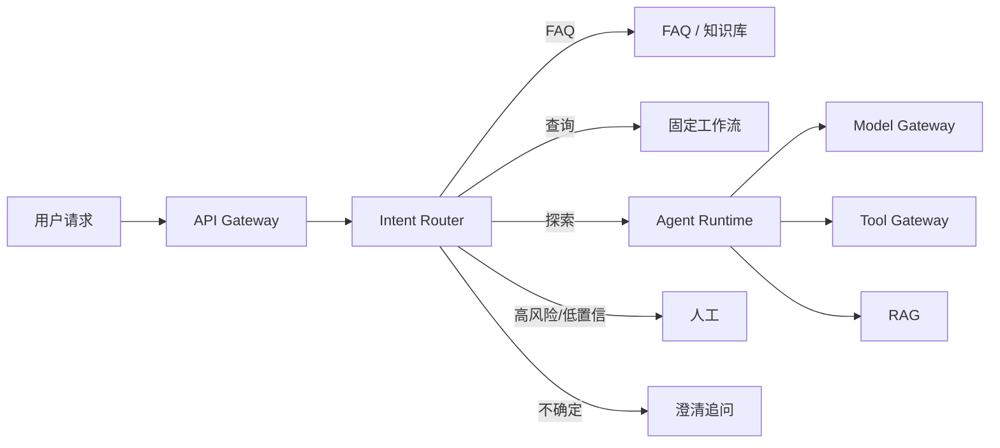
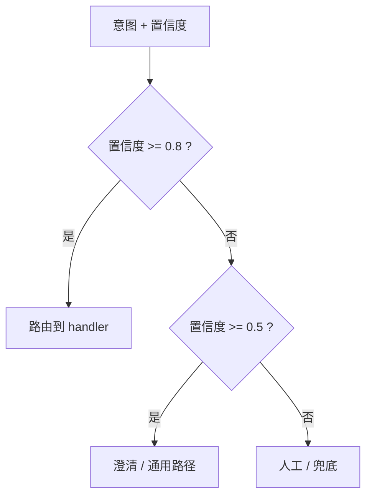
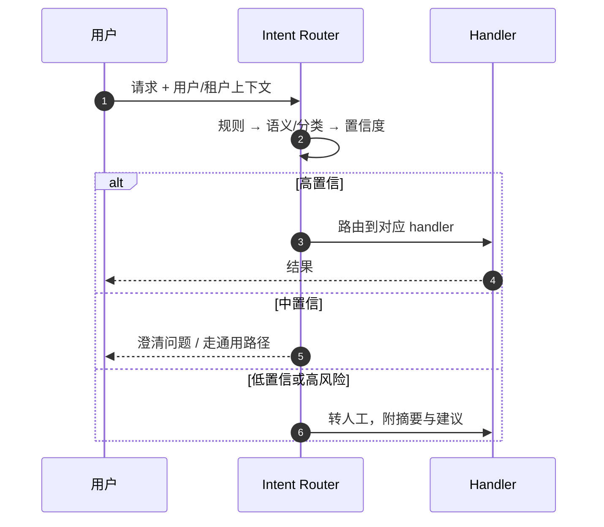

# 阶段 6：意图识别与路由

> 一个“查订单到哪了”的请求，不应该进入一个可以退款、发邮件、改地址的通用 Agent。

## 一图看懂

<strong>一图看懂</strong> · 在 Agent 之前加一层路由：它不回答，只决定“下一步交给谁”

  
<b>1</b><strong>粗分</strong>
售前 / 售后 / 技术 / 投诉。

  
<b>2</b><strong>细分</strong>
退款 / 换货 / 物流 / 账户。

  
<b>3</b><strong>置信度</strong>
高置信直接路由，中置信澄清，低置信人工。

  
<b>4</b><strong>兜底</strong>
任何 handler 都可以说“这不像我的问题”。

本章另有 2 张图：图 1 置信度分叉，图 2 一次请求的路由时序。

## 置信度决定路径

见**图 1**：

<strong>图 1</strong> · 没有“不确定”出口的路由器，会把边界样本硬塞进错误路径

## 一次请求的路由时序

见**图 2**：

<strong>图 2</strong> · 路由层只做分流；具体处理仍由各自的 handler 完成

## 路由方法

| 方法 | 适合 | 代价 |
| --- | --- | --- |
| 规则/关键词 | 明确、高频、强合规 | 覆盖有限，容易被改写绕过 |
| 嵌入/语义 | 同义表达多 | 边界样本易混，需要阈值 |
| 小分类模型 | 延迟低、成本低、可批量 | 需要标注与持续维护 |
| LLM 分类 | 冷启动快、复杂表达 | 贵、慢、可能编造 |
| 分层路由 | 意图多、可解释 | 错误逐层累积 |

> 实践常用**混合路由**：规则兜底 + 嵌入/小模型主路由 + LLM 处理低置信/长尾。

## 命中的目的地

| 目的地 | 适合 | 特点 |
| --- | --- | --- |
| 直接回答 | 闲聊、简单事实 | 最快最便宜 |
| FAQ / 知识库 | 标准问题 | 可控、可引用 |
| 固定工作流 | 查单、改地址 | 稳定、可测试 |
| RAG | 文档型问题 | 有证据、可引用 |
| Agent | 需要探索、多步、工具组合 | 灵活、成本高 |
| 人工 | 高风险、低置信、投诉 | 安全、可兜底 |

## 它解决了什么，又制造了什么

| 解决了 | 同时制造了 |
| --- | --- |
| 简单请求不再走大模型 | 误分类：上游错，下游再强也没用 |
| 延迟下降一个数量级 | 歧义与多意图：一句话包含两件事 |
| 固定流程比自由循环更稳 | 分布漂移：新产品/新政策让旧分类器失效 |
| 高风险请求不走万能 Agent | 路由本身也有延迟 |
| 每条路径可独立监控/评测 | 错误级联：路由错 → 检索错 → 回答错 |

## 优化与度量

::: tip 可复制模板
本章的清单有对应的结构化版本：[`eval_case.json`](../../examples/templates/eval_case.json)。全部模板见 [examples/templates/README.md](../../examples/templates/README.md)。
:::

| 症状 | 手段 |
| --- | --- |
| 误分类 | 分层意图、混合路由、置信度阈值、人工兜底 |
| 多意图 | 多标签、意图拆分、先主后次 |
| 分布漂移 | 持续采样、标注、回归、监控低置信比例 |
| 路由延迟 | 规则优先、缓存、并行、小模型 |
| 错误级联 | handler 内部保留“退出/二次路由” |

| 指标 | 说明 |
| --- | --- |
| 路由准确率 | 分到正确 handler 的比例 |
| 低置信率 | 需要澄清/兜底的比例 |
| 误路由代价 | 按业务成本加权，不只看准确率 |
| 各路径成功率 | 不能只看总体 |
| 路由延迟 | P50/P95 |
| 人工接管率 | 路由后仍需人工的比例 |

## 阶段边界

| 够用 | 进入下一阶段 |
| --- | --- |
| 请求类型少、路径清晰 | 单 Agent 无法高效处理复杂任务 |
| 一个 Agent 能覆盖大部分场景 | 子任务可并行、需要独立评审 |
| 子任务上下文差异不大 | 需要不同角色/权限/工具集 |

## 来源

- Anthropic, **Building Effective Agents：Routing**——最简单的路由器长什么样，以及为什么它不该自己做回答。[链接](https://www.anthropic.com/research/building-effective-agents)
- Botpress, **Intent 与 Entity 文档**——意图体系的分层设计与训练数据组织。[链接](https://botpress.com/docs)
- Casanueva et al., **IntentGPT**（2024）——小样本/开放意图分类，回答“新产品上线后分类器失效”怎么办。[链接](https://arxiv.org/abs/2410.01651)
- AWS, **Well-Architected：Reliability Pillar**——降级与兜底的设计原则。[链接](https://docs.aws.amazon.com/wellarchitected/latest/reliability-pillar/welcome.html)

完整清单见[推荐来源](/appendix/sources#06-意图识别与路由)。

::: details 参考答案与自检
**1. 设计 5 条路由并写出低置信兜底**
要点：每条路由都要有“上升”和“下降”两个出口——高置信直接走，低置信要么澄清、要么降级到更保守的路径（RAG → Agent → 人工）。
自检：如果五条路由的兜底全是“转人工”，等于没有设计兜底——人工是最后的出口，不是默认出口。

**2. 置信度阈值应该由什么决定**
要点：由**误路由的代价**决定，而不是由“准确率好看”决定。漏放一个退款请求（应人工却走了 Agent）与多问一句“您是要查订单还是退款”，成本完全不同。
参考：本章开头的“置信度决定路径”图给了 0.8 / 0.5 两档，你的系统可以不同，但要能说出为什么不同。

**3. 线上误分类怎么排查**
要点：先看**分布**（低置信率是否突增、新意图是否涌现），再看**规则**（阈值是否被改过），最后看**样本**（把误分类的样本按 handler 分组）。
自检：如果第一反应是“再补几条提示词”，说明还没把路由当成一个有监控指标的服务——见本章「优化与度量」的路由准确率、低置信率、误路由代价三个指标。
:::

下一步：[阶段 7：多 Agent 协作](/evolution/multi-agent)。
