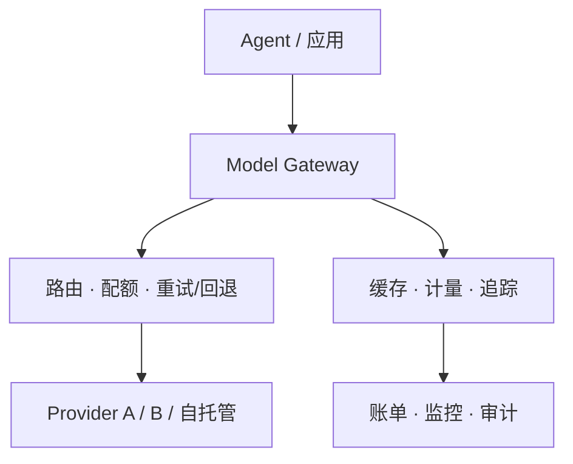
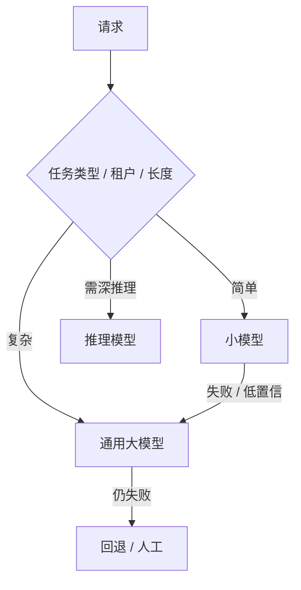
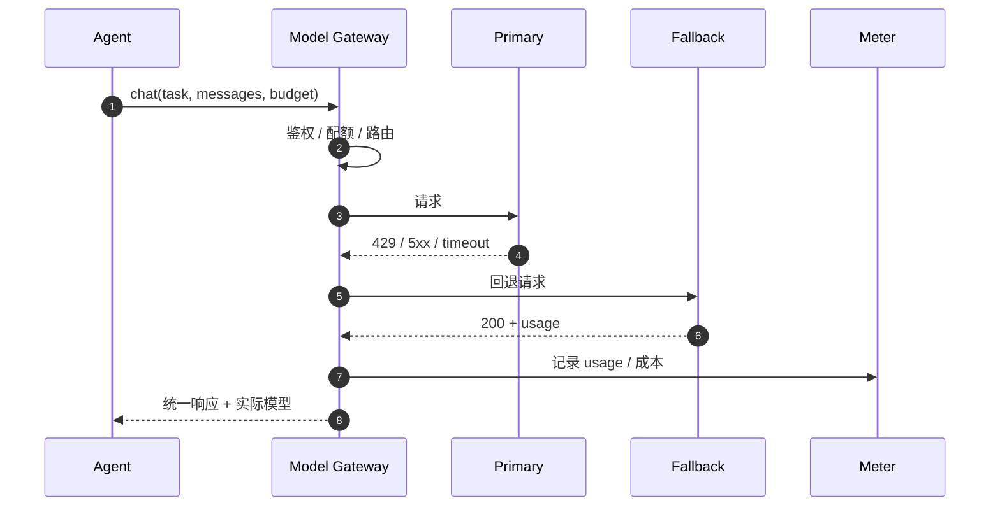

# 阶段 3：模型网关与路由

> 当系统从“一个模型”变成“多个模型 / 多个供应商”，模型访问就不再是业务代码里的 if/else。

## 一图看懂



<p class="diagram-caption"><strong>一图看懂</strong> · 模型网关（Model Gateway）把“鉴权、路由、配额、回退、计量”收拢到一个内部服务</p>

<div class="flow-steps">
  <div class="flow-step"><b>1</b><strong>鉴权与配额</strong><p>这个请求属于谁？还有没有预算？</p></div>
  <div class="flow-step"><b>2</b><strong>路由</strong><p>按任务、租户、成本、延迟选模型。</p></div>
  <div class="flow-step"><b>3</b><strong>调用与回退</strong><p>失败时换 provider，而不是让业务代码重试。</p></div>
  <div class="flow-step"><b>4</b><strong>计量与观测</strong><p>记录 usage、成本、延迟，进入账单与 trace。</p></div>
</div>

本章另有 3 张图：图 1 路由决策树，图 2 带回退的调用时序，图 3 网关的优化顺序。

## 路由决策树

见**图 1**：



<p class="diagram-caption"><strong>图 1</strong> · 路由不是“越强越好”，而是在质量、成本、延迟之间做匹配</p>

| 路由策略 | 做法 | 风险 |
| --- | --- | --- |
| 静态 | 任务类型 → 固定模型 | 边界变化要改配置 |
| 规则 | 按租户/长度/语言/SLA | 规则会越来越多 |
| 分类器 | 小模型判断难度 | 分类错 → 成本或质量损失 |
| 级联 | 小模型失败再升级 | 失败请求延迟叠加 |
| 成本/延迟感知 | 满足质量下选最便宜/最快 | 需要持续评测质量 |
| 灰度/影子 | 小流量对比新模型 | 需要双倍调用与对比体系 |

## 一次带 fallback 的调用

见**图 2**：



<p class="diagram-caption"><strong>图 2</strong> · 回退只对瞬态错误生效；参数错、权限错回退也没用</p>

| 错误 | 是否回退 | 原因 |
| --- | --- | --- |
| 429 | 是 | 换 provider 或退避 |
| 5xx / 超时 | 是 | 换健康实例 |
| 400 / schema 错 | 否 | 换模型也修不好请求 |
| 内容拒绝 | 视策略 | 可能需要换更合适的安全策略 |
| 配额耗尽 | 否 | 直接拒绝或走付费升级 |

## 网关职责：必须与可选

| 必须 | 可选/进阶 |
| --- | --- |
| 统一协议（消息/工具/流式/错误） | prompt cache |
| 鉴权与租户 | 结果缓存 / 语义缓存 |
| 路由 | 内容安全 / PII 脱敏 |
| 配额与限流 | 模型目录（能力/价格/区域） |
| 重试与回退 | 灰度 / 影子 / A-B |
| 计量与追踪 | 成本预测 / 预算告警 |

## 它解决了什么，又制造了什么

| 解决了 | 同时制造了 |
| --- | --- |
| 每家 SDK / 协议不同 | 多一跳延迟 |
| API Key 散落各服务 | 网关单点故障 |
| 无法统一限流与配额 | 路由错误：简单任务送贵模型，复杂任务送小模型 |
| 供应商挂了自己写回退 | 计费口径不一致：token、缓存、图片计费不同 |
| 不知道谁花了多少钱 | 缓存正确性：相似不等于相同 |
| 换模型要改所有调用点 | 网关持有全部密钥，成为高价值目标 |

## 优化清单

::: tip 可复制模板
本章的清单有对应的结构化版本：[`usage_event.json`](../../examples/templates/usage_event.json)。全部模板见 [examples/templates/README.md](../../examples/templates/README.md)。
:::

见**图 3**：


<p class="diagram-caption"><strong>图 3</strong> · 网关优化顺序：正确性 → 成本 → 稳定性</p>

| 问题 | 手段 |
| --- | --- |
| 延迟 | 连接池、同区域、流式透传、异步计量 |
| 单点 | 多副本、熔断、受控降级、容量预留 |
| 路由错 | 路由评测集、置信度阈值、低置信升级 |
| 计费差异 | 统一 usage schema、保留原始 usage、对账 |
| 缓存错 | 缓存键含租户/模型/prompt 版本/权限 |

::: details 网关骨架
```python
class ModelGateway:
    def chat(self, ctx, messages, tools=None):
        self.quota.check(ctx.tenant, ctx.task_type)
        route = self.router.pick(ctx, messages)
        last_error = None

        for candidate in route.candidates:
            try:
                resp = self._call(candidate, messages, tools)
                self.meter.record(ctx, candidate, normalize_usage(resp.usage))
                return resp
            except RetryableError as exc:
                last_error = exc
                continue
            except NonRetryableError:
                raise

        raise GatewayExhausted(route, last_error)
```
:::

## 阶段边界

| 够用 | 进入下一阶段 |
| --- | --- |
| 单模型、单团队、无计费 | 工具跨团队/跨网络 |
| 模型调用点很少 | 需要统一工具鉴权、审计、沙箱路由 |
| 不需要精细配额 | 需要按租户/用户限制工具调用 |

## 来源

- LiteLLM, **Router 文档**——多模型路由、回退、重试与预算的参考实现，本章骨架的对照物。[链接](https://docs.litellm.ai/docs/routing)
- OpenRouter, **Provider Routing**——跨供应商路由的顺序定义与实际做法。[链接](https://openrouter.ai/docs/provider-routing)
- OpenTelemetry, **GenAI 语义约定**——一次模型调用应记录哪些字段（模型、token、延迟）。[链接](https://opentelemetry.io/docs/specs/semconv/gen-ai/)
- Chen et al., **FrugalGPT**（2023）——级联路由的“成本/质量”权衡与实测收益。[链接](https://arxiv.org/abs/2305.05176)

完整清单见[推荐来源](/appendix/sources#03-模型网关与路由)。

::: details 参考答案与自检
**1. 画出你当前系统的网关图**
要点：图上要能回答三件事——哪些调用**不经过**网关（这是最大的风险点）、凭证从哪里来、失败时降级到什么。
自检：如果画完发现所有模型调用都直连、密钥散落在各服务，那么这张图的价值就在于它暴露了问题，而不在乎画得多漂亮。

**2. 找一条“模型能直接访问密钥”的路径**
要点：常见路径是工具进程从环境变量读密钥、或网关把上游 key 透传给沙箱。修复方向是“凭证不进模型、不进沙箱，由网关按真实主体注入短期 token”（见[工具网关](/evolution/tool-gateway)）。
自检：修复方案如果写成“在提示词里告诉模型不要泄露”，属于未通过。

**3. fallback 应该对哪些错误生效**
要点：只对 `429 / 5xx / 超时` 这类**可重试且与内容无关**的错误回退；对 `400 / 内容审核拒绝 / schema 不符` 回退，会把同一个坏请求重复打给多个供应商（既浪费钱又不解决问题）。
自检：能说出“回退是换一个执行者，不是换一个问题”即达标。
:::

下一步：[阶段 4：工具网关](/evolution/tool-gateway)。
