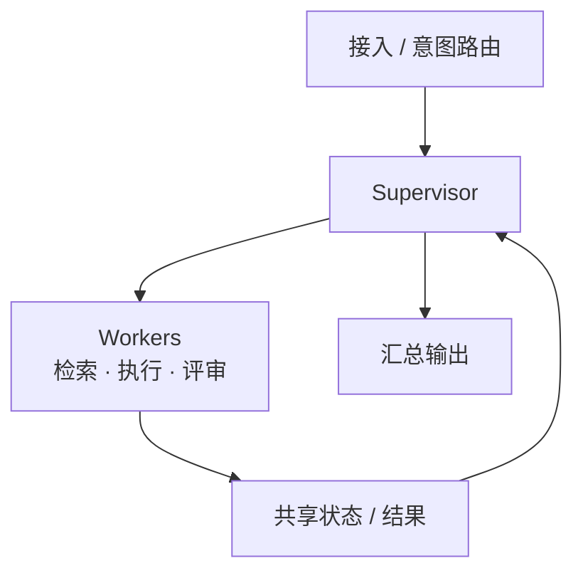
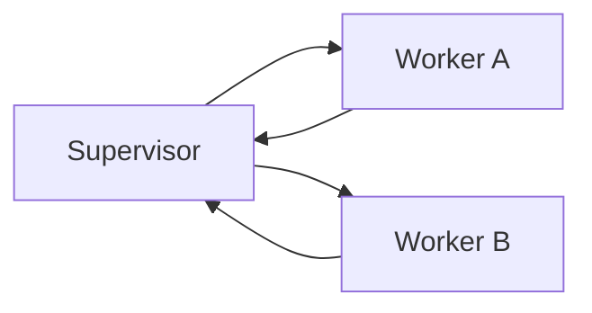
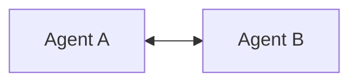
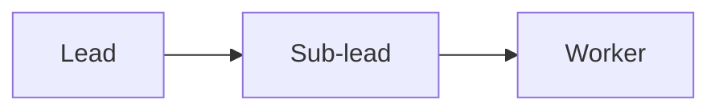
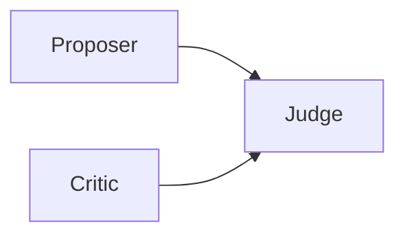
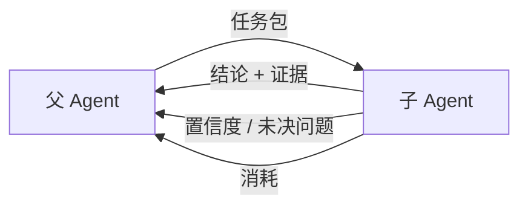
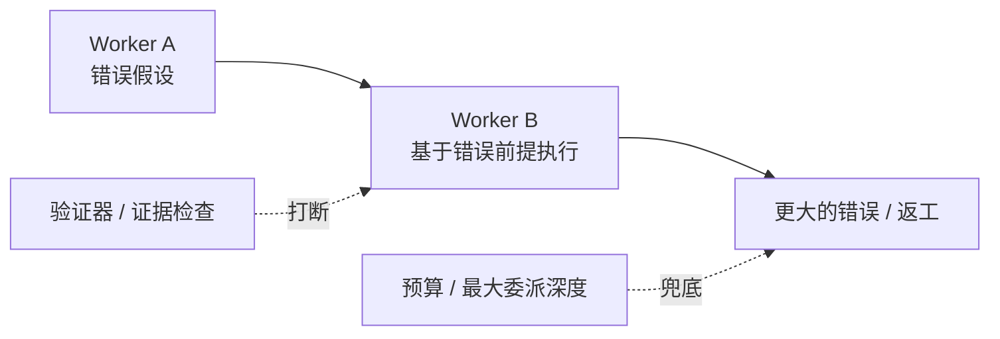

# 阶段 7：多 Agent 协作

> 多 Agent 不是“更多智能”，而是“更多边界”：上下文边界、权限边界、责任边界。

## 一图看懂



<p class="diagram-caption"><strong>一图看懂</strong> · 主管负责拆解与汇总，工人负责独立子任务，共享状态负责交接</p>

<div class="flow-steps">
  <div class="flow-step"><b>1</b><strong>拆解</strong><p>主管把任务拆成可独立执行的子任务。</p></div>
  <div class="flow-step"><b>2</b><strong>隔离</strong><p>每个 Worker 只带自己的上下文、工具和预算。</p></div>
  <div class="flow-step"><b>3</b><strong>交接</strong><p>通过结构化结果和证据回传，不传全部轨迹。</p></div>
  <div class="flow-step"><b>4</b><strong>汇总</strong><p>主管合并、裁决冲突、决定是否继续。</p></div>
</div>

本章另有 6 张图：图 1a–1d 是同一组的四种拓扑，图 2 父子交接，图 3 错误传播。

## 四种拓扑

见**图 1a**：



<p class="diagram-caption"><strong>图 1a</strong> · Supervisor：最常用，责任清晰，主管容易成为瓶颈</p>




<p class="diagram-caption"><strong>图 1b</strong> · 对等：灵活，但容易跑偏、责任不清</p>




<p class="diagram-caption"><strong>图 1c</strong> · 分层：适合超大任务，通信层数多、延迟高</p>




<p class="diagram-caption"><strong>图 1d</strong> · 辩论：适合判断类任务，成本高、可能虚假共识</p>

## 子 Agent 契约

::: tip 可复制模板
本章的清单有对应的结构化版本：[`agent_task_packet.json`](../../examples/templates/agent_task_packet.json)。全部模板见 [examples/templates/README.md](../../examples/templates/README.md)。
:::

见**图 2**：



<p class="diagram-caption"><strong>图 2</strong> · 父 Agent 只合并结论和证据，不吞掉子 Agent 的全部轨迹</p>

::: details 任务包示例
```json
{
  "task": "找出 parser 模块中导致 3 个测试失败的最小修改",
  "constraints": ["不要改公共 API", "不要新增依赖", "只读访问 src/"],
  "tools": ["read_file", "search_code", "run_tests"],
  "success_criteria": "3 个失败测试通过，且原有测试不回归",
  "output_schema": {
    "summary": "string",
    "files_changed": "array",
    "evidence": "array",
    "confidence": "number",
    "open_questions": "array"
  },
  "budget": {"max_steps": 20, "max_tokens": 60000}
}
```
:::

## 它解决了什么，又制造了什么

| 解决了 | 同时制造了 |
| --- | --- |
| 上下文互相干扰 | 通信损耗：理解别人也要花 token |
| 子任务可并行 | 错误传播：上游错误假设被下游当真 |
| 需要不同专长/工具 | 责任不清：不知道是规划、检索还是合并错了 |
| 自我确认偏差 | 协调死锁：互相等待、重复劳动 |
| 超大任务拆解 | 成本爆炸：每个 Agent 都带完整上下文 |

## 错误传播

见**图 3**：



<p class="diagram-caption"><strong>图 3</strong> · 多 Agent 的核心风险不是“不聪明”，而是“错误被复制”</p>

## 设计原则

| 原则 | 说明 |
| --- | --- |
| 少即是多 | 先单 Agent + 好工具；只在独立性/并行/评审有收益时拆 |
| 契约优先 | 输入、输出 schema、预算、成功标准写清楚 |
| 编排确定性 | 能写死的流程不要交给 Agent 协商 |
| 可观测 | trace_id 贯穿父子 Agent，能还原调用树 |
| 有上限 | 委派深度、并行数、总预算、总时长 |
| 不绕网关 | 模型/工具调用仍走模型网关 / 工具网关 |

## MCP 与 A2A

| 协议 | 连接什么 | 解决什么 |
| --- | --- | --- |
| MCP | Agent ↔ 工具/资源 | 工具接入标准化 |
| A2A | Agent ↔ Agent | 跨系统委派、发现、协作 |

两者都不能自动解决信任、权限、计费和责任问题。

## 阶段边界

| 够用 | 进入下一阶段 |
| --- | --- |
| 任务线性、共享细粒度状态 | 需要按租户/Agent 计费、配额、审计 |
| 没有可靠合并/裁决机制 | 一次任务跨多个模型/工具/团队 |
| 预算/延迟敏感 | 需要控制面、账单、合规、评测与灰度 |

## 来源

- Cemri et al., **Why Do Multi-Agent LLM Systems Fail?**（2025）——多 Agent 失败的实证分类（MAST），本章“错误传播”一节的依据。[链接](https://arxiv.org/abs/2503.13657)
- Wu et al., **AutoGen**（2023）——可对话的多 Agent 编排与四种拓扑的工程来源。[链接](https://arxiv.org/abs/2308.08155)
- Hong et al., **MetaGPT**（2023）——SOP 式分工与角色契约。[链接](https://arxiv.org/abs/2308.00352)
- A2A Project, **Agent2Agent Protocol**——跨系统委派、能力发现与协作的规范。[链接](https://a2a-protocol.org/latest/specification/)

完整清单见[推荐来源](/appendix/sources#07-多-agent)。

::: details 参考答案与自检
**1. 设计“研究 → 写作 → 评审”的流程**
要点：三者之间的**不是对话**，而是契约——每个子 Agent 的输入 schema、输出 schema、可用工具、预算、成功标准、失败回报方式。评审 Agent 的输出必须包含“结论 + 证据 + 未决问题”，否则主管无法裁决。
自检：如果你的设计里子 Agent 能互相自由对话，先回答本章的“协调死锁”和“错误传播”该如何避免。

**2. 去掉评审 Agent，质量会下降吗**
要点：先做 A/B：同一批任务，有评审 vs 无评审，比较**证据支持率**和**返工率**，而不是比“感觉更好”。
自检：如果下降无法被指标观测到，结论应当是“这个多 Agent 目前没必要”——本章的设计原则第一条就是“少即是多”。

**3. 什么情况下多 Agent 比“单 Agent + 工具”更差**
要点：三个具体例子可以从本章的错误传播图里找——(a) 子任务强依赖，拆开后要反复同步上下文；(b) 只有一个角色有真实权限，其余 Agent 只是转发，多一跳只增加延迟；(c) 任务本身可验证性弱，评审 Agent 和生成 Agent 共享同样的盲区，形成虚假共识。
自检：能说出“多 Agent 增加的是边界，不是智能”——这是本章开头的原话，能用自己的例子复述它才算理解。
:::

下一步：[阶段 8：平台化](/evolution/platform)。
