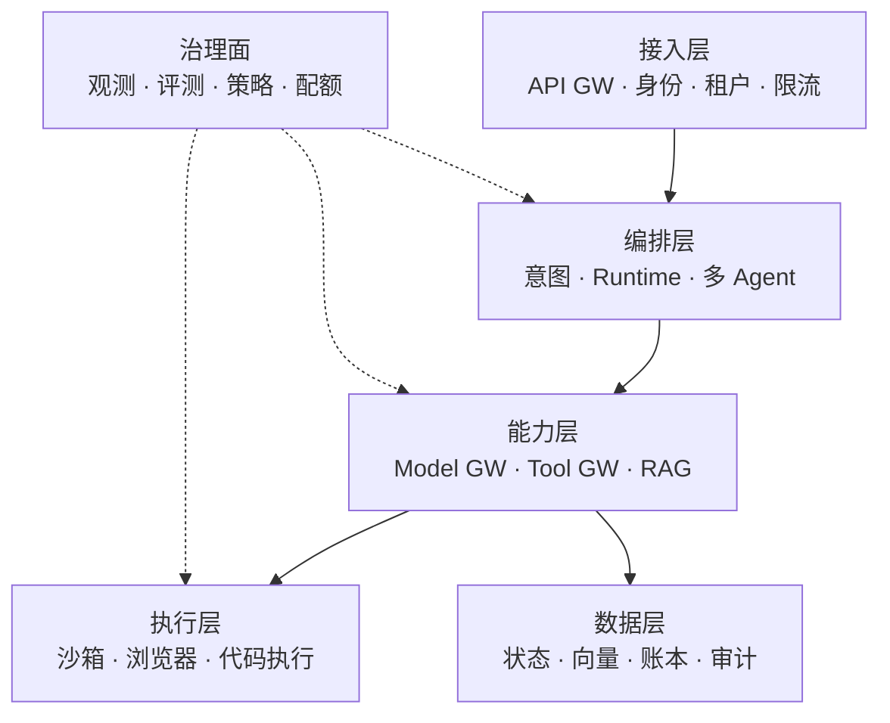
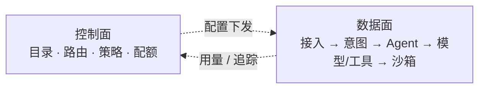
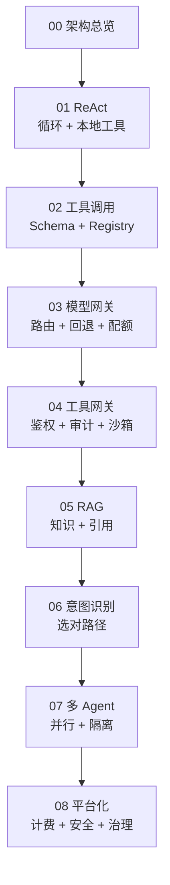

# 架构总览：从一次调用到 Agent 平台

## 一图看懂

如果你只记一张图，记这张：



<p class="diagram-caption"><strong>一图看懂</strong> · Agent 平台的六层结构：请求自上而下，治理面横向支撑</p>

<div class="diagram-legend">
  <span><i class="brand"></i> 请求 / 动作流</span>
  <span><i class="dashed"></i> 配置 / 反馈</span>
</div>

<div class="flow-steps">
  <div class="flow-step"><b>1</b><strong>接入层</strong><p>谁在调用：身份、租户、限流、WAF。</p></div>
  <div class="flow-step"><b>2</b><strong>编排层</strong><p>走哪条路径：意图路由、Agent 循环、工作流、多 Agent。</p></div>
  <div class="flow-step"><b>3</b><strong>能力层</strong><p>需要什么：模型、工具、RAG、记忆。</p></div>
  <div class="flow-step"><b>4</b><strong>执行层</strong><p>副作用在哪：沙箱、浏览器、代码、桌面。</p></div>
  <div class="flow-step"><b>5</b><strong>数据层</strong><p>留下了什么：状态、向量、账本、审计。</p></div>
  <div class="flow-step"><b>6</b><strong>治理面</strong><p>怎么管：观测、评测、策略、配额、发布。</p></div>
</div>

::: tip 六层 vs 七层，别混着数
开篇那张图是**平台组件视角**的六层：接入、编排、能力、执行、数据，加上横向的治理面。

[分层架构](/foundations/architecture) 是**职责视角**的七层：L1 基础设施到 L7 应用与交互。两者不是同一套切法——一个回答“系统由哪些部件组成”，一个回答“某个功能该放在哪、出问题先查哪”。逐个换算见[分层架构末尾的换算表](/foundations/architecture)。
:::

这不是让你第一天就建这么多东西。它是一张**演进地图**：每个阶段只增加当前真正需要的组件，等新问题出现，再进入下一级。

本章另有 2 张图：图 1 控制面与数据面，图 2 八级演进。

## 一、先分清两个平面

Agent 平台最容易犯的错，是把“请求怎么走”和“系统怎么管”混在一起。

见**图 1**：



<p class="diagram-caption"><strong>图 1</strong> · 控制面负责“规则”，数据面负责“执行”；两者通过配置与用量事件连接</p>

| 平面 | 是什么 | 典型组件 | 变化频率 |
| --- | --- | --- | --- |
| 数据面 | 一次请求实际经过的路径 | API 接入、Agent 循环、模型调用、工具调用、沙箱执行 | 高（每请求） |
| 控制面 | 管理数据面怎么走 | 模型目录、路由规则、工具注册、策略、配额、版本、发布 | 低（配置/发布） |

```text
数据面：用户 → 接入 → 意图 → Agent → 模型/工具/RAG → 沙箱 → 输出
控制面：模型目录 / 路由规则 / 工具注册 / 策略 / 配额 / 评测 / 发布
```

为什么必须分开？

- 改一条路由规则，不应该重新部署 Agent。
- 加一个工具，不应该改所有 Agent 的代码。
- 调一次配额，不应该影响正在运行的任务。
- 出一次事故，应该能只回滚模型/提示/工具中的某一个。

**控制面是平台的“方向盘”，数据面是“发动机”。** 很多“Agent 平台”最后变成一堆硬编码，就是因为没有控制面。

## 二、为什么会出现 Gateway

当系统只有 1 个 Agent、1 个模型、3 个本地工具时，直接调用最简单。但当规模变成：

```text
N 个 Agent × M 个模型 × K 个工具 × T 个租户
```

直接连接会变成组合爆炸：

- 每个 Agent 都要处理多家模型的鉴权、重试、限流、计费。
- 每个工具都要在每个 Agent 里重复接一遍。
- 密钥散落在各个服务。
- 无法统一审计“谁在什么时候调了什么”。
- 换模型/换工具要改所有调用方。

Gateway 的本质是**把横切关注点集中到一个边界**：

| 网关 | 连接什么 | 主要职责 |
| --- | --- | --- |
| API Gateway | 客户端 → 平台 | 认证、租户、限流、路由、TLS、WAF |
| Model Gateway | Agent → 模型供应商 | 统一协议、路由、回退、配额、计费、缓存、观测 |
| Tool Gateway | Agent → 工具/执行环境 | 注册、鉴权、权限、限流、审计、结果规范化、沙箱路由 |

注意：**API Gateway 不等于 Agent Gateway，Model Gateway 也不等于 Tool Gateway。** 它们解决的是不同边界上的问题，后文会逐级展开。

## 三、八级演进：每一级只解决一个新矛盾

见**图 2**：



<p class="diagram-caption"><strong>图 2</strong> · 八级演进：每一级都在上一级的边界上补一个能力</p>

| 阶段 | 架构形态 | 新增组件 | 解决什么 | 引入什么新问题 |
| --- | --- | --- | --- | --- |
| 0 | 一次 LLM 调用 | Prompt | 用模型直接回答 | 无反馈、不会用外部世界 |
| 1 | ReAct 循环 | 循环 + 本地工具 | 多步推理、grounding | 解析脆弱、循环失控、无预算 |
| 2 | 工具调用 | Tool Registry + Schema | 稳定解析、参数校验 | 工具选择、权限、工具爆炸 |
| 3 | 多模型接入 | Model Gateway + Router | 统一接入、路由、回退、成本 | 网关延迟、路由错误、计费口径 |
| 4 | 多工具/多团队 | Tool Gateway | 统一鉴权、限流、审计、协议适配 | 越权、注入、长任务、幂等 |
| 5 | 私有知识 | RAG / 知识层 | 时效、私有数据、引用 | 召回噪声、权限过滤、注入 |
| 6 | 多任务类型 | 意图识别 / 任务路由 | 选对处理路径、降本提速 | 误分类、歧义、分布漂移 |
| 7 | 复杂任务 | 多 Agent | 并行、隔离、专长、评审 | 通信损耗、错误传播、责任不清 |
| 8 | 多租户/商业化 | 计费、安全、评测、治理 | 可运营、可审计、可规模化 | 复杂度、合规、成本归因 |

一条重要规律：**复杂度守恒**。ReAct 把复杂度从“写死流程”转移到“循环控制”；Function Calling 把复杂度从“解析文本”转移到“工具设计”；Gateway 把复杂度从“每个 Agent 重复实现”转移到“平台组件”。每一级都不是免费午餐。

## 四、三种成熟度，不要跳级

| 成熟度 | 典型形态 | 适合 | 不该有的东西 |
| --- | --- | --- | --- |
| L1 原型 | 单进程、本地工具、脚本化循环 | 验证想法、内部 demo | 复杂网关、计费、多 Agent |
| L2 团队 | 模型/工具网关、基础观测、简单配额 | 多团队共用、生产早期 | 过度治理、复杂控制面 |
| L3 平台 | 控制面、计费、安全、评测、多租户 | 对外产品、规模化 | 没有基线的“平台化” |

判断是否该升级，不看“别人有没有”，而看**当前架构是否已经被某一类问题反复卡住**：

- 每次接新模型都要改 N 个服务 → 该有 Model Gateway。
- 每个团队都在自己管工具密钥 → 该有 Tool Gateway。
- 无法回答“这个月谁花了多少钱” → 该有计量与计费。
- 同一类问题反复答错、无法回归 → 该有评测与追踪。
- 请求类型差异巨大、Agent 经常选错工具 → 该有意图路由。

## 五、这本主线怎么读

每一章都按同一个结构展开：

```text
上一阶段长什么样
  → 新需求/新矛盾
  → 新增组件与职责
  → 架构图与一次请求的时序
  → 解决了什么
  → 又制造了什么
  → 优化手段与度量
  → 什么时候进入下一阶段
```

建议顺序：

1. [阶段 1：ReAct](/evolution/react)：最小可用 Agent。
2. [阶段 2：工具调用](/evolution/tool-calling)：把动作协议标准化。
3. [阶段 3：模型网关与路由](/evolution/model-gateway)：多模型、成本与可靠性。
4. [阶段 4：工具网关](/evolution/tool-gateway)：多工具、权限与审计。
5. [阶段 5：RAG](/evolution/rag)：私有知识与引用。
6. [阶段 6：意图识别](/evolution/intent)：选对路径，而不是所有事都上 Agent。
7. [阶段 7：多 Agent](/evolution/multi-agent)：并行、隔离与专长。
8. [阶段 8：平台化](/evolution/platform)：计费、安全、评测与治理。

如果你更关心“每一层的职责和技术”，可以配合[七层职责模型](/foundations/architecture)阅读；如果你更关心“技术为什么这样演进”，可以配合[技术演进史](/foundations/evolution)。

## 六、横切能力：不占一层，但贯穿多层

演进主线讲的是“加了什么组件”，但有三类能力从来不是某一级的产物，而是从第一天就该存在、随规模变强的：

| 横切能力 | 最小形态 | 成熟形态 |
| --- | --- | --- |
| 安全与权限 | 工具白名单 | 策略引擎 + 能力令牌 + 审批 |
| 内容、隐私与合规 | 关键词拦截 | 分级审核 + 流式拦截 + 数据分级 + 标识留痕 |
| 可观测与发布 | 打日志 | trace + 评测集 + 灰度回滚 |

它们容易被推迟，因为“现在还能跑”。但推迟的代价是**事后补不回来**：没有 trace 就补不出历史，没有版本就回滚不了，没有审核就删不掉已发出去的内容。

下一步：[阶段 1：ReAct](/evolution/react)。
