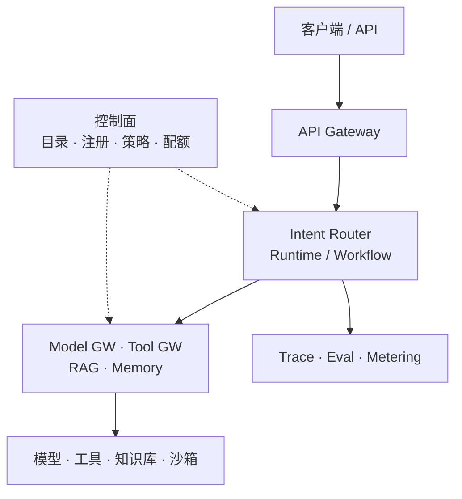
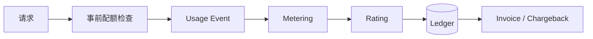
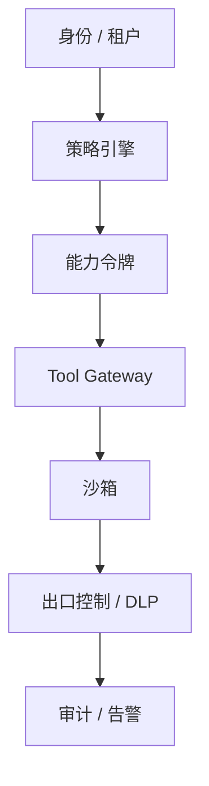
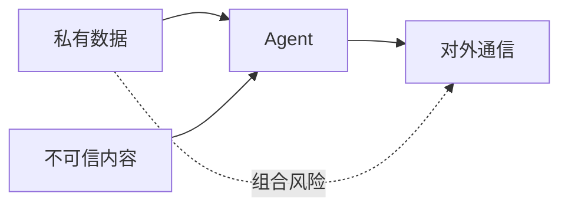
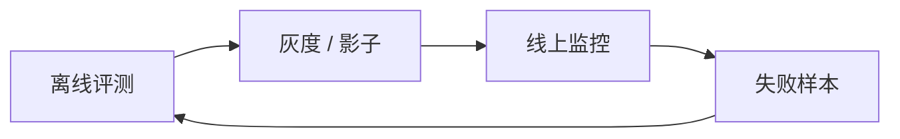
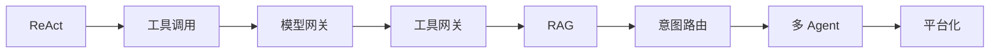

# 阶段 8：平台化与治理：计费、安全与评测

> 能跑不等于能运营。平台化要回答：谁在用、花了多少、安全吗、变好了吗。

## 一图看懂



<p class="diagram-caption"><strong>一图看懂</strong> · 平台参考架构：数据面负责执行，控制面负责规则</p>

<div class="flow-steps">
  <div class="flow-step"><b>1</b><strong>谁在用</strong><p>身份、租户、配额。</p></div>
  <div class="flow-step"><b>2</b><strong>花了多少</strong><p>计量、计费、成本归因。</p></div>
  <div class="flow-step"><b>3</b><strong>安全吗</strong><p>权限、注入、外泄、审计。</p></div>
  <div class="flow-step"><b>4</b><strong>变好了吗</strong><p>评测、观测、灰度、回滚。</p></div>
</div>

本章另有 5 张图：图 1 计费流水线，图 2 安全链路，图 3 致命三要素，图 4 评测闭环，图 5 全景收束。

## 一、计费：从 token 到账单

见**图 1**：



<p class="diagram-caption"><strong>图 1</strong> · 配额在调用前拦住，计费在调用后结算；两者都需要</p>

| 成本项 | 计量方式 |
| --- | --- |
| 输入 / 输出 token | prompt / completion tokens，区分缓存命中 |
| 工具调用 | 次数、时长、外部 API 单价 |
| 沙箱 | CPU / 内存 / 秒 |
| 检索 | 查询次数、索引存储、重排 |
| 存储 | GB / 月（记忆、日志、对象） |
| 人工 | 审批 / 接管时长 |

```json
{
  "event_id": "evt_123",
  "request_id": "req_456",
  "tenant_id": "acme",
  "agent_id": "support-agent",
  "model": "gpt-4.1-mini",
  "input_tokens": 4210,
  "cached_tokens": 3200,
  "output_tokens": 180,
  "tool_calls": [{"name": "order.lookup", "count": 1}],
  "sandbox_seconds": 0,
  "idempotency_key": "req_456:llm:1"
}
```

### 计费的五个坑

| 坑 | 防线 |
| --- | --- |
| 重试重复计费 | idempotency_key 去重 |
| token 口径不一致 | 以 provider 账单为准，保留原始 usage |
| 缓存 token 价格不同 | 价格表区分命中/写入 |
| 多租户归因 | tenant_id 全链路透传 |
| 退款/调账 | 账本不可变，用冲正记录 |

## 二、安全：假设模型会被骗

见**图 2**：



<p class="diagram-caption"><strong>图 2</strong> · 安全是一条链路：身份 → 策略 → 能力 → 执行 → 出口 → 审计</p>




<p class="diagram-caption"><strong>图 3</strong> · 致命三要素：私有数据 + 不可信内容 + 对外通信，至少要切断一条</p>

| 威胁 | 防线 |
| --- | --- |
| 直接/间接注入 | 数据标记、指令层级、出口控制、高风险审批 |
| 混淆代理 | 权限绑定真实用户，每次调用都授权 |
| 数据外泄 | 网络白名单、DLP、禁元数据地址 |
| 工具投毒 | 来源审查、版本锁定、隔离运行 |
| 记忆污染 | 来源/置信度、租户隔离、可删除 |
| 沙箱逃逸 | 容器/微虚拟机、非 root、只读根文件系统 |
| 违规内容 | 分级审核、流式拦截、拒答话术（见[内容安全与审核](/layers/content-safety)） |
| 隐私泄露 | 数据分级、日志脱敏、记忆可删（见[隐私与数据治理](/layers/privacy)） |
| 合规缺失 | 备案、内容标识、审计留痕（见[合规与法律](/layers/compliance)） |

## 三、评测与可观测

见**图 4**：



<p class="diagram-caption"><strong>图 4</strong> · 评测不是一次性的，而是“离线 → 灰度 → 线上 → 回流”的闭环</p>

| 维度 | 指标 |
| --- | --- |
| 质量 | 成功率、`pass@1`、`pass^k` |
| 成本 | 每任务 / 每成功任务成本 |
| 延迟 | P50 / P95 |
| 过程 | 步数、工具成功率、循环率 |
| 安全 | 越权 / 注入 / 泄露事件 |

## 四、控制面

| 组件 | 管什么 |
| --- | --- |
| 模型目录 | 能力、价格、上下文、区域、合规 |
| 路由规则 | 任务 → 模型/Agent 的映射 |
| 工具注册 | schema、版本、负责人、权限 |
| 策略 | 谁能做什么、是否需要审批 |
| 配额 | 租户/用户/Agent 的预算 |
| 版本与开关 | Prompt/Agent/工具的回滚、灰度、降级 |
| 内容策略 | 类目、阈值、处置动作、审核抽样率 |
| 发布门禁 | 评测集通过标准、灰度护栏、熔断阈值 |

## 五、成熟度与取舍

| 级别 | 特征 | 建议 |
| --- | --- | --- |
| L1 原型 | 单进程、本地工具、无计费 | 先验证任务价值 |
| L2 团队 | 网关、基础观测、简单配额 | 多团队共用前补齐 |
| L3 平台 | 控制面、计费、安全、评测、多租户 | 对外产品/规模化 |

> 每一个平台组件都应该对应一个真实、反复出现的问题。不要为了“平台感”提前建 L3。

## 最小可用平台清单

- [ ] 统一身份与租户，所有调用可归因
- [ ] Model Gateway：路由、回退、配额、用量记录
- [ ] Tool Gateway：注册、鉴权、限流、审计
- [ ] 沙箱：代码/浏览器隔离，无宿主凭证
- [ ] 策略引擎：高风险审批，默认拒绝
- [ ] Trace：每步模型/工具/成本可查
- [ ] 评测集 + 回归门禁
- [ ] 计费/配额：至少能回答“谁花了多少”
- [ ] 版本化与回滚：模型/提示/工具独立
- [ ] 失败分类与告警：知道哪里坏了

## 收束

见**图 5**：



<p class="diagram-caption"><strong>图 5</strong> · 每一级都在把“不可控”变成“可控”，代价是更多组件与运维</p>

下一步：回到[架构总览](/evolution/overview)复盘整张图，或进入[优化手册](/advanced/optimization)。
