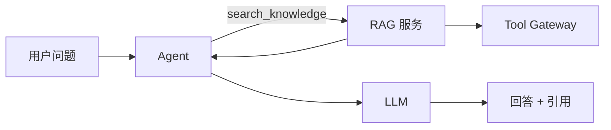
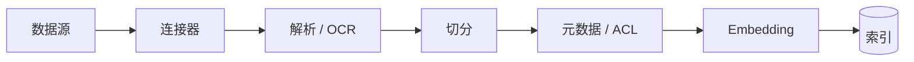
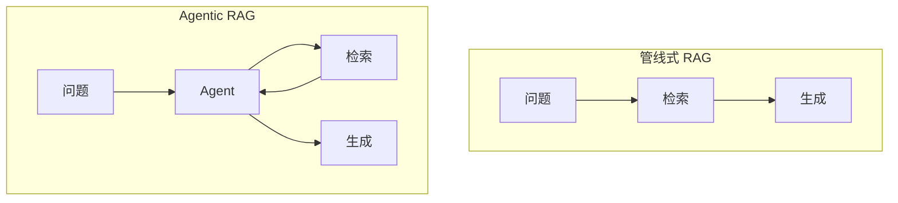
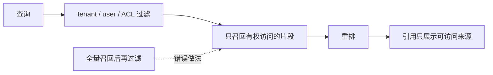

# 阶段 5：RAG 与知识层

> Agent 会调工具，但它仍然不知道公司内部的产品文档、昨天的价格、客户的合同。

## 一图看懂

<strong>一图看懂</strong> · RAG 不是“把文档塞进 prompt”，而是一个可被 Agent 调用的知识服务

  
<b>1</b><strong>索引</strong>
连接数据源、解析、切分、embedding、建索引。

  
<b>2</b><strong>查询</strong>
改写问题、混合检索、权限过滤、重排。

  
<b>3</b><strong>组装</strong>
片段 + 来源 + 时间 + 冲突提示。

  
<b>4</b><strong>引用</strong>
每个关键结论可追溯到来源。

本章另有 4 张图：图 1 索引流水线，图 2 查询流水线，图 3 管线式与 Agentic 的取舍，图 4 权限过滤。

## 两条流水线

见**图 1**：

<strong>图 1</strong> · 写入/索引流水线：元数据与 ACL 必须在这里就写入

<strong>图 2</strong> · 查询流水线：权限过滤必须在召回阶段，而不是让模型“别说”

## 管线式 RAG vs Agentic RAG

见**图 3**：

<strong>图 3</strong> · 路径固定用管线；需要多跳、判断“查够了没有”用 Agentic RAG

## 权限感知：最容易漏的一环

见**图 4**：

<strong>图 4</strong> · 权限过滤发生在召回阶段；索引里必须有可过滤的元数据

ACL 要在索引期写入元数据，查询时过滤，而不是取回结果再筛。删除、留存与跨境的要求见[隐私与数据治理](/layers/privacy)；召回质量怎么量化，见[检索层](/layers/retrieval)。

## 它解决了什么，又制造了什么

| 解决了 | 同时制造了 |
| --- | --- |
| 知识过时 | 切分破坏语义，答案跨段丢失 |
| 私有数据不可见 | 相似度 ≠ 相关性，top-k 全是噪声 |
| 幻觉 / 无依据 | 多跳问题单次检索不够 |
| 无法追溯 | 来源冲突、旧文档未下线 |
| 上下文装不下 | 检索内容注入、权限泄露 |
| 权限差异 | 索引/重排/长上下文成本高 |

## 优化矩阵

> 这张表只给方向。切分、混合检索、重排参数与评测方法，见[检索层](/layers/retrieval)。

| 症状 | 手段 |
| --- | --- |
| 召回不到 | 查询改写、混合检索、扩大候选、同义词 |
| 召回太杂 | 重排、元数据过滤、提高阈值 |
| 片段不完整 | 父文档/子片段、上下文扩展 |
| 多跳 | 查询分解、Agentic RAG、工具组合 |
| 权限泄露 | ACL 元数据 + 召回时过滤 |
| 时效 | 增量索引、TTL、版本号 |
| 引用不可信 | 引用只来自检索结果，逐条校验 |
| 成本高 | 缓存、分层检索、结果复用 |

## 度量

| 指标 | 说明 |
| --- | --- |
| Recall@k / Precision@k | 正确证据在不在候选里、候选有多纯 |
| 引用支持率 | 结论是否被引用支持 |
| 答案正确率 | 端到端任务成功 |
| 权限泄露 | 应为 0 |
| 索引新鲜度 | 索引延迟、过期文档比例 |
| 延迟 / 成本 | 检索 + 重排 + 生成 |

## 阶段边界

| 够用 | 进入下一阶段 |
| --- | --- |
| 问题类型单一、路径固定 | 请求类型差异大：FAQ/工单/Agent 混在一起 |
| 所有请求都值得检索 | 简单请求检索反而更慢更贵 |
| 统一入口、统一策略 | 需要按意图选择不同处理路径 |

下一步：[阶段 6：意图识别与路由](/evolution/intent)。
