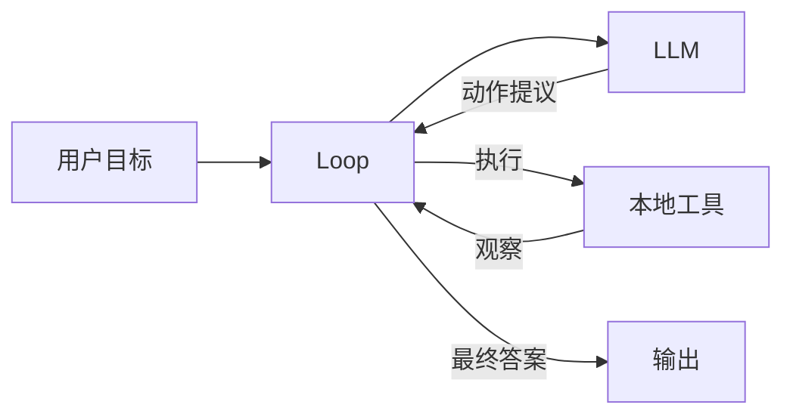
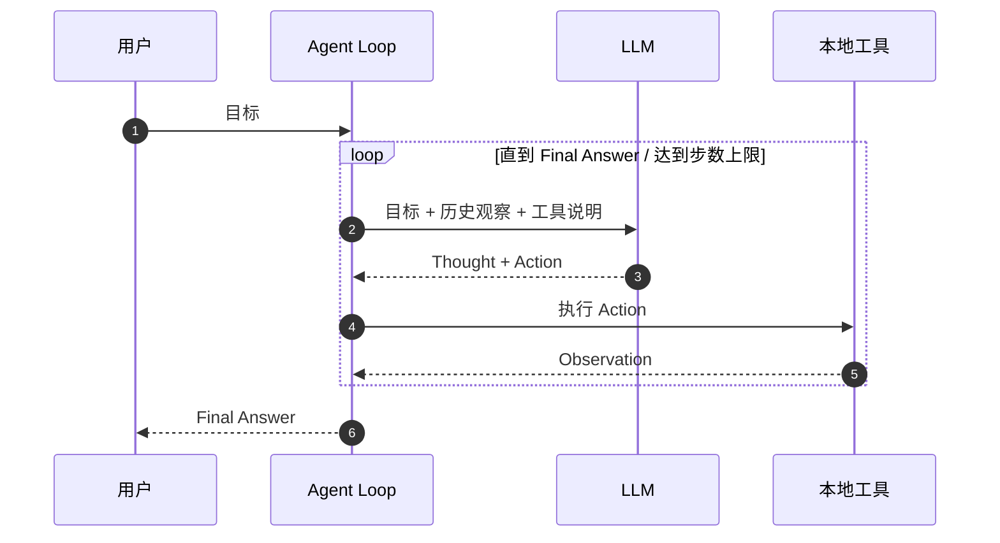
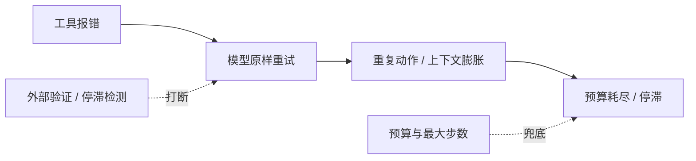

# 阶段 1：ReAct，最小可用 Agent

> 一次调用只能“答”，ReAct 让模型开始“做”。

## 一图看懂



<p class="diagram-caption"><strong>一图看懂</strong> · ReAct 只有四个部件：循环、模型、本地工具、输出</p>

<div class="flow-steps">
  <div class="flow-step"><b>1</b><strong>模型决定动作</strong><p>输出 Thought + Action，而不是直接给答案。</p></div>
  <div class="flow-step"><b>2</b><strong>循环执行动作</strong><p>由宿主程序解析并调用本地工具。</p></div>
  <div class="flow-step"><b>3</b><strong>观察回到模型</strong><p>工具结果成为下一轮的 Observation。</p></div>
  <div class="flow-step"><b>4</b><strong>模型决定继续或停止</strong><p>信息够了就输出 Final Answer，否则继续循环。</p></div>
</div>

本章另有 2 张图：图 1 一次循环的时序，图 2 最常见的失控回路。

## 一次循环的时序

见**图 1**：



<p class="diagram-caption"><strong>图 1</strong> · 循环的燃料是 Observation；没有新观察，循环就没有意义</p>

## 它解决了什么，又制造了什么

| 解决了 | 同时制造了 |
| --- | --- |
| 事实幻觉：可以用检索/数据库结果纠偏 | 文本协议脆弱：格式漂移、JSON 坏掉 |
| 计算错误：可以调用计算器/代码 | 循环失控：原样重试、无预算、无停滞检测 |
| 单步规划不够：可以根据中间结果改计划 | 工具错误不可行动：模型只看到 `Error: 500` |
| 不能操作外部世界：动作空间扩展到工具 | 没有状态与追踪：进程一挂任务就没了 |
| 过程不可见：Thought/Action 轨迹可读 | 注入面直接暴露：工具结果里的指令可能被执行 |

## 最常见的失败回路

见**图 2**：



<p class="diagram-caption"><strong>图 2</strong> · ReAct 的失控通常不是“想错了”，而是“没有新信息还继续”</p>

## 第一轮工程化：不换架构，先补护栏

::: tip 可复制模板
本章的清单有对应的结构化版本：[`mini_agent_config.json`](../../examples/templates/mini_agent_config.json)。全部模板见 [examples/templates/README.md](../../examples/templates/README.md)。
:::

| 护栏 | 解决的问题 |
| --- | --- |
| 最大步数 | 防无限循环 |
| token/时间/工具调用预算 | 防成本与延迟失控 |
| 结构化工具错误 | 让模型知道“能不能重试、怎么改” |
| 外部验证器 | 防止模型过早宣布完成 |
| trace | 出问题能还原每一步 |
| 停滞检测 | 重复调用时及时停止 |

::: details 最小实现（约 20 行）
```python
def react_loop(goal, tools, llm, max_steps=8):
    history = []
    for step in range(max_steps):
        prompt = build_prompt(goal, tools, history)
        text = llm.complete(prompt)

        if "Final Answer:" in text:
            return text.split("Final Answer:", 1)[1].strip()

        action, args = parse_action(text)
        observation = tools[action](**args)
        history.append((text, observation))

    return "达到最大步数，任务未完成"
```
:::

## 阶段边界

| 什么时候够用 | 什么时候进入下一阶段 |
| --- | --- |
| 内部工具、单团队、低风险 | 工具数量变多、模型经常选错 |
| 工具 < 10 个、只读或可逆 | 工具来自不同团队，需要鉴权/审计 |
| 单模型、单租户、无精细计费 | 要接多家模型、做回退与成本控制 |
| 任务分钟级、失败可重来 | 需要私有知识、引用、权限过滤 |

下一阶段先解决最痛的一个：**动作协议**。

## 来源

- Yao et al., **ReAct: Synergizing Reasoning and Acting in Language Models**（2022）——原始论文。论文的提示模板与解析逻辑正是本章“文本协议脆弱”的来源。[链接](https://arxiv.org/abs/2210.03629)
- Wei et al., **Chain-of-Thought Prompting**（2022）——ReAct 的推理前身，“把计算放进生成过程”。[链接](https://arxiv.org/abs/2201.11903)
- Shinn et al., **Reflexion**（2023）——语言化反思，是“停滞检测 + 外部验证”的思想来源。[链接](https://arxiv.org/abs/2303.11366)
- Zhou et al., **WebArena**（2023）——长循环任务在真实环境中的失败率，支撑“没有护栏的循环会失控”。[链接](https://arxiv.org/abs/2307.13854)

完整清单见[推荐来源](/appendix/sources#01-react)。

::: details 参考答案与自检
本章正文的「练习」以 TIP 形式出现在「第一轮工程化」表格之后：

**1. 把 `max_steps` 改成 1，观察 `status` 和 `output`**
要点：`status` 应为 `partial`（预算耗尽不等于失败），`output` 应包含已完成的部分与失败原因，而不是空字符串或抛异常。
参考实现见 `examples/mini_agent/agent.py` 的 `_partial_output()`：它把“已执行步数 / 最近观察 / 建议下一步”写进输出。
自检：如果你拿到的是 `error` 或异常，说明循环把“资源耗尽”当成了“程序错误”——见[优化手册](/advanced/optimization)。

**2. 改成 3，观察停滞检测何时触发**
要点：同一个工具、同一组参数连续出现第 3 次时触发（阈值可配），而不是等到步数耗尽。参数“略有不同但语义相同”（如 `1+1` 与 `1 + 1`）能否识别，取决于你是否对参数做了规范化。
自检：能说清“停滞是启发式，`max_steps` 是硬兜底，两者不能互相替代”即达标。
:::

下一步：[阶段 2：工具调用与注册](/evolution/tool-calling)。
