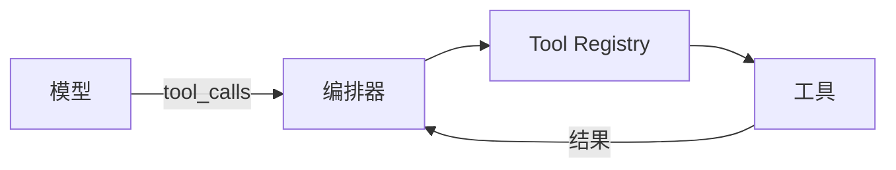
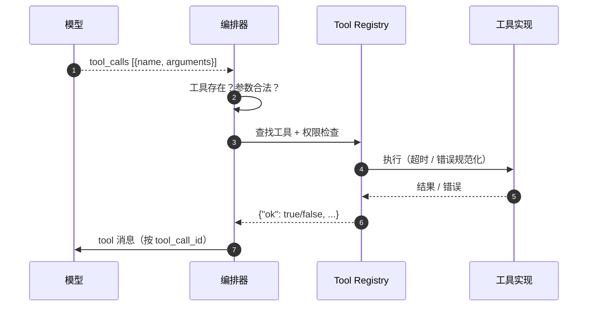
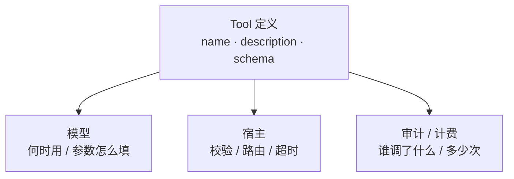
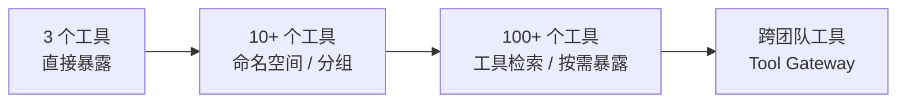

# 阶段 2：工具调用与注册

> 把“模型用自然语言说动作”变成“模型返回结构化动作”。

## 一图看懂



<p class="diagram-caption"><strong>一图看懂</strong> · 模型只提议；编排器通过 Registry 校验并执行，再把结果转成 tool 消息回传</p>

<div class="flow-steps">
  <div class="flow-step"><b>1</b><strong>模型选工具</strong><p>依据名称、描述、schema 选择要调用的工具。</p></div>
  <div class="flow-step"><b>2</b><strong>宿主做校验</strong><p>工具是否存在、参数是否合法、有没有权限。</p></div>
  <div class="flow-step"><b>3</b><strong>Registry 执行</strong><p>超时、错误规范化、结果截断都在这里发生。</p></div>
  <div class="flow-step"><b>4</b><strong>结果按 ID 回传</strong><p>tool 消息回到模型，进入下一轮决策。</p></div>
</div>

本章另有 3 张图：图 1 一次调用的时序，图 2 一个定义的三个消费者，图 3 工具爆炸的三个阶段。

## 协议：从文本到 JSON

| ReAct 文本协议 | Function Calling |
| --- | --- |
| 模型输出 `Action:` / `Action Input:` | 模型返回 `tool_calls` 数组 |
| 正则解析，格式漂移就崩 | 协议由模型/API 保证 |
| 参数靠自然语言拼 | JSON Schema 描述与校验 |
| 一次一个动作 | 支持并行 tool calls |
| 错误是字符串 | 可定义结构化错误契约 |

```json
{
  "tool_calls": [
    {
      "id": "call_1",
      "name": "search_web",
      "arguments": "{\"query\":\"agent gateway\",\"limit\":5}"
    }
  ]
}
```

## 一次工具调用的时序

见**图 1**：



<p class="diagram-caption"><strong>图 1</strong> · 模型不执行任何东西；执行、校验、权限、超时都在宿主侧</p>

## 工具定义：三个消费者

见**图 2**：



<p class="diagram-caption"><strong>图 2</strong> · 工具描述不是文档，而是给模型、宿主、审计三方共同消费的接口</p>

## 错误也是接口

::: tip 可复制模板
本章的清单有对应的结构化版本：[`tool_spec.json`](../../examples/templates/tool_spec.json)。全部模板见 [examples/templates/README.md](../../examples/templates/README.md)。
:::

```json
{
  "ok": false,
  "error": {
    "type": "invalid_argument",
    "message": "path 必须是工作区内的相对路径",
    "retryable": true,
    "hint": "使用相对于仓库根目录的路径，例如 'src/main.py'",
    "field": "path"
  }
}
```

| 错误类型 | 模型应该做什么 |
| --- | --- |
| `invalid_argument` | 修正参数后重试 |
| `not_found` | 换路径/换查询，不要原样重试 |
| `permission_denied` | 停止并告知用户，或请求授权 |
| `rate_limited` / `timeout` | 退避、缩小范围或换方法 |
| `conflict` | 重新读取状态再决定 |
| `internal` | 有限重试，之后降级 |

## 解决了什么，又制造了什么

| 解决了 | 同时制造了 |
| --- | --- |
| 文本解析脆弱 | 工具选择变难：30 个工具时描述会重叠 |
| 参数靠猜 | Schema 成为新的“Prompt”：字段越多越容易填错 |
| 无法并行 | 工具数量爆炸：上下文放不下，选择也不准 |
| 工具散落在 prompt | 权限与凭证开始出现：本地函数模型不够用 |
| 错误不可行动 | 结果大小失控：整页 HTML / 全量日志撑爆上下文 |

## 工具爆炸的应对

见**图 3**：



<p class="diagram-caption"><strong>图 3</strong> · 工具数量增长时，先做“暴露策略”，再考虑“网关治理”</p>

::: details 执行器骨架
```python
def execute(call, registry, policy, budget):
    tool = registry.get(call.name)
    if tool is None:
        return error("unknown_tool", hint=registry.names())

    try:
        validate(call.arguments, tool.parameters)
    except ValidationError as exc:
        return error("invalid_argument", str(exc), retryable=True)

    if not policy.allow(call, tool):
        return error("permission_denied", retryable=False)

    if not budget.try_spend(tool):
        return error("quota_exceeded", retryable=False)

    result = run_with_timeout(tool.handler, call.arguments, tool.timeout_s)
    return normalize(result)
```
:::

## 阶段边界

| 够用 | 进入下一阶段 |
| --- | --- |
| 单进程、本地工具、同团队 | 工具跨团队/跨网络 |
| 凭证由宿主直接持有 | 需要按租户/用户授权与审计 |
| 同步调用、分钟级 | 长任务、异步、审批 |
| 粗粒度权限 | 需要限流、配额、协议适配 |

## 来源

- OpenAI, **Function Calling 指南**——`tool_calls` 数组、`tool_call_id` 与并行调用的官方定义。[链接](https://platform.openai.com/docs/guides/function-calling)
- Anthropic, **Tool use 指南**——`tool_use` / `tool_result` 块结构，以及工具错误如何回传。[链接](https://docs.anthropic.com/en/docs/build-with-claude/tool-use/overview)
- JSON Schema, **Specification**——参数声明的语义来源，校验器应当按它而不是按自己的直觉实现。[链接](https://json-schema.org/specification)
- Patil et al., **Gorilla**（2023）——函数调用中的参数幻觉与选错工具的实测。[链接](https://arxiv.org/abs/2305.15334)

完整清单见[推荐来源](/appendix/sources#02-工具调用与注册)。

::: details 参考答案与自检
**1. 重写工具描述，让模型在 10 个用例上选对**
要点：描述里要写**何时用**和**何时不用**（后者最常被省略）；参数用 enum 收窄，用 description 给示例值；一次只做一件事。
自检：用例里至少要有 2 条“看起来像但不该调用”的负样本。10 条全是正样本，测不出描述问题。

**2. 写操作的幂等键与 dry-run**
要点：幂等键由**宿主**生成（`request_id + tool + 序号`），不能由模型提供；dry-run 返回“将变成什么样”的差异，而不是只返回成功。
自检：如果模型能自己编一个幂等键，说明幂等保护可以被绕过——参见[工具层](/layers/tools)第六节。

**3. 工具返回内容里藏指令**
要点：把工具返回值标记为数据（如 `<tool_result trusted="false">`），并在出口处禁止“带不可信上下文的请求调用外发工具”。
参考实现见 `examples/mini_agent/agent.py` 的工具结果处理与 `guard.py` 的阶段策略；完整思路见[安全与权限](/layers/security)的“致命三要素”。
自检：不执行这条指令只是及格；能说出**在哪一层拦**（策略引擎而不是提示词）才算通过。
:::

下一步：[阶段 3：模型网关与路由](/evolution/model-gateway)。
