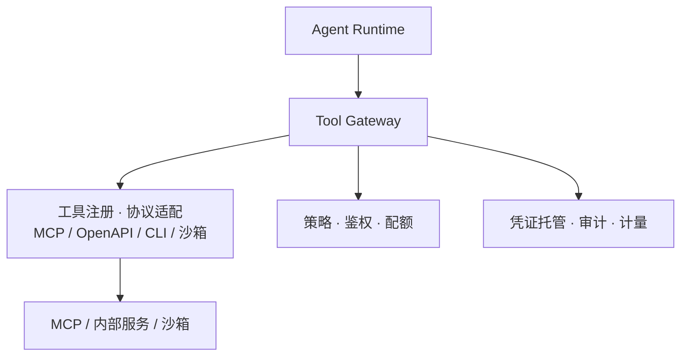
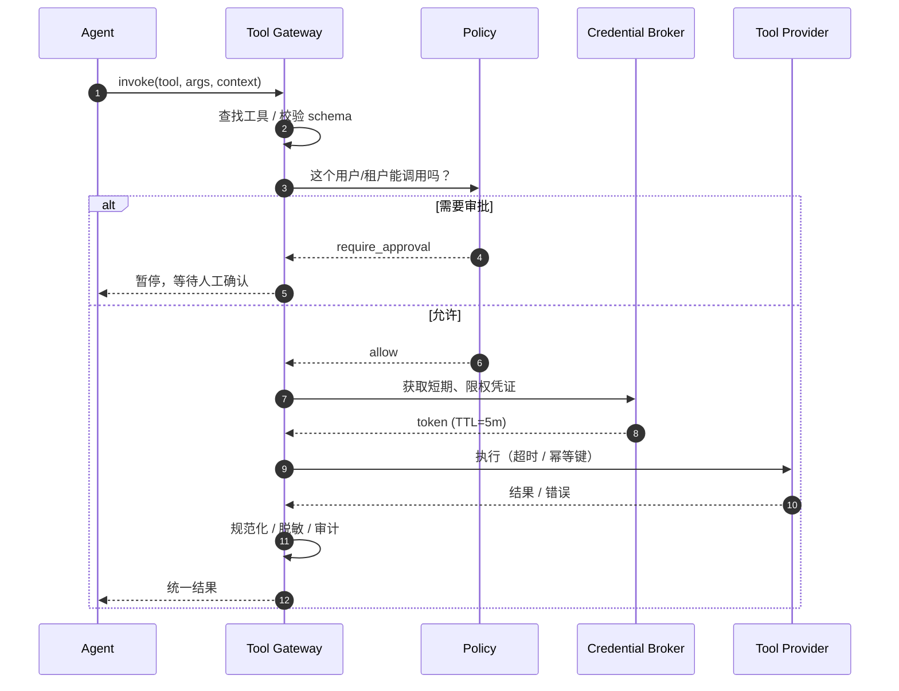
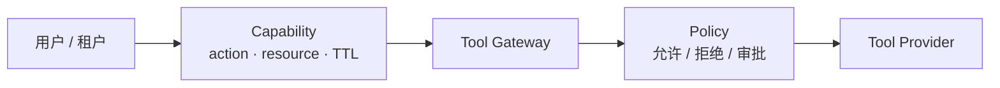
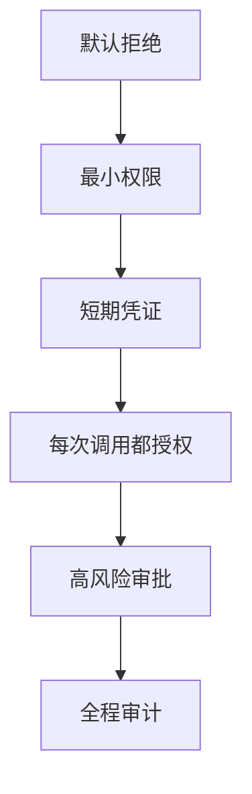

# 阶段 4：工具网关

> Agent 的权限，不应该由模型“自称”，而应该由系统“签发”。

## 一图看懂



<p class="diagram-caption"><strong>一图看懂</strong> · Tool Gateway 是 Agent 的“能力总线”：统一协议、鉴权、限流、审计</p>

<div class="flow-steps">
  <div class="flow-step"><b>1</b><strong>注册</strong><p>工具目录、schema、版本、负责人。</p></div>
  <div class="flow-step"><b>2</b><strong>授权</strong><p>这个用户/租户/Agent 能不能调用？</p></div>
  <div class="flow-step"><b>3</b><strong>执行</strong><p>注入短期凭证，路由到 MCP/服务/沙箱。</p></div>
  <div class="flow-step"><b>4</b><strong>留痕</strong><p>结果规范化、审计、计量、脱敏。</p></div>
</div>

本章另有 3 张图：图 1 一次调用的生命周期，图 2 能力令牌，图 3 关键设计原则。

## 它和另外两个网关的区别

| 网关 | 边界 | 解决的问题 |
| --- | --- | --- |
| API Gateway | 客户端 → 平台 | 认证、租户、限流、WAF |
| Model Gateway | Agent → 模型 | 多模型、路由、回退、计费 |
| Tool Gateway | Agent → 工具/执行环境 | 注册、鉴权、权限、审计、协议适配、沙箱路由 |

## 一次工具调用的生命周期

见**图 1**：



<p class="diagram-caption"><strong>图 1</strong> · 凭证不经过模型、不进入沙箱；由网关按真实主体注入</p>

## 权限模型：能力令牌

见**图 2**：



<p class="diagram-caption"><strong>图 2</strong> · 不问“Agent 是谁”，问“它持有哪个能力，能对哪个资源做什么”</p>

```python
@dataclass(frozen=True)
class Capability:
    subject: str          # user:123 / tenant:acme
    action: str           # "ticket.write"
    resource: str         # "project:42"
    expires_at: datetime
    max_uses: int = 1
    approval_id: str | None = None
```

## 新问题：能力越大，边界越重要

| 风险 | 表现 | 防线 |
| --- | --- | --- |
| 混淆代理 | Agent 有权限，用户没有 | 权限绑定最终用户；每次调用都授权 |
| 间接注入 | 网页/工具结果里藏指令 | 数据标记、出口控制、高风险审批 |
| 工具投毒 | 第三方 MCP/插件描述藏指令 | 来源审查、版本锁定、隔离运行 |
| Schema 漂移 | 工具升级后参数变了 | 版本化、兼容性检查、灰度 |
| 长任务 | 构建/爬取跑几分钟 | 异步任务 + 任务 ID + 检查点 |
| 结果过大 | 全量日志/网页撑爆上下文 | 分页、截断、外置存储 + 引用 |

## 关键设计原则

见**图 3**：



<p class="diagram-caption"><strong>图 3</strong> · 工具安全不是“加一句提示”，而是一条从策略到审计的链路</p>

::: details 网关骨架
```python
class ToolGateway:
    def invoke(self, ctx, name, args):
        tool = self.registry.get(name)
        if tool is None:
            return error("unknown_tool", hint=self.registry.names())

        validate(args, tool.schema)
        decision = self.policy.check(ctx.user, tool, args)
        if decision == "deny":
            return error("permission_denied", retryable=False)
        if decision == "approval":
            return approval_required(tool, args)

        credential = self.credentials.issue(ctx.user, tool, ttl=300)
        result = tool.invoke(
            args,
            credential=credential,
            idempotency_key=ctx.request_id,
        )
        self.meter.record(ctx, tool, result)
        return normalize(result)
```
:::

## 度量与阶段边界

| 指标 | 说明 |
| --- | --- |
| 工具成功率 | 按工具/租户分桶 |
| 权限拒绝率 | 可能是攻击信号，也可能是配置错 |
| 审批通过率 / 等待时间 | 审批是否成为瓶颈 |
| 幂等命中率 / 重复副作用 | 写操作是否安全 |
| P95 延迟 | 按工具类型 |
| 结果截断率 / 超时率 | 长任务与结果大小 |

| 够用 | 进入下一阶段 |
| --- | --- |
| 工具同团队、本地、同步 | 需要私有知识、引用、权限过滤 |
| 凭证由宿主直接持有 | 知识库需要租户/文档级 ACL |
| 无高风险写操作 | 需要 Agentic RAG / 多跳检索 |

下一步：[阶段 5：RAG 与知识层](/evolution/rag)。
