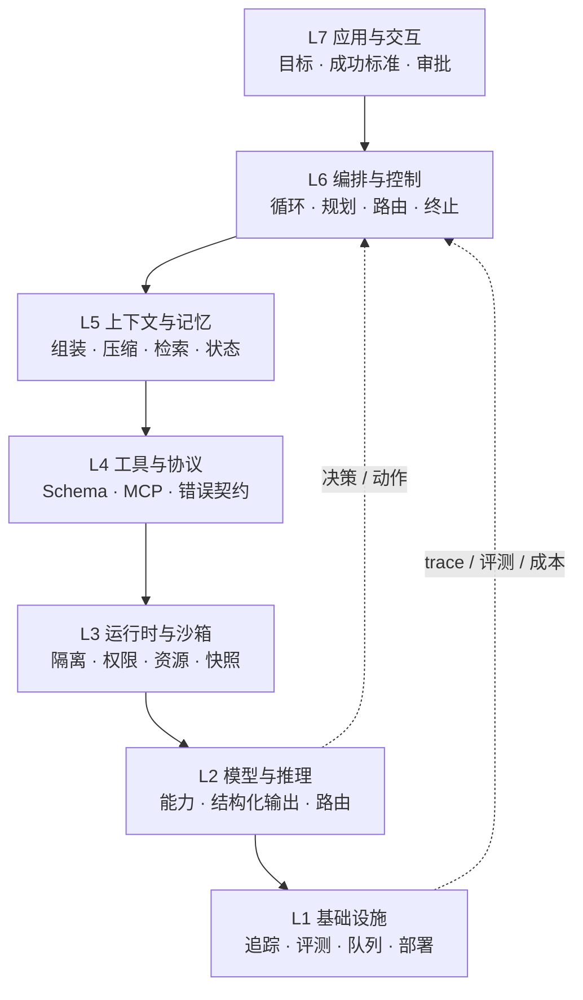
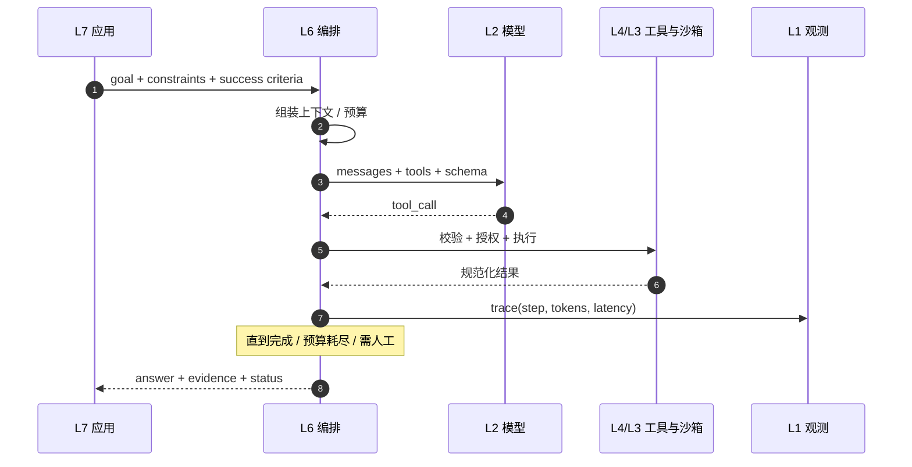

# 分层架构：七层职责模型

::: tip 阅读位置
如果你在按“架构演进主线”阅读，建议先看[架构总览](/evolution/overview)。本篇是**职责视角**的七层参考模型，重点讲每层“负责什么、契约是什么”，而不是“为什么演进到这一步”。

总览页还有一张**平台组件视角**的“六层”图（接入 / 编排 / 能力 / 执行 / 数据 / 治理面）。两套编号不是同一个切法，**不要对应着数**：本篇的 L1 是基础设施，总览的“执行层”对应的是本篇 L3 运行时。
:::

## 一图看懂：七层全景

<strong>一图看懂</strong> · 七层职责模型：自上而下是任务与动作，自下而上是能力与反馈

  <i class="brand"></i> 请求 / 动作流
  <i class="dashed"></i> 反馈 / 治理

图中自上而下是任务与动作的流转，自下而上是能力与反馈的支撑；层与层不是严格的上下级依赖。

Agent 系统看起来千差万别，但工程职责高度相似。把它拆成七层，不是为了画一张漂亮的图，而是为了回答三个问题：

1. **这个功能该放在哪一层？**
2. **出问题时先查哪一层？**
3. **换模型/换框架时，哪些层可以不动？**

这不是唯一的分法（有人把“规划”单独成层，有人把“安全”放最上面），但**职责边界**基本一致。下面逐层说明。

## L7 应用与交互：定义“什么算成功”

这一层不实现 Agent，它定义 Agent 的**任务契约**：

- 用户目标是什么，边界在哪里？
- 成功标准是什么，谁来验证？
- 哪些动作需要人工审批？
- 失败时如何向用户解释、如何恢复？
- 交互是同步、异步、流式，还是后台任务？

**常见错误**：把“成功标准”交给模型自己判断。应用层必须提供可执行的验收条件，例如“测试通过”“JSON schema 合法”“引用可访问”“人工点击确认”。

**关键指标**：任务完成率、用户接受率、人工接管率、端到端延迟。

## L6 编排与控制：决定“下一步”

编排层是 Agent 的大脑皮层，负责：

- 驱动循环（单步、多步、并行、子任务）。
- 选择策略（直接回答、调用工具、规划、交给子 Agent）。
- 管理状态与预算。
- 决定何时终止、重试、降级、升级给人工。
- 在多 Agent 场景中做路由、合并、冲突消解。

它**不应该**负责：具体工具怎么执行、上下文怎么拼、模型怎么调。否则编排会变成难以测试的 `if/else` 巨兽。

**常见错误**：把业务规则、提示词、工具实现全塞进一个“agent.py”。正确做法是把编排写成显式状态机或图，节点只做决策，副作用放在工具/运行时。

**关键指标**：平均步数、循环率、无进展率、人工升级率、每任务成本。

## L5 上下文与记忆：模型“此刻知道什么”

这一层负责把系统状态投影成模型能消费的上下文，并管理跨轮次的信息。

- **上下文组装**：系统提示、任务、工具定义、相关历史、检索片段、当前观察。
- **压缩**：摘要、裁剪、去重、分层保留。
- **记忆**：工作记忆（本轮）、情景记忆（发生过什么）、语义记忆（事实/知识）、程序记忆（怎么做）。
- **检索**：什么时候查、查什么、如何排序、如何引用。

**常见错误**：把“上下文窗口”当“记忆”；把所有历史原样拼接；检索结果不标注来源；压缩时丢掉约束条件。

**关键指标**：上下文 token 分布、关键信息召回率、压缩后任务成功率、缓存命中率。

## L4 工具与协议：Agent 的“手脚”

工具层把外部能力包装成模型可调用的接口：

- 工具注册与发现（名称、描述、参数 schema）。
- 协议适配（原生 function calling、MCP、OpenAPI、CLI）。
- 参数校验、权限检查、幂等性。
- 结果规范化（成功/失败/部分成功、分页、截断）。
- 错误契约（可重试？建议下一步？）。

**常见错误**：工具描述写成人类文档；错误直接抛 stack trace；返回巨大 JSON；一个工具做太多事；没有幂等键。

**关键指标**：工具选择准确率、参数合法率、执行成功率、P95 延迟、副作用事故数。

## L3 运行时与沙箱：动作真正发生的地方

这一层提供隔离的执行环境：

- 进程/容器/微虚拟机（如 Firecracker、gVisor）。
- 文件系统挂载、网络出口、密钥注入。
- CPU/内存/时间/磁盘限制。
- 快照、回滚、审计。
- 代码解释器、浏览器、桌面（Computer Use）。

**常见错误**：在宿主进程里 `exec` 模型生成的代码；把生产密钥传给沙箱；没有网络白名单；没有超时。

**关键指标**：逃逸/越权事件、沙箱启动延迟、执行成功率、资源利用率。

## L2 模型与推理：能力与成本的来源

这一层不是“越强越好”，而是**匹配任务**：

- 模型选型（通用/推理/小模型/多模态）。
- 结构化输出与工具调用能力。
- 推理预算（thinking tokens）、temperature、并行采样。
- 路由与级联（简单任务走小模型，失败升级）。
- 缓存（prompt cache、结果缓存）。

**常见错误**：所有任务用最贵模型；把模型当数据库；忽略结构化输出的失败率；不记录 token 成本。

**关键指标**：任务成功率、每千 token 成本、首 token/尾 token 延迟、schema 合法率。

## L1 基础设施：让系统可运营

包括推理服务、队列、对象存储、向量库、追踪、评测、发布与回滚。

它不直接产生“智能”，但决定了系统能不能**被观测、被复现、被优化**。

**常见错误**：只打普通日志，没有 trace/span；没有记录每步的模型输入输出；评测靠手工；发布没有回归。

**关键指标**：trace 覆盖率、评测回归通过率、故障恢复时间、成本归因完整度。

## 层间契约：比分层更重要

::: tip 可复制模板
本章的清单有对应的结构化版本：[`trace_step.json`](../../examples/templates/trace_step.json)、[`preflight_checklist.json`](../../examples/templates/preflight_checklist.json)。全部模板见 [examples/templates/README.md](../../examples/templates/README.md)。
:::

分层不是画框，而是定义**谁可以假设什么**。下面这些契约值得写进代码：

| 从 → 到 | 契约 | 违约的后果 |
| --- | --- | --- |
| L7 → L6 | 目标、约束、成功标准、审批策略 | Agent 不知道何时停 |
| L6 → L5 | token 预算、必须保留的事实、输出格式 | 上下文爆炸或关键信息丢失 |
| L5 → L2 | messages、tools、response schema | 解析失败、工具调用错误 |
| L6 → L4 | 已校验参数、deadline、幂等键 | 重复副作用、超时堆积 |
| L4 → L3 | 沙箱策略、凭据、资源上限 | 越权、逃逸、数据泄露 |
| 全层 → L1 | 结构化 trace、成本、结果 | 无法定位、无法回归 |

一个实用检查：**每个跨层调用都应该有超时、错误类型和可观测字段。** 如果某一层只会抛一个笼统的 `Exception`，上层就只能瞎猜。

## 三条横切能力：不属于任何一层

分层模型解释“职责在哪”，但有三类能力不属于任何单层，而是**横跨多个层的边界**，硬塞进某一层反而会误导：

| 横切能力 | 作用点 | 为什么不能只放一层 |
| --- | --- | --- |
| 安全与权限 | L3 / L4 / L5 / L6 / L7 | 只在入口鉴权，工具调用、上下文拼接、记忆写入、子 Agent 委派时都会失守；见[安全与权限](/layers/security) |
| 内容、隐私与合规 | L2 / L4 / L5 / L7 | 输入、生成中、工具返回、输出、记忆写入五个卡点都要过审；PII 与留痕同理；见[内容安全与审核](/layers/content-safety)、[隐私与数据治理](/layers/privacy)、[合规与法律](/layers/compliance) |
| 可观测与发布 | 全层 + 控制面 → L1 | 没有 trace 无法定位，没有版本无法回滚；见[评测与可观测性](/layers/evaluation)、[版本与发布](/layers/release) |

这三类能力的共同点是：**由策略和机制组成，且必须可配置、可版本化、可灰度**。所以它们最终都收敛到控制面（见[平台化](/evolution/platform)），而不是散落在业务代码里。

## 数据流：一次任务到底发生了什么

见**图 1**：

<strong>图 1 · 一次任务的数据流：目标下发 → 组装 → 决策 → 执行 → trace 回收</strong>

注意最后返回的不只是 `answer`，还应该有 **evidence（证据）** 和 **status（完成/部分完成/阻塞）**。这是生产级 Agent 和 Demo 的重要区别。

## 三种典型部署形态

### 1. 单进程原型

所有层在一个 Python 进程里，工具是本地函数，状态在内存。

- 适合：验证想法、内部工具、教学。
- 风险：沙箱缺失、状态易丢、无法水平扩展。

### 2. 服务化

编排/上下文/工具各自是服务，模型走 API，运行时是独立沙箱集群。

- 适合：多租户产品、需要审计和弹性。
- 风险：跨服务超时、状态一致性、链路追踪复杂。

### 3. 事件驱动/长任务

任务进入队列，Worker 执行，状态持久化，支持暂停/恢复/人工审批。

- 适合：Deep Research、批量处理、持续监控。
- 风险：重复执行、幂等、检查点、任务优先级。

## 最常见的五个架构错误

::: danger 错误一：没有上下文层
直接把 `messages` 追加到底。短任务能跑，长任务一定崩。上下文需要独立的构建、压缩和预算逻辑。
:::

::: danger 错误二：工具层没有错误契约
工具抛裸异常，模型只看到“Error”。它不知道能不能重试、要不要换方法。错误信息是给模型看的**接口**。
:::

::: danger 错误三：编排层承担业务逻辑
把权限、计费、审批写进 prompt。模型不是策略引擎，这些必须是代码。
:::

::: danger 错误四：运行时和工具耦合
工具函数直接在宿主执行 `shell=True`。一旦模型被注入，攻击者就获得了宿主权限。
:::

::: danger 错误五：没有 L1 的追踪
只记录最终答案，不记录每步输入输出、token、工具结果。出了问题只能靠猜，优化也无从谈起。
:::

## 附：与平台六层的换算

[架构总览](/evolution/overview) 用的是**组件视角**的六层：接入、编排、能力、执行、数据、治理面。它回答“部署时有哪些部件”。
本篇用的是**职责视角**的七层：L1~L7。它回答“这个功能该放在哪、出问题先查哪”。

两套编号不是一一对应，硬对会出错。换算关系如下：

| 平台六层（组件） | 职责七层 | 说明 |
| --- | --- | --- |
| 接入层 | L7 应用与交互（部分） | 认证、租户、限流在组件上属接入，最终由应用层定义 |
| 编排层 | L6 编排与控制 | 基本一一对应 |
| 能力层 | L2 模型 + L4 工具 + L5 上下文与记忆 | 组件上打包成“能力”，职责上要拆开看 |
| 执行层 | L3 运行时与沙箱 | 对应 |
| 数据层 | L1 基础设施（存储）+ L5（记忆来源） | 数据既是底座，也是上下文的来源 |
| 治理面 | L1 基础设施（观测 / 评测 / 发布）+ 横切策略 | 治理横切所有层，不属于任何单层 |

一个实用判断：**讨论“怎么部署、买什么组件”时用六层；讨论“这个 bug 该谁修”时用七层。**

## 来源

- Martin, **Clean Architecture**——依赖方向与“跨层只走契约”的思想来源。[链接](https://blog.cleancoder.com/uncle-bob/2012/08/13/the-clean-architecture.html)
- Brown, **C4 Model**——分层描述系统的工程惯例，本章画法与之对应。[链接](https://c4model.com/)
- OpenTelemetry, **规范总览**——横切能力（观测）如何不占业务层的实例。[链接](https://opentelemetry.io/docs/specs/otel/overview/)
- HumanLayer, **12-Factor Agents**——从职责切分角度看生产化缺口。[链接](https://github.com/humanlayer/12-factor-agents)

完整清单见[推荐来源](/appendix/sources#七层职责模型)。

## 练习

1. 画出你正在做的系统（或一个熟悉的 Agent 产品）的七层图，标注每层的输入/输出。
2. 找出一条跨层调用，检查它是否有超时、错误类型和 trace 字段。
3. 思考：如果把“记忆”合并进“上下文层”，会失去什么？如果把“运行时”合并进“工具层”，又会失去什么？

::: details 参考答案与自检
**1. 画出你系统的七层图并标注输入/输出**
要点：每层至少写一对”输入 → 输出“，且**输出应当是下一层的输入**。画不出来通常说明这一层没有明确契约。
自检：如果某一层的输出写了“处理后的数据”，等于没写——要具体到字段（如 `messages + tools + response schema`，参见本章表 1）。

**2. 检查一条跨层调用**
要点：同时具备三件事——超时、结构化错误类型、trace 字段（`request_id / step / tenant / latency`）。
自检：如果这条调用只能抛出一个笼统的 `Exception`，上层就只能瞎猜，这正是本章结尾那句“只会抛 Exception，上层就只能瞎猜”的意思。

**3. 合并层会失去什么**
要点：把“记忆”并入“上下文层”，会失去**跨任务的持久化与遗忘策略**（上下文是视图，可以随时重建；记忆是资产，需要生命周期管理）；把“运行时”并入“工具层”，会失去**隔离边界**——工具是接口，运行时是副作用发生的地方，混淆后权限与资源限制无处安放。
自检：答案里能区分“视图 / 资产”“接口 / 副作用发生地”这两组概念，即说明分层不是背下来的。
:::

下一步：[技术演进史](/foundations/evolution)。
