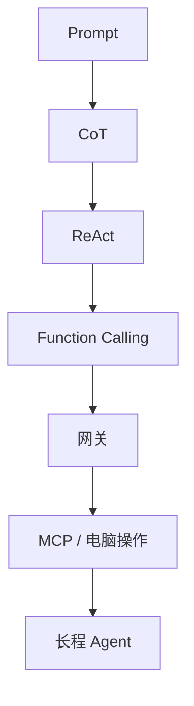

# 技术演进史：能力、问题与补偿

## 一图看懂



<p class="diagram-caption"><strong>一图看懂</strong> · 技术演进不是替代，而是“能力跃迁 → 新失败模式 → 工程补偿”的叠加</p>


::: tip 阅读位置
本篇是**技术史视角**，按时间线梳理能力与问题。如果你更关心“架构怎么一步步长出来”，请读[架构演进主线](/evolution/overview)。
:::

Agent 的演进不是一条“模型越来越强”的直线，而是一连串**能力跃迁 → 新失败模式 → 工程补偿**的循环。理解这条主线，比记住框架名字有用得多。

下面这张表是全书的主干，后文会逐段展开。

| 阶段 | 大致时间 | 驱动力 | 代表技术 | 解决了什么 | 制造了什么新问题 |
| --- | --- | --- | --- | --- | --- |
| 提示工程 | 2020–2022 | 大模型具备上下文学习 | Few-shot、角色提示、CoT | 不训练也能做任务 | 一次性生成、不可验证、不会用外部世界 |
| 推理—行动 | 2022–2023 | 需要 grounding | ReAct、MRKL、Toolformer | 把推理与工具交替起来 | 文本协议脆弱、循环失控、成本上升 |
| 工具调用标准化 | 2023 | 应用落地 | Function Calling、JSON Schema、并行调用 | 决策与执行解耦、解析稳定 | 工具选择/参数错误、权限与注入 |
| 自主 Agent 热潮 | 2023 | “让 AI 自己干活” | AutoGPT、BabyAGI、Voyager | 端到端自主、技能积累 | 空转、烧钱、无终止、难评测 |
| 检索与记忆 | 2023–2024 | 知识时效与个性化 | RAG、Agentic RAG、MemGPT | 外部知识、跨轮记忆 | 检索噪声、记忆污染、隐私 |
| 多 Agent | 2023–2024 | 分工与并行 | AutoGen、MetaGPT、CAMEL | 角色协作、并行探索 | 通信损耗、错误传播、协调复杂 |
| 长上下文与上下文工程 | 2024 | 窗口变大但注意力有限 | 长上下文模型、压缩、缓存 | 更多信息可入上下文 | 中间遗忘、成本、上下文腐烂 |
| 协议与具身 | 2024–2025 | 工具生态与真实世界操作 | MCP、Computer Use、A2A | 标准化接入、操作界面 | 安全边界、延迟、可靠性 |
| 推理模型与长程任务 | 2025– | 测试时计算、可验证奖励 | o 系列、R1、Deep Research、Coding Agent | 多步推理、长任务 | 成本、延迟、评测困难、过度自信 |

> 一个反复出现的规律：**每一代技术都把“智能”往前推一步，同时把“工程复杂度”转移到新的地方。** ReAct 把复杂度从“写死流程”转移到“解析与循环控制”；Function Calling 把复杂度从“解析文本”转移到“工具设计与权限”；长上下文把复杂度从“检索”转移到“上下文选择与压缩”。

## 1. 提示工程：把模型当函数

2020 年 GPT-3 展示了上下文学习：给几个例子，模型就能完成新任务。于是“提示词工程”成为第一代方法论：

- 角色设定（“你是一个资深工程师”）
- Few-shot 示例
- 输出格式约束
- 思维链（Chain-of-Thought, CoT）：让模型先写推理过程，再给答案

CoT 的意义不在于“让模型解释自己”，而在于**把更多计算放到生成过程里**。对于多步推理，直接输出答案容易跳步；展开中间步骤能显著提升正确率。

但这一代系统有一个根本限制：**一次生成，没有外部反馈**。模型不知道计算结果对不对，不能查最新资料，也不能在执行后修正。

### 仍然有效的遗产

- 明确的角色、目标、约束、输出格式。
- 用示例定义“好答案长什么样”。
- 对复杂任务要求分步思考（但对推理模型要谨慎，见下文）。

### 遗留问题

- 推理过程可能是“事后编造”的，不忠实于实际计算。
- 没有验证机制，错误无法被系统发现。
- 上下文里放不下多少示例，示例选择本身成为问题。

## 2. ReAct：把“想”和“做”交替起来

2022 年的 ReAct（Reason + Act）是 Agent 史上的关键一步。它让模型输出交替的推理轨迹和动作：

```text
Thought: 我需要查一下这个人的出生年份。
Action: search("Ada Lovelace birth year")
Observation: 1815
Thought: 还需要确认她去世的年份。
Action: search("Ada Lovelace death year")
Observation: 1852
Thought: 现在可以计算年龄了。
Action: calculate("1852 - 1815")
Observation: 37
Final Answer: 37 岁
```

相比 CoT，ReAct 多了两样东西：

1. **外部观察**：推理不再只依赖参数记忆，可以被环境“纠偏”。
2. **动作选择**：模型可以根据中间结果决定下一步，而不是一次性规划完。

这带来了两个直接好处：减少事实幻觉（有检索依据）、提升复杂任务完成率（可以探索）。

### ReAct 的工程债

原始 ReAct 用文本标记约定动作。工程上很快遇到：

- **格式漂移**：模型多写一句解释，解析器就挂了。
- **参数错误**：JSON 缺引号、类型不对、字段名编造。
- **循环失控**：动作失败后重复同样的动作。
- **观察污染**：工具返回的网页内容里包含“忽略之前的指令”，模型可能照做。
- **无法并行**：一次只能一个动作，延迟高。

这些问题催生了下一代：把动作协议标准化。

## 3. Function Calling：把“动作”变成结构化接口

2023 年，主流模型开始原生支持工具调用：开发者用 JSON Schema 描述工具，模型返回结构化的 `tool_calls`，由宿主程序执行。

```json
{
  "name": "search",
  "description": "Search the web and return top results",
  "parameters": {
    "type": "object",
    "properties": {
      "query": { "type": "string" },
      "limit": { "type": "integer", "default": 5 }
    },
    "required": ["query"]
  }
}
```

这解决了 ReAct 最痛的解析问题，并带来：

- **决策与执行解耦**：模型只提议，宿主负责校验、授权、执行。
- **并行调用**：一次返回多个互不依赖的工具调用。
- **可约束的输出**：schema 让参数类型和必填项可检查。

### 新问题：工具成为新的“Prompt”

工具的名字、描述、参数设计，直接决定模型会不会选、选得对不对。工具层的设计质量，开始比 Prompt 技巧更重要。

同时，工具调用引入了新的攻击面：

- 模型被诱导调用危险工具（删库、转账）。
- 工具返回的内容包含注入指令。
- 工具权限过大，Agent 成为“ confused deputy ”。
- 工具描述冲突，模型随机选一个。

> Function Calling 没有让 Agent 更“聪明”，它让 Agent 更**可工程化**。智能仍然来自模型、上下文和工具设计的组合。

## 4. 自主 Agent 热潮：能力演示与工程现实

2023 年春，AutoGPT、BabyAGI 一类项目展示了“给一个目标，Agent 自己拆解、执行、反思”的愿景。它们通常包含：

- 目标队列
- 任务规划
- 工具使用（搜索、写文件、执行代码）
- 记忆（向量库）
- 自我反思

演示很震撼，但生产落地暴露了大量问题：

| 症状 | 根因 |
| --- | --- |
| 无限循环、重复劳动 | 没有可靠的完成判定与无进展检测 |
| 成本失控 | 每步都调用大模型，历史全量拼接 |
| 越走越偏 | 错误没有验证，计划不能修正 |
| 结果不可复现 | 温度、工具状态、外部环境都在变 |
| 无法评测 | 任务开放，成功标准模糊 |

这一波热潮的最大遗产，不是那些项目本身，而是**失败模式清单**：终止条件、预算、验证、状态、可观测性，后来都成了 Agent 工程的基本配置。

同一时期，Voyager 在 Minecraft 中展示了另一条路：**技能库 + 自动课程 + 迭代提示**。它把“会做什么”沉淀为可复用的代码技能，而不是每轮重新推理。这预示了后来的“程序性记忆”和“技能”方向。

## 5. RAG 与记忆：把外部世界接进来

RAG（Retrieval-Augmented Generation）最早在 2020 年提出，2023 年随着向量数据库流行成为应用标配。基本流程：

```text
文档 → 切分 → 向量化 → 索引
查询 → 向量化 → 召回 top-k → 重排 → 拼进上下文 → 生成
```

RAG 解决了模型知识过时、无法访问私有数据的问题，但也带来新问题：

- 切分破坏语义，召回片段缺少上下文。
- 相似度不等于相关性，top-k 里全是噪声。
- 多跳问题需要多次检索，单次 RAG 不够。
- 检索结果可能包含过时/冲突/恶意内容。

于是出现 **Agentic RAG**：把检索变成 Agent 的一个工具，由模型决定何时查、查什么、是否继续查。它更灵活，但也更慢、更贵，且可能“查上瘾”。

记忆方向则从“向量库=记忆”逐渐细化：

- **工作记忆**：当前任务的临时状态。
- **情景记忆**：过去发生过什么（轨迹、结果）。
- **语义记忆**：稳定事实与偏好。
- **程序记忆**：可复用的技能/代码。

MemGPT（2023）借鉴操作系统虚拟内存，把上下文窗口当“内存”、外部存储当“磁盘”，通过换入换出管理长对话。这个类比很有启发性，但工程上真正难的是**写什么、何时写、如何冲突消解**，而不是存储介质。

## 6. 多 Agent：分工的诱惑

多 Agent 的动机很自然：一个人做不完，就组个团队。常见角色包括：规划者、执行者、评审者、检索者、代码审查者。

代表框架：CAMEL（角色扮演）、AutoGen（对话式多 Agent）、MetaGPT（SOP 分工）、ChatDev（软件公司模拟）。

它确实适合：

- 可并行的子任务（多文件修改、多源研究）。
- 需要独立视角的任务（生成者 + 评审者）。
- 需要隔离上下文的场景（每个子 Agent 只看自己那块）。

但多 Agent 不是免费午餐：

- **通信损耗**：每个 Agent 都要花 token 理解别人。
- **错误传播**：上游的错误假设被下游当真。
- **责任不清**：出问题不知道是哪个 Agent 的锅。
- **协调死锁**：互相等待、重复劳动。
- **评测困难**：轨迹组合爆炸。

> 经验顺序：**单 Agent + 好工具 → 单 Agent + 显式工作流 → 多 Agent**。不要反过来。

## 7. 长上下文与上下文工程

2024 年，上下文窗口从 8K/32K 快速推到 200K、1M 甚至更大。直觉是“把一切都塞进去”，但很快发现：

- **中间遗忘**（lost in the middle）：关键信息在长上下文中间时召回率下降。
- **上下文腐烂**（context rot）：无关信息越多，模型越容易被干扰。
- **成本与延迟**：长上下文意味着更高的 token 费用和更慢的首 token。
- **注意力稀释**：模型不是数据库，不能假设它精确检索了每个 token。

于是关键词从“提示词工程”转向“**上下文工程**”（context engineering）：把上下文当成有限资源，决定放什么、按什么顺序、何时压缩、如何隔离。

这也解释了为什么“长上下文”没有取代 RAG，而是与之融合：**长上下文负责“装得下”，检索与压缩负责“装得对”**。

## 8. MCP、Computer Use 与协议化

### MCP（Model Context Protocol）

2024 年底，Anthropic 提出 MCP，用统一的客户端—服务器协议把工具、资源、提示模板暴露给模型应用。它常被类比为“AI 应用的 USB-C”。

MCP 解决的是**生态碎片化**：每个应用都要为每个工具写适配器。有了协议，工具提供方写一次 Server，多个客户端都能用。

但它不解决：工具设计质量、权限模型、结果可靠性、注入防护。协议只规定“怎么连”，不规定“连上之后是否安全”。

### Computer Use

2024 年，模型开始能看屏幕截图、移动鼠标、点击、输入。这把 Agent 的动作空间从“API”扩展到“任何有界面的软件”。

优势：不需要对方提供 API，能操作遗留系统。
代价：**极慢、极脆、极难验证**。坐标偏移、弹窗、加载延迟、分辨率差异都会导致失败。更严重的是，它把注入攻击的后果从“读错数据”扩展到“点错按钮/转错账”。

### A2A（Agent-to-Agent）

2025 年出现的 Agent 间协作协议，试图标准化“Agent 如何发现彼此、委派任务、交换结果”。它解决的是一组 Agent 跨系统协作的接口问题，但组织边界、信任、计费、责任归属仍然没有标准答案。

## 9. 推理模型与长程任务

2024 年底到 2025 年，推理模型（o 系列、R1 等）把“测试时计算”变成一等公民：模型在回答前可以生成很长的内部推理，用更多算力换正确率。

对 Agent 的影响：

- **规划能力提升**：更愿意分解任务、检查假设。
- **单步更贵更慢**：需要重新设计预算和超时。
- **不一定需要显式 CoT**：对推理模型过度提示“逐步思考”可能适得其反。
- **可验证性更重要**：推理再长，也不能代替外部验证。

同期，Deep Research、Coding Agent 等长程任务成为主战场。它们的特点是：

- 任务时长从分钟级到小时级。
- 需要多轮工具调用、文件操作、状态恢复。
- 成功标准相对可验证（引用、测试、构建）。
- 对上下文管理、检查点、沙箱、评测提出更高要求。

这也让“Agent 工程”从 Prompt 技巧，变成真正的**分布式系统 + 人机交互 + 安全**问题。

## 技术演进的四个判断

面对一个“新 Agent 技术”，可以用四个问题判断它是否值得投入：

1. **它解决的是模型能力问题，还是工程问题？**
   模型能力会随版本迭代消失，工程问题不会。
2. **它把复杂度转移到了哪里？**
   没有免费的抽象。看它是否让调试、评测、安全变得更难。
3. **它是否依赖当前模型的某个缺陷？**
   比如“用特殊格式逼模型输出 JSON”。模型升级后，这类技巧可能失效。
4. **它有没有可验证的收益？**
   在固定评测集上，质量/成本/延迟是否真的变好？

## 练习

1. 选一个你熟悉的 Agent 框架，指出它主要解决了演进史中的哪个问题，又引入了什么新问题。
2. 比较 ReAct 与 Function Calling 的错误处理方式，列出至少三个差异。
3. 思考：如果上下文窗口无限大且免费，RAG 和记忆系统还需要吗？为什么？

下一步：进入[模型层](/layers/model)，开始逐层剖析。
