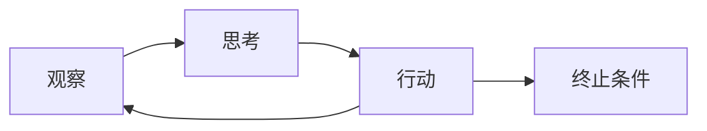
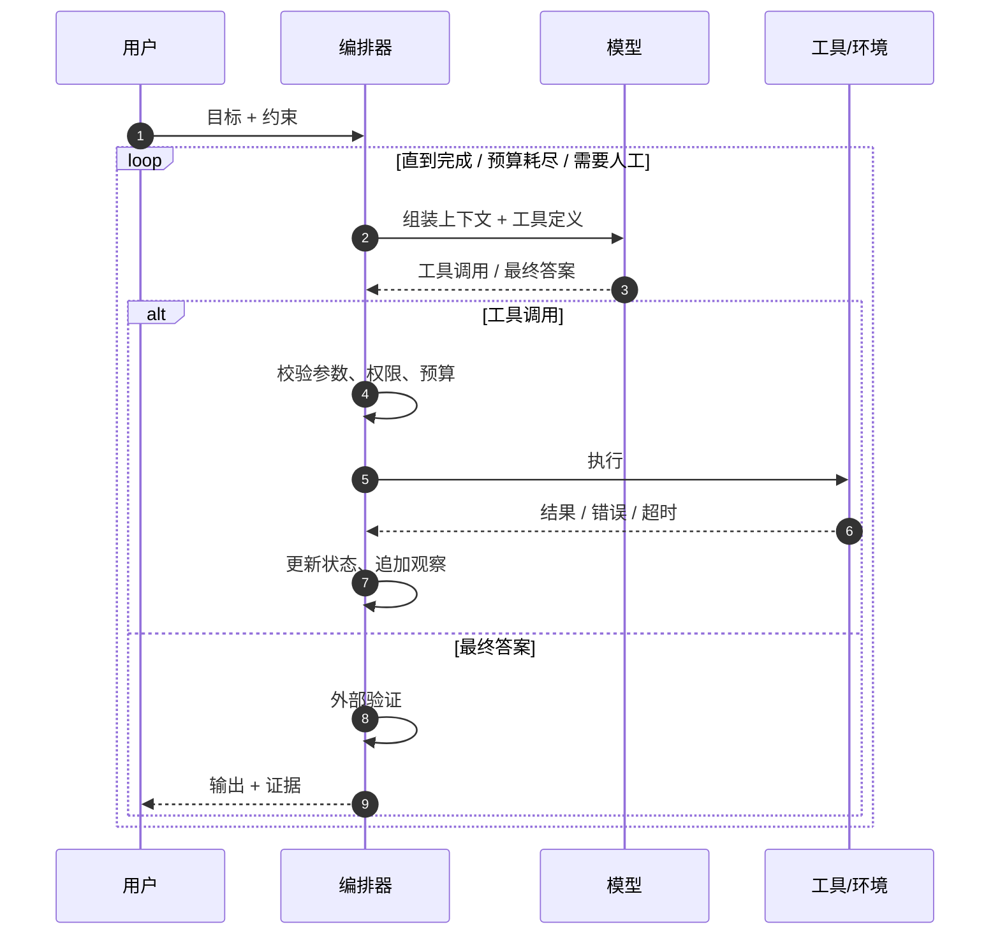

# 核心循环：Agent 的心跳

## 一图看懂



<p class="diagram-caption"><strong>一图看懂</strong> · Agent 的心跳：观察—思考—行动—再观察，直到完成、预算耗尽或需要人工</p>


所有 Agent，不管包装成什么框架，内核都是一个**带状态和终止条件的循环**：

```text
state = 初始化(目标, 约束, 工具)
while not done and budget_remaining:
    context = 组装上下文(state, 记忆, 观察历史)
    decision = LLM(context)                # 思考 / 决策
    if decision 是最终答案:
        return decision
    result = 执行工具(decision.action)     # 行动
    state = 更新(state, decision, result)  # 观察
```

看起来简单，但每一行都藏着工程问题：

- `组装上下文`：放什么、放多少、按什么顺序？
- `LLM`：如何保证输出可解析、可校验？
- `执行工具`：失败、超时、副作用、权限怎么办？
- `更新状态`：什么值得保留，什么必须丢弃？
- `done`：谁来判断真的完成了？

## 一次循环的完整时序

见**图 1**：



<p class="diagram-caption"><strong>图 1 · 一次循环的时序：校验、执行、更新观察，直到终止条件成立</strong></p>

关键点：**模型只负责“决策”，不负责“执行”和“记账”**。执行、预算、权限、状态更新必须由外部代码掌控。把控制权全部交给模型，是很多 Agent 失控的根源。

## 两种常见的决策协议

### 1. 文本协议（ReAct 风格）

模型输出带标记的文本：

```text
Thought: 我需要先确认失败测试的数量。
Action: run_tests
Action Input: {"path": "tests/"}
Observation: 3 failed, 12 passed
Thought: 失败集中在 parser，先读测试。
Action: read_file
Action Input: {"path": "tests/test_parser.py"}
...
Final Answer: ...
```

优点：不依赖模型原生工具调用能力，任何文本模型都能用；轨迹可读，便于调试。
缺点：解析脆弱（格式漂移、多余文字、JSON 坏掉）；需要自己处理转义和多行动作；token 开销大。

### 2. 原生工具调用（Function Calling / Tool Use）

模型返回结构化的工具调用：

```json
{
  "tool_calls": [
    {
      "id": "call_1",
      "name": "run_tests",
      "arguments": "{\"path\":\"tests/\"}"
    }
  ]
}
```

优点：协议由模型/API 保证，解析稳定；支持并行调用；参数 schema 可约束。
缺点：依赖模型能力；不同厂商格式有差异；错误处理仍要自己做；模型可能“编造”工具或参数。

> 工程上优先用原生工具调用。文本协议只在模型不支持、或需要高度自定义推理格式时使用。两者可以混合：原生调用负责动作，文本字段负责计划/解释。

## 终止条件：Agent 最容易忽略的部分

一个没有可靠终止条件的循环，本质上是一个**会烧钱的死循环**。至少要设置：

| 条件 | 说明 | 典型值 |
| --- | --- | --- |
| 任务完成 | 模型声明完成，且通过验证器 | 验证通过 |
| 最大步数 | 防止无限循环 | 10–50 步 |
| 最大 token | 控制上下文与成本 | 按任务预算 |
| 最大墙钟时间 | 防止工具卡死 | 30s–10min |
| 最大工具调用次数 | 防止重复试错 | 按工具类型 |
| 无进展检测 | 连续多轮状态无变化 | 2–3 轮 |
| 人工介入 | 高风险/不确定时暂停 | 审批点 |

```python
class Budget:
    def __init__(self, max_steps=20, max_tokens=100_000, max_seconds=300):
        self.max_steps = max_steps
        self.max_tokens = max_tokens
        self.max_seconds = max_seconds
        self.steps = 0
        self.tokens = 0
        self.started = time.monotonic()

    def spend(self, tokens: int) -> None:
        self.steps += 1
        self.tokens += tokens
        if self.steps > self.max_steps:
            raise BudgetExceeded("step limit")
        if self.tokens > self.max_tokens:
            raise BudgetExceeded("token limit")
        if time.monotonic() - self.started > self.max_seconds:
            raise BudgetExceeded("time limit")
```

注意：**预算耗尽不是异常，而是一种正常终止状态**。应该把当前进展、未完成事项和下一步建议返回给用户，而不是直接抛 500。

## 状态：循环真正的主体

很多人把 Agent 的状态等同于 `messages` 列表。这在短任务里够用，在长任务里会迅速失控。更可靠的做法是分离：

```python
@dataclass
class AgentState:
    goal: str
    constraints: list[str]
    plan: list[str]                 # 可更新的计划
    completed: list[str]            # 已完成事项
    open_questions: list[str]
    artifacts: dict[str, str]       # 文件/链接/结果
    observations: list[Observation] # 最近的关键观察
    budget: Budget
    status: str                     # running / done / blocked / failed
```

- `messages` 是**给模型看的视图**，可以压缩、裁剪、重排。
- `AgentState` 是**系统的事实来源**，不应该被模型随意改写。
- 两者之间由上下文构建器做投影。

> 经验法则：**凡是后续决策要依赖的事实，都不要只存在于聊天记录里。** 把它结构化，才能被验证、恢复和审计。

## 循环中的五类典型故障

### 1. 原地打转

模型反复调用同一个工具、收到同样的错误、继续同样的尝试。

**根因**：错误信息没有提供新信息；没有“已尝试”记录；没有无进展检测。
**处方**：错误信息里带“下一步建议”；在上下文中显式列出已尝试动作；连续 N 轮无进展就升级模型/换策略/问人。

### 2. 过早宣布完成

模型说“已完成”，但实际上测试没跑、文件没改、引用是编的。

**根因**：完成条件没有可验证的定义；模型自我评估过于乐观。
**处方**：引入外部验证器（跑测试、schema 校验、引用核对）；要求“完成”必须附带证据；高风险任务强制人工确认。

### 3. 上下文爆炸

每一步都把完整工具结果塞进历史，几轮后超出窗口，或被截断丢失关键信息。

**根因**：没有观察压缩策略；工具返回巨大（日志、网页、文件）。
**处方**：工具侧分页/截断；观察侧摘要；只保留与当前计划相关的片段；把大结果放到外部存储，上下文里放引用。

### 4. 错误级联

第一步读错文件，后续所有推理都基于错误事实，越走越偏。

**根因**：没有验证关键假设；工具结果没有置信度/来源。
**处方**：关键动作前做 cheap check；对事实性观察标注来源；定期让 verifier 检查“当前结论是否被证据支持”。

### 5. 工具副作用不可逆

Agent 误删文件、发错邮件、提交错误代码。

**根因**：读写权限没有分级；没有 dry-run；没有审批。
**处方**：默认只读；写操作分级授权；高风险动作先 dry-run 再确认；沙箱与快照。

## 让循环更聪明的三个扩展

### 计划—执行分离

先让模型产出计划，再逐步执行；每完成一步更新计划。适合步骤多、依赖多的任务。代价是额外的 token 和“计划本身错了”的风险。

### 反思（Reflection）

执行后让模型（或独立 verifier）检查结果，发现问题则回到循环。适合有明确评价标准的任务（代码、数学、写作）。注意：**自我反思容易确认偏误**，独立验证器通常更有效。

### 并行与子任务

把互不依赖的动作并行执行，或把子任务交给子 Agent。适合研究、多文件修改、批量处理。代价是协调、合并和上下文隔离问题。

这些扩展不是越多越好。**先把基础循环、预算、验证和追踪做对**，再考虑加戏。

## 一个可运行的最小循环

下面是 Mini Agent 的核心（完整实现见[实战章节](/practice/mini-agent)）：

```python
def run(agent, goal: str, max_steps: int = 12) -> str:
    state = AgentState(goal=goal)
    for step in range(max_steps):
        messages = build_context(state)          # 组装视图
        decision = agent.llm.decide(messages, agent.tools.specs())

        if decision.is_final:
            if agent.verify(decision, state):    # 外部验证
                return decision.content
            state.observations.append("验证未通过，请修正")
            continue

        result = agent.tools.execute(           # 执行 + 错误规范化
            decision.tool_name,
            decision.arguments,
        )
        state.record(decision, result)          # 更新事实状态
    return state.summarize_incomplete()
```

注意这段代码里，**模型没有直接操作状态、没有直接执行工具、也没有权力绕过验证**。这是刻意设计的。

## 来源

- Yao et al., **ReAct**（2022）——循环的原始形态与文本协议。[链接](https://arxiv.org/abs/2210.03629)
- Yao et al., **Tree of Thoughts**（2023）——把循环扩展成搜索时的对照物，说明“循环 + 选择”的代价。[链接](https://arxiv.org/abs/2305.10601)
- Zhou et al., **WebArena**（2023）——长循环在真实环境中的失败分布。[链接](https://arxiv.org/abs/2307.13854)
- Anthropic, **Building Effective Agents**——循环与固定工作流的取舍边界。[链接](https://www.anthropic.com/research/building-effective-agents)

完整清单见[推荐来源](/appendix/sources#核心循环)。

## 练习

1. 给你的循环加上“连续两轮无进展就停止”的逻辑。什么算“有进展”？
2. 设计一个工具错误格式，要求同时包含：错误类型、可读信息、是否可重试、建议的下一步。
3. 思考：如果模型每轮都要求调用同一个工具，但参数略有不同，这算有进展吗？如何检测？

::: details 参考答案与自检
**1. 加“连续两轮无进展就停止”，什么算“有进展”**
要点：进展不是“调用了工具”，而是**状态发生了可观测的变化**——新观察到的事实、新增或更新的产物、被消除的待办项。可以给状态算一个指纹（如 `hash(artifacts) + len(open_questions)`），指纹不变就是无进展。
参考实现见 `examples/mini_agent/agent.py` 的 `_check_stall()`：它用“相同工具 + 相同参数”的重复度做代理，属于简化版。
自检：如果你的“有进展”定义为“模型没有报错”，那模型换着花样失败时你永远不会停。

**2. 工具错误格式**
要点：`type / message / retryable / hint / field`。`hint` 是给模型看的修正建议，`retryable` 决定循环要不要重试，`field` 让模型定位到具体参数。
可直接对照 `examples/mini_agent/tools.py` 的 `ToolResult` 与本章第七节的 JSON 示例。
自检：缺少 `retryable` 时，模型只能靠猜要不要重试——这是“原地打转”的头号成因。

**3. 每轮都调同一工具、参数略有不同，算进展吗**
要点：**不算**，但现有的精确匹配检测会漏掉它。两级处理：先把参数规范化（去空格、统一数字与路径写法、排序 key）再比较；仍不同但“语义等价”的（如 `"a.py"` 与 `"./a.py"`）应视为重复。
自检：能说出“精确匹配是低误杀的启发式，规范化是提高召回的手段，两者叠加才实用”即达标。
:::

下一步：[分层架构](/foundations/architecture)。
