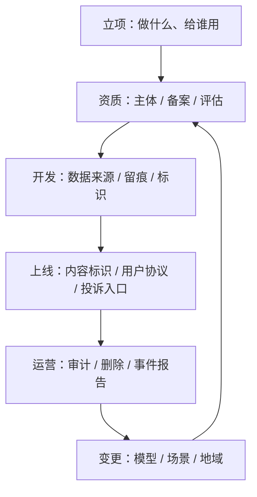

# 合规与法律：先有资格，再谈体验

> 本章讲工程视角的合规约束，不构成法律意见。具体条款请以你所在司法辖区的现行法规和专业顾问意见为准。

合规经常被当成上线前的一张清单，实际上它约束的是**架构**：能不能留日志、能不能删数据、能不能把内容发到境外、能不能让模型自己决定——这些在写第一行代码时就定了。

## 一图看懂



<p class="diagram-caption"><strong>一图看懂</strong> · 合规是有回路的：每次换模型、换场景、换地域，都要回到资质与评估</p>

## 一、为什么 Agent 比 Chatbot 更难合规

| 差异 | Chatbot | Agent |
| --- | --- | --- |
| 输出形态 | 一段文本 | 文本 + 动作 + 文件 + 调用第三方 |
| 影响范围 | 影响读者的认知 | 可能改数据、发消息、下单、执行代码 |
| 责任主体 | 平台与用户 | 平台、开发者、工具提供方、被调用的业务系统 |
| 证据 | 对话记录 | 对话 + 工具参数 + 执行结果 + 审批记录 |
| 出错后果 | 说错话 | 做错事，且可能不可逆 |

“我们只是提供工具，具体动作是模型决定的”这种说法，在监管眼里往往站不住：**模型是你部署的，工具是你接的，权限是你给的。**

## 二、四类硬约束

### 1. 主体与服务资质

- 面向公众提供生成式 AI 服务，通常需要相应的备案/登记（在中国的语境下，主要是生成式人工智能服务备案与算法备案）。
- 面向企业内部、不面向公众的场景，义务不同，但**数据与内容责任不会因此消失**。
- 涉及新闻、医疗、金融、教育等特殊领域，还要叠加行业许可。

工程含义：**服务要有明确的运营主体和投诉渠道**，而不是一个匿名 API。

### 2. 内容标识

生成内容需要可识别。两类标识要一起做：

| 类型 | 做法 | 目的 |
| --- | --- | --- |
| 显式标识 | 界面提示“本内容由 AI 生成”、语音开头提示 | 让用户知道 |
| 隐式标识 | 文件元数据、数字水印、内容指纹 | 让监管与平台可追溯 |

Agent 的特殊问题：内容会被**二次搬运**。Agent 生成的文本被写进邮件、生成的文件被转发、图片被截图——显式标识很容易在传递中丢失。所以隐式标识要落在**产物**上（文件元数据），而不只是落在界面上。

### 3. 数据合规

见[隐私与数据治理](/layers/privacy)。合规侧要额外回答三个问题：

- 训练/微调数据的来源是否合法、是否有授权？
- 用户数据是否出境？调用的模型服务在哪个区域？
- 数据保存多久？到期是否真的删除？

### 4. 责任与免责

免责声明不能免除法定责任。能降低风险的是**可证明的工程措施**：

- 高风险动作有人工确认（见[安全与权限](/layers/security)）。
- 内容有审核与拒答（见[内容安全与审核](/layers/content-safety)）。
- 全过程有 trace、有审批记录、有版本号。

出事时，监管和客户问的不是“你有没有写免责声明”，而是“你有没有采取合理措施”。

## 三、知识产权

| 风险 | 场景 | 缓解 |
| --- | --- | --- |
| 训练数据侵权 | 用抓取内容做微调 | 数据来源台账、许可审查、可删除 |
| 输出侵权 | 模型复述受版权保护的段落 | 引用与相似度检测、来源标注 |
| 代码许可污染 | Coding Agent 生成 GPL 片段进入闭源项目 | 许可证扫描、生成代码审查 |
| 商标与人格权 | 生成内容使用他人姓名/形象 | 禁用清单、审核规则 |

Coding Agent 尤其要注意：它生成的不是“建议”，而是会进入代码库的**衍生作品**。

## 四、未成年人保护

- 年龄识别与监护人同意（涉及收集个人信息时）。
- 默认关闭个性化推荐与长期记忆。
- 对自伤、诱导、攀比等高风险内容有更强的前置拦截。
- 提供家长控制与使用时长限制。

工程上最容易漏的是**记忆**：一个为成年人设计的长期记忆，用在未成年人身上就是长期画像。

## 五、行业差异

| 行业 | 额外约束 | 架构影响 |
| --- | --- | --- |
| 医疗 | 不得给出诊断/处方建议；需可溯源 | 强拒答、强引用、强人工 |
| 金融 | 适当性管理、投顾资质、留痕 | 审批链、双录、不可篡改日志 |
| 教育 | 未成年人保护、内容分级 | 年龄分层、内容白名单 |
| 政务 | 数据分级、等保、国产化 | 私有化部署、离线模型 |
| 跨境 | 数据出境评估 | 区域化部署、路由到本地模型 |

同一套 Agent 代码，进入不同行业时**策略层必须可配置**——这就是把策略做成控制面而不是写进 prompt 的现实理由。

## 六、审计与留痕

合规要求“可追溯”，落到工程上是这几个字段：

```json
{
  "request_id": "req_456",
  "tenant_id": "acme",
  "subject": "user:123",
  "agent_version": "support-agent@2026.03.1",
  "model": "gpt-4.1-mini@2026-02",
  "prompt_version": "support@v17",
  "policy_version": "policy@v9",
  "tool_calls": [{"name": "refund.create", "approved_by": "user:123"}],
  "content_flags": ["pii.masked"],
  "retention_until": "2027-03-01"
}
```

要点：

- **版本号必须能追到具体内容**，否则“回滚”只是口号。
- **审批记录要绑定真实主体**，不能是 agent。
- **留痕本身也是数据**，要遵守留存期限和删除义务——留太久同样违规。

## 七、上线前的四张表

| 表 | 回答什么 | 谁维护 |
| --- | --- | --- |
| 资产表 | 处理哪些数据、存在哪、谁能访问 | 数据/安全 |
| 模型表 | 用了哪些模型/供应商、部署在哪、数据是否回流 | 平台 |
| 场景表 | 每个场景的能力边界、拒答范围、人工兜底 | 产品 |
| 变更表 | 每次改模型/prompt/策略的时间、影响、审批人 | 研发 |

没有这四张表，合规检查只能靠回忆。

## 常见问题速查

**Q：内部工具也要备案吗？**
面向公众与面向内部是两套义务，但**个人信息保护与内容责任**不因“内部”而消失。先判断是否处理个人信息、是否对外提供服务。

**Q：模型供应商说数据不用于训练，就不用管了？**
要看合同与默认配置。很多服务的“不用于训练”是可选项，且日志留存期限不同。把它写进供应商准入清单。

**Q：我们在多个国家提供服务怎么办？**
按最严的地区设计数据流：区域化部署、按地区路由模型、按地区决定保留期限。事后拆分比事前设计贵得多。

**Q：合规会不会拖慢迭代？**
会，但拖慢的是**高风险变更**。把变更分级（文案/工具描述/模型/策略），低风险走自动门禁，高风险才走评审。

## 合规检查清单

- [ ] 运营主体、服务备案、投诉渠道是否就位？
- [ ] 生成内容是否有显式 + 隐式标识，且落在产物上？
- [ ] 数据来源是否有台账，是否可删除？
- [ ] 是否评估过数据出境与模型服务区域？
- [ ] 高风险场景（医疗/金融/教育/未成年人）是否有额外拒答与人工兜底？
- [ ] 留痕是否包含 request/tenant/subject/版本号/审批人？
- [ ] 留存期限是否明确，到期是否真的删除？
- [ ] 变更是否分级，高风险变更是否有人审？
- [ ] 是否有事件报告流程与对外沟通口径？

## 练习

1. 为你的 Agent 填一遍“四张表”，看哪一张填不出来。
2. 检查一次生成文件的元数据：里面有没有可追溯的来源标识？
3. 假设明天要进入医疗行业，列出需要改的三处架构，而不是三处文案。

下一步：[从零实现 Mini Agent](/practice/mini-agent)。
