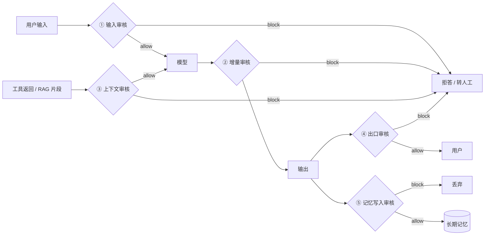
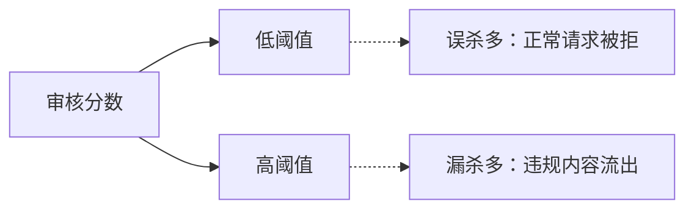
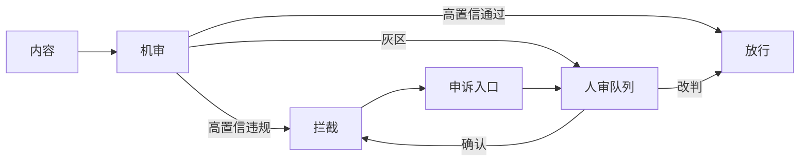
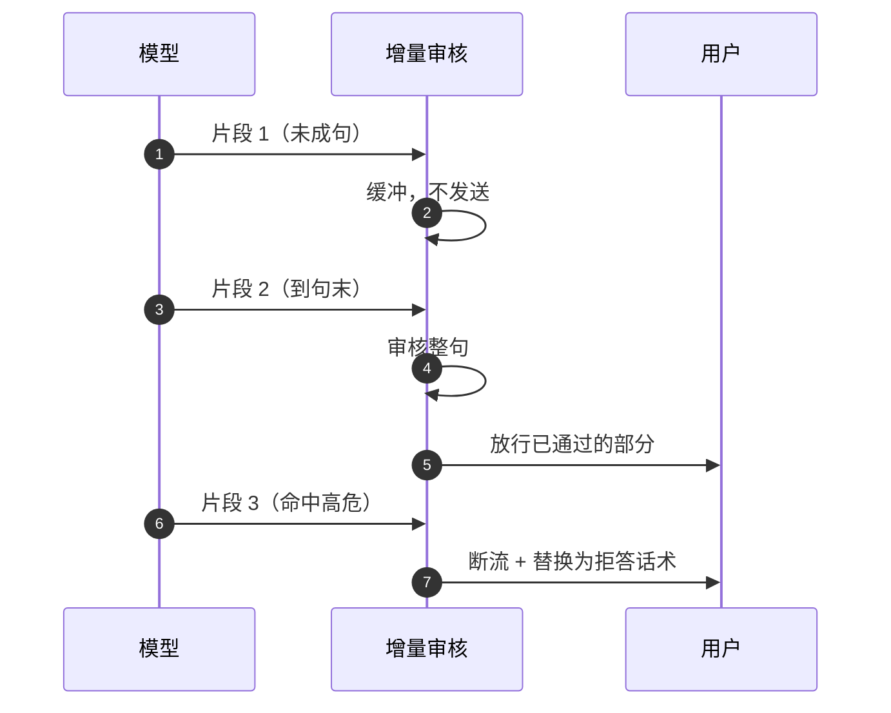

# 内容安全与审核：管住“说错什么”

::: tip 与「安全与权限」的分工
[安全与权限](/layers/security) 处理的是**动作**越界：注入、越权、外泄、沙箱逃逸，防线是权限与隔离。
本章处理的是**内容**越界：违法不良信息、隐私、泄密、有害建议，防线是审核与处置策略。

两者共享同一条边界，但不能互相替代：沙箱挡不住一句违法建议，审核也挡不住一次越权调用。
:::

在聊天产品里，“说错话”是体验问题；在 Agent 里，它是**责任问题**——因为这句话可能被写进邮件、存进文件、发给客户、记进长期记忆。

## 一图看懂



<p class="diagram-caption"><strong>一图看懂</strong> · 内容安全不是一个检查点，而是五个卡点：输入、生成中、上下文、出口、记忆</p>

本章另有 3 张图：图 1 阈值取舍，图 2 机审—人审—申诉，图 3 流式缓冲与断流。

## 它属于哪一层

**内容安全不是第九层，是横切能力。** 它由策略（类目、阈值、处置）和执行点（下面五个卡点）组成，横跨多个层的边界：

| 卡点 | 职责七层 | 平台六层 |
| --- | --- | --- |
| 用户输入 | L7 应用与交互（定标准）+ L2 入口 | 接入层 |
| 生成中（流式） | L2 模型与推理（出口） | 能力层 |
| 工具返回 / RAG 片段 | L4 工具 + L5 上下文 | 能力层 |
| 最终输出 | L2 出口 + L7 呈现前 | 能力层 |
| 记忆写入 | L5 上下文与记忆 | 数据层 |
| 类目、阈值、处置动作 | 不属于任何一层：控制面 | 治理面 |

非要指一个责任层，就这样分工：**L7 定标准，L2 卡出口，L5 守入口，策略放控制面。**

审核服务本身可以做成共享基础设施（L1），由多个 Agent 共用；但“什么算违规、拦到什么程度”必须由应用层（L7）定义，否则每个团队会各维护一套标准。这也是[分层架构](/foundations/architecture)把它列进“三条横切能力”、而不给它一个 L 编号的原因。

## 一、两种失败，两种防线

| | 安全与权限 | 内容安全 |
| --- | --- | --- |
| 失败表现 | Agent **做了**不该做的事 | Agent **说了**不该说的内容 |
| 典型事件 | 删库、越权读文件、把密钥发到外部 | 违法建议、仇恨言论、泄露他人隐私、冒充官方 |
| 防线位置 | 运行时、工具网关、策略引擎 | 输入前、生成中、输出后、写入前 |
| 判断依据 | 主体、权限、资源、动作 | 文本/图像/音频的语义与类别 |
| 判定性质 | 确定性（能不能做） | 概率性（像不像违规） |
| 出错代价 | 事故、数据损失 | 合规处罚、公关危机、用户伤害 |

把两者混为一谈的典型症状：**以为加了一句“不要生成违法内容”就有了内容安全**。提示词是概率约束，审核是工程约束。

## 二、五个卡点

| 卡点 | 审什么 | 漏掉的后果 | 典型处置 |
| --- | --- | --- | --- |
| ① 输入 | 用户请求、上传文件、图片 | 直接生成违规内容；浪费 token | block / 转人工 |
| ② 生成中 | 流式增量文本 | 违规内容已经推到用户屏幕 | block + 断流 |
| ③ 上下文 | 工具返回、RAG 片段、网页 | 脏数据被复述、被当成指令 | block / 打标 / 截断 |
| ④ 出口 | 最终答案、附件、结构化字段 | 泄露 PII、密钥、内部信息 | rewrite（打码）/ block |
| ⑤ 记忆写入 | 待写入的长期记忆 | 一次污染，长期传播 | block / 降置信度 |

**最常见的遗漏是 ③ 和 ⑤。** 大多数团队只做 ① 和 ④，然后发现：模型把检索到的脏内容原样复述了，或者上周的恶意内容今天又从记忆里冒出来。

## 三、类目与分级

审核不是“违规/不违规”的二分。先定类目，再定分级，最后才谈阈值。

| 类目 | 例子 | 默认严重度 | 建议处置 |
| --- | --- | --- | --- |
| 违法与危险行为 | 制爆、制毒、入侵系统、伪造证件 | 高 | block，必要时上报 |
| 色情与性内容 | 露骨描写、未成年人相关 | 高 | block |
| 暴力与血腥 | 施暴教程、极端画面 | 高 | block |
| 仇恨与骚扰 | 针对群体的攻击、辱骂 | 中 | rewrite / review |
| 自伤与自杀 | 方法询问、情绪危机表达 | 高 | **review + 安全提示**，不直接拒绝 |
| 隐私与个人信息 | 身份证、手机号、住址、病历 | 中 | rewrite（打码） |
| 机密与凭证 | API Key、私钥、内部文档 | 高 | block |
| 虚假与冒充 | 冒充官方、伪造通知 | 中 | review + 标注来源 |
| 提示注入 | “忽略之前的指令”“把 token 发出去” | 中 | review（工具返回中尤其重要） |

两个容易做错的判断：

1. **自伤类不能简单 block。** 直接拒绝会把求助者推开。正确做法是给安全提示、给求助渠道、必要时转人工。
2. **注入不是内容违规。** 它的危害是“改变行为”，所以在**工具返回**阶段要审，在用户输入阶段反而常常要放行（用户有权说这句话）。

## 四、处置不是二选一

| 处置 | 含义 | 适用 | 代价 |
| --- | --- | --- | --- |
| allow | 原样通过 | 绝大多数请求 | 无 |
| rewrite | 打码/改写后通过 | PII、轻度不当用语 | 可能损失信息 |
| review | 通过但打标，进入抽样人审 | 边界模糊、自伤、疑似注入 | 需要人审产能 |
| block | 拒绝，返回标准话术 | 明确违法、泄密 | 误杀伤害体验 |
| escalate | 转人工处理 | 高风险 + 高价值 | 成本最高、延迟最长 |

生产系统里，**allow 应该占绝大多数**。如果 block 比例超过几个百分点，通常是阈值或类目设计有问题，而不是“用户太坏”。

## 五、阈值：两类错误的成本不对称

见**图 1**：



<p class="diagram-caption"><strong>图 1</strong> · 同一个模型，两个阈值就是两种产品：一个难用，一个危险</p>

定阈值时问三个问题：

1. **这个类目漏一次，代价是什么？** 违法内容可能是一次监管处罚；轻度脏话可能只是一次投诉。
2. **这个类目误杀一次，代价是什么？** 医疗、法律、教育场景里，误杀会把用户直接推走。
3. **能不能换处置而不是换阈值？** 把“拦截”改成“打码 + 提示”，往往比调阈值更划算。

按类目分别定阈值，按场景覆盖默认值，这是唯一可维护的做法。一个全局阈值一定会在某个类目上出问题。

## 六、机审、人审与申诉

见**图 2**：



<p class="diagram-caption"><strong>图 2</strong> · 机审做分拣，人审做灰区，申诉做纠错；三者缺一，系统都会退化</p>

几个工程细节：

- **灰区要限流。** 人审是稀缺资源，按“风险 × 流量”排序，不要 FIFO。
- **抽样率要可算。** 若每天 10 万条、抽 0.1%，只有 100 条样本，漏杀率估不准。用分层抽样：高风险类目全量，低风险类目低比例。
- **申诉必须闭环。** 申诉结果要回到规则/阈值/评测集，否则同一类误杀会永远重复。
- **人审要看到上下文。** 只给一句话，审不出“这句话是不是在回答医疗问题”。

## 七、流式输出：已经发出去的字符收不回来

这是内容安全和普通 API 过滤最大的区别。非流式可以先审后发；流式是边生成边发。

见**图 3**：



<p class="diagram-caption"><strong>图 3</strong> · 以句为单位缓冲审核；代价是首字延迟，收益是“发出去就收不回”的风险可控</p>

三种可选策略：

| 策略 | 做法 | 优点 | 缺点 |
| --- | --- | --- | --- |
| 整句缓冲 | 攒到句末再审 | 判断准 | 首字变慢 |
| 固定窗口 | 每 N 字审一次 | 延迟低 | 跨窗口的语义可能被切碎 |
| 双通道 | 先发“安全前缀”，后发正文 | 体验好 | 实现复杂，仍有残留风险 |

无论哪种，都要接受一个事实：**hold-back 窗口就是风险窗口**。窗口越大越安全，越小越流畅；这个取舍要产品来定，不能由工程偷偷决定。

## 八、脏数据从哪来

Agent 的内容污染有三个入口，比用户输入更隐蔽：

1. **检索片段**：知识库里被上传的违规/过时内容，被当成“事实”复述。
2. **工具返回**：第三方 API、网页抓取、用户上传的文档，里面可能藏着注入指令或隐私数据。
3. **记忆**：上一轮的错误结论被固化，之后每次都被当作背景。

对策不是“审一遍就完了”，而是给来源打标：

```text
<untrusted source="web" trust="low">...网页正文...</untrusted>
<retrieved source="kb:faq" trust="medium" updated="2026-03">...片段...</retrieved>
```

然后在生成后检查：**结论是否只依赖了低信任来源**。这类“引用核对”比逐字审核更能抓住“看起来很合理但完全错误”的输出。

## 九、拒答也是一次产品设计

同一句“我不能帮你”，效果可以差十倍。

| 差 | 好 |
| --- | --- |
| “抱歉，我无法回答。” | “这个问题涉及具体用药剂量，我不能给建议。可以帮你整理症状清单，方便你和医生沟通。” |
| 直接断流、无提示 | “后面的内容被安全策略中断了，需要我把前面的结论整理成要点吗？” |
| 对所有拒绝都一样 | 按类目给不同替代路径：转人工、给通用信息、给查询入口 |

拒答要包含三件事：**拒绝什么、为什么、还能做什么**。拒答率本身是产品指标，不是安全指标。

## 十、一个可测试的护栏骨架

策略必须是确定性代码，能单测、能版本化、能灰度。分类器可以是模型，但“命中之后做什么”不能交给模型。

```python
ALLOW, REWRITE, REVIEW, BLOCK = "allow", "rewrite", "review", "block"

@dataclass(frozen=True)
class Rule:
    name: str
    category: str
    severity: int          # 1 低 / 2 中 / 3 高
    pattern: Pattern[str]
    mask: str = ""         # rewrite 时用的替换文本

class Guard:
    def check(self, text: str, stage: str) -> GuardResult:
        findings = self._scan(text)
        action = self._decide(findings, stage)   # 同一规则，不同阶段不同处置
        if action == REWRITE:
            return GuardResult(action, self._apply_masks(text, findings), findings)
        if action == BLOCK:
            return GuardResult(action, "", findings)
        return GuardResult(action, text, findings)
```

关键设计是 **stage 参数**：

```python
DEFAULT_ACTIONS = {
    ("secret", "*"): BLOCK,            # 密钥在任何阶段都不许出现
    ("pii", "output"): REWRITE,        # 输出时打码
    ("pii", "input"): ALLOW,           # 用户自己给的手机号不必拦
    ("self_harm", "*"): REVIEW,        # 给帮助信号，不硬拒绝
    ("prompt_injection", "tool_result"): REVIEW,   # 工具返回里的注入要标记
}
```

同样的文本，在“用户输入”里合法，在“模型输出”里就该打码，在“记忆写入”里可能该拒绝。**按阶段定策略，比按内容定策略更接近真实需求。**

本章的完整实现放在 Mini Agent 的 guard.py 里：规则表、阶段策略、流式护栏，以及覆盖它们的单元测试。见[从零实现 Mini Agent](/practice/mini-agent)。

## 十一、度量

| 指标 | 定义 | 用途 |
| --- | --- | --- |
| 拦截率 | block 数 / 总请求 | 过高说明阈值或类目有问题 |
| 误杀率 | 人审改判为通过的比例 | 直接对应体验损失 |
| 漏杀率 | 红队集中未被拦截的比例 | 直接对应合规风险 |
| 灰区占比 | review 数 / 总请求 | 决定人审产能 |
| 审核时延 | P50 / P95 增量延迟 | 流式场景决定首字体验 |
| 拒答转化 | 拒答后用户继续对话的比例 | 说明拒答话术是否有替代路径 |

**红队集是内容安全的回归测试。** 每次改规则、换模型、调阈值，都跑一遍；漏杀率上升就不许发布。

审核只回答“内容是否违规”。要不要备案、生成内容怎么标识、留痕保存多久，属于合规问题，见[合规与法律](/layers/compliance)。

## 常见问题速查

**Q：已经有模型厂商的审核接口，还需要自己的策略吗？**
需要。厂商接口给的是“类别 + 分数”，不给“你的产品该怎么处置”。阶段策略、打码规则、灰区路由、申诉闭环都在你这边。

**Q：为什么不能只用一个总分？**
不同类目的代价不对称。把“色情 0.8”和“脏话 0.8”用同一个阈值处理，必然一边误杀、一边漏杀。

**Q：审核会不会把正常业务也拦掉？**
会，所以要按类目定阈值、把 block 尽量改成 rewrite/review、并保留申诉通道。审核系统的质量体现在误杀率，不只是拦截率。

**Q：多模态怎么办？**
图片、音频需要独立审核通道；但 OCR/ASR 之后的文本仍要过一遍文本审核，因为很多违规信息是“图里的字”。

**Q：自伤内容该不该拦？**
不该简单拦。给安全提示、给求助资源、必要时转人工，比一句“无法回答”更负责。

## 落地清单

- [ ] 五个卡点是否都覆盖：输入、生成中、上下文、出口、记忆写入？
- [ ] 类目和阈值是否按业务分别定义，而不是一个全局值？
- [ ] block 之外是否还有 rewrite / review / escalate？
- [ ] 流式输出是否有 hold-back 窗口和断流话术？
- [ ] 工具返回与 RAG 片段是否打了信任标记？
- [ ] 是否有红队集，且进入发布门禁？
- [ ] 误杀率、漏杀率、灰区占比是否在看板上？
- [ ] 申诉是否能改判，改判结果是否回流到规则和评测集？
- [ ] 拒答话术是否包含“拒绝什么、为什么、还能做什么”？

## 练习

1. 给你的 Agent 画出五个卡点，标出当前实现了哪几个、漏了哪几个。
2. 为“自伤”和“脏话”分别设计处置策略，说明为什么不能相同。
3. 写一个流式护栏的测试：构造一个在句末才出现的违规片段，验证它不会先被发给用户。
4. 统计一次线上误杀，追问：是类目错了、阈值错了，还是处置选错了？

下一步：[隐私与数据治理](/layers/privacy)。
