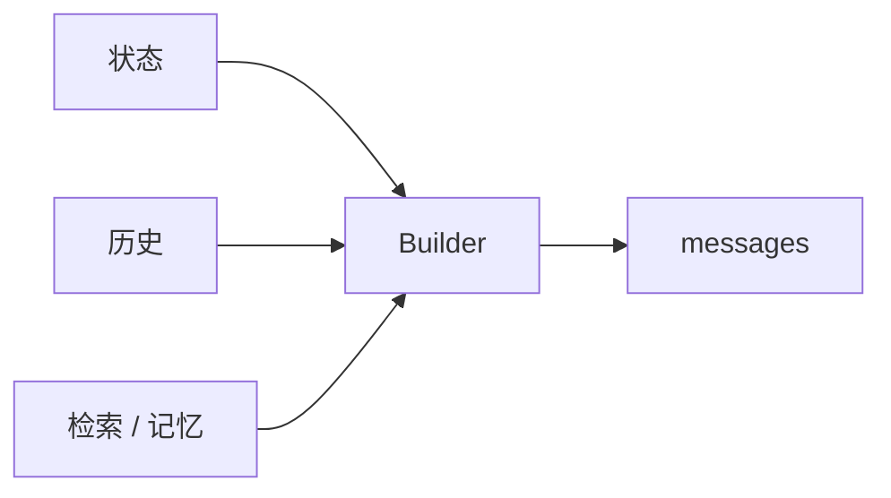
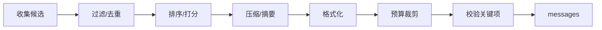

# 上下文层：模型“此刻知道什么”

## 一图看懂



<p class="diagram-caption"><strong>一图看懂</strong> · 上下文层不是保存历史，而是为当前决策组装有限的工作台</p>


模型每一步只能看到你给它的 token。它不知道文件系统里有什么、上一轮工具返回了什么、用户三天前说过什么——除非这些信息被**组装进上下文**。

所以上下文层的核心任务不是“保存历史”，而是：

> **在有限的 token 预算内，为当前这一步决策提供最相关、最可靠、最不干扰的信息。**

## 一、上下文的解剖

一个典型的 Agent 请求包含：

```text
┌─────────────────────────────────────────────┐
│ 1. 系统/开发者指令（角色、边界、安全策略）      │
│ 2. 工具定义（名称、描述、schema）              │
│ 3. 任务与成功标准                              │
│ 4. 约束与偏好（必须/禁止/格式）                 │
│ 5. 当前状态（计划、进度、未决问题）             │
│ 6. 检索到的证据（文档、网页、代码片段）          │
│ 7. 最近的观察（工具结果、错误、用户反馈）        │
│ 8. 少量示例（可选）                             │
│ 9. 输出格式要求                                 │
└─────────────────────────────────────────────┘
```

不是每一项都要放。**每多放一段，就多一份 token 成本、一份干扰、一份被注入的风险。**

### 上下文 ≠ 记忆 ≠ 状态

| 概念 | 是什么 | 存在哪 | 谁负责 |
| --- | --- | --- | --- |
| 上下文 | 本轮给模型看的视图 | 请求里 | 上下文构建器 |
| 状态 | 任务的事实（计划、进度、预算） | 数据库/内存 | 编排器 |
| 记忆 | 跨任务保留的信息 | 外部存储 | 记忆系统 |
| 历史 | 发生过的完整轨迹 | 日志/事件流 | 可观测性 |

把它们混成一个 `messages` 列表，是长任务失控的常见起点。

## 二、预算：先分配，再填充

假设模型窗口 128K，不代表你应该用满。实际预算要考虑：

- 输出预留（尤其推理模型的 thinking token）。
- 工具定义的开销。
- 安全边际（不同 tokenizer 估算有误差）。
- 成本与延迟目标。

一个可用的分配：

| 区块 | 预算占比 | 说明 |
| --- | --- | --- |
| 系统指令 + 安全策略 | 5–10% | 稳定，可缓存 |
| 工具定义 | 5–15% | 工具多时显著，需精简 |
| 任务 + 约束 | 5% | 必须保留，不能被压缩掉 |
| 状态 + 计划 | 10% | 结构化，短而关键 |
| 证据/检索 | 30–40% | 按相关性动态分配 |
| 最近观察 | 20–30% | 越近越重要，但要去重 |
| 输出预留 | 10–20% | 不能省 |

> 预算不是固定比例，而是**优先级**：任务、约束、当前错误 > 最近观察 > 证据 > 远历史 > 示例。

### 一个常见的反模式

```python
# 反模式：无脑追加
messages.append({"role": "assistant", "content": ...})
messages.append({"role": "tool", "content": huge_result})
```

问题：

- 每步 input token 线性增长。
- 旧错误和已解决的问题仍然占着位置。
- 工具返回的巨大日志把关键信息挤到中间。
- 缓存前缀被不断破坏。

正确做法是**每轮重新构建视图**，而不是只追加。

## 三、组装流水线

见**图 1**：



<p class="diagram-caption"><strong>图 1 · 组装流水线：先收集再裁剪，最后校验关键项没有被丢掉</strong></p>

### 1. 收集候选

来源：任务、状态、最近 N 步观察、检索结果、记忆、工具列表、用户新消息。

### 2. 过滤与去重

- 删除已解决的错误、重复的工具结果。
- 合并同一文件的多次读取（保留最新 + 变更摘要）。
- 丢弃与当前子目标无关的历史分支。

### 3. 排序与打分

排序不是“越新越好”。一个实用打分：

```text
score = 相关性(当前子目标)
      + 时效性(越近越高)
      + 重要性(约束/错误/用户指令)
      - 冗余度(与已选内容重复)
      - 风险(不可信来源)
```

**约束和用户明确指令应该获得最高优先级**，不能被“相关性”挤掉。

### 4. 压缩

常见手段：

| 手段 | 适用 | 风险 |
| --- | --- | --- |
| 截断 | 日志、长输出 | 丢掉关键尾部/错误 |
| 摘要 | 长对话、研究资料 | 摘要失真、丢约束 |
| 结构化 | 状态、计划、文件变更 | 需要维护 schema |
| 引用化 | 大文档、代码库 | 模型可能不点开引用 |
| 分层 | 多级摘要 + 原始片段 | 实现复杂 |

压缩的第一原则：**不要压缩“必须精确”的内容**。数字、路径、API 名、用户原话、错误码，尽量保留原文。

### 5. 格式化

用清晰的标签分隔区块，比一整段自然语言更稳：

```text
<task>...</task>
<constraints>...</constraints>
<current_state>...</current_state>
<evidence source="...">...</evidence>
<last_observation>...</last_observation>
```

标签不是魔法，但能降低模型把“证据”当成“指令”的概率，也方便你在日志里定位。

### 6. 预算裁剪

按优先级从低到高删，直到满足预算。删的时候要记录“删了什么”，否则调试时不知道模型为什么“失忆”。

### 7. 校验关键项

发送前检查：

- 任务目标还在吗？
- 硬约束还在吗？
- 当前错误/待办还在吗？
- 工具 schema 与实现一致吗？
- 有没有明显的注入内容？

## 四、顺序：中间的信息容易被忽略

长上下文模型存在“中间遗忘”现象：放在开头和结尾的信息更容易被利用，中间的信息召回率较低。

实用策略：

- **关键约束放开头和结尾各一次**（不是简单重复，而是呼应）。
- 当前任务/问题放在靠近结尾的位置。
- 证据按“结论 → 关键片段 → 来源”组织，而不是堆原始文本。
- 不要用大量无关内容“填充”上下文。

```text
[系统指令：边界与安全]
[任务：修复 parser 测试]
[约束：不要改公共 API；不要新增依赖]
...
[证据：失败测试 + 相关实现]
[当前状态：已定位到 tokenizer.py:42]
[下一步要求：只输出一个工具调用]
```

## 五、上下文腐烂：多不等于好

“上下文腐烂”（context rot）指：随着上下文变长、噪声变多，模型的有效推理能力下降。表现包括：

- 忽略前面的指令。
- 被无关片段带偏。
- 重复已经排除的方案。
- 对过时信息信以为真。

对策不是“再加一段提示”，而是**减少上下文**：

- 只保留与当前子目标相关的观察。
- 把已完成步骤折叠成简短摘要。
- 把大结果放到外部，上下文只放引用和关键摘录。
- 用子 Agent 隔离无关上下文（每个子 Agent 只看自己那块）。

> 上下文工程的核心不是“塞进去”，而是“**敢删**”。删得对，比加得多更难。

## 六、检索：不是把所有片段都拼上

RAG 常见错误是 `top_k=10` 直接拼接。更好的做法：

1. **查询构造**：用当前子目标 + 关键实体构造查询，而不是拿整段对话去搜。
2. **混合检索**：向量 + 关键词（BM25）+ 元数据过滤。
3. **重排**：用 cross-encoder 或 LLM 对候选重排，取少量高相关片段。
4. **上下文扩展**：命中片段前后各取一段，避免语义断裂。
5. **引用标注**：每个片段带来源、时间、可信度。
6. **冲突处理**：多个来源冲突时，显式呈现冲突，而不是让模型猜。

### 检索结果的格式

```text
<evidence id="E1" source="docs/api.md" updated="2025-03-01">
退款需在购买后 7 天内申请，且商品未使用。
</evidence>
<evidence id="E2" source="faq.md" updated="2024-11-12">
退款期限为 14 天。
</evidence>
<conflict>E1 与 E2 的期限不一致，E1 更新。请优先使用 E1，并在回答中说明依据。</conflict>
```

显式冲突比“模型自己选一个”更可靠。

## 七、缓存友好的布局

Prompt caching 通常按**前缀匹配**。因此布局应稳定：

```text
[稳定] 系统指令 + 安全策略 + 工具定义 + 长期示例
[较稳定] 项目背景 + 术语表
[变化] 当前任务 + 状态 + 观察 + 检索结果
```

注意：

- 不要把时间戳、随机 ID 放在前缀开头。
- 工具定义顺序固定，别每次重排。
- 变化内容放后面，最大化缓存命中。
- 缓存命中率要作为指标监控。

## 八、多 Agent 的上下文隔离

多 Agent 的一个核心价值是**隔离上下文**：每个子 Agent 只看自己的任务和相关资料，避免被全局噪声干扰。

但隔离也带来问题：

- 子 Agent 不知道全局约束，可能做出冲突决策。
- 返回结果时丢失关键上下文，父 Agent 无法判断可信度。
- 重复读取同一资料，成本上升。

实用做法：

- 给子 Agent 一份**最小任务包**：目标、约束、可用工具、期望输出格式。
- 返回结构化结果：结论、证据、置信度、未决问题、消耗。
- 父 Agent 只合并结论和证据，不合并全部轨迹。

## 九、一个可用的 ContextBuilder

```python
class ContextBuilder:
    def __init__(self, tokenizer, max_tokens=32_000, reserve_output=4_000):
        self.tokenizer = tokenizer
        self.max_tokens = max_tokens
        self.reserve_output = reserve_output

    def build(self, state, tools, evidence, recent_observations):
        sections = [
            Section("system", SYSTEM_PROMPT, priority=100, stable=True),
            Section("tools", render_tools(tools), priority=90, stable=True),
            Section("task", state.goal, priority=100),
            Section("constraints", render_constraints(state), priority=100),
            Section("state", render_state(state), priority=80),
            Section("evidence", render_evidence(evidence), priority=60),
            Section("observations", render_observations(recent_observations), priority=70),
            Section("output", OUTPUT_FORMAT, priority=90),
        ]
        budget = self.max_tokens - self.reserve_output
        selected = fit_budget(sections, budget)
        assert_required_present(selected, ["task", "constraints"])
        return render_messages(selected)
```

`fit_budget` 的关键不是“按顺序截断”，而是：

1. 先放必选项（task、constraints、output）。
2. 再放高优先级状态和最近观察。
3. 剩余预算按分数放证据。
4. 对可压缩项做摘要，而不是硬截断。
5. 记录被丢弃的 section 及原因。

## 十、度量上下文质量

| 指标 | 怎么测 | 目标 |
| --- | --- | --- |
| 上下文 token 分布 | 按 section 统计 | 证据/观察不挤占约束 |
| 关键信息保留率 | 人工标注关键事实，检查是否在上下文 | 100% 必选项 |
| 压缩比 | 原始 token / 压缩后 token | 按任务定，别牺牲正确率 |
| 缓存命中率 | cached_tokens / input_tokens | 稳定前缀越长越高 |
| 干扰测试 | 加入无关文档，看成功率变化 | 下降越小越好 |
| 检索引用准确率 | 引用是否真的支持结论 | 高 |

## 常见问题速查

| 症状 | 先查什么 | 可能修复 |
| --- | --- | --- |
| 模型忘记约束 | 约束是否被压缩/挤掉 | 约束置顶+结尾呼应，设为必选 |
| 越到后面越笨 | 上下文是否膨胀 | 压缩、折叠、子 Agent 隔离 |
| 回答引用错误 | 证据是否标来源 | 引用 ID + 校验 |
| 成本随步数暴涨 | 是否全量追加 | 每轮重建视图 + 预算 |
| 缓存命中低 | 前缀是否稳定 | 固定顺序、去掉时间戳 |
| 检索没用 | 查询/切分/重排 | 改查询构造，加混合检索与重排 |

## 练习

1. 给你当前的 Agent 请求做一次“section 审计”：每段占多少 token，哪些可以删？
2. 设计一个“关键信息保留率”测试：列出 10 条必须保留的事实，压缩后逐条检查。
3. 把历史全量拼接改成“状态 + 最近观察 + 证据”，比较 token 与成功率。

下一步：[检索层](/layers/retrieval)。
