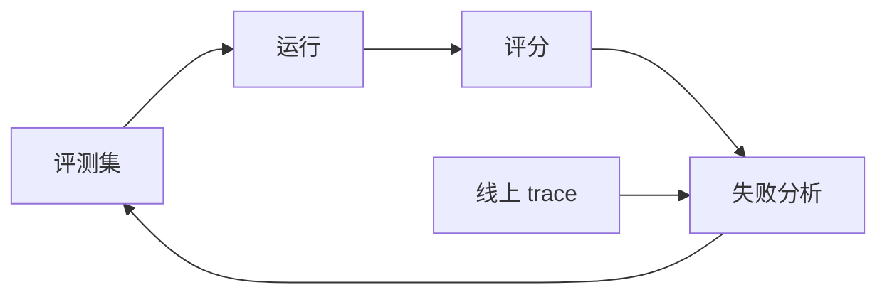

# 评测与可观测性：让改进可被证明

## 一图看懂



<p class="diagram-caption"><strong>一图看懂</strong> · 评测是闭环：离线评测、线上 trace、失败分析、回流评测集</p>


Agent 的评测比普通模型难，因为：

- **输出不确定**：同样输入，路径和结果可能不同。
- **成功标准多样**：有些任务没有唯一答案。
- **轨迹很长**：错误可能发生在第 3 步，却在第 20 步才显现。
- **依赖环境**：工具、网络、文件状态都会影响结果。
- **成本也是指标**：成功但花 10 美元，可能不如失败但花 1 美分。

没有评测，所谓“优化”只是换一种随机。

## 一、指标金字塔

| 层级 | 回答的问题 | 典型指标 |
| --- | --- | --- |
| 业务价值 | 对用户/业务有没有用？ | 转化、留存、人工节省 |
| 任务成功 | 任务真的完成了吗？ | 端到端通过率、质量分 |
| 过程健康 | 是怎么完成的？ | 步数、工具成功率、循环率 |
| 资源效率 | 代价可接受吗？ | token、成本、P95 延迟 |
| 安全与合规 | 有没有造成伤害？ | 越权、注入、数据泄露 |

只看“任务成功”会掩盖成本和风险；只看成本会牺牲质量。至少同时报告：

| 维度 | 指标 | 说明 |
| --- | --- | --- |
| 质量 | 任务通过率、评分 | 用可验证标准或 rubric |
| 可靠性 | 多次运行的方差、失败率 | 同输入跑 3–5 次 |
| 效率 | 每任务 token/成本、P50/P95 延迟 | 按任务类型分桶 |
| 过程 | 平均步数、工具成功率、循环率 | 定位问题 |
| 安全 | 越权/注入/泄露事件 | 应为 0，需红队测试 |
| 体验 | 人工接管率、用户接受率 | 线上关键 |

## 二、离线评测：先有“金标准”

### 1. 任务集从哪来

- **真实请求采样**：最有价值，覆盖真实分布。
- **失败案例回归**：每次线上事故都进回归集。
- **边界/对抗样本**：注入、歧义、缺信息、超长输入。
- **合成任务**：补足长尾，但要防止“合成分布”自嗨。

一个可用的起步规模：**30–50 条**覆盖主要场景的任务，足以发现大问题；要比较小改进，需要更多样本或配对设计。

### 2. 成功标准怎么写

| 任务类型 | 可验证标准 |
| --- | --- |
| 代码修复 | 测试通过 + 不回归 + 不改禁止文件 |
| 数据抽取 | schema 合法 + 字段级准确率 |
| 研究问答 | 引用支持结论 + 关键事实覆盖 |
| 客服处理 | 政策合规 + 用户问题解决 + 无越权承诺 |
| 写作 | rubric 评分（结构/事实/语气） |

标准要**可执行**，不能是“回答得好”。最好由独立验证器判断，而不是让生成模型自评。

### 3. 评测的三种粒度

- **端到端**：只看最终结果。接近真实，但难定位。
- **轨迹**：检查每一步的工具选择、参数、观察处理。能定位，但评分成本高。
- **组件**：单测工具、上下文构建、解析器。快，但不能代表整体。

三者都要有：组件测试保证地基，轨迹评测定位过程，端到端评测对齐业务。

## 三、LLM-as-Judge：好用，但有偏

用 LLM 给回答打分很常见，但要认识它的偏差：

| 偏差 | 表现 | 缓解 |
| --- | --- | --- |
| 位置偏差 | 偏好第一个/最后一个 | 随机顺序、成对交换 |
| 长度偏差 | 更长=更好 | 控制长度、分段评分 |
| 自我偏好 | 偏好同模型输出 | 用不同模型评审 |
| 谄媚 | 倾向给高分 | 给明确 rubric、要求找反例 |
| 不一致 | 同答案不同分 | 固定温度、多人/多次投票 |

实用做法：

- 用** rubric + 少量示例**，而不是“1–10 分”。
- 要求输出**逐项判断 + 证据**，再汇总。
- 对关键任务，人工抽检 10–20% 校准。
- 让 judge 只看必要信息，避免被长度/格式干扰。
- 记录 judge 的版本和提示，评测结果要可复现。

> LLM judge 适合“相对比较”和“粗筛”，不适合作为唯一的高风险验收。

## 四、统计：别被 2% 的波动骗了

假设评测集 50 条，通过率从 70% 提升到 74%（35 → 37 条）。这可能只是噪声。

基本做法：

- 同一配置跑 3–5 次，报告均值与方差。
- 用配对比较：同一批任务，A/B 各跑一次，统计“A 通过 B 失败”和“B 通过 A 失败”的数量。
- 报告置信区间（Wilson interval）或至少原始通过数。
- 对关键指标做显著性检验（如 McNemar）。
- 固定随机种子/温度（能固定的部分）。

一个粗略的经验：**50 条样本只能发现大改进；要稳定检测 5% 的提升，通常需要几百条。**

## 五、可观测性：Trace 是 Agent 的“黑匣子”

普通日志记录“发生了什么”，trace 记录“一次任务中每一步的因果链”。

### 最小 trace 结构

```json
{
  "trace_id": "t-123",
  "task": "修复 parser 测试",
  "model": "…",
  "steps": [
    {
      "span_id": "s1",
      "type": "llm",
      "input_tokens": 3200,
      "output_tokens": 120,
      "latency_ms": 900,
      "tool_calls": [{"name": "run_tests", "args": {"path": "tests/"}}]
    },
    {
      "span_id": "s2",
      "type": "tool",
      "name": "run_tests",
      "duration_ms": 2400,
      "ok": false,
      "error_type": "test_failure",
      "output_preview": "3 failed, 12 passed"
    }
  ],
  "result": {"status": "success", "steps": 7, "cost_usd": 0.04}
}
```

关键字段：

- `trace_id` / `span_id` / `parent_id`：还原调用树。
- 每步的**模型输入输出**（脱敏后）、token、延迟。
- 工具名、参数（脱敏）、结果摘要、错误类型。
- 上下文各 section 的 token 分布。
- 预算消耗、终止原因。
- 用户/租户/任务类型（用于分桶）。

### 隐私与成本

- 不记录密钥、密码、完整个人信息。
- 大文本存引用/哈希，按需采样。
- 设置保留期和访问控制。
- 采样策略：成功任务低采样，失败/高风险全量。

## 六、线上监控：从“能跑”到“可运营”

| 监控 | 指标 | 告警 |
| --- | --- | --- |
| 成功率 | 端到端通过率、人工接管率 | 连续下降 |
| 延迟 | P50/P95/P99 | 超 SLO |
| 成本 | 每任务/每用户成本 | 突增 |
| 工具 | 错误率、超时率、限流 | 突增 |
| 安全 | 越权、注入、异常出口 | 立即 |
| 模型 | 版本、schema 失败率 | 变更后 |

发布策略：

- 影子流量：新版本只观察不生效。
- 金丝雀：小流量对比。
- 回滚开关：模型/提示/工具都可独立回滚。

## 七、一个最小评测框架

```python
@dataclass
class Case:
    id: str
    input: str
    expected: dict
    tags: list[str]

def run_eval(agent_factory, cases, runs=3):
    results = []
    for case in cases:
        for i in range(runs):
            agent = agent_factory(seed=i)
            trace = agent.run(case.input)
            passed = evaluate(case, trace)
            results.append({
                "case": case.id,
                "run": i,
                "passed": passed,
                "steps": trace.steps,
                "cost": trace.cost,
                "latency_ms": trace.latency_ms,
            })
    return summarize(results)

# 伪代码：mean / group_by / percentile 需要按你的评测框架实现
def summarize(rows):
    by_case = group_by(rows, "case")
    pass_at_1 = mean(r["passed"] for r in rows if r["run"] == 0)
    pass_all = mean(all(x["passed"] for x in xs) for xs in by_case.values())
    return {
        "pass@1": pass_at_1,
        "pass^3": pass_all,
        "avg_steps": mean(r["steps"] for r in rows),
        "avg_cost": mean(r["cost"] for r in rows),
        "p95_latency": percentile([r["latency_ms"] for r in rows], 95),
    }
```

注意 `pass@1` 和 `pass^k` 的区别：

- `pass@1`：单次运行通过率（用户体验）。
- `pass^k`：k 次都通过的比例（可靠性）。

一个 Agent 可能 `pass@1=80%`，但 `pass^3=50%`——说明它“经常能对，但不稳定”。生产更关心后者。

## 八、公开 Benchmark：能参考，别迷信

| Benchmark | 测什么 | 局限 |
| --- | --- | --- |
| SWE-bench | 真实仓库修 issue | 任务偏 Python、污染风险 |
| GAIA | 通用助手任务 | 评分依赖答案匹配 |
| WebArena | 网页操作 | 环境固定、模拟站点 |
| OSWorld | 桌面操作 | 成本高、环境脆弱 |
| τ-bench | 工具+政策遵循 | 领域特定 |

使用原则：

- 看**任务分布**是否接近你的场景。
- 看**评测协议**（是否给工具、多少步、什么模型）。
- 警惕训练集污染：公开 benchmark 可能进了模型训练数据。
- 不要用 benchmark 分数替代自己的评测集。

## 九、失败分类：让每次失败都变成资产

建议统一 failure taxonomy：

```text
planning      计划错误/遗漏
context       信息缺失/被干扰/压缩失真
tool_selection 选错工具
tool_args     参数错误
tool_exec     工具失败/超时
reasoning     推理错误
verification  未验证/误判完成
orchestration 流程/协调错误
environment   环境/依赖问题
safety        越权/注入/泄露
```

每次失败标注一类或多类，按周统计。这样你才知道该修模型、上下文、工具还是编排。

## 十、调试一个失败任务的顺序

1. **看结果**：错在哪，能否复现？
2. **看终止**：为什么停？预算、验证、还是模型说完成？
3. **看轨迹**：哪一步开始偏？关键工具返回了什么？
4. **看上下文**：那一步模型看到了什么？关键信息在不在？
5. **看工具**：参数对不对？错误是否可行动？
6. **看模型**：换更强模型能否通过？是能力还是工程问题？
7. **写回归**：把案例加入评测集，防止再犯。

> 不要一上来就改 prompt。**先定位是哪一层的信息/契约断了。**

## 常见问题速查

| 症状 | 先查什么 | 可能修复 |
| --- | --- | --- |
| 评测分数波动大 | 样本量/随机性 | 增加样本、多次运行、配对比较 |
| 线上好、离线差 | 分布不一致 | 采样真实请求、更新评测集 |
| 离线好、线上差 | 环境/延迟/并发 | 影子流量、线上监控 |
| 不知道为何失败 | 缺少 trace | 补每步输入输出与工具结果 |
| 改进无法归因 | 一次改多个变量 | 单变量实验、A/B |
| judge 分数虚高 | 偏差/ rubric 模糊 | 人工校准、成对比较 |

## 练习

1. 为你的 Agent 写 20 条评测用例，覆盖正常、边界、对抗三类。
2. 给一个失败任务补全 trace，指出最早出错的那一步。
3. 计算你的 `pass@1` 和 `pass^3`，比较差距。

下一步：[版本与发布](/layers/release)。
