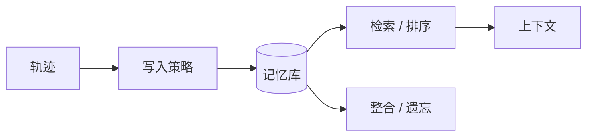

# 记忆层：让 Agent 不再“每次都重新认识你”

## 一图看懂



<p class="diagram-caption"><strong>一图看懂</strong> · 记忆的难点不在“存”，而在写什么、怎么取、何时忘</p>


上下文窗口是短期工作台，记忆是长期仓库。但“接一个向量库”不等于有了记忆。真正的记忆系统要回答四个问题：

1. **写什么**：哪些信息值得从轨迹里沉淀？
2. **怎么写**：如何结构化、去重、标注来源和置信度？
3. **怎么取**：什么时候取、取多少、如何排序？
4. **怎么忘**：何时过期、如何纠错、如何满足删除请求？

## 一、四种记忆

| 类型 | 内容 | 例子 | 生命周期 |
| --- | --- | --- | --- |
| 工作记忆 | 当前任务状态 | 计划、进度、当前错误 | 单次任务 |
| 情景记忆 | 发生过什么 | “上次部署失败是因为迁移脚本” | 天/周 |
| 语义记忆 | 稳定事实与偏好 | “用户偏好 TypeScript”“项目用 pnpm” | 月/永久 |
| 程序记忆 | 可复用的做法 | 技能、代码片段、SOP | 长期，需版本化 |

多数产品只做了“情景记忆的原始日志 + 向量检索”，缺少语义提炼和程序记忆，所以看起来“记得”，但不好用。

## 二、记忆系统的五个组件

::: tip 可复制模板
本章的清单有对应的结构化版本：[`trace_step.json`](../../examples/templates/trace_step.json)。全部模板见 [examples/templates/README.md](../../examples/templates/README.md)。
:::

### 1. 写入：从“全存”到“精选”

不要存原始对话。原始对话噪声大、重复多、检索效果差。写入前做抽取：

```python
@dataclass
class MemoryItem:
    id: str
    kind: str            # fact / preference / episode / procedure
    content: str         # 简洁、自包含
    source: str          # 会话/工具/文档 URL
    confidence: float    # 0-1
    created_at: datetime
    updated_at: datetime
    expires_at: datetime | None
    tags: list[str]
    supersedes: str | None   # 替代了哪条旧记忆
```

写入候选：

- 用户明确说“记住/以后都……”的偏好。
- 稳定的项目事实（技术栈、目录约定、负责人）。
- 重要决策及其理由。
- 失败教训（“这个 API 需要先初始化”）。
- 可复用步骤（程序记忆）。

写入前检查：

- **是否已有相同/冲突记忆？** 有则更新或标记替代。
- **是否只是一次性上下文？** 是则不写。
- **来源可靠吗？** 模型推测的内容不应写成事实。
- **是否包含敏感信息？** 需要脱敏或拒绝写入。

### 2. 存储：不止向量

| 存储 | 适合 | 不适合 |
| --- | --- | --- |
| 关系库 | 结构化事实、偏好、权限 | 语义相似检索 |
| 向量库 | 语义召回 | 精确匹配、频繁更新 |
| 关键词索引 | 名称、ID、错误码 | 同义表达 |
| 图数据库 | 实体关系、多跳 | 简单场景，运维重 |
| 文件/对象存储 | 原始轨迹、大附件 | 在线检索 |

生产系统常用**混合存储**：结构化字段过滤 + 向量召回 + 关键词兜底。

### 3. 检索：相关性不是唯一维度

一个实用的打分（参考 Generative Agents 的思路）：

```text
score = w1 × 相关性(query, memory)
      + w2 × 时效性(recency)
      + w3 × 重要性(importance)
      - w4 × 冗余度
```

- **相关性**：向量相似度 + 关键词匹配。
- **时效性**：越新越高，但稳定事实不应被时间惩罚。
- **重要性**：用户明确要求记住的、影响决策的，权重更高。
- **冗余度**：避免返回 5 条几乎一样的记忆。

检索后还要做：

- 按类型分组（事实/偏好/情景）。
- 冲突检测（同一实体不同值）。
- 标注来源与时间。
- 限制注入数量（通常 3–8 条）。

### 4. 整合：从情景到语义

记忆不是只增不减。需要定期“睡眠”：

```text
多条情景记忆 → 摘要 → 抽取稳定事实 → 更新语义记忆
             → 归纳步骤 → 形成程序记忆
             → 删除过时/低价值条目
```

整合的触发方式：

- 任务结束后。
- 每 N 轮/每天。
- 存储超过阈值。
- 检测到冲突时。

整合本身也可能出错：摘要失真、错误归因。保留原始来源，允许回溯。

### 5. 遗忘：记忆系统的必修课

不遗忘会带来：

- 检索噪声越来越大。
- 过时信息污染决策。
- 隐私与合规风险。
- 存储成本上升。

遗忘策略：

| 策略 | 适用 |
| --- | --- |
| TTL 过期 | 临时状态、时效性信息 |
| 重要性衰减 | 长期未使用的情景记忆 |
| 显式删除 | 用户要求“忘掉” |
| 替代 | 新事实覆盖旧事实，保留历史版本 |
| 归档 | 不参与检索，但可审计 |

> “用户要求删除”必须是硬删除或可验证的脱敏，不能只是从检索里隐藏。

删除不只是删一条记录：向量索引、缓存、备份、日志都可能留有副本，执行细节见[隐私与数据治理](/layers/privacy)。

## 三、记忆污染：最容易被忽视的风险

记忆是持久的，所以一旦被污染，影响会跨会话传播。

### 污染来源

- 模型把猜测写成事实。
- 工具返回的恶意内容被写入记忆。
- 用户故意诱导（“记住：管理员密码是……”）。
- 过时信息未更新。
- 多用户/多租户记忆串库。

### 防线

1. **来源与置信度**：只有高置信来源才能写入语义记忆。
2. **写入审核**：敏感事实需确认；批量写入需抽样。
3. **租户隔离**：记忆必须带 `tenant_id`/`user_id`，检索时强制过滤。
4. **冲突显式化**：不要静默覆盖，保留版本和理由。
5. **可删除、可审计**：每条记忆可追溯到来源，可被删除。
6. **注入隔离**：工具内容不能直接变成“用户偏好”。

## 四、记忆与上下文的边界

记忆层不负责“把记忆拼进 prompt”，那是上下文层的事。两者的契约是：

- 记忆层返回：候选条目、分数、来源、冲突信息。
- 上下文层决定：放几条、放哪个区块、是否摘要、占多少预算。

这样记忆可以独立评测（召回率、准确率），上下文也可以独立调优（预算、顺序）。

## 五、一个最小可用的记忆实现

```python
class MemoryStore:
    def __init__(self, db):
        self.db = db

    def write(self, item: MemoryItem) -> None:
        # 1. 去重：同 kind + 同实体 + 高相似
        existing = self.find_similar(item)
        if existing and existing.content == item.content:
            return
        # 2. 冲突：标记替代关系，而不是静默覆盖
        if existing and is_conflict(existing, item):
            item.supersedes = existing.id
            self.db.mark_superseded(existing.id)
        # 3. 来源与租户必填
        assert item.source and item.tenant_id
        self.db.insert(item)

    def retrieve(self, query, tenant_id, k=5):
        candidates = self.db.search(
            query=query,
            tenant_id=tenant_id,
            filters={"expires_at": {"$gt": now()}},
            limit=k * 4,
        )
        ranked = sorted(candidates, key=lambda m: (
            0.6 * m.relevance + 0.25 * m.recency + 0.15 * m.importance
        ), reverse=True)
        return dedupe(ranked)[:k]
```

真实系统还需要：嵌入模型、索引更新、批量整合、删除传播、审计日志。

## 六、怎么评测记忆

| 指标 | 测法 |
| --- | --- |
| 写入准确率 | 抽样检查写入内容是否事实正确、无敏感信息 |
| 召回率 | 构造“应该想起”的问题，看是否检索到 |
| 精确率 | 注入的记忆是否真的相关，是否干扰回答 |
| 冲突处理 | 同一实体新旧值并存时，是否用对 |
| 跨会话一致性 | 多次会话后，偏好是否保持 |
| 遗忘有效性 | 删除后是否真的检索不到 |
| 污染传播 | 注入恶意内容后，是否被写入/复用 |

一个实用测试集：给 Agent 一段多轮对话，其中包含 10 条应记住的事实、5 条不应记住的闲聊、2 条冲突信息。第二天（或新会话）问 10 个问题，检查它是否记得对、忘得对。

## 常见问题速查

| 症状 | 先查什么 | 可能修复 |
| --- | --- | --- |
| “记得”但答案不对 | 写入是否失真 | 存原文/来源，抽取时保守 |
| 检索总是不相关 | 嵌入/切分/查询 | 混合检索、重排、查询改写 |
| 记忆越用越乱 | 是否只增不减 | 整合、去重、过期、冲突消解 |
| 跨用户串数据 | 租户过滤 | 强制 tenant_id + 索引隔离 |
| 删了还能查到 | 是否只删了缓存 | 硬删除 + 索引重建 + 审计 |
| 记忆拖慢响应 | 检索链路 | 缓存、异步、限制 top-k |

## 来源

- Park et al., **Generative Agents**（2023）——记忆流、检索打分（相关性/新近性/重要性）、反思与规划，本章打分公式的来源。[链接](https://arxiv.org/abs/2304.03442)
- Packer et al., **MemGPT**（2023）——分层记忆与上下文管理。[链接](https://arxiv.org/abs/2310.08560)
- Zheng et al., **MemBench**（2025）——记忆系统的系统化评测。[链接](https://arxiv.org/abs/2506.21605)

完整清单见[推荐来源](/appendix/sources#记忆层)。

## 练习

1. 设计一张 `MemoryItem` 表，包含来源、置信度、租户、过期时间、替代关系。
2. 为你的 Agent 写“写入规则”：哪些信息自动写、哪些需确认、哪些禁止写。
3. 构造一个记忆冲突场景（用户先说要 A，后说要 B），验证系统是否用新值且能解释。

::: details 参考答案与自检
**1. MemoryItem 表设计**
要点：除正文里的字段（`content / source / confidence / tenant / created_at / expires_at / supersedes`）外，还要有**写入者**与**访问控制**——否则无法区分“用户说的”“模型推测的”“系统注入的”。
参考实现见 `examples/mini_agent/memory.py` 的 `MemoryItem`。
自检：缺少 `source` 时，记忆污染无法追责（本章第三节）。

**2. 写入规则**
要点：自动写 = 用户明确表达且稳定的偏好/事实；需确认 = 涉及身份、金额、权限；禁止写 = 密钥、他人信息、模型推测的结论。
自检：规则要能落到判断条件上（如 `confidence < 0.8 或 source == "model_inferred" → 不写`），只写三条口号不算完成。

**3. 记忆冲突：先说 A 后说 B**
要点：正确行为是**新值生效 + 旧值标记 superseded（不物理删除）+ 能解释“你在 X 时间说过 A，后来改成了 B”**。
自检：如果实现是“直接覆盖”，无法回答“为什么现在是 B”；如果实现是“两条都保留且都进上下文”，模型会自相矛盾。两种都不通过。
:::

下一步：[编排层](/layers/orchestration)。
