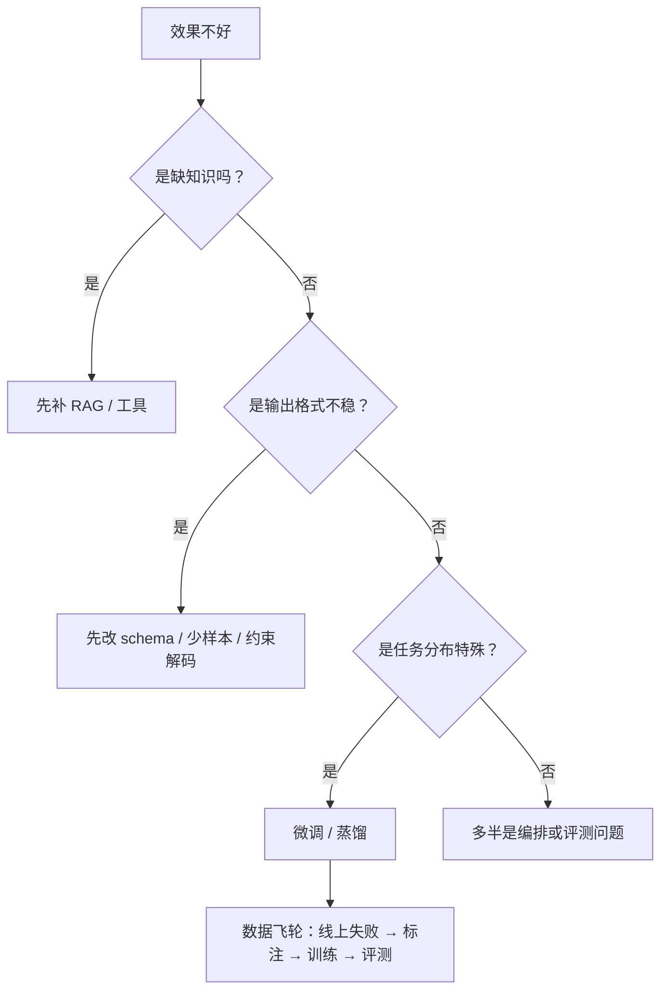
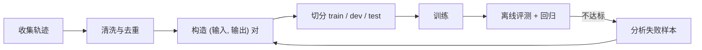
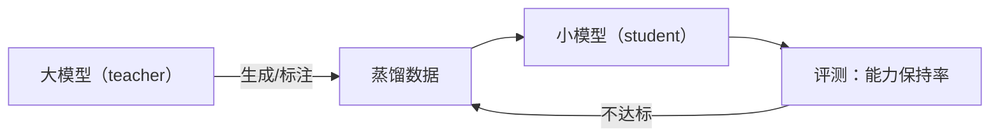

# 模型适配：改上下文，还是改模型

团队遇到效果不好，第一反应常是“去微调一个”。但 Agent 的失败大多不在模型权重里，而在上下文、工具契约和评测缺失里。微调解决的是**分布与格式**问题，不是“模型太笨”。

## 一图看懂



<p class="diagram-caption"><strong>一图看懂</strong> · 适配手段有先后：提示 → 检索/工具 → 格式约束 → 微调 → 蒸馏</p>

本章另有 2 张图：图 1 SFT 流程，图 2 蒸馏回路。

## 一、三种问题，三种解法

| 症状 | 根因 | 该动的地方 |
| --- | --- | --- |
| 答不出内部信息 | 缺知识 | RAG、工具、知识库 |
| 知道但格式总错 | 指令或 schema 问题 | 提示、少样本、结构化输出、校验重试 |
| 领域黑话听不懂 | 分布差异 | 微调（SFT） |
| 推理链太啰嗦/太短 | 行为偏好 | 提示、偏好优化 |
| 太贵/太慢 | 模型过大 | 蒸馏、路由到小模型、缓存 |
| 时好时坏 | 缺评测与稳定性 | 先补评测，再谈优化 |

**判断标准很简单：换一段上下文能不能解决？** 能，就不要微调——上下文可以每天改，权重不能。

## 二、四种手段的取舍

| 手段 | 生效速度 | 单次成本 | 可解释性 | 适合 |
| --- | --- | --- | --- | --- |
| 提示工程 | 分钟 | 低（token 变多） | 高 | 格式、语气、流程 |
| RAG | 小时 | 中（检索+token） | 高（可引用） | 事实、私有知识、时效 |
| 微调（SFT） | 天 | 中高（训练+托管） | 低 | 风格、领域术语、稳定格式 |
| 蒸馏 | 周 | 训练高、推理低 | 低 | 降本、低延迟、边缘部署 |

一个常见误判：**用微调记知识**。权重里塞事实既贵又难更新，还会与检索结果冲突。知识用检索，行为用微调。

## 三、SFT 的最小可行流程

见**图 1**：



<p class="diagram-caption"><strong>图 1</strong> · 微调的瓶颈从来不是训练，而是数据构造与评测</p>

数据格式通常就是对话消息列表：

```json
{
  "messages": [
    {"role": "system", "content": "你是工单分类助手，只输出 JSON。"},
    {"role": "user", "content": "退款三天了还没到账"},
    {"role": "assistant", "content": "{\"category\":\"refund\",\"urgency\":\"high\"}"}
  ]
}
```

几条实践经验：

- **质量 > 数量**：几百条高质量样本，常常胜过几万条噪声样本。
- **覆盖失败模式**：从线上失败里采样，比从成功里采样有价值。
- **保留真实分布**：训练集里 90% 是简单样本，模型就只会做简单样本。
- **必须留 holdout**：用训练时没见过的样本评测，否则数字只是记忆。
- **警惕灾难性遗忘**：微调后通用能力可能下降，用通用评测集做护栏。

## 四、偏好优化：什么时候值得

SFT 教“怎么做”，偏好优化教“哪种更好”。当你有**成对比较**（A 比 B 好）时，DPO 一类方法比人工写标准答案更省力。

值得做的信号：

- 输出都“对”，但风格/详略不稳定。
- 有明确的好坏排序，且能低成本采集（人工标注、用户反馈、规则打分）。

不值得做的信号：

- 你连“好”的定义都写不出来——那还没有评测标准，先补评测。
- 问题其实是知识缺失——偏好优化不会让模型知道新事实。

## 五、蒸馏：降本的主力

见**图 2**：



<p class="diagram-caption"><strong>图 2</strong> · 蒸馏的本质是“用大模型的输出当标注”，数据质量决定学生上限</p>

工程要点：

- **只蒸馏窄任务**：客服分类、抽取、改写，效果稳定；开放推理容易掉。
- **保留拒答样本**：否则学生模型会“什么都敢答”。
- **按任务路由**：简单任务走学生，复杂任务升级到老师，比全量替换更划算。
- **蒸馏数据也要合规**：教师模型的输出可能带版权或隐私问题。

## 六、数据从哪来

| 来源 | 优点 | 风险 |
| --- | --- | --- |
| 线上成功轨迹 | 真实分布 | 含隐私、需脱敏 |
| 线上失败样本 | 信息量最高 | 需要标注与归因 |
| 人工构造 | 可控、覆盖长尾 | 成本高、可能不真实 |
| 合成数据 | 便宜、可扩量 | 分布偏移、错误放大 |
| 用户反馈（点赞/改稿） | 免费、贴近需求 | 噪声大、有偏 |

**最好的数据是“被修正过的输出”**：用户改了哪里，就是模型错在哪里。

## 七、评测：微调最大的坑

微调让模型“更像训练数据”，评测必须能发现这件事的两面：

- **过拟合**：训练集指标漂亮，holdout 崩。
- **分布漂移**：真实流量变了，模型还停在旧分布。
- **能力回退**：目标任务变好，通用能力变差。
- **污染**：评测集混进了训练数据，数字虚高。

最低要求：**一个领域 holdout + 一个通用回归集 + 一条人工抽检**。

## 八、部署：版本与多租户

| 问题 | 做法 |
| --- | --- |
| 多租户定制 | LoRA 适配器按租户加载，基础模型共享 |
| 版本管理 | 模型、适配器、提示、评测集同版本号发布 |
| 回滚 | 保留上一版适配器与路由开关 |
| 成本 | 适配器热加载，避免每租户一份权重 |
| 灰度 | 按租户或流量比例切换 |

## 九、算一笔账

微调不一定省钱。粗略比较：

```text
方案 A：大模型 + 长提示 + 少样本
  单次成本 = 输入 token × 单价（含示例）
方案 B：小模型微调
  单次成本 = 小模型 token × 更低单价
  但固定成本 = 数据标注 + 训练 + 评测 + 托管 + 迭代
```

结论：**日调用量足够大、任务足够窄、格式足够稳定**时，微调/蒸馏才划得来。日调用几百次的产品，优化提示和检索的收益高得多。

## 常见问题速查

**Q：可以先用微调解决，再回头补评测吗？**
不建议。没有评测，你无法判断微调是变好还是变差，也无法决定何时回滚。

**Q：微调后还需要 RAG 吗？**
通常需要。微调改行为，RAG 供事实，两者解决不同问题。

**Q：合成数据能占多大比例？**
先小比例混入并观察 holdout。全合成数据容易让学生模型学到老师的错误。

**Q：开源模型私有化部署值不值？**
看数据合规与调用量。数据不能出境、调用量巨大、延迟敏感，这三条占一条就值得评估。

## 落地清单

::: tip 可复制模板
本章的清单有对应的结构化版本：[`eval_case.json`](../../examples/templates/eval_case.json)。全部模板见 [examples/templates/README.md](../../examples/templates/README.md)。
:::

- [ ] 先确认问题属于知识、格式还是分布？
- [ ] 有没有 holdout 与通用回归集？
- [ ] 训练数据是否脱敏、是否可追溯来源？
- [ ] 是否评估过灾难性遗忘？
- [ ] 是否有版本化与回滚方案？
- [ ] 蒸馏是否只用于窄任务，并保留拒答样本？
- [ ] 成本模型是否包含标注、训练、托管与迭代？

## 来源

- Hu et al., **LoRA: Low-Rank Adaptation**（2021）——多租户共享基础模型 + 独立适配器的技术基础。[链接](https://arxiv.org/abs/2106.09685)
- Rafailov et al., **Direct Preference Optimization**（2023）——比 RLHF 更易落地的偏好优化。[链接](https://arxiv.org/abs/2305.18290)
- Hinton et al., **Distilling the Knowledge in a Neural Network**（2015）——蒸馏的原始思路。[链接](https://arxiv.org/abs/1503.02531)
- Ouyang et al., **InstructGPT**（2022）——行为对齐（RLHF）的起点。[链接](https://arxiv.org/abs/2203.02155)

完整清单见[推荐来源](/appendix/sources#模型适配)。

## 练习

1. 挑一个你的失败案例，判断它属于“缺知识”还是“缺行为”，并说明理由。
2. 设计一个 200 条的 SFT 数据集，写清楚采样来源与去重规则。
3. 估算一次蒸馏的固定成本，与“继续用大模型”的年度成本对比。

::: details 参考答案与自检
**1. “缺知识”还是“缺行为”**
要点：判据是**同样的输入换个模型/加检索是否就能答对**。加检索能解决的是知识缺失；换更强模型也不行、且错误模式稳定复现的是行为缺失（格式、拒答倾向、语气）。本章开头那张决策图就是按这个分支画的。
自检：如果结论是“数据不够所以微调”，但没有区分这两类，方向大概率错。

**2. 200 条 SFT 数据集的设计**
要点：写清四件事——采样来源（修正过的真实输出优先）、去重规则（近似重复会放大过拟合）、正负比例（是否保留拒答样本）、划分（holdout 必须与训练集在主题上隔离）。
自检：只写了“从线上日志抽 200 条”，没有去重与 holdout，等于没设计。

**3. 蒸馏的固定成本 vs 继续用大模型**
要点：固定成本 = 标注 + 训练算力 + 评测 + 托管 + 迭代（每次模型升级都要重跑）；对比项是“年度调用量 × 单价差”。本章第九节给了这个框架，你的答案要给出**盈亏平衡的调用量**，而不是只算一次训练花了多少。
自检：如果没给出“日调用多少次才回本”这个数，结论没有可执行性。
:::

下一步：[多模态与实时交互](/layers/multimodal)。
