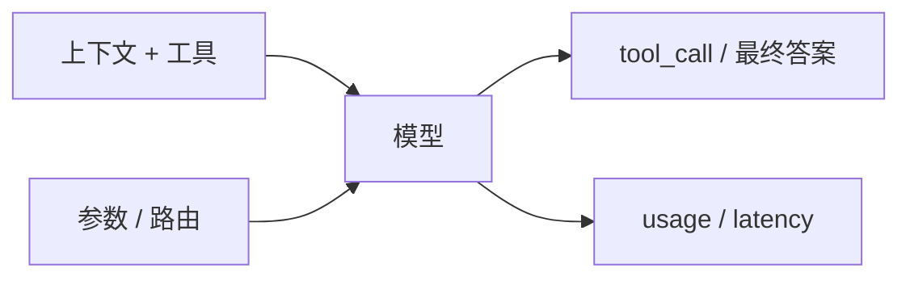
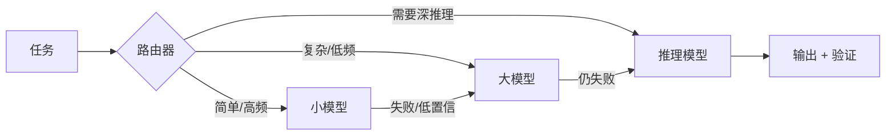

# 模型层：Agent 的“策略函数”

## 一图看懂



<p class="diagram-caption"><strong>一图看懂</strong> · 模型层是策略函数：输入上下文，输出动作或答案，同时产生用量与延迟</p>


::: tip 平台视角
当系统接入多家模型、需要路由/回退/配额/计费时，这一层的职责会外移成[模型网关](/evolution/model-gateway)。本篇讲模型能力与调用细节，网关篇讲平台边界。
:::

在 Agent 里，模型不是“知道答案的人”，而是**策略函数**：

```text
π(下一步动作 | 目标, 上下文, 可用工具, 历史观察)
```

它输出的是“接下来做什么”，而不是“世界的真相”。理解这一点，才能正确地选模型、写调用、做优化。

## 一、选型：不要只看排行榜

模型能力是多维的，不同任务吃的维度不同：

| 维度 | 对 Agent 的影响 | 怎么测 |
| --- | --- | --- |
| 指令遵循 | 是否遵守格式、边界、禁止事项 | 固定 prompt 的合规率 |
| 工具调用 | 选对工具、参数合法、少编造 | 工具选择准确率、参数合法率 |
| 多步推理 | 规划、纠错、长链任务 | 你的任务集上的端到端成功率 |
| 长上下文 | 能否在长文档中定位信息 | 关键信息召回率、干扰项测试 |
| 结构化输出 | JSON/schema 合法率 | 解析失败率 |
| 多模态 | 截图/图表/文档理解 | 视觉任务通过率 |
| 延迟 | 影响交互与并行策略 | 首 token / 尾 token P50/P95 |
| 成本 | 决定能否规模化 | 每任务 token 成本 |
| 稳定性 | 同样输入是否可复现 | 多次运行方差 |

> 排行榜测的是“平均能力”，你的系统关心的是“在你的分布上的可靠能力”。**用 30–50 条自己的样本做选型，比看十张榜单有用。**

### 一个实用的模型组合

生产系统通常不是“一个模型打天下”，而是分层：

见**图 1**：



<p class="diagram-caption"><strong>图 1 · 级联路由：先小模型，失败或低置信再升级</strong></p>

- **小模型**：分类、抽取、格式化、简单工具调用。
- **通用大模型**：大多数对话与工具使用。
- **推理模型**：复杂规划、代码、数学、长链验证。
- **专用模型**：嵌入、重排、语音、视觉。

路由的收益来自“任务难度分布”：如果 80% 的请求很简单，把简单请求分流到小模型能显著降本；如果任务普遍很难，级联只会增加延迟。

## 二、调用参数：每个都有语义

```python
response = client.chat.completions.create(
    model="...",
    messages=messages,
    tools=tools,
    tool_choice="auto",        # auto / required / 指定工具
    temperature=0.2,           # 越低越确定，但不等于事实正确
    top_p=1.0,
    max_tokens=2048,
    stop=["</answer>"],
    seed=42,                   # 若支持，帮助复现（不保证）
)
```

几个常见误区：

- **temperature=0 不等于完全确定**：并行计算、批处理、模型版本更新都会带来差异。
- **max_tokens 不是“回答长度”**：推理模型的 thinking token 也占预算，设太小会导致答案被截断。
- **stop 序列可能被模型“学会”**：如果 stop 出现在正常内容里，会提前截断。
- **tool_choice=required 不等于一定调用正确工具**：它只强制“必须调用”，不保证选对。

### 结构化输出

三种常见方式，可靠性依次上升：

1. **提示词要求 JSON**：最脆弱，模型可能加解释、漏引号。
2. **JSON mode**：保证是合法 JSON，但不保证符合你的 schema。
3. **Schema 约束 / 原生结构化输出**：按 schema 生成，仍要在服务端校验。

无论哪种，**服务端都必须校验**。模型输出是“不可信输入”，不是“可信函数返回值”。

```python
from jsonschema import validate, ValidationError

def parse_decision(raw: str, schema: dict) -> dict:
    try:
        data = json.loads(raw)
        validate(instance=data, schema=schema)
        return data
    except (json.JSONDecodeError, ValidationError) as exc:
        raise InvalidModelOutput(str(exc)) from exc
```

校验失败后的策略：

- 把错误信息回给模型，要求重试（最多 1–2 次）。
- 用更保守的解析器做兜底（如只提取第一个 JSON 对象）。
- 降级到“让用户确认”或“使用上次有效结果”。

## 三、推理模型：更多思考，不等于更好

推理模型通过更长的内部推理（test-time compute）提升复杂任务表现。它适合：

- 多步规划、约束满足、代码修复。
- 需要自我检查的数学/逻辑任务。
- 长程任务中的关键决策点。

不适合：

- 简单分类、抽取、格式化（浪费钱和延迟）。
- 对延迟极敏感的交互。
- 需要严格实时性的场景。

### 使用推理模型的三个注意点

1. **不要过度提示“逐步思考”**：推理模型已经内置了推理过程，外部再要求 CoT 可能干扰它，或产生冗余 token。
2. **给足输出预算**：thinking token 算在 max_tokens 里，预算太小会导致答案截断。
3. **区分“思考”和“答案”**：如果 API 返回 reasoning 字段，不要把它当作最终答案；也不要假设它一定忠实反映计算过程。

> 推理模型的“推理轨迹”是产品能力，不是审计证据。要验证结论，仍然需要外部工具和测试。

## 四、成本：算清楚，才能优化

Agent 的成本通常按 token 计费，但真实成本还包括工具调用、沙箱、检索、重试和人工。

一个简化的单步成本：

```text
cost_step = input_tokens × price_in
          + cached_tokens × price_cached
          + output_tokens × price_out
          + tool_cost
```

多步任务：

```text
cost_task = Σ cost_step + retries + overhead
```

### 成本失控的五个来源

| 来源 | 表现 | 优化 |
| --- | --- | --- |
| 历史全量拼接 | 每步 input token 线性增长 | 压缩、摘要、只保留相关观察 |
| 工具结果过大 | 网页/日志/文件整段进上下文 | 分页、截断、外部存储 + 引用 |
| 重复推理 | 相同子问题反复问 | 结果缓存、计划复用 |
| 无效重试 | 错误后原样重试 | 错误分类、退避、换策略 |
| 过度使用大模型 | 简单任务也走最贵模型 | 路由、级联、小模型 |

### Prompt Caching

多数厂商支持对**稳定前缀**做缓存（系统提示、工具定义、长文档）。要点：

- 把稳定内容放前面，变化内容放后面。
- 缓存有 TTL，隔太久会失效。
- 缓存命中通常按更低价格计费，但仍有写入成本。
- 不要为了缓存把不该放的内容塞进前缀。

## 五、可靠性：模型是概率系统

### 常见失败模式

| 失败 | 症状 | 处理 |
| --- | --- | --- |
| 幻觉工具 | 调用不存在的工具 | 工具白名单校验，返回可用工具列表 |
| 参数编造 | 缺字段、类型错、枚举越界 | schema 校验 + 错误回传 |
| 指令漂移 | 多轮后忘记约束 | 每轮重申关键约束；结构化状态 |
| 过度自信 | 说“已完成”但没做 | 外部验证、要求证据 |
| 拒绝 | 安全策略误伤 | 改写请求、提供上下文、降级 |
| 截断 | 输出不完整 | 检查 finish_reason，必要时续写 |
| 上下文超限 | 请求失败 | 预算控制、压缩、分块 |

### 重试不是万能药

重试适用于**瞬态错误**：网络超时、429、5xx。
不适用于**语义错误**：参数错、工具不存在、任务理解错。后者重试只会重复犯错。

```python
RETRYABLE = {408, 409, 425, 429, 500, 502, 503, 504}

def should_retry(exc) -> bool:
    if isinstance(exc, (TimeoutError, ConnectionError)):
        return True
    status = getattr(exc, "status_code", None)
    return status in RETRYABLE
```

重试要带：

- 指数退避 + 抖动。
- 最大次数（通常 2–3 次）。
- 总 deadline，避免重试把延迟拖爆。
- 幂等键（对写操作尤其重要）。

## 六、缓存：别把“相似”当“相同”

| 缓存类型 | 命中条件 | 风险 |
| --- | --- | --- |
| Prompt cache | 前缀 token 完全一致 | 前缀变动导致失效 |
| 结果缓存 | 请求完全相同 | 外部状态变化后结果过期 |
| 语义缓存 | 向量相似度高 | 相似问题答案不同，返回错误 |
| 工具缓存 | 相同工具 + 参数 | 数据时效性、权限差异 |

语义缓存要非常谨慎：**“退款政策是什么”和“如何申请退款”向量很近，但答案不同。** 如果要用，必须加业务键、时效和人工抽检。

## 七、模型层的度量

不要只记录“调用成功”。至少记录：

```json
{
  "model": "...",
  "step": 3,
  "input_tokens": 4210,
  "cached_tokens": 3200,
  "output_tokens": 180,
  "latency_ms": 1240,
  "finish_reason": "tool_calls",
  "schema_valid": true,
  "tool_name": "search",
  "retry_count": 0,
  "cost_usd": 0.0031
}
```

按任务聚合：

- 成功率 / 通过率
- P50 / P95 延迟
- 每任务 token 与成本
- schema 合法率
- 工具选择准确率
- 重试率、降级率
- 不同模型版本的 A/B 对比

## 八、一个带校验与路由的模型客户端

```python
class ModelClient:
    def __init__(self, router, schemas):
        self.router = router
        self.schemas = schemas

    def decide(self, messages, tools, task_profile):
        model = self.router.pick(task_profile)
        for attempt in range(3):
            try:
                resp = self._call(model, messages, tools)
                decision = parse_decision(resp, self.schemas)
                return decision
            except InvalidModelOutput as exc:
                messages = messages + [
                    {"role": "user", "content": f"输出不符合 schema：{exc}。请只返回合法 JSON。"}
                ]
            except RetryableError:
                time.sleep(backoff(attempt))
        # 降级：换更稳的模型或返回“需要人工”
        return self._fallback(messages, tools)
```

这段代码体现三个原则：

1. **模型可替换**：路由层决定用哪个。
2. **输出必校验**：不信任模型的结构化输出。
3. **失败有降级**：不是所有错误都值得重试。

## 常见问题速查

| 症状 | 先查什么 | 可能修复 |
| --- | --- | --- |
| 工具参数经常错 | schema 是否清晰、字段是否太多 | 简化参数、加示例、枚举约束 |
| 回答越来越慢 | 上下文是否线性增长 | 压缩、缓存、裁剪工具结果 |
| 成本突然翻倍 | 是否进入长循环/重试 | 预算、无进展检测、日志 |
| 同一输入结果不同 | 温度、模型版本、并行 | 固定 seed、记录版本、评测方差 |
| 模型不遵守格式 | 是否只靠提示词 | 用 schema/结构化输出 + 服务端校验 |
| 简单任务也用大模型 | 有没有路由 | 加分类器/规则路由，按难度分流 |

## 练习

1. 用你的任务集比较两个模型：固定 20 条样本，记录成功率、P95 延迟、单任务成本，画一张二维图。
2. 给你的模型调用加“schema 校验 + 一次修复重试 + 降级”，统计修复率。
3. 估算：如果每步 input 从 4K 降到 1.5K，一个 20 步任务能省多少 token？哪些信息可以安全丢弃？

下一步：[模型适配与微调](/layers/model-adaptation)。
