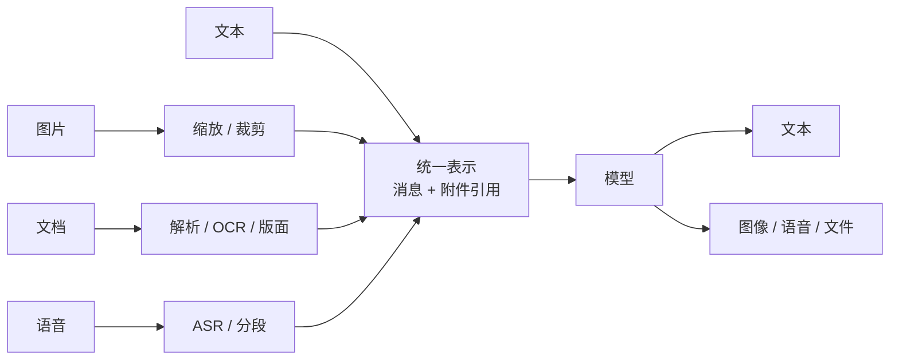
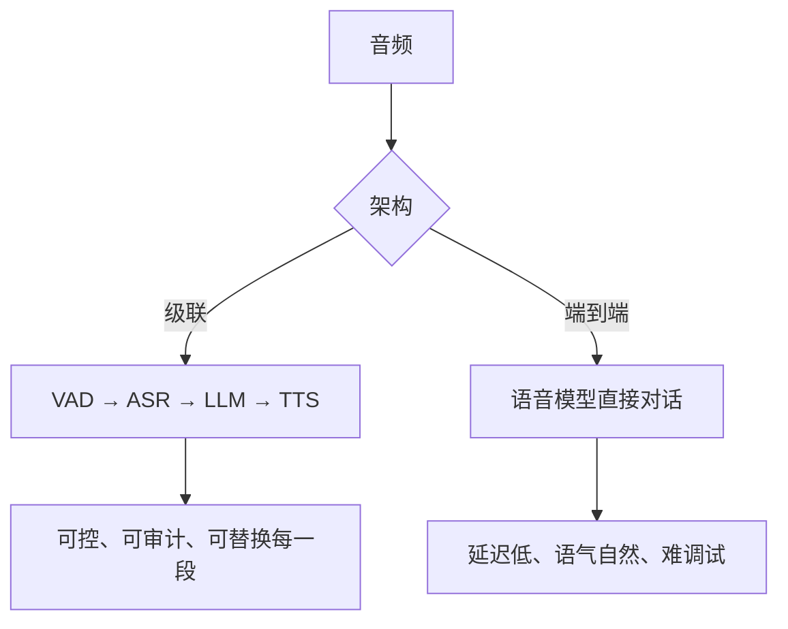

# 多模态与实时交互：当输入不再是一段文字

“支持多模态”常被当成模型能力清单上的一行。对 Agent 来说，它意味着新的**预处理链路**、新的**计费单位**、新的**失败模式**，以及一条新的内容审核通道。

## 一图看懂

<strong>一图看懂</strong> · 多模态的关键不在模型，而在模型之前的那条预处理链

## 一、先算账：多模态很贵

| 输入 | 成本驱动 | 常见失误 |
| --- | --- | --- |
| 图片 | 分辨率、切片数（tile） | 上传原图，token 翻十倍 |
| PDF | 页数、是否逐页转图 | 100 页文档整本塞进上下文 |
| 音频 | 时长、采样率 | 一小时会议录音直接进模型 |
| 视频 | 帧率 × 分辨率 × 时长 | 按秒抽帧，成本爆炸 |

工程上的默认动作应该是**先降采样，再进模型**：图片长边压到模型推荐尺寸、文档先做版面分析只取相关页、音频先分段再按需处理。

## 二、文档：最容易被低估的一环

PDF 不是文本，它是“画出来的版面”。三种解析方式差别巨大：

| 方式 | 适合 | 风险 |
| --- | --- | --- |
| 提取文本层 | 电子版 PDF | 双栏、页眉页脚会串行 |
| OCR | 扫描件、截图 | 错字、表格错位 |
| 视觉模型直读 | 复杂版面、图表 | 成本高、可能编造数字 |

Agent 场景里最常见的翻车：**表格被读成一句话**，数字对不上，但模型自信地给出结论。

对策：

- 表格单独抽成结构化数据，不要走纯文本。
- 保留页码与坐标，回答时能引用到“第几页第几段”。
- 数字类结论必须能回溯到原文位置，不能只靠模型复述。

## 三、图像：理解与生成是两件事

| | 理解（VLM） | 生成 |
| --- | --- | --- |
| 主要风险 | 幻觉细节、读错文字 | 违规内容、版权、深伪 |
| 审核位置 | 输入（用户图片） | 输出（生成结果） |
| 标识要求 | 不需要 | 需要水印/元数据 |
| 评测 | 人工 + 结构化问答 | 人工偏好 + 安全集 |

一个具体陷阱：模型“看图说话”时会补全不存在的内容。让模型描述图表时，要求它**逐项读出可见数值**，而不是总结趋势——可验证性完全不同。

## 四、语音：级联还是端到端

见**图 1**：

<strong>图 1</strong> · 级联好维护，端到端好体验；多数产品最终是混合架构

延迟预算（语音体验的生死线）：

| 阶段 | 目标 | 说明 |
| --- | --- | --- |
| VAD 判定说完 | 200~500ms | 太短会截断，太长会显得迟钝 |
| ASR 首字 | 300ms 内 | 流式识别 |
| 模型首 token | 500ms 内 | 小模型或预生成 |
| TTS 首包 | 300ms 内 | 流式合成 |
| **端到端首响** | **1s 左右** | 超过 1.5s 用户会觉得“卡住了” |

## 五、实时交互：打断比回答更难

语音 Agent 的核心体验不是“答得准”，而是“能被打断”。

- **用户插话时立即停止 TTS**，并丢弃未播放的音频。
- **保留已说出的内容**，作为下一轮的上下文，否则会重复。
- **区分“嗯/对”这类反馈音**与真正的话轮抢占。
- **回声消除**：否则 Agent 会听到自己。

这些在文本 Agent 里都不存在，但在语音产品里是主要工作量。

## 六、Computer Use：把屏幕当输入

视觉回路的三个工程问题：

1. **截图频率**：每一步都截图最准，也最贵最慢。常见做法是“动作后截图 + 状态未变则跳过”。
2. **坐标误差**：模型给的坐标可能偏几个像素。要点在元素中心，且失败后重试一次。
3. **状态判断**：怎么知道“点成功了”？靠截图差异，还是靠可访问性树？后者更稳但覆盖不全。

在真实桌面上，**可访问性树（DOM/UI tree）优先于纯视觉**：文字与结构比像素更可靠。见[运行时与沙箱](/layers/runtime)的 Computer Use 一节。

## 七、多模态上下文怎么管

- 附件用**引用**而不是内容：消息里放附件 ID，需要时再取。
- 图片在上下文里只保留**摘要 + 引用**，原始像素按需重新加载。
- 多轮对话里，旧图片通常可以替换成一句描述，省下大量 token。
- 缓存友好：把稳定的图片/文档放在前缀，变动的指令放在后面。

## 八、评测多模态任务

| 任务 | 判分方式 | 注意 |
| --- | --- | --- |
| 文档问答 | 抽取答案 + 定位页码 | 容忍 OCR 噪声 |
| 图表读数 | 数值比对 | 允许合理误差范围 |
| 图像描述 | 人工 / LLM 评审 | 惩罚编造细节 |
| 语音转写 | WER | 专有名词单独统计 |
| 端到端语音 | 任务完成 + 打断响应 | 必须真人测试 |

## 常见问题速查

**Q：图片要不要先 OCR 再给模型？**
看任务。读文字用 OCR 更准更便宜；理解版面与图表用视觉模型。两者结合最稳。

**Q：长文档怎么处理？**
先检索定位相关页，再把这些页送进模型。整本塞进去既贵又容易“中间遗忘”。

**Q：语音能不能直接用文本 Agent 的评测集？**
不能。语音有识别错误与实时性两个额外维度，必须单独评测。

**Q：多模态审核要单独做吗？**
要。图片/音频走独立审核通道，OCR/ASR 之后的文本还要再过一遍文本审核。

## 落地清单

- [ ] 输入有降采样策略（尺寸、页数、时长）？
- [ ] 文档解析能保住表格与页码？
- [ ] 图片理解要求“可验证读出”而不是自由总结？
- [ ] 生成内容有水印与元数据标识？
- [ ] 语音有明确的首响预算与打断策略？
- [ ] Computer Use 优先用结构化界面信息？
- [ ] 多模态内容有审核通道与评测集？

## 练习

1. 算一次“100 页 PDF 问答”的 token 成本，再算“先检索 5 页”的成本。
2. 设计一个语音打断的测试用例，验证停止播放后不会重复已说内容。
3. 给你的 Agent 加一条规则：涉及数字的结论必须能定位到原文页。

下一步：[上下文层](/layers/context)。
