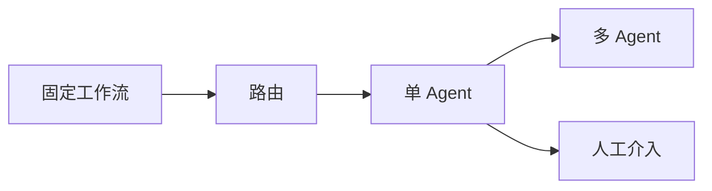
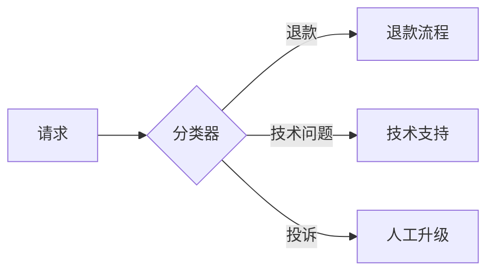
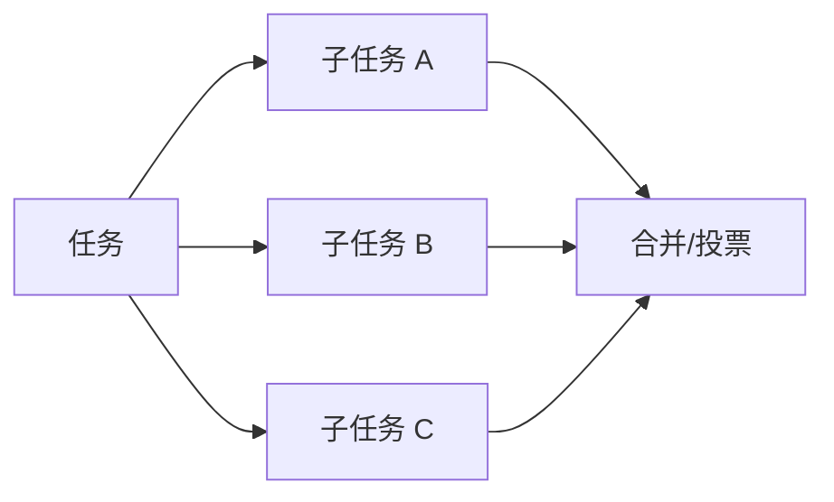
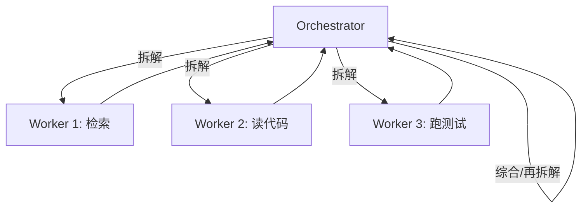
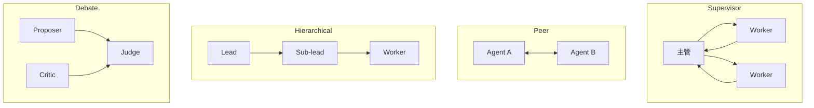

# 编排层：决定“下一步”的系统

## 一图看懂



<p class="diagram-caption"><strong>一图看懂</strong> · 编排形态从左到右自主性增加、可控性下降；不要跳级</p>


编排层是 Agent 的骨架。它不负责“想出答案”，而负责：

- 什么时候让模型决策，什么时候用固定代码。
- 任务如何拆、按什么顺序执行、何时并行。
- 状态放在哪、如何恢复。
- 什么时候停止、重试、降级、找人。
- 多个 Agent/角色如何协作与合并。

编排设计的好坏，通常比换一个更强的模型更能决定系统成败。

本章另有 6 张图：图 1 链式，图 2 路由，图 3 并行，图 4 编排者循环，图 5 生成—评估，图 6 四种拓扑。

## 一、先选形态：工作流还是 Agent

| 形态 | 控制流 | 适合 | 风险 |
| --- | --- | --- | --- |
| 单次调用 | 无 | 分类、抽取、改写 | 无法多步 |
| Prompt Chaining | 固定串行 | 步骤稳定的生成/校验 | 中间错误累积 |
| Routing | 分类后分支 | 多意图、多领域 | 路由错误 |
| Parallelization | 固定并行 | 多角度分析、批量 | 合并成本 |
| Orchestrator-Workers | 动态拆解 | 研究、多文件修改 | 协调复杂 |
| Autonomous Agent | 模型驱动循环 | 开放、探索性任务 | 失控、难评测 |
| Multi-Agent | 多角色协作 | 需要独立视角/并行 | 通信损耗、责任不清 |

> 选择顺序建议：**固定流程 → 固定流程 + 局部 Agent → 单 Agent 循环 → 多 Agent**。每往右一步，都要用评测证明收益大于成本。

## 二、五种基本编排模式

### 1. Prompt Chaining（链式）

见**图 1**：


<p class="diagram-caption"><strong>图 1 · 生成—校验—修订：把质量检查从模型自觉变成流程</strong></p>

适合：写作、翻译、抽取后校验。每步职责单一，容易测试。
风险：上游错误被下游放大；总延迟线性增加。

### 2. Routing（路由）

见**图 2**：



<p class="diagram-caption"><strong>图 2 · 请求分类：不同意图走不同流程，边界样本要有兜底</strong></p>

适合：意图明确、领域差异大。路由可以是规则、小模型或大模型。
风险：边界样本错分；路由置信度低时应允许“不确定 → 人工/通用路径”。

### 3. Parallelization（并行）

见**图 3**：



<p class="diagram-caption"><strong>图 3 · 并行分解：子任务真正独立才值得并行</strong></p>

两种用法：

- **分片**：把大任务切成互不依赖的小块（多文件、多文档）。
- **多视角**：同一问题让多个角色/采样独立回答，再投票或综合。

风险：合并逻辑复杂；重复计算；结果冲突。

### 4. Orchestrator-Workers（编排者—工人）

见**图 4**：



<p class="diagram-caption"><strong>图 4 · 编排者循环：拆解、汇总，必要时再拆解</strong></p>

适合：任务无法提前枚举步骤，但可以动态拆成子任务。研究型 Agent、Coding Agent 常用。
关键：**子任务契约**（输入、输出、预算、成功标准）和**合并策略**。

### 5. Evaluator-Optimizer（生成—评审）

见**图 5**：


<p class="diagram-caption"><strong>图 5 · 生成器—评估器：评估必须独立，否则只会自我表扬</strong></p>

适合：有明确评价标准的任务（代码测试、格式校验、事实核查）。
关键：评审者最好**独立**（不同提示/模型/工具），否则容易自我确认。

## 三、用状态机/图来表达控制流

把编排写成嵌套 `if/else`，很快就会不可维护。更好的方式是显式状态机或图：

```python
class Graph:
    def __init__(self):
        self.nodes = {}
        self.edges = {}

    def add_node(self, name, fn):
        self.nodes[name] = fn

    def add_edge(self, src, dst, condition=None):
        self.edges.setdefault(src, []).append((dst, condition))

    def run(self, state, max_steps=50):
        current = "start"
        for _ in range(max_steps):
            state = self.nodes[current](state)
            nxt = self.next(current, state)
            if nxt is None:
                return state
            current = nxt
        raise GraphExceeded("max steps")
```

图编排的好处：

- 控制流可视化、可测试。
- 每个节点是纯函数或受控副作用，便于单测。
- 支持检查点/恢复（持久化 state）。
- 支持人工审批节点（暂停/继续）。
- 支持条件边、并行分支、子图。

LangGraph、Temporal 等工具本质上都在做这件事：**把 Agent 的不确定性，约束在可管理的控制流里**。

### 状态设计

```python
@dataclass
class State:
    messages: list[dict]
    plan: list[str]
    current_step: int
    artifacts: dict[str, str]
    errors: list[str]
    budget: Budget
    status: str
```

原则：

- 状态必须是**可序列化**的，才能持久化和恢复。
- 状态变更通过节点返回新状态，避免隐式全局变量。
- 大对象（文件、网页）存引用，不存全文。
- 每个节点声明自己读/写哪些字段，便于并发控制。

## 四、规划：计划不是越长越好

### 常见规划方式

| 方式 | 做法 | 适合 | 风险 |
| --- | --- | --- | --- |
| 一次性计划 | 先列完整步骤再执行 | 步骤可预判 | 计划过时 |
| 滚动计划 | 每步只规划下一步 | 环境不确定 | 缺乏全局视野 |
| 分层计划 | 目标 → 子目标 → 动作 | 复杂任务 | 实现复杂 |
| 计划—执行—重规划 | 执行中根据观察修订 | 动态环境 | token 成本 |

### 计划的最小结构

```json
{
  "goal": "修复 parser 测试",
  "steps": [
    {"id": 1, "action": "运行测试并收集失败用例", "status": "done"},
    {"id": 2, "action": "定位 parser 失败原因", "status": "in_progress"},
    {"id": 3, "action": "修改实现并回归", "status": "pending"}
  ],
  "open_questions": ["是否允许修改公共 API？"]
}
```

计划要能被**更新**，而不是一次生成后供着。每完成一步，标记状态、记录证据、判断是否需要改计划。

## 五、多 Agent：什么时候值得

### 适合的场景

- **上下文隔离**：子任务需要读大量互不相关的资料，放在一个上下文里会互相干扰。
- **并行探索**：多个方案/多个文件/多个数据源可以同时处理。
- **独立评审**：生成者与评审者分离，减少自我确认。
- **角色专长**：不同角色有不同工具、提示、权限。

### 不适合的场景

- 任务本身是线性的，拆开只会增加通信。
- 子任务之间需要频繁共享细粒度状态。
- 没有可靠的合并/裁决机制。
- 预算紧张、延迟敏感。

### 四种拓扑

见**图 6**：



<p class="diagram-caption"><strong>图 6 · 四种多 Agent 拓扑：主管、对等、分层、辩论</strong></p>

- **Supervisor**：一个主管分配/汇总，最常用，责任清晰。
- **Peer**：平等对话，灵活但容易跑偏。
- **Hierarchical**：多层管理，适合超大任务，通信成本高。
- **Debate**：正反方 + 裁判，适合判断类任务，成本高。

### 子 Agent 契约

给子 Agent 的任务包必须包含：

```json
{
  "task": "找出 parser 模块中导致 3 个测试失败的最小修改",
  "constraints": ["不要改公共 API", "不要新增依赖", "只读访问 src/"],
  "tools": ["read_file", "search_code", "run_tests"],
  "success_criteria": "3 个失败测试通过，且原有测试不回归",
  "output_schema": {
    "summary": "string",
    "files_changed": "array",
    "evidence": "array",
    "confidence": "number",
    "open_questions": "array"
  },
  "budget": {"max_steps": 20, "max_tokens": 60000}
}
```

返回时要求：结论、证据、置信度、未决问题、消耗。父 Agent 不应该直接吞掉子 Agent 的全部轨迹。

### 多 Agent 的五个失败模式

1. **电话游戏**：信息在 Agent 间转述失真。→ 传原始证据/引用，不传二手总结。
2. **错误级联**：上游错误被下游当事实。→ 每层验证关键假设。
3. **责任扩散**：都说“我以为它做了”。→ 明确 owner 和完成标准。
4. **协调死锁**：互相等待。→ 超时、deadline、降级路径。
5. **成本爆炸**：每个 Agent 都全量上下文。→ 上下文隔离、预算、并行上限。

## 六、终止与升级

编排层必须回答：什么时候停？

| 终止类型 | 触发 | 输出 |
| --- | --- | --- |
| 成功 | 验证通过 | 结果 + 证据 |
| 部分成功 | 预算耗尽但有进展 | 已完成 + 未完成 + 建议 |
| 阻塞 | 缺信息/缺权限 | 明确的问题 + 需要谁做什么 |
| 失败 | 不可恢复错误 | 错误摘要 + 已尝试 |
| 人工接管 | 高风险/低置信 | 上下文包 + 建议动作 |

升级（escalation）不是失败，而是**正确的系统行为**。一个从不找人的 Agent，通常不是 autonomous，而是 reckless。

## 七、编排层的度量

- 每任务步数分布（长尾是否失控）。
- 循环率/重复动作率。
- 无进展步数占比。
- 子任务成功率、合并冲突率。
- 人工升级率及升级后的解决率。
- 端到端 P50/P95 延迟。
- 每任务成本。
- 失败原因分类（模型/工具/上下文/编排/环境）。

## 八、一个最小图编排示例

```python
def build_graph():
    g = Graph()
    g.add_node("plan", plan_node)
    g.add_node("act", act_node)
    g.add_node("verify", verify_node)
    g.add_node("replan", replan_node)
    g.add_node("finish", finish_node)

    g.add_edge("plan", "act")
    g.add_edge("act", "verify")
    g.add_edge("verify", "finish", condition=lambda s: s.verified)
    g.add_edge("verify", "replan", condition=lambda s: not s.verified)
    g.add_edge("replan", "act")
    return g
```

这段代码的价值不在于“能跑”，而在于**控制流是显式的**：你能画出它、测试每个节点、在 `verify` 处加人工审批、在 `replan` 处加次数上限。

## 常见问题速查

| 症状 | 先查什么 | 可能修复 |
| --- | --- | --- |
| 步骤越跑越多 | 终止条件/无进展检测 | 加预算、验证器、升级路径 |
| 多 Agent 互相甩锅 | 任务契约/owner | 明确成功标准与责任人 |
| 子 Agent 结果没法用 | 输出 schema | 结构化返回 + 证据 + 置信度 |
| 编排代码难维护 | 是否嵌套 if/else | 改成显式图/状态机 |
| 长任务中断后重来 | 是否持久化状态 | 检查点 + 恢复 |
| 延迟太高 | 是否串行/多轮 | 并行、路由、缓存、流式 |

## 练习

1. 把你熟悉的 Agent 画成状态机：节点、边、终止条件。
2. 设计一个“研究 + 写作 + 评审”的多 Agent 流程，写出每个子 Agent 的契约。
3. 思考：什么情况下“多 Agent”反而比“单 Agent + 工具”更差？给出三个具体例子。

下一步：[运行时与沙箱](/layers/runtime)。
