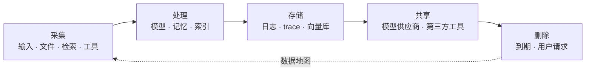

# 隐私与数据治理：数据进得越多，责任越大

Chatbot 只看到用户打出来的字；Agent 会读文件、查数据库、调接口、写记忆。**它的隐私暴露面，等于它能触达的全部系统。**

## 一图看懂



<p class="diagram-caption"><strong>一图看懂</strong> · 隐私治理覆盖整条生命周期；只在入口做脱敏，等于没做</p>

## 一、Agent 特有的四个泄漏面

| 泄漏面 | 为什么危险 | 典型事故 |
| --- | --- | --- |
| 上下文 | 检索、工具返回、历史都被拼进 prompt | 他人文档被拼进回答 |
| 日志与 trace | 默认记录完整请求与响应 | 日志库里躺着明文手机号 |
| 长期记忆 | 跨会话留存，可能跨用户 | A 的记忆出现在 B 的对话里 |
| 工具参数 | 敏感数据被当作参数传给第三方 | 身份证号进了外部 API |

## 二、先分级，再决定怎么处理

| 级别 | 例子 | 允许进入模型上下文 | 允许写入日志 | 允许出境 |
| --- | --- | --- | --- | --- |
| 公开 | 官网内容、公开文档 | 是 | 是 | 是 |
| 内部 | 内部流程、非敏感代码 | 是（按租户隔离） | 脱敏后 | 需评估 |
| 敏感 | 手机号、地址、订单 | 按需最小化 | 否（仅哈希/掩码） | 否 |
| 高风险 | 身份证、病历、凭证、密钥 | 默认否 | 否 | 否 |

分级的价值在于：**它把“要不要脱敏”变成查表，而不是每次靠人判断。**

## 三、最小化：少要一点，问题少一半

三个可落地的动作：

1. **只取需要的字段。** 查订单只需要状态和金额，不需要整行记录。
2. **只取需要的条数。** 检索 top-3 而不是 top-50，泄露面小一个量级。
3. **只留需要的时间。** 会话上下文默认 7 天，记忆默认 90 天，日志按合规要求。

Agent 的诱惑是“多给点上下文效果更好”。但每多一个字段，就多一份泄露责任。

## 四、脱敏的时机与层次

见**图 1**：


<p class="diagram-caption"><strong>图 1</strong> · 四个层次强度不同：假名化仍属个人信息，匿名化才可能脱离适用范围</p>

工程上最容易做错的两件事：

- **只在出口脱敏。** 数据已经进了模型上下文、进了 trace，出口再怎么脱敏都晚了。
- **把假名化当匿名化。** 只要还能通过映射表还原，它就还是个人信息。

## 五、日志与 trace：最大的默认泄漏源

可观测性要求记录完整请求，隐私要求不记录敏感内容，两者必须显式平衡。

| 做法 | 效果 | 代价 |
| --- | --- | --- |
| 默认记录全文 | 调试方便 | 高风险 |
| 默认脱敏 + 采样留存原文 | 平衡 | 需要脱敏管道 |
| 只记录结构（角色、长度、hash） | 最安全 | 调试变难 |
| 分级：敏感字段单独加密存储 | 折中 | 需要密钥管理 |

推荐组合：**结构全留、内容脱敏、原文加密短留、访问留痕**。

## 六、记忆的隐私

长期记忆是最容易被忽视的合规风险，因为它同时具备“持久”“跨会话”“可推断”三个特征。

最低要求：

- **可见**：用户能查看系统记住了什么。
- **可删**：删除请求能定位到所有副本（记忆库、向量索引、缓存、备份）。
- **隔离**：租户与用户标识在检索时强制过滤，不能只靠 prompt 约束。
- **可过期**：每条记忆带 TTL 与来源，过期自动失效。
- **可解释**：能回答“你为什么记得这件事”。

## 七、RAG 的数据边界

检索层最容易出现“权限穿透”：

- 索引时没带 ACL，检索时无法过滤。
- 检索到了，但引用展示把原文贴出来了。
- 摘要环节把无权访问的段落混进了有权访问的回答。

对策见 [RAG 知识层](/evolution/rag) 的“权限感知”一节。这里补一条：**ACL 要在索引阶段写入元数据，而不是查询阶段临时补。**

## 八、第三方与跨境

| 问题 | 要确认的事 |
| --- | --- |
| 模型供应商 | 数据是否用于训练、留存多久、部署在哪个区域 |
| 工具供应商 | 参数里会不会带个人信息、是否二次存储 |
| 向量库/日志平台 | 是否跨区域复制、备份保留多久 |
| 子处理者 | 合同是否覆盖下游、是否有审计权 |

“供应商说合规”不是证据，**合同条款 + 技术配置 + 审计记录**才是。

## 九、删除：真正难的是找全

用户要求删除时，数据可能在这些地方：

```text
1. 业务库（结构化）
2. 会话历史
3. 长期记忆
4. 向量索引（chunk + embedding）
5. trace / 日志平台
6. 缓存（语义缓存、结果缓存）
7. 备份与快照
8. 第三方（模型供应商、工具商）
```

工程做法：维护一张**数据地图**（数据在哪、谁负责、怎么删），每条数据带主体标识，删除任务按地图逐项执行并记录结果。没有数据地图的删除，一定是漏的。

## 十、度量

| 指标 | 说明 |
| --- | --- |
| PII 命中率 | 上下文中出现 PII 的比例，应逐月下降 |
| 日志裸奔率 | 未脱敏即落盘的请求占比，目标为 0 |
| 删除 SLA | 从请求到全部副本删除的时长 |
| 跨租户访问次数 | 应为 0，任何非 0 都是事故 |
| 供应商数据回流 | 是否存在用于训练的路径 |

## 常见问题速查

**Q：脱敏会不会影响效果？**
会。所以按用途脱敏：模型需要“知道有手机号”，不需要“知道号码是多少”。用占位符保留结构，通常不影响推理。

**Q：用户自己输入的隐私，也要脱敏吗？**
进日志和进记忆时要。进当前上下文时可以按需保留，但要限制留存时间。

**Q：向量库里存的 embedding 算个人信息吗？**
通常仍可关联到个人，按个人信息处理。删除时要一起删，否则“删了文档但还能被检索到”。

**Q：跨境部署能不能只做逻辑隔离？**
能不能取决于法规与合同，不取决于你的架构图。技术上要能证明数据实际存放在哪里。

## 落地清单

- [ ] 有数据分级表，且与代码里的字段标注对应？
- [ ] 上下文、日志、记忆、工具参数四个泄漏面都覆盖了吗？
- [ ] 日志默认脱敏，原文加密短留并有访问审计？
- [ ] 记忆支持查看、删除、过期、隔离？
- [ ] 索引阶段写入 ACL，而不是查询时补？
- [ ] 有数据地图，删除任务可执行、可验证？
- [ ] 供应商的数据使用与留存已写进合同？
- [ ] 跨境数据流有明确的技术边界？

## 练习

1. 列出你的 Agent 一次请求会经过的所有存储，标注哪些含个人信息。
2. 设计一个删除流程：从用户点击“删除”到所有副本清理完成，中间有哪些步骤？
3. 检查一次 trace：如果这份 trace 被公开，会泄露什么？

下一步：[合规与法律](/layers/compliance)。
