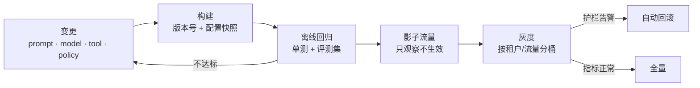
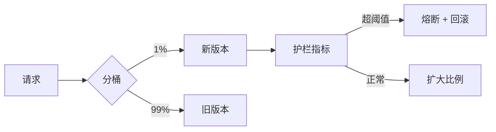

# 版本与发布：一次改提示，等于一次上线

Agent 的“版本”不止一个。改一句提示、换一个模型、加一个工具、调一条策略，都会改变行为，而且**都不需要改代码**。这让发布变得容易，也让事故变得容易。

## 一图看懂



<p class="diagram-caption"><strong>一图看懂</strong> · 发布不是一次动作，而是一条带闸门的通道；每一道闸门都要能独立触发回滚</p>

## 一、七类需要版本化的东西

| 对象 | 例子 | 变更影响 |
| --- | --- | --- |
| 代码 | 循环、校验、路由 | 逻辑与终止条件 |
| 提示模板 | system prompt、few-shot | 语气、格式、工具选择 |
| 模型 | 型号、版本、区域 | 能力、成本、延迟 |
| 工具 schema | 参数、描述、错误码 | 模型能否正确调用 |
| 策略 | 审批规则、内容阈值 | 合规与安全边界 |
| 索引 | 知识库、embedding 模型 | 检索结果与引用 |
| 记忆 schema | 字段、TTL、隔离键 | 老数据能否读取 |

**只要其中一项变了，行为就可能变。** 所以版本号要能描述这个组合，而不是只描述代码：

```text
agent= support-agent
build= 2026.03.14-1
prompt= support@v17
model= gpt-4.1-mini@2026-02
tools= crm@v3, refund@v5
policy= policy@v9
index= kb-support@2026w11
```

出事故时，这张表决定你能不能在五分钟内定位“是哪一项变的”。

## 二、提示词是产物，不是字符串

把 prompt 当代码管理，需要四个能力：

1. **模板化**：变量显式声明，缺失时报错而不是拼出空字符串。
2. **可 diff**：每次改动能看出加了哪句、删了哪句。
3. **可评审**：高风险改动需要第二个人看。
4. **可 pin**：运行时锁定版本，不随线上最新值漂移。

最常见的坑：**提示写在配置中心，改了不留痕**。出事时只能看到“当前值”，看不到“改动前是什么”。

## 三、变更分级

| 级别 | 例子 | 门禁 |
| --- | --- | --- |
| 低 | 文案、日志、非关键提示 | 单测 + 自动发布 |
| 中 | few-shot、工具描述、检索参数 | 单测 + 冒烟评测 + 灰度 5% |
| 高 | 模型切换、策略阈值、工具新增、记忆 schema | 全量评测 + 影子 + 灰度 1% 起 + 人工确认 |

分级的价值是**让高风险变更贵一点，低风险变更快一点**。所有变更都走同一套流程，团队一定会绕过它。

## 四、离线回归：三层评测集

| 层 | 规模 | 跑多久 | 作用 |
| --- | --- | --- | --- |
| 冒烟集 | 20~50 | 分钟 | 挡住明显崩坏 |
| 核心集 | 200~500 | 十几分钟 | 覆盖主流程与常见失败 |
| 长尾集 | 1000+ | 小时级 | 分布覆盖、发布前跑 |

通过标准要写死，不能靠感觉：

- 冒烟集 **必须 100% 通过**。
- 核心集通过率下降超过 **2 个百分点** 即阻断（阈值要按评测集方差定，别拍脑袋）。
- 长尾集只看趋势，不作为单次门禁。

## 五、影子流量

影子流量 = 新版本跟着真实流量跑，但结果不外发。

| 能发现 | 发现不了 |
| --- | --- |
| 崩溃、超时、schema 错 | 用户是否喜欢 |
| 成本与延迟变化 | 需要交互才能暴露的问题 |
| 新旧答案差异 | 有副作用的动作（不能真执行） |

所以影子流量必须**关闭写操作**：读路径可以影子，写路径只能灰度。

## 六、灰度与自动熔断

见**图 1**：



<p class="diagram-caption"><strong>图 1</strong> · 灰度的关键不是分桶，而是护栏指标与自动熔断</p>

护栏指标（任一触发就回滚）：

- 成功率下降 > 3%
- P95 延迟上升 > 30%
- 每任务成本上升 > 20%
- 工具错误率上升
- 内容拦截率/投诉率异常
- 人工接管率上升

分桶要按**租户 + 用户**稳定哈希，否则同一个用户一会新一会旧，问题无法复现。

## 七、回滚：不是把代码退回去

Agent 的回滚有四个层次，难度递增：

| 层次 | 动作 | 时间 |
| --- | --- | --- |
| 开关 | 关掉新工具/新路径 | 秒级 |
| 版本 | 切回上一个 build | 分钟级 |
| 配置 | 回退 prompt/模型/策略 | 分钟级 |
| 数据 | 回退索引、记忆 schema | 小时级，可能不可逆 |

**数据层回滚最难**，所以 schema 变更必须向前兼容：先加字段、双写、观察，再切读，最后删旧字段。想做“一键回滚”，就得先放弃“就地改 schema”。

回滚演练：每季度真跑一次，确认开关有效、旧版本还能启动、记忆还能读。

## 八、变更审计

每次发布记录六件事：

```text
谁（提交人 + 审批人）
改了什么（prompt/tool/model/policy 的具体 diff）
为什么（关联 issue / 事故 / 需求）
影响谁（租户范围、流量比例）
怎么验证（评测结果、影子对比）
怎么回滚（开关名 / 上一版版本号）
```

没有第 5、6 条，这次发布就不算完成。

## 常见问题速查

**Q：小团队也需要这么重吗？**
不需要全流程，但至少要有：版本号、一个冒烟集、一个能秒关的开关。这三样是底线。

**Q：模型供应商悄悄升级模型怎么办？**
pin 具体版本；无法 pin 的，用每日评测集做“漂移检测”，指标掉了再决定是否迁移。

**Q：提示词改动要不要 A/B？**
要，当目标是“体验指标”时；当目标是“修 bug”时，回归测试就够。

**Q：灰度期间用户投诉怎么办？**
先按租户定位是否在新桶里，再决定是回滚还是补偿。没有按租户分桶，就只能全量回滚。

## 发布清单

- [ ] 版本号覆盖代码/提示/模型/工具/策略/索引？
- [ ] 提示模板可 diff、可评审、可 pin？
- [ ] 变更已分级，高风险变更有人确认？
- [ ] 冒烟集 100% 通过，核心集无显著下降？
- [ ] 影子流量已关闭写操作？
- [ ] 灰度按租户稳定分桶，护栏指标已配置？
- [ ] 熔断与回滚能自动触发，且演练过？
- [ ] schema 变更向前兼容，回滚不丢数据？
- [ ] 变更记录包含验证结果与回滚方式？

## 练习

1. 列出你系统的七类版本，看哪几类现在没有版本号。
2. 为一次“更换模型”设计发布路径：影子多久、灰度多大、看哪些指标。
3. 写一条回滚演练脚本：从告警到恢复，每一步谁执行、多久。

下一步：[安全与权限](/layers/security)。
