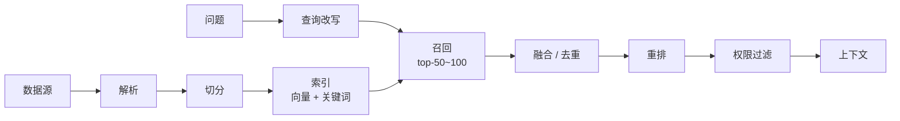
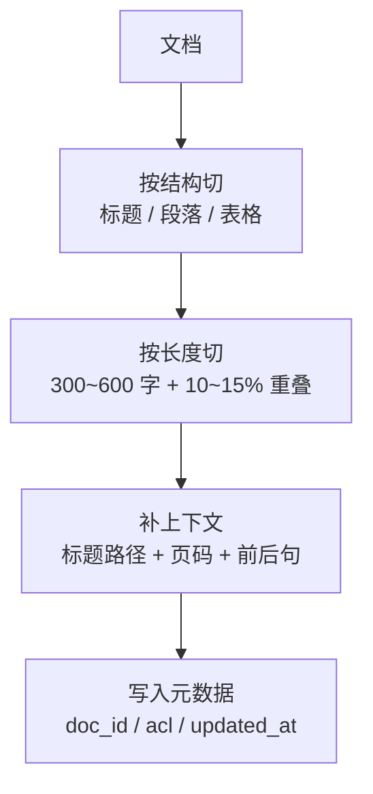
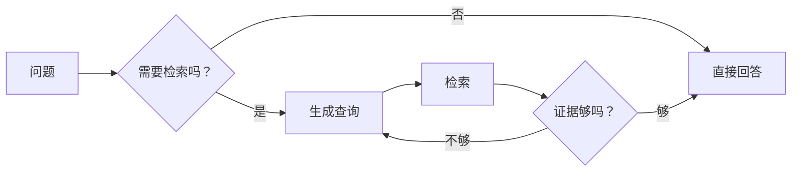

# 检索层：把召回做到可用

RAG 的效果上限由检索决定。模型再强，拿不到证据就只能编；证据拿回来了但排在第 12 位，模型大概率也用不上。

[阶段 5：RAG](/evolution/rag) 讲的是“为什么要检索、两条流水线怎么走”；本章讲**怎么把召回率做上去**，以及怎么证明它真的上去了。

## 一图看懂



<p class="diagram-caption"><strong>一图看懂</strong> · 索引与查询是两条流水线，中间靠“候选集”连接；每一段都能独立评测</p>

本章另有 2 张图：图 1 切分策略，图 2 Agentic 检索。

## 一、先把失败分清楚

检索问题不是一种，而是三种，对应的手段完全不同：

| 失败 | 现象 | 根因 | 该动哪里 |
| --- | --- | --- | --- |
| 没召回到 | 正确证据不在候选里 | 切分、embedding、改写、索引缺失 | 召回侧 |
| 召回到但太靠后 | 在 top-50 里，不在 top-5 | 排序、融合、重排 | 排序侧 |
| 召回到但没用上 | 证据进了上下文，答案仍然错 | 上下文组织、提示、模型 | 生成侧 |

判断方法很简单：**把正确答案的证据直接塞给模型，看它能不能答对。**

- 能答对 → 问题在检索侧。
- 还不能答对 → 问题在生成侧，别再调检索参数了。

这一步能省掉大量“调 k、调阈值”的无效劳动。

## 二、切分：影响最大，最容易被略过的一步

见**图 1**：



<p class="diagram-caption"><strong>图 1</strong> · 好的切分先尊重结构、再控制长度、最后补回被切掉的上下文</p>

| 策略 | 适合 | 问题 |
| --- | --- | --- |
| 固定窗口 | 无结构长文 | 切断句子、丢失标题 |
| 按结构 | 手册、规章、API 文档 | 依赖解析质量 |
| 语义切分 | 长论述、访谈 | 成本高、边界不稳定 |
| 父子块 | 需要精确定位又需要上下文 | 实现复杂、存储翻倍 |
| 句子窗口 | 问答型语料 | 长答案覆盖不全 |

几条实用规则：

- **块要自包含**：单独拿出来也能读懂。代词要还原，标题要带上。
- **表格不要切**：整表作为一个块，或转成结构化记录。切碎的表格是幻觉高发区。
- **重叠不是越多越好**：10~15% 足够，太多会让 top-k 全是重复内容。
- **元数据比正文更重要**：没有 doc_id、章节路径、页码，后面既不能引用也不能过滤。

## 三、Embedding 与索引

Embedding 选型看四件事，不要只看排行榜：

| 维度 | 要问的问题 |
| --- | --- |
| 语言 | 中文/多语言效果是否经过验证？ |
| 领域 | 法律、医疗、代码是否需要领域模型？ |
| 维度与成本 | 存储与检索延迟能否接受？ |
| 可替换性 | 换模型时是否需要全量重建？ |

**换 embedding 模型 = 全量重建索引。** 不同模型的向量空间不可比，混用会让相似度失去意义。切换时要双写、影子对比、再切读。

索引参数同样有权衡：

| 参数 | 调大 | 调小 |
| --- | --- | --- |
| HNSW 的 M / ef | 召回高、内存大 | 省内存、召回降 |
| IVF 的 nlist / nprobe | 精度高、延迟高 | 快、可能漏 |
| 候选数 top-k | 覆盖广、成本高 | 便宜、易漏 |

先用固定评测集量出“召回率 vs 延迟”曲线，再选点。拍脑袋设 k=3 是常见错误。

## 四、混合检索：向量不是万能

纯向量检索在两类查询上明显吃亏：

- **精确标识**：错误码、订单号、函数名、产品型号。
- **专有名词**：向量模型没见过的新词。

BM25 恰好擅长这些。常见做法是两路召回后融合：

```python
def rrf(rank_lists, k=60):
    """Reciprocal Rank Fusion：只用名次，不用分数，避免量纲问题。"""
    scores = {}
    for ranks in rank_lists:
        for position, doc_id in enumerate(ranks, start=1):
            scores[doc_id] = scores.get(doc_id, 0.0) + 1.0 / (k + position)
    return sorted(scores.items(), key=lambda kv: kv[1], reverse=True)
```

RRF 的优点是不需要校准两路分数的量纲，缺点是丢掉了“有多相关”的信息。如果两路分数都可靠，加权融合可能更好；不确定时先用 RRF。

| 方式 | 优点 | 缺点 |
| --- | --- | --- |
| RRF | 稳健、无需调权重 | 精度略低 |
| 加权分数融合 | 精度高 | 需要归一化与调参 |
| 只用一个 | 简单 | 单一失败模式 |

## 五、查询改写：把“用户的话”变成“检索的话”

多轮对话里，用户说“那它支持吗？”——直接拿去检索必然失败。

| 手段 | 解决什么 | 代价 |
| --- | --- | --- |
| 指代消解 | “它/这个/上面说的” | 需要对话历史 |
| 多查询扩展 | 表述差异、同义词 | 召回量翻倍 |
| HyDE | 问题太短、与文档风格差异大 | 多一次生成 |
| 查询分解 | 多跳、复合问题 | 多次检索 |
| 条件抽取 | “去年的”“北京的” → 元数据过滤 | 抽取错误会误过滤 |

改写的风险是**漂移**：改着改着就偏离了原问题。所以改写要有护栏：

- 保留原始查询，作为兜底的一路召回。
- 改写结果记录进 trace，便于事后归因。
- 改动前后在同一评测集上对比 Recall@k。

## 六、重排：用延迟换精度

两阶段是标准做法：

```text
召回（便宜、宽）: top-50 ~ top-100
重排（贵、准）: 打分后取 top-5
```

| 方案 | 延迟 | 适用 |
| --- | --- | --- |
| 不重排 | 最低 | 候选少、质量稳定 |
| Cross-encoder 重排 | 中 | 精度要求高的问答 |
| LLM 重排 | 高 | 高价值、低并发 |
| 规则重排（时效/来源） | 低 | 需要业务偏好 |

注：重排只能改善“排序”，救不了“没召回”。先看 Recall@50，再看重排后的 top-5 命中率。

## 七、权限过滤：越早越好

权限必须在**索引期写入元数据**，在**召回时过滤**，而不是取回结果后再筛。

原因很直接：先取 50 条再筛掉 45 条，你实际上只用了 5 条候选，召回率被静默腰斩。

| 做法 | 结果 |
| --- | --- |
| 索引带 ACL，查询时过滤 | 正确 |
| 检索后过滤 | 候选不足、可能泄露引用 |
| 只靠提示词“不要提别人的文档” | 必然泄露 |

多租户场景还要注意缓存：语义缓存如果不带租户维度，就是跨租户泄露。

## 八、新鲜度与增量索引

| 问题 | 做法 |
| --- | --- |
| 文档更新 | 按 doc_id upsert，先删旧块再写新块 |
| 文档删除 | 墓碑标记 + 定期物理清理，同步删 embedding |
| 版本切换 | 新索引影子对比，指标达标再切 |
| 过期内容 | 元数据带 updated_at，检索时降权或过滤 |
| 索引延迟 | 监控“最新文档到可检索”的时延 |

**删除是最容易漏的。** 文档删了但向量还在，用户能搜到已经不存在的内容——这既是体验问题，也是合规问题。

## 九、Agentic RAG：什么时候让模型决定检索

见**图 2**：



<p class="diagram-caption"><strong>图 2</strong> · 把检索变成工具，模型自己决定查不查、查几次</p>

适合：

- 问题难度差异大（有的完全不需要检索）。
- 需要多跳、逐步收敛。
- 检索成本高，希望按需触发。

不适合：

- 简单 FAQ（多一次模型调用纯属浪费）。
- 延迟敏感（多轮检索会叠加）。
- 需要确定性行为（什么时候查应该可预测）。

必须设预算：**最大检索轮数、最大候选数、总 token 上限**。否则一个“证据不够”的判断会把循环拖死。

## 十、评测：先造数据，再谈优化

没有评测集的检索优化，等于蒙眼调参。

### 1. 造评测集

```json
{
  "query": "退款多久到账",
  "expected_doc_ids": ["kb-refund-03"],
  "expected_spans": ["3-5 个工作日"],
  "type": "faq"
}
```

来源优先级：真实用户问题 > 客服工单 > 人工构造。每条至少标注一个“正确证据”，多跳问题标多个。

### 2. 指标

| 指标 | 回答什么 | 目标 |
| --- | --- | --- |
| Recall@50 | 候选里有没有正确证据 | > 0.95 |
| Recall@5 | 重排后是否命中 | 按业务定 |
| MRR / nDCG | 正确证据排得多靠前 | 越高越好 |
| 引用支持率 | 结论是否被引用支持 | > 0.9 |
| 答案正确率 | 端到端效果 | 按业务定 |
| P95 延迟 / 单次成本 | 能不能上生产 | 按 SLA |

### 3. 一个最小评测脚本

```python
def recall_at_k(retriever, cases, k=5):
    hit, total = 0, 0
    for case in cases:
        docs = {d.doc_id for d in retriever.search(case["query"], k=k)}
        if set(case["expected_doc_ids"]) & docs:
            hit += 1
        total += 1
    return hit / total
```

先在 Recall@50 达标，再调重排。顺序反了，你会在一个本来就召不回的候选集上优化排序。

## 十一、优化顺序：症状 → 手段 → 验证

| 症状 | 先查什么 | 手段 | 怎么验证 |
| --- | --- | --- | --- |
| 完全召不回 | 索引是否包含该文档 | 补数据、修解析 | Recall@50 |
| 中文专有名词召回差 | 是否只有向量 | 加 BM25 混合 | Recall@50 |
| 多轮指代失败 | 查询是否独立 | 指代消解改写 | 该类子集 Recall |
| 结果太杂 | 候选是否过大 | 重排、元数据过滤 | Recall@5 / nDCG |
| 片段不完整 | 块边界 | 父子块、扩大窗口 | 人工抽检 |
| 表格数值错 | 是否切碎表格 | 整表或结构化 | 数值准确率 |
| 引用不支持结论 | 引用是否来自检索 | 逐条校验、限制引用来源 | 支持率 |
| 延迟高 | 哪一段慢 | 分层检索、缓存、降 k | P95 |
| 权限泄露 | 过滤在哪一步 | ACL 下沉到索引 | 泄露用例 = 0 |

## 常见问题速查

**Q：块大小设多少？**
中文 300~600 字是常见起点，但要以评测集为准。答案需要跨段落的，用父子块而不是把块调得更大。

**Q：top-k 设多少？**
召回阶段 50~100，重排后 3~5。只看 top-3 的召回率，你无法判断是排序问题还是召回问题。

**Q：一定要重排吗？**
候选多、精度要求高时值得。候选本来就只有 10 条、来源可靠时，重排收益有限。

**Q：多查询扩展会不会引入噪声？**
会，但融合后通常净收益为正。前提是有评测集能证明它没把 Recall@5 拉低。

**Q：什么时候该上 Agentic RAG？**
当“是否需要检索”本身不确定、且简单查询占比高时。全部请求都走多轮检索，成本和延迟都会失控。

## 落地清单

::: tip 可复制模板
本章的清单有对应的结构化版本：[`eval_case.json`](../../examples/templates/eval_case.json)。全部模板见 [examples/templates/README.md](../../examples/templates/README.md)。
:::

- [ ] 有 query → evidence 的评测集，且覆盖多跳与指代？
- [ ] 切分尊重结构，表格未被切碎？
- [ ] 每个块带 doc_id、章节、页码、ACL、updated_at？
- [ ] 混合检索（向量 + 关键词）已启用，融合方式有依据？
- [ ] 查询改写有原始查询兜底？
- [ ] 召回与重排分两阶段，k 值由评测决定？
- [ ] ACL 在索引期写入，召回时过滤？
- [ ] 删除能同步清理向量？
- [ ] 索引切换有影子对比与回滚？
- [ ] Recall@50 / Recall@5 / 引用支持率在看板上？

## 来源

- Cormack et al., **Reciprocal Rank Fusion**（2009）——书中 RRF 与 `k=60` 的原始出处。[链接](https://dl.acm.org/doi/10.1145/1571941.1572114)
- Robertson & Zaragoza, **The Probabilistic Relevance Framework: BM25 and Beyond**（2009）——稀疏检索基线。[链接](https://dl.acm.org/doi/10.1561/1500000019)
- Malkov & Yashunin, **Efficient and Robust ANN Search Using HNSW Graphs**（2016）——索引参数 M / ef 的语义。[链接](https://arxiv.org/abs/1603.09320)
- Nogueira & Cho, **Passage Re-ranking with BERT**（2019）——重排的经典做法。[链接](https://arxiv.org/abs/1901.04085)
- Lewis et al., **RAG**（2020）——为什么“召回决定上限”。[链接](https://arxiv.org/abs/2005.11401)

完整清单见[推荐来源](/appendix/sources#检索层)。

## 练习

1. 给你的知识库造 50 条评测样本，量一次 Recall@5 和 Recall@50，看差距在哪。
2. 取一个“召回到了但答错”的 case，把正确证据直接塞给模型，判断是检索问题还是生成问题。
3. 加一路 BM25 召回，用 RRF 融合，对比融合前后的 Recall@5。
4. 找出一个被切碎的表格，改成整表索引，看数值类问题的准确率变化。

::: details 参考答案与自检
**1. 50 条样本量 Recall@5 与 Recall@50**
要点：两个数的差距说明“排序问题”还是“召回问题”。Recall@50 依然低 → 切分/embedding/改写有问题；Recall@50 高而 @5 低 → 重排或融合有问题（本章第一节的三分类）。
参考：本章第十节给了 `recall_at_k()` 的最小实现。
自检：如果样本全是“能从标题直接命中”的简单问题，两个指标都会很高，测不出问题——样本要包含精确标识（订单号、错误码）和多跳问题。

**2. 把正确证据直接塞给模型**
要点：塞进去能答对 → 检索/排序问题；塞进去仍答错 → 生成侧问题（上下文组织、提示、模型）。这是本章第一节给的**唯一判据**。
自检：不做这个对照就直接调 `k` 和阈值，是本末倒置。

**3. 加一路 BM25 + RRF**
要点：融合前后的 Recall@5 要有对比数字；同时要观察延迟变化（多一路召回 = 多一次查询 + 融合开销）。
参考实现：本章第四节的 `rrf()`；自检：如果两路结果的分数直接相加，不通过——向量分数与 BM25 分数不可比，必须用排名融合。

**4. 被切碎的表格改成整表索引**
要点：先造一组“数值类问题”（求和、比较、条件筛选），再改索引方式，比较准确率与 token 成本（整表索引会变大）。
自检：只看了“是否能查到”，没看“答案里的数字对不对”，不通过——表格问题的高发错误是数值幻觉。
:::

下一步：[工具层](/layers/tools)。
