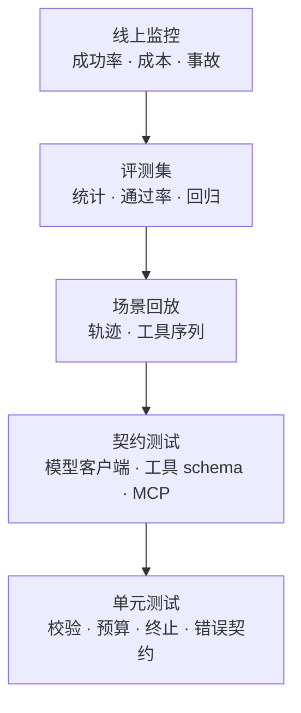

# 测试与验证：让 Agent 可以被断言

评测回答“它有多好”，测试回答“它有没有坏”。两者常被混为一谈：评测是统计的、跑在评测集上；测试是确定的、跑在 CI 里。**没有测试的 Agent，每次改提示都像掷骰子。**

## 一图看懂



<p class="diagram-caption"><strong>一图看懂</strong> · 越往下越确定、越快、越便宜；越往上越接近真实，也越难复现</p>

## 一、四类不确定性

| 来源 | 表现 | 控制手段 |
| --- | --- | --- |
| 模型采样 | 同输入不同输出 | 假模型、温度 0、固定种子 |
| 外部依赖 | API 超时、限流、数据变化 | 打桩、录制回放、fixture |
| 时间与环境 | 超时判定、时区、并发 | 注入时钟、固定工作区 |
| 长链路 | 第 3 步错了，第 7 步才崩 | 轨迹断言、逐步快照 |

测试的第一原则：**先让不确定的东西变成确定的**，再谈断言。

## 二、把模型换成假的

Agent 测试里最重要的一个动作：把 LLM 当成可注入的依赖。

```python
# 假模型按脚本返回，测试的是循环而不是模型
agent = MiniAgent(
    llm=MockLLM([
        tool("calculator", expression="23 * 7 + 1"),
        final("162"),
    ]),
    tools=build_default_tools(workspace),
    budget=Budget(max_steps=4),
)
result = agent.run("23 * 7 + 1 等于多少？")
assert result.status == "success"
assert result.trace.steps[0].tool_calls[0].name == "calculator"
```

这样能测的东西很多：工具选择顺序、预算耗尽、停滞检测、验证器拒绝、错误重试。这些都是**确定性逻辑**，不该交给真实模型去碰运气。

假模型不该只测“成功路径”。更有价值的是：

- 返回不存在的工具名 → 是否有可读的错误？
- 返回非法参数 → 是否回传 hint 让模型自我修正？
- 返回空内容 → 循环是否卡死？
- 永远调用同一个工具 → 停滞检测是否触发？

## 三、单测该覆盖什么

| 对象 | 必测项 |
| --- | --- |
| 参数校验 | 缺字段、类型错、多余字段、注入字符 |
| 路径与权限 | 目录穿越、绝对路径、只读模式、越界写入 |
| 错误契约 | 错误类型、可重试标记、hint 是否存在 |
| 预算 | 步数、工具次数、token、时间四类上限 |
| 终止 | 正常结束、空回复、重复调用、验证器连续拒绝 |
| 上下文 | 消息顺序、角色合法性、超长截断 |
| 输出契约 | JSON 合法性、必填字段、截断标记 |

判断标准：**这个失败能不能用一段断言描述？** 能，就该有单测。

## 四、契约测试：跨边界的假设

Agent 的 Bug 大量来自“我以为对方是这样”。契约测试就是把假设写成断言：

- **模型客户端**：流式与非流式返回结构是否一致；usage 缺失时是否兜底；429/5xx 是否按策略重试。
- **工具网关**：schema 变更是否向后兼容；新增必填字段会不会打挂老 Agent。
- **MCP Server**：工具列表变化、超时、错误码是否符合约定。
- **存储**：记忆 schema 迁移后旧数据能否读取。

契约测试应该跑在**集成环境**，用真实协议、假数据。

## 五、场景回放

录制一次真实轨迹，回放时断言“该调什么、不该调什么”。

```json
{
  "goal": "把 notes.md 里的构建命令总结给用户",
  "expect": {
    "tools": ["read_file"],
    "forbid_tools": ["write_file", "shell"],
    "final_contains": ["make test"],
    "max_steps": 4
  }
}
```

回放的价值不在“答案一样”，而在**行为边界一样**：不许写文件、不许越权、步数不失控。这类断言比文本相似度稳定得多。

## 六、评测集与测试的分工

| | 单元 / 契约 / 回放 | 评测集 |
| --- | --- | --- |
| 性质 | 确定性断言 | 统计分布 |
| 频率 | 每次提交 | 每次发布 / 每日 |
| 失败含义 | 回归，必须修 | 指标变化，需判断 |
| 数量 | 几十到几百 | 几百到几千 |
| 谁维护 | 研发 | 产品 + 研发 |

**不要用评测集代替单测**：跑得慢、结果波动、失败原因难定位。也不要用单测代替评测：单测覆盖不到“真实任务的完成率”。

## 七、CI 门禁设计

```text
提交 → 单测（< 1 分钟，必过）
     → 契约测试（< 5 分钟，必过）
     → 场景回放（< 10 分钟，必过）
     → 评测集（每日 / 发布前，指标不下降）
     → 灰度（线上指标护栏）
```

三个实践细节：

1. **分层超时**：不能让单测跑十分钟，否则大家会跳过它。
2. **Flaky 要修不要重跑**：Agent 测试的 flaky 通常意味着真实的不稳定（超时、并发、状态泄漏）。
3. **失败要可归因**：断言信息里带轨迹 ID 与关键步骤，而不是只有 AssertionError。

## 八、一个真实的最小测试

```python
def test_budget_returns_partial(self):
    agent = self.agent([tool("calculator", expression="1 + 1")] * 5)
    result = agent.run("反复计算")
    self.assertEqual(result.status, "partial")
    self.assertIn("预算", result.output)
```

它断言的不是“模型聪明”，而是“系统在资源耗尽时优雅退出”。这正是单测该管的事。

## 常见问题速查

**Q：假模型会不会测不出真实问题？**
会。所以假模型测“机制”，评测集测“效果”，线上监控测“真实分布”。三者不能互相替代。

**Q：多 Agent 怎么测？**
先测单个 Agent 的契约，再测消息传递与终止条件。多 Agent 的测试重点在“错误是否被吞掉”“责任是否清楚”，而不是“讨论是否精彩”。

**Q：要不要给提示词写测试？**
要，但测的是**结构**：是否包含必填约束、是否注入了不可信标记、版本变更是否影响输出 schema。

**Q：测试覆盖率有意义吗？**
对工具与编排有意义，对模型调用意义有限。别用覆盖率安慰自己。

## 落地清单

::: tip 可复制模板
本章的清单有对应的结构化版本：[`eval_case.json`](../../examples/templates/eval_case.json)。全部模板见 [examples/templates/README.md](../../examples/templates/README.md)。
:::

- [ ] LLM 是可注入依赖，测试里可以替换成假模型？
- [ ] 工具的参数校验、路径越界、错误契约都有测试？
- [ ] 预算与终止的每条路径都有测试？
- [ ] 关键流程有场景回放与行为断言？
- [ ] 契约测试覆盖模型客户端与外部工具？
- [ ] CI 分层，单测足够快？
- [ ] 评测集与单测职责分清？

## 来源

- Google, **Flaky Tests at Google and How We Mitigate Them**——flaky 要修不要重跑。[链接](https://testing.googleblog.com/2016/05/flaky-tests-at-google-and-how-we.html)
- Hypothesis, **Property-Based Testing 文档**——用性质替代枚举样例。[链接](https://hypothesis.readthedocs.io/en/latest/)
- Pact, **Consumer-Driven Contract Testing**——契约测试的工程实践。[链接](https://docs.pact.io/)
- pytest, **Parametrize 与 Fixture**——本书 Mini Agent 测试所用机制。[链接](https://docs.pytest.org/en/stable/)

完整清单见[推荐来源](/appendix/sources#测试与验证)。

## 练习

1. 给你的 Agent 写一个“模型返回不存在工具”的测试，断言错误信息里包含可用工具列表。
2. 设计一个回放用例，断言“只读任务绝不调用写工具”。
3. 统计最近 20 个线上问题，看有多少本可以被单测拦住。

::: details 参考答案与自检
**1. “模型返回不存在工具”的测试**
要点：断言错误里包含**可用工具列表**，且错误类型是 `unknown_tool`（而不是 `invalid_argument`），并带有可重试标记。
参考实现见 `examples/mini_agent/tools.py` 的 `ToolRegistry.execute()`：未知工具会返回结构化的 `ToolResult`。
自检：如果测试只断言“抛异常了”，模型就无法自我修正——见[工具层](/layers/tools)的“错误也是接口”。

**2. 回放用例：只读任务绝不调用写工具**
要点：断言形式是 `forbid_tools: ["write_file", "shell"]` + `max_steps`，而不是比对最终文本（本章第五节的 JSON 就是模板）。
自检：断言里只写“期望调用 read_file”，没写禁止项，测试仍然能通过一个偷偷写文件的版本。

**3. 最近 20 个线上问题能否被单测拦住**
要点：分类统计成三类——可被单测拦住（确定性逻辑）、只能被回放/契约拦住（跨边界假设）、只能靠评测发现（质量分布）。比例本身就是团队测试成熟度的指标。
自检：如果 20 个里有 15 个是“可被单测拦住但没写”，那缺的不是框架，是门禁——见本章第七节“CI 门禁设计”。
:::

下一步：[评测与可观测性](/layers/evaluation)。
