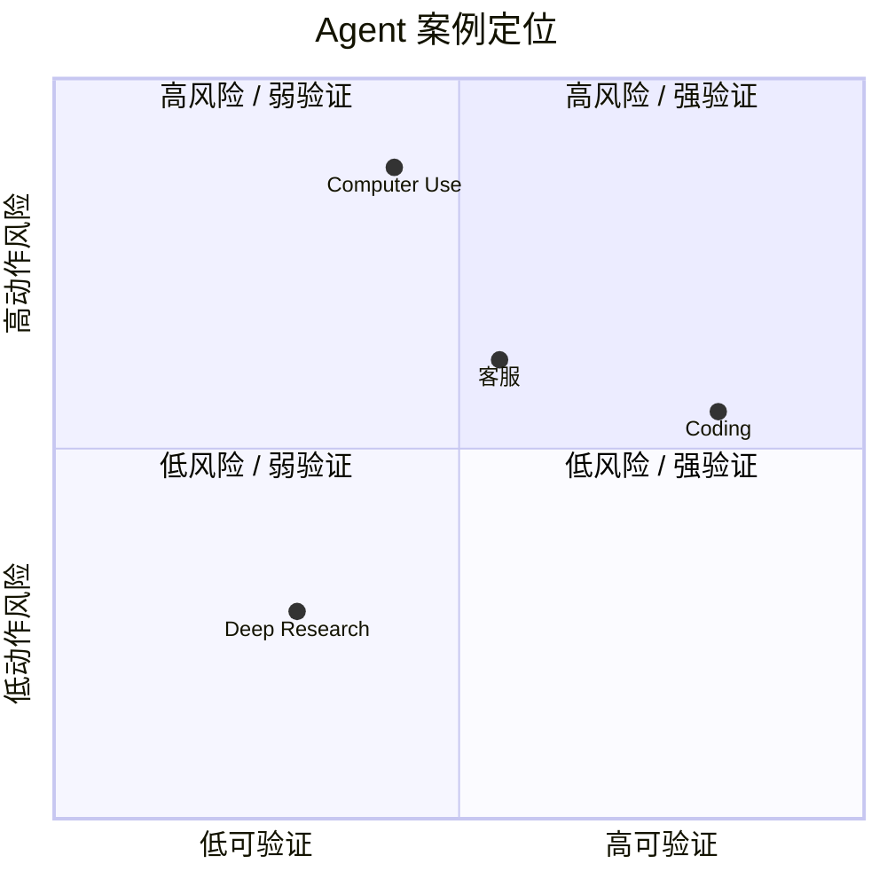

# 真实案例拆解

## 一图看懂



<p class="diagram-caption"><strong>一图看懂</strong> · 四个案例在“可验证性 × 动作风险”上的位置，决定了它们该有多自主</p>


这一章用同一套七层模型拆四个典型系统。目的不是复刻产品，而是训练一种能力：**看到一个 Agent，能快速说出它的控制流、工具边界、上下文策略和失败模式。**

## 案例一：Coding Agent（修 issue / 改多文件）

### 目标与成功标准

> 给定一个仓库和一条 issue，产出可合并的代码修改，测试通过且不回归。

成功标准非常可验证：测试、构建、lint、代码审查。这让 Coding Agent 成为 Agent 技术最成熟的落地场景之一。

### 七层映射

| 层 | 实现 |
| --- | --- |
| L7 应用 | CLI/IDE/PR 机器人；权限与人工 review |
| L6 编排 | 探索 → 定位 → 修改 → 测试 → 修复 循环；子 Agent 做搜索/审查 |
| L5 上下文 | 仓库地图、相关文件、失败测试、git diff、历史尝试 |
| L4 工具 | 读/写/搜索文件、跑测试、git、包管理、浏览器查文档 |
| L3 运行时 | 容器/微虚拟机；代码执行；网络白名单；资源限制 |
| L2 模型 | 强代码模型 + 推理模型用于定位/修复 |
| L1 基础设施 | 任务队列、沙箱池、trace、评测（SWE-bench 类） |

### 典型循环

```text
1. 读 issue，提取复现步骤与验收标准
2. 探索仓库：目录、依赖、相关模块
3. 跑测试，拿到失败栈
4. 定位根因（读实现 + 测试 + 历史）
5. 生成最小补丁
6. 跑目标测试 + 回归测试
7. 失败则分析差异，回到 4/5
8. 通过后整理 diff、写说明、请求 review
```

### 关键设计

- **先复现，再修改**：没有失败测试，就没有可靠的成功标准。
- **最小 diff**：大改会引入不可控回归；要求“只改必要文件”。
- **读回验证**：写完文件要读回/跑测试，不能相信“我已修改”。
- **沙箱**：代码执行必须隔离，禁止访问生产凭证。
- **检查点**：长任务要能中断恢复，保留已完成的修改。

### 常见失败

| 失败 | 根因 | 修复 |
| --- | --- | --- |
| 改了不相关的文件 | 上下文没有边界 | 明确“只改 X 模块”，diff 审查 |
| 测试没跑就说完成 | 缺少验证 | 完成条件绑定测试输出 |
| 反复改同一处 | 没有失败分析 | 要求先解释失败原因再改 |
| 引入新依赖 | 工具权限过大 | 依赖变更需审批 |
| 破坏公共 API | 约束未重申 | 约束置顶 + 自动 API diff 检查 |

### 可迁移的经验

**把“完成”定义成可执行检查，而不是模型的一句话。** 这是所有 Agent 都适用的原则。

## 案例二：Deep Research（多源研究）

### 目标与成功标准

> 给定一个研究问题，产出有引用、覆盖多来源、区分事实与观点的报告。

成功标准比 Coding 模糊，通常用 rubric：关键问题覆盖、引用可访问、事实准确、结构清晰、区分不确定性。

### 七层映射

| 层 | 实现 |
| --- | --- |
| L7 应用 | 报告界面、引用点击、导出 |
| L6 编排 | 澄清 → 拆子问题 → 并行检索 → 阅读 → 综合 → 缺口检查 → 写报告 |
| L5 上下文 | 研究计划、来源卡片、证据表、冲突记录、草稿 |
| L4 工具 | 搜索、抓网页、PDF 解析、代码执行（数据分析） |
| L3 运行时 | 浏览器/抓取沙箱；出口控制；缓存 |
| L2 模型 | 强推理 + 长上下文；子 Agent 用便宜模型 |
| L1 基础设施 | 抓取缓存、去重、引用库、评测集 |

### 典型循环

```text
1. 澄清问题与范围（时间、地域、受众）
2. 拆成 3–6 个子问题
3. 每个子问题并行检索，收集来源卡片
4. 阅读并抽取“主张 + 证据 + 来源”
5. 标记冲突、缺口、低置信结论
6. 针对缺口补检索
7. 综合成报告，逐条挂引用
8. 事实核查：引用是否真的支持结论
```

### 关键设计

- **来源卡片**：每条证据结构化保存 `claim / quote / url / date / confidence`，不要只存网页全文。
- **并行 + 隔离**：每个子问题一个子 Agent，上下文互不污染。
- **缺口驱动**：不是“检索 N 次就停”，而是“关键问题是否都有证据”。
- **引用校验**：最终报告里的每个关键结论都要能追溯到来源。
- **冲突显式化**：来源矛盾时呈现分歧，而不是取平均。

### 常见失败

| 失败 | 根因 | 修复 |
| --- | --- | --- |
| 引用是编的 | 模型生成 URL | 引用只能来自工具返回的来源库 |
| 只查了一个角度 | 没有缺口检查 | 子问题覆盖表 + 反方检索 |
| 报告很长但没信息 | 摘要堆砌 | 以“主张—证据”组织，而非按来源 |
| 抓取内容注入 | 网页含恶意指令 | 数据标记、出口控制、不执行网页指令 |
| 成本爆炸 | 无限制并行 | 子任务预算 + 去重 + 缓存 |

### 可迁移的经验

**研究型 Agent 的核心不是“搜得多”，而是“知道还缺什么”。** 缺口检测与证据管理，比搜索工具本身更重要。

## 案例三：客服/工单 Agent

### 目标与成功标准

> 解决用户问题，遵守政策，必要时升级人工；不能越权承诺或泄露他人信息。

成功标准：问题解决率、政策合规、用户满意度、人工接管率、平均处理时长。

### 七层映射

| 层 | 实现 |
| --- | --- |
| L7 应用 | 聊天/工单界面；身份认证；审批 |
| L6 编排 | 意图路由 → 查政策/订单 → 处理 → 确认 → 升级 |
| L5 上下文 | 用户历史、订单、政策片段、会话状态 |
| L4 工具 | 订单查询、退款、改地址、创建工单、知识库 |
| L3 运行时 | 受控 API 网关；最小权限；审计 |
| L2 模型 | 低成本模型做分类/抽取，强模型处理复杂对话 |
| L1 基础设施 | 会话存储、CRM 集成、合规日志、质检 |

### 关键设计

- **政策是代码，不是提示词**：退款期限、权限、可承诺范围由策略引擎判定。
- **身份绑定**：只能查当前用户的数据；工具调用带用户上下文。
- **写操作幂等 + 审批**：退款、改地址等需要幂等键；高风险动作人工确认。
- **升级路径**：不确定、超权限、用户不满时，带着摘要转人工。
- **可解释**：告诉用户“依据哪条政策”，而不是“系统说的”。

### 常见失败

| 失败 | 根因 | 修复 |
| --- | --- | --- |
| 承诺了不能退的款 | 政策靠模型记忆 | 政策检索 + 策略引擎硬约束 |
| 查了别人的订单 | 工具没绑用户 | 每次调用强制 tenant/user 过滤 |
| 重复退款 | 重试不幂等 | 幂等键 + 去重 |
| 该升级却硬答 | 没有不确定性出口 | 低置信/超权限自动升级 |
| 对话越权 | 注入/诱导 | 指令层级 + 工具白名单 |

### 可迁移的经验

**高合规场景的核心是“限制”，不是“能力”。** Agent 的价值在于处理长尾，而不是绕过规则。

## 案例四：Computer Use（操作桌面软件）

### 目标与成功标准

> 通过截图和鼠标键盘完成一个界面任务，例如在旧系统里录一张发票。

成功标准：目标状态达成（数据正确录入）、无副作用、可回滚。

### 七层映射

| 层 | 实现 |
| --- | --- |
| L7 应用 | 任务描述、录屏、人工接管 |
| L6 编排 | 观察屏幕 → 定位元素 → 操作 → 验证 → 循环 |
| L5 上下文 | 当前截图、历史动作、任务状态、界面约束 |
| L4 工具 | 截图、点击、输入、滚动、快捷键、读屏 |
| L3 运行时 | 独立桌面 VM；固定分辨率；无宿主访问 |
| L2 模型 | 多模态/视觉模型；坐标定位 |
| L1 基础设施 | 录屏、动作日志、回放、异常告警 |

### 关键设计

- **优先可访问性树/选择器**：坐标点击是最后手段。
- **固定环境**：分辨率、缩放、语言、窗口布局固定，减少漂移。
- **动作后验证**：点击后截图/读状态，确认真的生效。
- **高风险确认**：提交、支付、删除前人工确认。
- **超时与恢复**：弹窗、加载、网络错误要有兜底。

### 常见失败

| 失败 | 根因 | 修复 |
| --- | --- | --- |
| 点错位置 | 分辨率/弹窗/延迟 | 固定环境、选择器、等待条件 |
| 不知道是否成功 | 没有验证 | 动作后读状态/截图差分 |
| 陷入弹窗循环 | 未处理异常界面 | 检测 + 关闭/升级 |
| 注入诱导点击 | 页面内容不可信 | 高风险确认、域名白名单 |
| 太慢太贵 | 每步传截图 | 降低频率、区域裁剪、缓存 |

### 可迁移的经验

**动作空间越接近真实世界，验证和回滚就越重要。** 能 API 就不要 UI；能读状态就不要靠截图猜。

## 四个案例的对比

| 维度 | Coding | Deep Research | 客服 | Computer Use |
| --- | --- | --- | --- | --- |
| 成功标准 | 强可验证 | 弱（rubric） | 中（政策+结果） | 中（状态） |
| 主要风险 | 回归/破坏 | 引用失真 | 越权/错承诺 | 误操作 |
| 上下文重点 | 代码相关片段 | 证据与来源 | 用户/订单/政策 | 屏幕与动作历史 |
| 工具特点 | 文件/命令 | 搜索/抓取 | 业务 API | 鼠标键盘 |
| 关键护栏 | 测试/沙箱 | 引用校验 | 策略引擎 | 桌面隔离/确认 |
| 适合自主性 | 高 | 高 | 中 | 低–中 |

## 来源

- Jimenez et al., **SWE-bench**（2023）——Coding Agent 的任务分布与评测协议。[链接](https://arxiv.org/abs/2310.06770)
- Yang et al., **SWE-agent**（2024）——Agent-Computer Interface 设计如何影响成功率。[链接](https://arxiv.org/abs/2405.15793)
- OpenAI, **Deep Research**——研究型 Agent 的流程与已知失败。[链接](https://openai.com/index/deep-research/)
- Xie et al., **OSWorld**（2024）——Computer Use 的可复现评测。[链接](https://arxiv.org/abs/2404.07972)
- Yao et al., **τ-bench**（2024）——工具 + 政策遵循的评测，对应本章客服案例。[链接](https://arxiv.org/abs/2406.12045)

完整清单见[推荐来源](/appendix/sources#真实案例拆解)。

## 练习

::: tip 可复制模板
本章的清单有对应的结构化版本：[`agent_task_packet.json`](../../examples/templates/agent_task_packet.json)、[`eval_case.json`](../../examples/templates/eval_case.json)。全部模板见 [examples/templates/README.md](../../examples/templates/README.md)。
:::

1. 选一个你熟悉的产品，填出它的七层表，并标出最薄弱的层。
2. 为“客服 Agent”写三条必须由代码而不是提示词保证的规则。
3. 设计一个“Deep Research”的缺口检查表：满足什么条件才允许写最终报告？

::: details 参考答案与自检
**1. 填一个产品的七层表，标出最薄弱的一层**
要点：最薄弱层通常不是“模型”，而是 **L7 成功标准**（没人定义什么叫完成）或 **L1 可观测**（出问题查不到）。能给出证据（如“他们的失败提示只有‘出错了’”）。
自检：如果结论是“最弱是 L2 模型不够强”，说明还在用模型能力解释系统问题——回到本章的四个案例对比表。

**2. 客服 Agent 必须由代码保证的三条规则**
要点：从本章“关键设计”里挑，且必须是**防模型绕过**的类型，例如：只能查当前用户的数据（强制 tenant/user 过滤）、退款期限由策略引擎判定、低置信自动升级人工。
自检：如果三条里有“要礼貌”“不要承诺未授权内容”这种提示词级别的规则，不通过——它们不可判定。

**3. Deep Research 的缺口检查表**
要点：写成可判定的条件，例如：每个结论至少一条可访问引用、未决问题清单为空或已被明确标注、覆盖率（问题域的子问题是否都查过）、时间窗口内无矛盾来源。
自检：如果检查表最终归结为“让模型自己说有没有缺口”，那是自我确认——本章第二节“缺口检测与证据管理”明确要求外部判据。
:::

下一步：[交互与信任设计](/practice/ux)。
