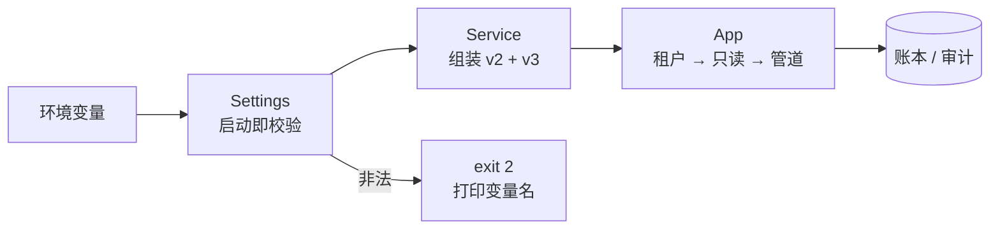
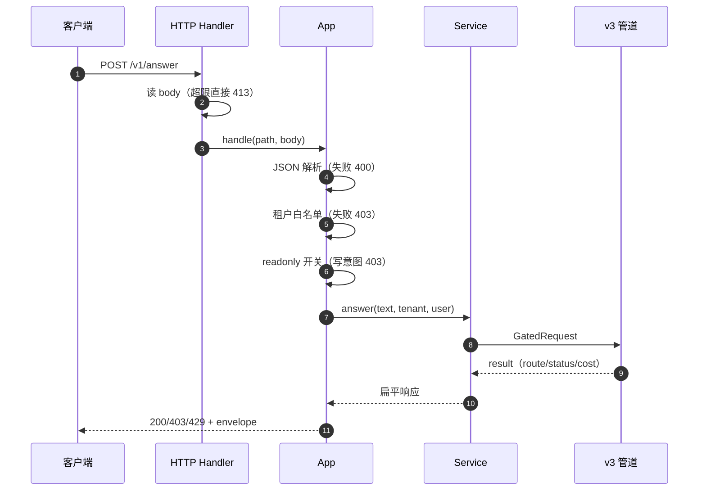

# 部署形态：从「能跑」到「能上线」

## 为什么这一步单独成一章

v1–v3 都是**在你自己机器上跑起来**。真正部署时会多出一整类问题，而且它们不在代码逻辑里：

- 配置从哪来？写错一个端口号会发生什么？
- 健康检查该查什么——进程活着，还是真的能服务？
- 生产环境里怎么保证“这个实例不许写”？
- 密钥放哪，怎么确认它没被日志和 `/health` 漏出去？
- 镜像里该放什么、不该放什么？

这一章用**零第三方依赖**的方式回答它们：不引 FastAPI，不引 gunicorn，只用标准库。代价是 HTTP 层只是教学级（单进程、无 TLS、无连接池），收益是**每一个决策都在一个文件里看得见**。



<p class="diagram-caption"><strong>一图看懂</strong> · 配置决定组装方式；配错就在启动时退出，而不是在第一个请求时出问题是</p>

## 先跑起来

```bash
# 1. 本地直接起（不需要任何依赖）
MINI_AGENT_PORT=8000 TENANT_LIMITS="acme:5,globex:2" \
  python3 -m examples.mini_agent_v3.app

# 2. 探活
curl -s http://127.0.0.1:8000/health

# 3. 发一个请求
curl -s -X POST http://127.0.0.1:8000/v1/answer \
  -H 'Content-Type: application/json' \
  -d '{"text":"订单 A1024 到哪了","tenant":"acme","user_id":"user:88"}'

# 4. 两个实例：一个读写、一个只读
docker compose up --build
```

## Lab 1：配置必须“启动即失败”

`config.py` 只做一件事：**把字符串变成可信的配置，配错就退出**。

```python
MINI_AGENT_PORT=abc python3 -m examples.mini_agent_v3.app
# 配置错误：MINI_AGENT_PORT 必须是整数，当前为 'abc'
# exit=2
```

三个设计决定：

1. **错误信息必须带变量名。** 容器编排会把 stderr 原样给你，`config error` 这种话毫无帮助，`MINI_AGENT_PORT 必须是整数` 才能让人改对。
2. **退出码是接口。** 配置错误用 2，和“正常运行中失败”用 1 区分开，编排系统据此判断要不要重启。
3. **布尔值不接受模糊输入。** `maybe`、`yes please` 直接报错，不做“猜你想说什么”。

还有一个来自真实事故的规则：

```python
if self.env == "prod" and self.api_key == "":
    raise ConfigError("prod 环境必须配置 OPENAI_API_KEY（否则会退化为确定性替身并给出假答案）")
```

“没有 key 就用替身”在开发和测试里是优点，在 `prod` 里是**事故**：系统会稳定地给出看似合理但没有任何依据的答案。这种配置不应该是“警告”，应该是**拒绝启动**。

## Lab 2：租户是配置出来的，不是判断出来的

`TENANT_LIMITS=acme:5,globex:2` 会让校验器检查一件容易被忽略的事：

```python
unknown = [t for t in self.tenant_allowlist if t not in self.tenant_limits]
if unknown:
    raise ConfigError("TENANT_ALLOWLIST 中的租户缺少额度配置：%s" % ", ".join(unknown))
```

为什么这条必须是错误而不是默认值？因为**允许一个没有额度的租户等于开了一个不计费的洞**。默认额度会让它在账本里以“未知租户”的身份花钱，事后对账时你根本不知道这是谁。

对应到请求路径上，租户检查发生在任何工作之前：

```python
if not self.settings.tenant_allowed(tenant):
    return 403, {"status": "tenant_not_allowed", "error": "该租户未开通"}
```

未开通的租户**连“这个租户存不存在”都不该被告知**，所以错误信息是统一的“未开通”，不区分“不存在”和“无权限”。

## 请求在服务层的完整路径

见**图 1**：



<p class="diagram-caption"><strong>图 1</strong> · 五道拒绝都在进入业务逻辑之前完成：体积、格式、租户、只读、权限</p>

## Lab 3：只读开关是一个部署属性，不是提示词

生产上常见需求是“这个实例跑在灾区，只允许读”。实现方式有两种：

| 做法 | 问题 |
| --- | --- |
| 在提示词里写“不要执行写操作” | 是概率，不是边界 |
| 在工具执行前判断 `readonly` 标记 | 可以，但判断散落在各处 |
| **在配置层拒绝，并在网关层不注册写工具** | 边界明确，且可测试 |

这个项目用的是第三种思路在 HTTP 入口的轻量版：只读实例对写意图的请求直接 403。

```bash
MINI_AGENT_READONLY=true
curl -X POST ... -d '{"text":"帮我退款 A1024",...}'
# → 403 {"status":"readonly","error":"当前实例为只读模式，拒绝写操作"}
```

注意这个开关是**粗粒度**的（按关键词识别写意图），文档里如实说明了这一点。更正确的做法是上一章的能力令牌：只读部署**不给** `order.refund` 这个 action 签发令牌，于是写操作在授权层就不可达。粗粒度开关只是最后一道兜底。

## Lab 4：健康检查要查“能服务”，不是“进程活着”

```dockerfile
HEALTHCHECK CMD python3 -c "import urllib.request,sys; sys.exit(0 if urllib.request.urlopen('http://127.0.0.1:8000/health', timeout=2).status==200 else 1)"
```

`/health` 返回的是**安全配置摘要**，不是完整配置：

```json
{"ok": true, "service": "mini-agent-v3",
 "config": {"env": "dev", "model": "gpt-4.1-mini", "live_model": false,
            "readonly": false, "guard": true, "tenants": ["acme","globex"]}}
```

关键点是 `live_model: false` —— 你能一眼看出这个实例**没有接真实模型**。把“进程活着”和“能正确服务”分开，是上线判断的基础：

- **liveness**：进程还在，别重启我（本项目的 `/health` 偏 liveness）；
- **readiness**：依赖都就绪，可以把流量打给我（生产应单独一个 `/ready`，检查模型可达性、存储可写）。

本项目只有一个 `/health`，这是**已知的生产化差距**，在文档里标出来比假装完整更有用。

## Lab 5：镜像里该有什么

`Dockerfile` 的关键选择：

```dockerfile
FROM python:3.11-slim
# 只复制运行需要的代码：docs/、offline/、node_modules/ 都不进镜像
COPY examples/mini_agent ./examples/mini_agent
RUN useradd --create-home --uid 10001 appuser && chown -R appuser /app /data
USER appuser
```

- **非 root**：容器内逃逸的第一步通常是拿到 root；`USER appuser` 让这一步失效。
- **`/data` 是唯一可写目录**：账本与审计落在卷里，重启不丢。
- **`.dockerignore` 排除 `docs/` 与 `.data/`**：前者让镜像从几百 MB 变成几十 MB，后者避免把本地测试数据打进镜像（那是**数据泄露**）。
- **健康检查走真实端点**，不是 `ps aux | grep python`。

::: tip 本地怎么验证
镜像构建需要 Docker daemon 能写自己的缓存目录。如果你的环境受限（比如沙箱里只允许写工作区），可以直接跑：

```bash
python3 -m examples.mini_agent_v3.app   # 与容器内是同一条命令
```

CI 里有独立的 `image` 作业负责 `docker build` + 启动容器 + 探测端点——也就是说，**镜像能否构建由 CI 证明，而不是由本地口头保证**。
:::

## Lab 6：CI 分成三件不同的事

一个常见错误是把所有检查塞进一个工作流。这个项目分成三条：

| 工作流 | 触发 | 回答的问题 |
| --- | --- | --- |
| `deploy-docs.yml` | push main | 文档站能不能构建、能不能部署 |
| `ci.yml` / `test` | PR + push | 代码在不同 Python 版本上是否还正确 |
| `ci.yml` / `smoke` | PR + push | 真实起服务后端点行为对不对 |
| `ci.yml` / `image` | PR + push | 镜像能不能构建、容器能不能健康 |

`smoke` 作业直接测行为，而不是只看进程：

```bash
# agent 主体必须被拒绝
code=$(curl -s -o /dev/null -w '%{http_code}' -X POST .../v1/answer \
  -d '{"text":"...","user_id":"agent:support"}')
test "$code" = "403"
```

这正是单元测试测不到的那一类问题：配置、app、server 之间的**接线错误**。

`test` 作业的矩阵从 **Python 3.8** 开始，因为 README 声称 3.8+——声明必须由 CI 证明，否则就是一句愿望。

## 来源

- Docker, **Dockerfile reference：HEALTHCHECK / USER**——健康检查与非 root 运行的正确写法。[链接](https://docs.docker.com/reference/dockerfile/)
- The Twelve-Factor App, **III. Config**——配置属于环境，不属于代码；本项目 `Settings` 的实现依据。[链接](https://12factor.net/config)
- Kubernetes, **Configure Liveness, Readiness and Startup Probes**——三种探针的区别。[链接](https://kubernetes.io/docs/tasks/configure-pod-container/configure-liveness-readiness-startup-probes/)
- OWASP, **Docker Security Cheat Sheet**——容器安全的最小要求。[链接](https://cheatsheetseries.owasp.org/cheatsheets/Docker_Security_Cheat_Sheet.html)

完整清单见[推荐来源](/appendix/sources#部署形态)。

## 已知的生产化差距

诚实列出，而不是假装完整：

| 差距 | 现状 | 生产做法 |
| --- | --- | --- |
| HTTP 服务器 | `http.server`，单进程、无 TLS | gunicorn/uvicorn + Ingress TLS 终止 |
| 并发 | 线程池，无背压 | 连接池、限流、队列 |
| 存储 | JSON 文件 + 追加日志 | 数据库 + 对象存储 |
| 就绪探针 | 只有 `/health` | 分离 `/ready`，检查模型与存储 |
| 密钥管理 | 环境变量 | 密钥管理服务 + 轮换 |
| 多副本 | 单实例 | 共享状态、幂等键跨实例 |
| 可观测 | 进程内计数器 | OpenTelemetry 导出 |

## 自检清单

- [ ] 能解释为什么配置错误要用非零退出码，而不是打日志后继续跑。
- [ ] 能说出「允许但没有额度的租户」会导致什么账务问题。
- [ ] 能说出只读开关的两种实现，以及为什么“在提示词里写”不算实现。
- [ ] 能区分 liveness 与 readiness，并指出本项目缺哪一个。
- [ ] 能说出镜像里不放 `docs/` 的两个理由。
- [ ] 能解释为什么 `smoke` 作业比单元测试更容易发现接线错误。

下一步：[框架对照](/advanced/frameworks)——知道这些组件在主流框架里分别对应什么，以及什么时候该用它们。
