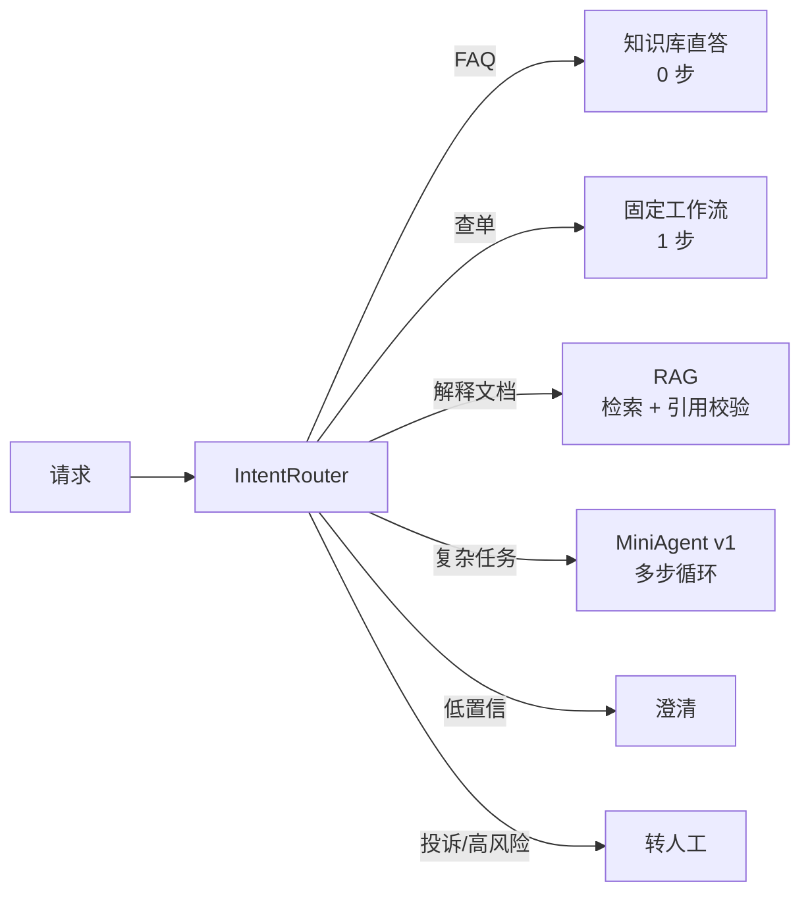

# Mini Agent v2：从「一个循环」到「一条管线」

## 本章在整套内容里的位置

v1 只回答了“一个 Agent 怎么跑”。但真实产品里，**大部分请求根本不该进入 Agent 循环**：

- “退款多久到账” 应该查知识库，不该让模型自由发挥；
- “订单 A1024 到哪了” 应该走固定流程，不该多轮推理；
- “我要投诉” 应该立刻转人工，不该继续自动回答。

v2 做的就是把这三种判断变成代码，并把 v1 的 Agent 循环降级为**其中一条路径**。



<p class="diagram-caption"><strong>一图看懂</strong> · v2 把 v1 的循环变成六条路径之一，每条路径有自己的成本与失败模式</p>

## 先跑起来

```bash
python3 -m examples.mini_agent_v2.cli --demo     # 六个典型请求的路由与处理
python3 -m examples.mini_agent_v2.cli --eval     # 检索评测：Recall + ACL 泄漏
python3 -m examples.mini_agent_v2.eval           # 端到端评测：路由 + 检索 + 转人工率
python3 -m unittest discover -s tests            # 58 个测试（v1 的 26 个 + v2 的 32 个）
```

不需要 API Key：RAG 路径使用一个**只引用证据**的确定性替身，用来验证“引用校验”这条契约。

## 代码结构

```text
examples/mini_agent_v2/
├── corpus.py           文档 / 片段 / 确定性 embedding（哈希词袋）
├── retrieval.py        结构化切分、混合检索、加权 RRF、ACL 前置过滤、评测
├── router.py           规则 + 例子的意图路由，置信度分叉
├── memory_hygiene.py   来源、冲突取代、写入前脱敏、按主体删除
├── pipeline.py         六条路径的调度、引用校验、trace、转人工包
├── fixtures.py         种子知识库（含 ACL 陷阱）与评测集
├── eval.py             端到端评测
└── cli.py              演示 / 单问 / 评测
```

::: tip 和 v1 的关系
v2 **不 fork** v1：`pipeline.py` 直接 `from ..mini_agent.agent import MiniAgent`，`Tool`、`ToolRegistry`、`Budget`、`Guard` 全部复用。
这本身是一个结论——**“加 RAG、加路由”不该以重写 Agent 循环为代价**。
:::

## Lab 1：切分——顺序错了，后面全白做

`chunk_document()` 的顺序是刻意的：

1. **先按结构切**（`## 标题`），因为“退款条件”和“退款金额”不能拼进同一个片段；
2. **再按长度切**，带 10% 左右重叠，但**不跨章节**；
3. **最后补上下文**，把章节标题放回片段首行。

开发过程中这里出过一个真实的 bug：最初把**文档标题**也拼进了每个片段，结果同一文档的所有片段共享一个前缀，向量分数被压平到 0.031~0.032 的噪声区间，排序基本随机。

```python
# 错误：标题进了正文 → 所有片段共享前缀 → 相似度塌缩
body = f"{document.title} / {section}\n{text}"
# 正确：标题走元数据（doc_id / section），正文只留本章节内容
body = f"{section}\n{text}" if section else text
```

**教训**：给片段补上下文是对的，但补什么必须想清楚——补“区分性”的信息（章节），而不是补“共有”的信息（文档名）。

## Lab 2：混合检索与加权 RRF

纯向量在精确标识（`GW-4021`、订单号、函数名）上表现很差——这正是本书[检索层](/layers/retrieval)强调的一点。v2 用两路召回 + RRF 融合，并在实测中发现了**纯 RRF 的一个坑**：

| 查询 | BM25 分数 | 纯 RRF 排序 | 加权 RRF 排序 |
| --- | --- | --- | --- |
| `GW-4021 是什么错误` | 6.99 vs 1.78 | 错（超时） | 对（错误码） |
| `解释一下退款时效条款` | 明显领先 | 错（退款金额） | 对（退款时效） |

原因：纯 RRF 只吃排名 `1/(k+rank)`，第 1 名和第 2 名的差距只有约 0.0005——**BM25 里 6.99 和 1.78 的差距被抹平了**。所以 v2 默认给词法路线加权：

```python
self.weights = {"vector": 1.0, "bm25": 2.5}   # 不把两种分数相加，只调信任度
```

这不是“调参玄学”，而是把**“精确匹配更可信”这个先验**写进融合公式。测试 `test_rrf_is_rank_based_not_score_based` 会断言 RRF 分数仍然等于 `Σ weight/(k+rank)`，防止有人改回“分数相加”。

## Lab 3：权限过滤必须发生在召回之前

这是全书反复强调、也最容易写错的一条。v2 的实现只做一件事：

```python
# 1. 先过滤：候选集里根本不存在无权访问的片段
visible = [chunk for chunk in self.chunks if chunk.acl & principals]
# 2. 再排序、融合、截断
```

种子知识库里埋了两个 ACL 陷阱（`policy-vip`、`internal-ops`），评测集用 `forbid_docs` 断言 **public 身份下这些文档一个片段都不能出现在结果里**，并统计 `forbidden_hits`——这个数必须是 0，没有任何“优化空间”。

`python3 -m examples.mini_agent_v2.cli --eval` 会输出：

```text
retrieval eval: samples=15 recall@5=1.000 recall@20=1.000 forbidden_hits=0
```

## Lab 4：引用不是请求出来的，是校验出来的

RAG 路径里，模型被要求用 `[c1]` 标注来源。但管线**不相信模型**：

```python
used = self._verify_citations(answer, allowed_refs)
if not used:
    return "ungrounded"  # 降级转人工，而不是把无依据答案发给用户
```

测试 `test_ungrounded_answer_is_downgraded_not_returned` 用 `_BadLLM` 模拟“编造一个 `[c99]`”的模型，断言结果是 `ungrounded` 而不是 `success`。

**练习**：把校验规则改成“至少 50% 的句子带引用”，思考为什么这条规则会比“有任意一个引用”更难被绕开。

## Lab 5：置信度必须能用于决策

路由的置信度有三个用途：选路径、设告警、做评估。所以它**不能是一个不能动的常数**。

开发中一度出现过 `0.7 + similarity / 3` 的写法，结果多个请求都稳定显示 `1.000`。这看起来“很自信”，实际上意味着：

- 阈值形同虚设（永远在阈值之上）；
- 监控看不出置信度分布；
- 评测无法用置信度区分“拿不准”和“很确定”。

v2 的修法是：规则命中与语义分歧时**降**置信度（`min(0.9, ...)`），两者一致时按 `0.55×0.9 + 0.45×similarity` 融合，语义单路命中时上限 `0.95`。

## Lab 6：记忆的三条硬规则

`memory_hygiene.py` 只用三条规则就挡住了记忆系统最常见的事故：

| 规则 | 代码 | 挡住的失败 |
| --- | --- | --- |
| 推断不能写成事实 | `source == "model_inferred"` → 拒绝 | 记忆污染 |
| 新值取代旧值但保留旧记录 | `supersedes` / `superseded_by` | 无法解释“为什么现在是 B” |
| 写入前脱敏、密钥直接拒绝 | `scan_text` / `redact` | 记忆成为第二份泄露源 |

加上租户隔离（跨租户写入直接 `raise`）和 `purge_subject()`（按主体删除，对应《隐私与数据治理》的删除义务），这就是一个能讲清来源、能追溯变更、能配合删除的最小记忆。

**练习**：现在的冲突检测用“`key：value` 的 key 或前两个 token”作为主题，非常粗糙。请把它换成显式的 `(subject, predicate)` 槽位，并说明为什么生产系统通常不会自动抽取槽位。

## 自检清单

- [ ] 能说出六条路径各自**为什么不该合并**。
- [ ] 能解释：为什么权限过滤放在召回之后（例如重排后再删）是错的。
- [ ] 能说出纯 RRF 在什么情况下会丢信息，以及加权 RRF 为什么仍然安全。
- [ ] 能解释“引用校验”为什么必须由宿主完成，而不是提示词要求。
- [ ] 能说出置信度不可用于决策时，会造成哪三类后果。
- [ ] 能说出记忆冲突“直接覆盖”和“取代 + 保留”的差别。

## 和 v1 的对照

| 维度 | v1 | v2 |
| --- | --- | --- |
| 入口 | 只有 Agent 循环 | 六条路径，循环是其中一条 |
| 知识 | 无 | 结构化切分 + 混合检索 + ACL 前置过滤 |
| 权限 | 工作区路径约束 | 文档级 ACL + 逐条凭证（v3 补齐） |
| 引用 | 无 | 强制校验，不能对应则降级 |
| 记忆 | 关键词检索 | 来源 / 冲突取代 / 写入脱敏 / 按主体删除 |
| 评测 | 4 条 case，全绿 | 15 条检索 case（含 ACL 陷阱）+ 8 条路由 case |
| 测试 | 26 | 58 |

下一步：[Mini Agent v3](/practice/mini-agent-v3)——把能力令牌、计量账本、审计与断点续跑接进来；理论部分见[工具网关](/evolution/tool-gateway)与[长任务与可靠执行](/advanced/durability)。
