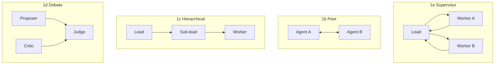

# Mini Agent v4：四种多 Agent 拓扑，四种控制流

## 为什么要把四种都写一遍

[多 Agent](/evolution/multi-agent) 那一章给了四种拓扑，但只有图。**看懂图不等于会实现**——四种拓扑在脑子里很像，落到代码上差在三个地方：

1. **谁决定下一步**（一个 leader / 对话本身 / 上一级 / 固定三轮）；
2. **谁负责合并**（leader / 最后发言者 / 逐级 / 裁判）；
3. **失败怎么传**（部分失败可合并 / 全部失败才报错 / 每层拦一次 / 裁判说了算）。

v4 把这三种差异写成四份代码。它们的**子 Agent 契约完全相同**，所以你能直接对比控制流，而不被不同的数据结构干扰。



<p class="diagram-caption"><strong>一图看懂</strong> · 四种拓扑，同一套子 Agent 契约，差别全在“谁决定下一步、谁合并、失败怎么传”</p>

## 先跑起来

```bash
python3 -m examples.mini_agent_v4.cli --compare    # 同一任务跑四种拓扑并对比
python3 -m examples.mini_agent_v4.cli --failures   # 错误传播：一个 worker 坏掉
python3 -m examples.mini_agent_v4.cli --budget     # 预算封顶：fan-out 不能超支
python3 -m unittest tests.test_mini_agent_v4 -v    # 26 个测试
```

对比输出是这样的（同一个任务，同一种结果结构）：

```text
拓扑           ok    置信度    子任务    tokens
supervisor    True  0.70     3        2400
peer          True  0.60     4        3200
hierarchical  True  0.70     3        2400
debate        True  0.70     3        2400
```

## 代码结构

```text
examples/mini_agent_v4/
├── contract.py      子任务包 / 结果信封 / 预算树 / 角色 / 合并规则
├── supervisor.py    1a：一个主管拆分 + 汇总
├── peer.py          1b：两个对等 Agent 轮流发言
├── hierarchical.py  1c：lead → sub-lead → worker
├── debate.py        1d：proposer + critic → judge
└── cli.py           对比 / 错误传播 / 预算演示
```

`contract.py` 是重点。四种拓扑共享它，所以你只要读一遍契约，再读四个 100 行左右的控制流就够了。

## Lab 1：契约——子 Agent 只返回“结论 + 证据 + 置信度”

`SubResult` 是四种拓扑唯一的返回值类型。关键设计：

```python
@property
def usable(self) -> bool:
    return self.ok and bool(self.summary.strip()) and self.confidence > 0
```

**“可用”不等于“成功”**。一个 worker 可能 `ok=True` 但返回空字符串还说自己很有信心——这种结果父 Agent 不能拿来合并。把这个判断做成属性，而不是散落在各处的 `if`，是让多 Agent 系统可调试的第一步。

另一个刻意的选择：**合并后的置信度取最小值，不取平均**。

```python
def merge_confidence(results):
    usable = [r for r in results if r.usable]
    return min(r.confidence for r in usable) if usable else 0.0
```

平均会让三个自信的 worker 掩盖一个“其实不知道”的 worker。合并的可信度只取决于**最弱的那一环**。

## Lab 2：Supervisor——默认选择，但要防两个坑

```bash
python3 -m examples.mini_agent_v4.cli --topology supervisor
```

控制流最直白：主管拆 → 并行跑 → 合并。两个容易写错的地方这里都处理了。

### 坑一：失败的 worker 必须是数据，不是异常

```bash
python3 -m examples.mini_agent_v4.cli --failures
```

输出：

```text
supervisor ok=True 置信度=0.70
失败被记录而非抛出: ['analyzer/sub_97bd94a6: tool_timeout']
仍然产出了答案: ...
```

如果某个 worker 抛异常把整个 supervisor 干掉，那"3 个里坏 1 个"就变成了"全军覆没"。正确做法是 worker **总是返回 `SubResult`**，失败也是（`ok=False` + `reason`），由主管决定怎么处理。

反例也演示了：**全部失败时必须明确说“无法完成”**，不能编一个答案。

### 坑二：fan-out 不能花超过预算

这是本项目开发中真实踩到的坑，也是 v4 最有价值的一段。最初的实现是：

```python
share = remaining // n          # 把池子切成 n 份
```

父预算 3000、10 个 worker，每份只有 300 tokens——而一次最小调用要 800。结果 10 个 worker **全部因“token 超限”失败**，而父级却报告消耗 0。

修复用了三步（见 `BudgetTree`）：

1. **`reserve(n)` 先算“养得起几个”**：`可养数 = 剩余 // 最小调用成本`，不够就不 spawn，而不是 spawn 一堆注定失败的；
2. **真正从父池扣掉预留额度**，避免父级“看起来没花钱”；
3. **`settle(child)` 退还未用完的部分**，避免浪费。

```bash
python3 -m examples.mini_agent_v4.cli --budget
# 计划 spawn: 10，实际 spawn: 3（预算只够这么多）
# 实际消耗: 2400 tokens（上限 3000，未越界: True）
```

测试 `test_fanout_respects_budget_cap` 锁住这条不变量：**子级总消耗 ≤ 父级上限**。

## Lab 3：Peer——最容易被误用的拓扑

```bash
python3 -m examples.mini_agent_v4.cli --topology peer
```

对等协商没有 leader，**“对话本身就是控制流”**。这正是它危险的地方：

- 没人对目标负责 → 话题漂移；
- 出错不知道是谁的锅；
- 两个 Agent 可以把同一个问题推来推去（livelock）。

所以这里加了两道**必须加、但常被忘记**的机制：

### 1. 轮数上限

`max_rounds=3`。"跑到收敛"不是终止条件——收敛本身要先被定义。

### 2. 基于实质的终止，而不是礼貌

```python
new_evidence = {e for r in round_results for e in r.evidence} - seen_evidence
if not new_evidence:
    break   # 这一轮没有产生新证据，再聊就是空转
```

测试 `test_peer_has_explicit_termination_reason` 断言：**每次停止都必须有明确理由**（`no_new_evidence` / `restating_agreement` / `budget`）。

开发中还修了一个 bug：最初把“上一轮发言”直接拼进下一轮的 goal 字符串，结果每轮都嵌套上一轮的话，token 爆炸。正确做法是把上下文放进 `task.constraints`（任务包的独立字段），而不是污染 goal。测试 `test_context_is_not_nested_into_goal` 守住它。

**练习**：如果两个 peer 一直同意但都是错的，上面哪个机制能发现？如果都不能，需要加什么？

## Lab 4：Hierarchical——只为“装不下”而用

```bash
python3 -m examples.mini_agent_v4.cli --topology hierarchical
```

分层拓扑适合单上下文放不下整个计划的超大任务。两个关键防护：

### 1. 深度守卫

```python
if subtask.depth >= subtask.max_depth:
    # 到顶了，自己干，不要再委派
```

没有 `max_depth`，每一层都能再拆，任务量指数膨胀。

### 2. 证据不能被“二次加工”掉

sub-lead 汇总子结果时，**合并的是证据列表，不是重写一段话**：

```python
summary = "%s：%s" % (branch.lead.name, "；".join(r.summary for r in usable))
evidence = evidence  # 原样向上传递
```

这样顶层仍然能把一句结论追溯到具体干活的那个 worker。测试 `test_evidence_is_preserved_up_the_tree` 就是查这个。

## Lab 5：Debate——昂贵，且容易虚假共识

```bash
python3 -m examples.mini_agent_v4.cli --topology debate
```

正反方 + 裁判，用于判断类任务（政策边界、风险分级）。两个机制针对“虚假共识”：

### 1. 裁决必须有理由

没有理由的裁决不可复核，直接算失败。

### 2. 分歧是合法输出

```python
if debate_confidence < confidence_floor:
    return "裁决：存在未解决的异议，不给出结论。异议：..."
```

如果反方的异议压过了正方，**报异议比给一个自信的错答案好**。测试 `test_strong_objection_blocks_consensus` 覆盖这一点。

成本提醒：至少 3 次调用（正 / 反 / 判），不要对每个请求都辩论——只辩那些“错一次代价高”的。

## 四种拓扑怎么选

| 拓扑 | 何时用 | 主要代价 | 本项目里最容易踩的坑 |
| --- | --- | --- | --- |
| Supervisor | 子任务独立，默认选择 | 主管是瓶颈 | fan-out 超预算 |
| Peer | 需要来回质询、没有天然主管 | 漂移 / livelock | 没有实质终止条件 |
| Hierarchical | 单个上下文装不下计划 | 层级延迟叠加 | 忘了深度上限 |
| Debate | 判断类、错一次代价高 | 3× 调用成本 | 把虚假共识当结论 |

## 自检清单

- [ ] 能说出四种拓扑在“谁决定下一步”上的区别。
- [ ] 能解释为什么合并置信度取最小值而不是平均。
- [ ] 能说出 fan-out 超预算的两种表现（全失败 / 父级报 0）。
- [ ] 能说出 peer 为什么必须有“基于实质”的终止条件。
- [ ] 能解释深度守卫防的是什么。
- [ ] 能说出 debate 里“报异议”为什么比“给结论”更正确。

下一步：[多 Agent](/evolution/multi-agent) 讲理论、[编排层](/layers/orchestration) 讲选型，本章是它们的可运行版本。

## 来源

- Cemri et al., **Why Do Multi-Agent LLM Systems Fail?**（2025）——多 Agent 失败的实证分类（MAST），本章错误传播与失败模式的主要依据。[链接](https://arxiv.org/abs/2503.13657)
- Wu et al., **AutoGen**（2023）——对话式多 Agent 编排，Peer 拓扑的工业来源。[链接](https://arxiv.org/abs/2308.08155)
- Hong et al., **MetaGPT**（2023）——SOP 式分工，Hierarchical 拓扑的对照。[链接](https://arxiv.org/abs/2308.00352)
- Du et al., **Improving Factuality and Reasoning via Multiagent Debate**（2023）——Debate 拓扑的原始论文。[链接](https://arxiv.org/abs/2305.14325)
- Anthropic, **Building Effective Agents**——Orchestrator-Workers 模式的原始描述。[链接](https://www.anthropic.com/research/building-effective-agents)

完整清单见[推荐来源](/appendix/sources#mini-agent-v4多-agent-拓扑实现)。
