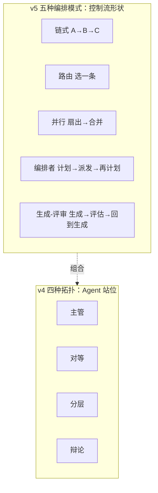

# Mini Agent v5：五种编排模式，五种控制流

## 先分清两组分类

这本书里其实有**两组不同的东西**，很容易混：

| 你在问什么 | 看哪一章 | 实现 | 数量 |
| --- | --- | --- | --- |
| 控制流长什么样？ | [编排层](/layers/orchestration) §二 | **本章 v5** | 5 种模式 |
| 多个 Agent 怎么站位？ | [多 Agent](/evolution/multi-agent) | [v4](/practice/mini-agent-v4) | 4 种拓扑 |

它们不是一回事：一个「主管 + 工人」的多 Agent 系统，其内部每个节点仍可能用链式或生成—评审。所以本章的 5 种模式是**更底层**的积木。



<p class="diagram-caption"><strong>一图看懂</strong> · 模式是控制流积木，拓扑是 Agent 站位；真实系统是两者组合</p>

## 先跑起来

```bash
python3 -m examples.mini_agent_v5.cli --compare    # 五种模式跑同一任务并对比
python3 -m examples.mini_agent_v5.cli --terminals  # 五种终止状态各演示一次
python3 -m unittest tests.test_mini_agent_v5 -v    # 28 个测试
```

对比输出（注意：和 v4 不同，这里比的是**控制流形状**）：

```text
模式            ok    终止       阶段   tokens
chaining      True  success    4      2400
routing       True  success    1      600
parallel      True  success    3      1800
orchestrator  True  success    3      1800
evaluator     True  success    6      3600
```

## Lab 0：五种终止状态，一个都不能少

[编排层](/layers/orchestration)第六章说：编排层必须回答“什么时候停”，并列了五种终止状态。本章把它们做成 `StopReason` 枚举，**每种模式都必须返回一个**：

| 状态 | 含义 | 典型触发 |
| --- | --- | --- |
| `SUCCESS` | 验证通过 | 检查阶段通过 |
| `PARTIAL` | 有产出但不完整 | 检查未过 / 预算耗尽 / 跑了最大轮次 |
| `BLOCKED` | 缺信息/缺权限 | 路由识别了业务但缺订单号 |
| `FAILED` | 不可恢复错误 | 所有分片都抛异常 |
| `NEEDS_HUMAN` | 高风险/低置信 | 低置信且没有兜底分支 |

```bash
python3 -m examples.mini_agent_v5.cli --terminals
```

这里有个容易搞错的区分（本项目开发中踩过）：

- **PARTIAL 不是 FAILED**。检查没通过、但已经有了初稿，应该返回 `PARTIAL` + 初稿，**不是**报错，也不是假装成功。
- **BLOCKED 不是 NEEDS_HUMAN**。BLOCKED 是“知道该干什么、缺个输入”（缺订单号）；NEEDS_HUMAN 是“根本不知道该干什么”（低置信且无兜底）。两者都要有人介入，但前者系统自己还能继续，后者必须交人。

## Lab 1：链式——把“检查”变成流程

```bash
python3 -m examples.mini_agent_v5.cli --pattern chaining
```

链式最朴素，但有两个关键设计：

### 检查阶段只裁决，不改变内容

开发中踩的坑：

```text
错误：格式化输出：检查：初稿：写退款说明     ← 检查的输出被当成内容流下去了
正确：格式化输出：修订后的终稿：写退款说明
```

```python
# 只有 transform 阶段更新 current；check 阶段只给 verdict
if stage.role != "check":
    current = result.output
```

### 检查失败 → PARTIAL，返回已有内容

```python
if result.passed is False:
    return build_summary(..., stop_reason=StopReason.PARTIAL, answer=current)
```

这是全章最有价值的一条：**不要让模型自己检查自己**，而是把检查做成流程里的一个阶段，且检查失败有明确的退出语义。

## Lab 2：路由——一定要有中性兜底

```bash
python3 -m examples.mini_agent_v5.cli --pattern routing --goal "我要退款"
```

路由的全部价值在「选错怎么办」。本项目踩的坑：最初把兜底设成了「投诉」分支，结果**「今天天气怎么样」被送进了投诉流程**——既不对也很贵。

修正两条：

1. **兜底必须是中性的低风险分支**（这里是“转人工”），不能复用某个具体业务分支；
2. **低置信且没有兜底 → `NEEDS_HUMAN`**，不是 `BLOCKED`，因为系统确实不知道该怎么办。

还有一个细节：**识别出业务但缺输入，是 `BLOCKED` 而非失败**。

```python
missing = [k for k in branch.requires if k not in goal]
if missing:
    return build_summary(..., stop_reason=StopReason.BLOCKED,
                         questions=["请提供：订单号"])
```

「我要查订单」没有订单号，正确的响应是问一句，而不是选错流程或报错。

## Lab 3：并行——分片和投票是两件事

```bash
python3 -m examples.mini_agent_v5.cli --pattern parallel
```

正文把并行分成两种用法，合并逻辑完全不同，所以代码里用 `mode` 区分：

| 模式 | 合并方式 | 失败处理 |
| --- | --- | --- |
| `sharding`（分片） | 拼接 | 缺哪个分片要**说出来** → PARTIAL |
| `perspectives`（多视角） | 投票/综合 | 无多数时**承认无多数**，不硬凑 |

两条防护：

- **失败分片不能静默消失**：`（注意：1 个分片失败：bad）`；
- **无多数不假装共识**：`多种方案，无多数：...`。

还复用 v4 的预算不变量：`reserve` 决定能并行几个，`settle` 退还剩余，**分片总消耗不超过父预算**。

::: tip 和 v4 Supervisor 的区别
Supervisor 由**主管动态决定**拆几个；本章的并行是**固定扇出**（"把这 N 份文档都处理了"），没有规划者。这也是为什么两者都存在：一个需要决策，一个不需要。
:::

## Lab 4：编排者—工人——会重新规划

```bash
python3 -m examples.mini_agent_v5.cli --pattern orchestrator
```

和固定扇出的区别：**编排者先规划，合并后可能发现计划不全，再规划一轮**。研究型 Agent、Coding Agent 都是这个形状。

两个必须有的上限：

- **`max_rounds`**：重新规划本身可能再触发规划；
- **「无新产出就停」**：一轮下来没有任何可用结果，再规划也不会变好，直接 `PARTIAL`。

```bash
# 规划器的两轮：第 0 轮 retrieve+read_code，第 1 轮 run_tests
plan steps: [{'round': 0, 'planned': ['retrieve', 'read_code']},
             {'round': 1, 'planned': ['run_tests']}]
```

::: tip 和 v4 Supervisor 的区别
Supervisor **拆一次**；编排者**边拆边看、可能再拆**。契约相同，循环不同。
:::

## Lab 5：生成—评审——带回环，且必须喂回“理由”

```bash
python3 -m examples.mini_agent_v5.cli --pattern evaluator
```

这是唯一在**质量层面**有真实回环的模式：生成 → 评估 → 不通过就**带着理由**重来。

三个关键点：

### 1. 评审必须独立

生成器和评估器是**两个阶段**，不能是“模型自己说好不好”。这是本章反复强调的那句：评估必须独立，否则只会自我表扬。

### 2. 必须把“理由”喂回去

```python
feedback = eval_result.reason or "未满足要求"
gen_input = goal if not feedback else "%s（上次未通过：%s）" % (goal, feedback)
```

不带理由的重试只是**再掷一次骰子**；带上理由才是**优化**。

### 3. 跑满轮次 → PARTIAL

已经有草稿了，即使没通过评估，也是 `PARTIAL`（带着“仍未通过”的说明），不是 `FAILED`。

::: tip 和 v4 Debate 的区别
两者都有“评估者”，但控制流相反：

- **Debate**：正反方立场对立，裁判**一次性裁决**；
- **Evaluator-Optimizer**：一个生成一个把关，**循环到通过为止**。
:::

## 模式 vs 拓扑：一张对照表

| 你可能想问 | v5 模式 | v4 拓扑 |
| --- | --- | --- |
| 步骤固定 | 链式 | — |
| 按请求分派 | 路由 | — |
| 独立子任务并行 | 并行 | 主管 |
| 动态拆解 | 编排者 | 主管（拆一次） |
| 迭代提质 | 生成—评审 | 辩论（裁决一次） |
| 多个 Agent 各管一块 | — | 主管/分层 |
| 多个 Agent 互相质询 | — | 对等/辩论 |

**真实系统通常是组合**：外层路由 → 某个分支里用编排者 → 编排者内部每个 worker 用链式 → 关键节点用生成—评审。模式是可嵌套的积木。

## 自检清单

- [ ] 能说出五种终止状态，并各举一个触发场景。
- [ ] 能解释 PARTIAL 和 FAILED 的区别，以及为什么检查失败是 PARTIAL。
- [ ] 能说出路由为什么必须有**中性**兜底分支。
- [ ] 能区分 BLOCKED 与 NEEDS_HUMAN。
- [ ] 能说出并行两种模式在合并逻辑上的不同。
- [ ] 能解释“喂回理由”为什么让生成—评审变成优化而不是重试。
- [ ] 能说出 v5 的 `evaluator-optimizer` 和 v4 的 `debate` 在控制流上的区别。

下一步：[编排层](/layers/orchestration)讲选型与状态机，[Mini Agent v4](/practice/mini-agent-v4) 是多 Agent 拓扑的可运行版本。
