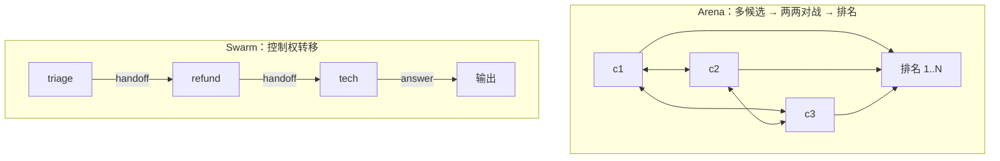

# Mini Agent v6：Arena 与 Swarm/Handoff

## 为什么还有 v6

前几轮已经实现了 9 种结构（v4 四拓扑 + v5 五模式）。但如果拿一份常见的「多 Agent 模式清单」对照，会发现还缺两个**不属于任何既有分类**的：

| 常见清单里的名字 | 本书对应 | 状态 |
| --- | --- | --- |
| Supervisor | v4 `supervisor` | ✅ |
| Pipeline | v5 `chaining` | ✅ |
| Parallel | v5 `parallel` | ✅ |
| Hierarchical | v4 `hierarchical` | ✅ |
| Reviewer | v5 `evaluator` | ✅ |
| Debate | v4 `debate` | ✅ |
| **Arena** | —— | ❌ 本章补 |
| **Swarm / Handoff** | —— | ❌ 本章补 |

这两个都**不能**塞进既有分类，因为它们改变的是不同的东西：

- **Arena** 改变的是**输出形态**：不是给一个答案，而是给一个**排名**；
- **Swarm** 改变的是**谁在执行**：不是对话，而是**控制权转移**。



<p class="diagram-caption"><strong>一图看懂</strong> · Arena 是“谁更好”的排名问题；Swarm 是“下一步谁来干”的移交问题</p>

## 先跑起来

```bash
python3 -m examples.mini_agent_v6.cli --arena      # 4 个候选两两对战
python3 -m examples.mini_agent_v6.cli --swarm      # 移交链 + 环检测
python3 -m examples.mini_agent_v6.cli --cycles     # 非传递性演示
python3 -m unittest tests.test_mini_agent_v6 -v    # 20 个测试
```

## Lab 1：Arena 不是 Debate

这是最容易混淆的一对。区别不在“有没有裁判”，而在这三点：

| | Debate（v4） | Arena（v6） |
| --- | --- | --- |
| 参与者 | 1 正 + 1 反 | N 个候选 |
| 裁判 | 裁决**一次**，选一方并给理由 | 每对判一次，反复进行 |
| 输出 | 一个答案 / 或“分歧” | **一个排名** |
| 成本 | 3 次调用 | **O(N²)** 次 |

```bash
python3 -m examples.mini_agent_v6.cli --arena
```

输出：

```text
「这笔超期订单能否批准退款？」竞技场排名：
  1. [c3] 根据退款政策第七条…（3.0 分）
  2. [c1] 这是直接把退款金额算出来的结论…（2.0 分）
  3. [c4] 可以退。（1.0 分）
  4. [c2] 可能会退款，也许需要审核…（0.0 分）
```

所以 Arena 适合**评测与选优**（哪个模型的回答更好、哪个 prompt 版本更优），不适合“给用户一个答案”的在线路径——除非你确实要展示多个选项。

## Lab 2：Arena 的两个硬问题

### 问题一：位置偏差

如果裁判只看一次「A vs B」，它会偏袒**先出现**的那个。本项目对每一对都**正反各判一次**：

```python
forward = judge(a, b)    # a 在前
reverse = judge(b, a)    # b 在前
# 两序一致才算胜，否则记平局
if forward_winner == reverse_winner and forward_winner != "draw":
    return Battle(..., consistency=True)
return Battle(..., winner="draw", consistency=False)   # 不一致 → 平，不掷硬币
```

测试 `test_swap_orders_flags_inconsistency_as_draw` 用「永远偏袒第一个参数」的假裁判验证：结果必须是平局，而不是被偏袒者取胜。

### 问题二：非传递性

```bash
python3 -m examples.mini_agent_v6.cli --cycles
```

```text
1. [c] 答案 C（1.0 分）
2. [b] 答案 B（1.0 分）
3. [a] 答案 A（1.0 分）
检测到非传递性（A>B>C>A）：排名依赖对阵顺序，结论不可当作绝对优劣。
```

A 赢 B、B 赢 C、C 又赢 A——任何两两对战方法都会遇到。**正确做法是如实检测并报告**，而不是假装第一名毫无争议。本实现会找出三人环并写进结果。

**练习**：为什么加更多对战轮次**不能**消除非传递性？提示：它与“平局”不是一回事。

## Lab 3：Swarm——没有主管的移交

```bash
python3 -m examples.mini_agent_v6.cli --swarm
```

和 Peer（v4）的区别，一句话：**Peer 是所有人在对话；Swarm 是同一时刻只有一个活跃的 Agent，靠“移交”换人**。

| | Peer | Swarm / Handoff |
| --- | --- | --- |
| 谁活跃 | 全员轮流发言 | **同一时刻一个** |
| 机制 | 对话 | 控制权转移 |
| 结束 | 内容收敛 / 轮数上限 | 有人回答 或 到达终态 |
| 风险 | livelock | **移交环**（A→B→A） |

### 必须有的守卫一：禁止重访

```python
if target in visited:
    return self._finish(..., action="blocked",
        detail="检测到移交环：%s 已经处理过，拒绝再次移交（避免 A→B→A）。")
```

默认 swarm 里我**故意埋了一个环**：`refund` 遇到信息不足会想退回 `triage`——“我要退款”（没有订单号）就会触发：

```text
路径: triage → refund
结果: ok=False
移交未能完成：检测到移交环：triage 已经处理过，拒绝再次移交（避免 A→B→A）。
```

没有这个守卫，这就是一个**无限循环**。这是去中心化架构最典型的故障。

### 必须有的守卫二：跳数上限

即使不重访，链也可以很长。`max_hops` 截断，超出即 `blocked`。

### 一个反直觉的结论：转人工是成功

```text
请求: 我要投诉你们
路径: triage
结果: ok=True  escalated=True
已移交人工处理（投诉需人工）。
```

`escalated=True` 且 `ok=True`——因为[编排层](/layers/orchestration)明确说过：**升级不是失败，而是正确的系统行为**。测试 `test_escalation_to_human_is_success` 和 `test_escalation_differs_from_failure` 分别守住这一点，以及它与“移交环导致 blocked”的区别。

## 六轮代码的全景

到 v6 为止，这套代码覆盖了三类共 11 种结构：

| 类别 | 数量 | 结构 |
| --- | --- | --- |
| 单 Agent 递进 | v1–v3 | 循环 / RAG+路由+记忆 / 网关+账本+审计+持久化 |
| 编排模式（控制流） | v5 | 链式、路由、并行、编排者-工人、生成-评审 |
| 多 Agent 拓扑（站位） | v4 + v6 | 主管、对等、分层、辩论 + **Arena、Swarm** |

三类的关系：**拓扑决定谁和谁说话，模式决定控制流形状，两者可嵌套**。一个「主管拓扑」里的每个 worker 内部可以用「链式」，而外层调度可以是「路由」。

## 自检清单

- [ ] 能说出 Arena 和 Debate 的三个区别（参与者/裁决次数/输出形态）。
- [ ] 能解释为什么 Arena 要对每一对换顺序各判一次。
- [ ] 能说出非传递性是什么，以及为什么它无法用“多比几轮”消除。
- [ ] 能区分 Swarm 与 Peer：谁活跃、靠什么换人、风险是什么。
- [ ] 能说出移交环的两种守卫（禁止重访、跳数上限）。
- [ ] 能解释为什么“转人工”在 Swarm 里是成功而不是失败。
- [ ] 能说清 v4/v5/v6 三类结构各自解决什么问题、如何组合。

下一步：[多 Agent](/evolution/multi-agent) 与 [编排层](/layers/orchestration) 讲理论，[v4](/practice/mini-agent-v4)、[v5](/practice/mini-agent-v5) 是另外 9 种结构的实现。
