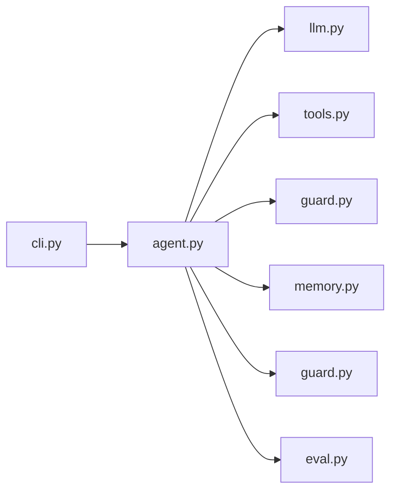

# 从零实现 Mini Agent

## 一图看懂



<p class="diagram-caption"><strong>一图看懂</strong> · Mini Agent 的模块边界：Agent 依赖模型、工具、记忆与评测，工具不反向依赖 Agent</p>


这一章不依赖 LangChain、LlamaIndex 或任何 Agent 框架，只用 Python 标准库实现一个**能跑、能测、能改**的 Agent。目标不是造一个产品，而是把前文的每一层契约落到代码里。

代码位于：

- `examples/mini_agent/`：实现
- `tests/test_mini_agent.py`：26 个单元测试
- `examples/mini_agent/cli.py`：8 个演示场景

## 先跑起来

```bash
# 不需要 API Key，跑脚本化演示
python3 -m examples.mini_agent.cli --demo

# 打印完整 trace
python3 -m examples.mini_agent.cli --demo --trace

# 跑评测报告（pass@1 / pass^k）
python3 -m examples.mini_agent.eval

# 跑测试
python3 -m unittest discover -s tests -v
```

演示会依次展示：

1. 调用计算器并给出最终答案。
2. 列目录、读文件，再总结。
3. 写文件、读回验证。
4. 外部验证器拒绝“草稿”。
5. 长期记忆注入上下文。
6. 重复调用触发停滞检测。
7. 输入审核拦截、输出 PII 打码。
8. 流式输出的增量审核与断流。

## 代码结构

```text
examples/mini_agent/
├── types.py     ToolCall / Decision / ToolResult / Budget / Trace
├── llm.py       MockLLM（脚本化） + OpenAICompatLLM（urllib）
├── tools.py     Tool / Schema 校验 / Workspace / 内置工具 / Registry
├── memory.py    MemoryItem / SimpleMemory（关键词检索）
├── guard.py     内容审核：规则 / 阶段策略 / 流式护栏
├── agent.py     MiniAgent 循环 / 上下文 / 验证 / 停滞检测
├── eval.py      迷你评测 harness（pass@1 / pass^k）
└── cli.py       演示与 live 模式
```

模块之间是单向依赖：`agent` 依赖 `llm`、`tools`、`memory`、`types`；工具不反向依赖 Agent。这样你可以单独测试工具，也可以换掉 LLM 而不动循环。

## Lab 1：最小循环

核心在 `MiniAgent.run()`：

```python
while True:
    self.budget.start_step()
    messages = self._build_messages(state)
    decision = self.llm.decide(messages, self.tools.specs())

    if decision.has_tools:
        self._record_assistant_tool_calls(state, decision)
        for call in decision.tool_calls:
            self.budget.spend_tool_call()
            result = self.tools.execute(call)
            self._record_tool_result(state, call, result)
        continue

    ok, reason = self.verifier(decision.content, state)
    if ok:
        return success(...)
    # 验证失败：把原因回给模型，继续循环
```

三个关键设计：

1. **模型只提议**：`Decision` 不直接执行任何东西。
2. **循环拥有状态与预算**：`AgentState`、`Budget` 在 Agent 里，不在模型里。
3. **完成需要验证**：`verifier` 是外部函数，不是模型自评。

用 `MockLLM` 可以在没有 API 的情况下测试循环：

```python
agent = MiniAgent(
    llm=MockLLM([
        tool("calculator", expression="6 * 7"),
        final("答案是 42。"),
    ]),
    tools=build_default_tools("."),
    budget=Budget(max_steps=4),
)
result = agent.run("6 * 7 等于多少？")
assert result.status == "success"
```

**练习**：把 `max_steps` 改成 1，观察 `result.status` 和 `result.output`。

## Lab 2：工具、Schema 与错误契约

`tools.py` 做了四件事：

### 1. Schema 声明

```python
Tool(
    name="calculator",
    description="Evaluate a numeric arithmetic expression...",
    parameters={
        "type": "object",
        "properties": {"expression": {"type": "string"}},
        "required": ["expression"],
        "additionalProperties": False,
    },
    handler=calculator,
)
```

### 2. 执行前校验

`validate_args()` 覆盖 `type/required/enum/additionalProperties/items/min/max` 等常用子集。校验失败返回：

```json
{
  "ok": false,
  "error": {
    "type": "invalid_argument",
    "message": "calculator.expression must be string, got int",
    "retryable": true,
    "hint": "请按 schema 修正参数后重试",
    "field": "expression"
  }
}
```

### 3. 工作区边界

文件工具只能访问工作区内的相对路径：

```python
def resolve(self, raw: str) -> Path:
    candidate = (self.root / raw).resolve()
    if candidate != self.root and self.root not in candidate.parents:
        raise ValidationError("path escapes the workspace")
    return candidate
```

`../secret` 会被拒绝，返回 `invalid_argument`。测试里有对应用例。

### 4. 错误规范化

所有异常都转成结构化错误，而不是把 stack trace 丢给模型。模型看到的是“类型、是否可重试、建议”，日志里保留完整异常。

**练习**：给 `Tool` 加一个 `side_effect` 为 `destructive` 的 `delete_file`，要求它必须经过 `allow_write` 且记录审计。

## Lab 3：记忆

`SimpleMemory` 很小，但包含了记忆系统的关键字段：

```python
MemoryItem(
    content="用户偏好中文回答",
    kind="preference",
    source="user",
    confidence=0.9,
    importance=0.8,
    tenant_id="default",
)
```

检索用词项重叠 + 重要性 + 时效性：

```text
score = (0.65 × 词项重叠 + 0.20 × 重要性 + 0.15 × 时效性) × 置信度
```

它不是生产级记忆（没有嵌入、没有整合、没有冲突消解），但足以演示**写入需要来源、检索需要排序、记忆需要租户隔离**。

`MiniAgent._recall()` 在每轮开始时按目标检索，`_build_messages()` 把结果放进 `<memory>` 区块。演示 5 用一个断言检查记忆是否真的进了上下文。

**练习**：给 `SimpleMemory` 加“同一实体新值覆盖旧值”的逻辑，并保留 `supersedes` 字段。

## Lab 4：预算、停滞与部分结果

::: tip 可复制模板
本章的清单有对应的结构化版本：[`mini_agent_config.json`](../../examples/templates/mini_agent_config.json)。全部模板见 [examples/templates/README.md](../../examples/templates/README.md)。
:::

### 预算

```python
@dataclass
class Budget:
    max_steps: int = 8
    max_tool_calls: int = 12
    max_seconds: float = 60
    max_tokens: int = 60_000
```

每次模型调用后 `spend_tokens()`，每次工具调用前 `spend_tool_call()`，每轮开始 `start_step()`。超限抛 `BudgetExceeded`，但**不让它变成 500**：`run()` 捕获后返回 `status="partial"`，附带已完成事项和建议。

### 停滞检测

`_check_stall()` 用 `ToolCall.signature()`（工具名 + 排序后的参数）计数：

- 第 2 次相同调用：给模型一条反馈，“你已重复，请换方法”。
- 第 3 次：停止，`status="stalled"`。

这比单纯 `max_steps` 更早发现问题，也更可解释。

**练习**：把“相同签名”改成“相同签名 + 相同结果”，观察行为差异。

## Lab 5：评测 harness

`examples/mini_agent/eval.py` 把“写评测”变成了可运行的代码：

```bash
python3 -m examples.mini_agent.eval
```

输出：

```text
cases=4 runs=3
case                  pass@1  pass^k  steps  tokens
calculator              True    True      2     346
read_file               True    True      2     379
write_read_back         True    True      3     734
verifier                True    True      2     243

overall: pass@1=1.00 pass^3=1.00 avg_steps=2.25 avg_tokens=426
```

它做了三件事：

1. 每个 case 用独立临时工作区，避免状态串扰。
2. 同一 case 跑 `runs` 次，同时报告 `pass@1` 与 `pass^k`。
3. 失败时打印 case、run、status 和输出摘要，便于定位。

**练习**：加一个会失败的 case（例如期望输出包含“162”但脚本返回“163”），观察报告如何呈现。

## Lab 6：追踪

`Trace` 记录每一步：

```json
{
  "step": 1,
  "content": "",
  "final": false,
  "tool_calls": [{"name": "calculator", "arguments": {"expression": "6*7"}}],
  "results": [{"name": "calculator", "result": {"ok": true, "data": {"result": 42}}}],
  "usage": {"input_tokens": 300, "output_tokens": 20},
  "latency_ms": 0,
  "note": ""
}
```

跑 `--trace` 可以看到完整结构。生产系统还应该加：

- `trace_id` / `span_id` / `parent_id`
- 上下文各 section 的 token 分布
- 工具参数脱敏后的完整值
- 终止原因、成本、模型版本

**练习**：把 `Trace` 导出为 JSONL，每行一个任务，便于批量分析。

## Lab 7：接入真实模型

`OpenAICompatLLM` 用 `urllib` 调用 `/chat/completions`：

```bash
export OPENAI_API_KEY="..."
export OPENAI_MODEL="gpt-4.1-mini"       # 或任何兼容模型
export OPENAI_BASE_URL="https://api.openai.com/v1"  # 可选
python3 -m examples.mini_agent.cli --live "用计算器算 123 * 456" --trace
```

它把原生 `tool_calls` 转成 `Decision`，并在下一轮把工具结果按 `tool_call_id` 回传。你可以换成任何 OpenAI 兼容端点。

::: warning 这不是生产实现
它没有重试、限流、密钥管理、沙箱和持久化。它的价值是**结构正确、可测试、可替换**。生产化时，优先补：沙箱、幂等、重试、持久化、审计。
:::

## Lab 8：把审核接进循环

审核不是外挂一个函数，而是四个卡点。`guard.py` 里只有两个概念：

- `Guard.check(text, stage)`：同一段文本，在不同 `stage` 得到不同处置。
- `StreamGuard`：按句缓冲，命中高危就断流。

```python
agent = MiniAgent(
    llm=MockLLM([final("联系人 13812345678")]),
    tools=build_default_tools(workspace),
    guard=Guard(),
)
result = agent.run("登记联系人")
# result.output -> "联系人 [手机号]"
```

循环里的四个位置：

| 位置 | stage | 处置 |
| --- | --- | --- |
| 目标 | input | 高危直接拒绝，一个 token 都不花 |
| 工具返回 | tool_result | 结构化结果只支持 block（打码会破坏 schema） |
| 最终答案 | output | PII 打码、密钥拦截 |
| 记忆写入 | memory | 命中即丢弃，避免长期污染 |

三个设计取舍值得记住：

- 规则式审核只适合教学与兜底，生产要接分类模型，但**契约不变**。
- 工具返回是结构化数据，字段级打码需要逐字段策略，示例里只做了 block。
- 流式审核有 hold-back 窗口，窗口就是风险，大小必须由产品决定。

**练习**：给 `Guard` 加一条“只在 tool_result 阶段生效”的注入规则，并写测试证明它在 input 阶段不误伤。

## 七个可以继续做的扩展

1. **并行工具调用**：一次返回多个 `ToolCall`，用 `asyncio.gather` 执行，按 id 回填。
2. **上下文压缩**：当 transcript 超过预算时，用模型生成结构化摘要，而不是直接丢弃。
3. **检查点/恢复**：把 `AgentState` 存 JSON，进程重启后从断点继续。
4. **子 Agent**：把 `MiniAgent` 包装成一个工具，给子任务独立上下文和预算。
5. **评测 harness**：用 `tests` 的断言方式跑 20 条任务，统计 `pass@1`、步数、成本。
6. **真实沙箱**：把 `write_file`/`calculator` 换成容器内的命令执行，加网络白名单和超时。
7. **审核策略版本化**：把规则表与阈值移到配置里，支持灰度与历史回放。

## 设计取舍：为什么这么小

- **不用框架**：避免把“框架会替你做什么”当成“Agent 本来就这样”。
- **不用真实 API 做测试**：脚本化 LLM 让测试确定、快速、免费。
- **不做花哨 UI**：把注意力放在循环、契约、错误和追踪上。
- **故意保留缺陷**：比如简单的 transcript 裁剪、线程超时不能强杀。这些缺陷在文中有标注，留作练习。

## 自检清单

读完并跑完这一章，你应该能回答：

- [ ] 模型、循环、工具、验证器各自的职责边界是什么？
- [ ] 工具错误为什么要结构化？哪些字段是给模型看的？
- [ ] 预算耗尽为什么是 `partial` 而不是 `error`？
- [ ] 停滞检测和 `max_steps` 各自解决什么问题？
- [ ] 如果要把这个 Agent 放到生产，最先补哪三件事？
- [ ] 内容审核的四个卡点分别在循环的哪一步？为什么工具返回只能 block？

## 来源

- CPython, **`ast` 模块**——书中计算器为何用 AST 白名单而不是 `eval`。[链接](https://docs.python.org/3/library/ast.html)
- CPython, **`subprocess` 模块**——超时、进程组与 `kill` 语义，是“线程超时不能强杀”这一取舍的依据。[链接](https://docs.python.org/3/library/subprocess.html)
- OpenAI, **Function Calling 指南**——`--live` 模式所用的协议。[链接](https://platform.openai.com/docs/guides/function-calling)
- OpenAI, **tiktoken**——token 计数的参考实现，用于理解“usage 缺失时的估算”为何只是近似。[链接](https://github.com/openai/tiktoken)

完整清单见[推荐来源](/appendix/sources#从零实现-mini-agent)。

::: details 参考答案与自检
本章的 8 个 Lab 每个都带「练习」，答案就是**代码改动的结果**，判定标准如下：

- **Lab 1**：`max_steps=1` 时 `status == "partial"` 且 `output` 含已完成部分；不是 `error`、不抛异常。
- **Lab 2**：越界路径返回 `invalid_argument` + `hint`；把工具 schema 里加一个必填字段后，旧测试应当**失败**（说明校验真的生效）。
- **Lab 3**：记忆注入后上下文里能看到来源与时效；把记忆的 `expires_at` 设为过去时间，注入应当消失。
- **Lab 4**：预算耗尽与停滞两种退出都要有；两者的 `status` 不同（`partial` vs `stalled`），输出都要包含“建议下一步”。
- **Lab 5**：`python3 -m examples.mini_agent.eval` 能打印 `pass@1 / pass^k`；把某个 case 的期望改错，指标应当下降——**全绿且改错也不掉分，说明评测没接上**。
- **Lab 6**：`--trace` 输出的每一步都有耗时、token 与决策类型；能据此回答“哪一步最贵”。
- **Lab 7**：`--live` 在缺少 key 时给出清晰报错，而不是堆栈。
- **Lab 8**：审核的四个卡点都能从 `--demo` 里观察到（输入拦截、工具返回、输出打码、流式断流）。

**“七个可以继续做的扩展”的自检**：每做一个扩展，都要能回答“它在文档的哪一章有对应描述”——做不到，说明你扩展的是代码而不是理解。
:::

下一步：[Mini Agent v2](/practice/mini-agent-v2)（加 RAG、意图路由与记忆治理），或先看[真实案例拆解](/practice/cases)。
