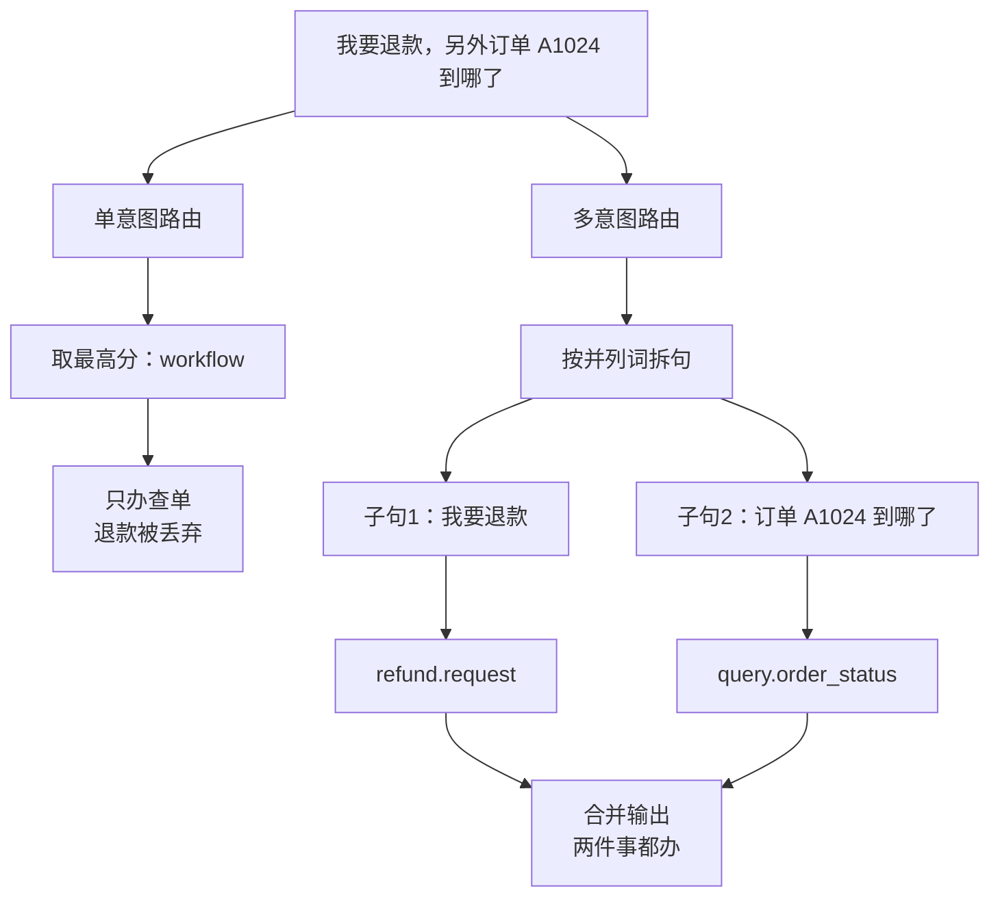

# 多意图路由：一句话里有两件事怎么办

## 先看一个事故

用户在客服里说：

> **「我要退款，另外订单 A1024 也帮我查一下到哪了」**

**单意图路由**的做法是：给这句话打一个意图分，取最高的那个。结果是——

```text
单意图路由 → workflow（只处理这一个，其余丢失）
```

**退款请求被丢掉了。** 用户以为说了两件事，系统只办了一件，另一件连提示都没有。这是客服类产品最典型的严重体验事故，而且**不报错、不告警**——日志里一切正常。

## 一图看懂



<p class="diagram-caption"><strong>一图看懂</strong> · 同样是路由，单意图丢弃、多意图拆句后全部执行</p>

## 跑起来看

```bash
python3 -m examples.mini_agent_v3.cli --multi
```

输出会并列展示「单意图会怎样」和「多意图会怎样」：

```text
请求: 我要退款，另外订单 A1024 也帮我查一下到哪了
  单意图路由 → workflow（只处理这一个，其余丢失）
  多意图路由 → primary=workflow / 共 2 个意图
      · [workflow] refund.request       我要退款
      · [workflow] query.order_status   订单 A1024 也帮我查一下到哪了
  实际输出:
      【业务办理】订单 A1024 当前状态：已发货…退款申请已受理，需人工审批后执行…
      【业务办理】订单 A1024：已发货，运输中（查询人 user:88）
```

## Lab 1：怎么拆——按并列词，宁可多拆

```python
_CLAUSE_SPLIT = re.compile(r"[，,；;。\n]|另外|以及|还有|顺便|同时|而且|并且|然后")
```

拆分的策略是**宁可过拆，不可漏拆**。因为过拆是安全的：拆出一条没有诉求的碎片，它路由不到任何东西就被丢掉；而漏拆会把真实诉求埋掉。

**练习**：为什么用「合并所有子句的 route」而不是「取子句里分数最高的那个」？

## Lab 2：两条保底规则

### 规则一：高风险永不丢弃

```python
def rank(scenario):
    route = scenario.route
    return (1 if route.is_high_risk else 0, route.confidence)

ordered = sorted(unique, key=rank, reverse=True)
primary = ordered[0].route
```

**排序时先把高风险（投诉/转人工）排到最前**，不管它的置信度是多少：

```text
请求: 这个功能报错了，而且我要投诉你们服务太差
  多意图路由 → primary=human / 共 2 个意图    ← 投诉提到主位
      · [rag  ] tech.issue       这个功能报错了   ← 技术问题也没丢
      · [human] risk.complaint   我要投诉你们服务太差
```

如果按"取最高分"排，技术问题分高，投诉就被降级到 secondary——甚至在某些实现里直接丢。**一条被埋掉的投诉仍然是投诉。**

### 规则二：同一路由、不同意图要分开

"退款" 和 "查单" 都走 `workflow` 路由，但它们是**两个不同的意图**。所以去重按 `intent` 而不是 `route`：

```python
key = scenario.route.intent or scenario.route.route   # 不是 route.route
```

如果按 route 去重，这两件事会被合并成一件。

## Lab 3：共享实体——订单号在另一个子句里

拆句带来一个新问题：

```text
「我要退款，订单 A1024」
  → 子句1「我要退款」（没有订单号！）
  → 子句2「订单 A1024」
```

退款子句单独执行时，找不到订单号，会返回「请问订单号是多少？」——**明明是同一句话里说过的**。

修复：每个子句执行时，把**原句**作为上下文一起带过去：

```python
def _clone_request(request, text, context=""):
    clone = GatedRequest(text=text, ...)
    clone.context_text = context or request.text   # 原句
    return clone

# handler 里做实体解析时，同时看子句和原句
haystack = request.text + " " + request.context_text
```

这是多意图里最容易被漏掉的一环：**拆分是逻辑上的，实体是物理上共享的。**

## Lab 4：合并——状态取最差

多个子句各有状态（success / partial / permission_denied / quota_exceeded），合并时：

```python
for bad in ("permission_denied", "quota_exceeded", "blocked"):
    if bad in statuses:
        return bad            # 任何一块失败，整体不能报"全部完成"
```

**只要有任意一个子句没办成，就不能告诉用户"都办好了"。** 这和多 Agent 里"合并置信度取最小值"是同一条原则：整体只和最弱的一环一样可靠。

## Lab 5：一个反例——不该硬答的别硬答

多意图暴露了另一个问题。技术问题「这个功能报错了」走 RAG，但知识库里**没有技术文档**，检索分数只有 0.016（真实匹配约 0.03+）。原来的实现仍然返回了检索到的第一条无关条款（居然是合同争议条款）。

修复：加相关度门槛，低于阈值就明确说"没找到"：

```python
RAG_MIN_SCORE = 0.025
hits = [h for h in raw_hits if h.score >= RAG_MIN_SCORE]
if not hits:
    return "知识库中没有与该问题相关的内容（可能属于技术问题，需转技术支持）。"
```

**说"不知道"比给一个看起来像答案的错答案好得多**——尤其当这个错答案会被当成本次请求的一部分交给用户时。

## 四种多意图策略（什么时候用哪种）

| 策略 | 做法 | 适用 |
| --- | --- | --- |
| **多标签** | 一次输出多个意图 + 各自置信度 | 意图相互独立 |
| **拆句路由**（本章） | 按并列词拆成子句，各自路由 | 有明确并列词、可分开执行 |
| **先主后次** | 只立即办主意图，其余追问 | 交互式、有会话 |
| **串行编排** | A 的出产作为 B 的输入 | 子意图有依赖顺序 |

本章实现的是**拆句路由 + 高风险保底**，因为客服场景里并列诉求最常见。如果有依赖（"先查单，如果超时再退款"），就要串行编排，不能并行。

## 自检清单

- [ ] 能说出单意图路由为什么会"不报错地"丢诉求。
- [ ] 能解释为什么拆句宁可过拆不可漏拆。
- [ ] 能说出高风险为什么必须优先，而不是按分数排。
- [ ] 能解释为什么去重按 intent 而不是 route。
- [ ] 能说出拆句后为什么订单号会丢，怎么修。
- [ ] 能解释合并状态为什么取最差，而不是取最好。
- [ ] 能说出 RAG 找不到内容时说"没找到"比硬答好在哪。

相关：[意图识别](/evolution/intent) 讲路由的理论、[组合架构](/practice/composite-architecture) 讲它在真实系统里的位置。
