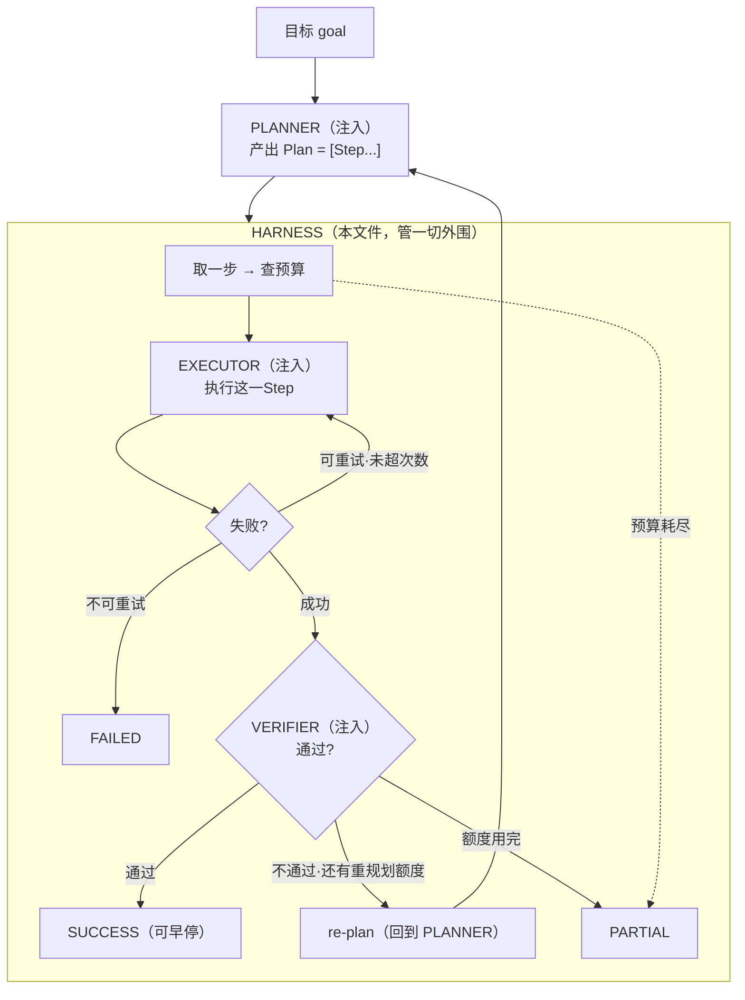

# 用 Harness 方式写一个 Plan-Execute

## 先明确 "harness 方式" 指什么

上一轮讨论过：**ReAct 的循环和 harness 的循环是同一个**。区别只在于——

- **ReAct** 讲循环的逻辑：想 → 做 → 观察；
- **Harness** 讲循环的工程：预算、超时、重试、终止、trace 谁来管。

所以"用 harness 方式写 Plan-Execute"意思是：

> **循环骨架和预算/终止/重试/追踪都写成一套通用框架；只把"规划""执行一步""验证"三件事做成可注入的函数。**

这样同一副 harness 既能跑"编码写死的计划"，也能跑"模型生成的计划"，还能跑不同领域——**换内容不换框架**。

## 一图看懂



<p class="diagram-caption"><strong>一图看懂</strong> · harness 拥有循环与所有外围控制；planner/executor/verifier 是三个注入点</p>

## 三个注入点 + 一个内核

```python
Planner  = Callable[[str, List[Step], int], Plan]      # (goal, done, round) -> Plan
Executor = Callable[[Step], ExecResult]                # (step) -> ExecResult
Verifier = Callable[[str, List[Step]], VerifyResult]   # (draft, done) -> VerifyResult

class PlanExecuteHarness:   # ← 内核
    def run(self, goal): ...
```

**harness 从不决定"内容"**，它只决定：
- 还有没有预算再跑一步；
- 失败的步骤能不能重试；
- 该重规划还是该停；
- 记录什么。

## 补强：harness 的「统一管理」也包括统一管配置

既然 harness 统一管预算/重试/终止，那这些**参数本身从哪来**？

上一版把它们写死在构造函数里（`max_replans=2`），这是缺陷——改一个参数要改代码、重新部署。补强后，**所有控制参数都来自 `HarnessConfig`**，harness 在**一个地方**读取，没有魔数散落在循环里。

```python
@dataclass
class HarnessConfig:
    max_steps: int = 16
    max_tool_calls: int = 16
    max_tokens: int = 60_000
    max_seconds: float = 60.0
    max_replans: int = 2
    max_attempts_per_step: int = 2
    early_stop: bool = True        # 验证一过就停
    trace_enabled: bool = True
    profile: str = "default"
```

配置有三个来源，对应真实企业级的不同场景：

| 来源 | 用途 | 方法 |
| --- | --- | --- |
| 环境变量 | 部署时注入（容器/控制面下发） | `HarnessConfig.from_env()` |
| 字典/JSON | 从配置文件或控制面 API 拉取 | `HarnessConfig.from_dict()` |
| 命名 profile | 不同任务类型预设不同策略 | `for_scenario("interactive")` |

```bash
python3 -m examples.mini_agent_v7.cli --config       # 同一 harness，不同 profile
python3 -m examples.mini_agent_v7.cli --config-env   # 从环境变量读
```

`--config` 的输出直接证明**harness 代码一行没改，行为却变了**：

```text
profile=default      early_stop=True  steps=1  status=success  ['a']
profile=interactive  early_stop=True  steps=1  status=success  ['a']
profile=strict       early_stop=False steps=4  status=success  ['a','b','c','d']
profile=batch        early_stop=True  steps=1  status=success  ['a']
```

三个内置 profile 对应三种任务气质：

| profile | 特点 | 用于 |
| --- | --- | --- |
| `interactive` | 快、便宜、少重试 | 在线交互，秒级响应 |
| `batch` | 预算大、耐心足 | 离线批处理、长任务 |
| `strict` | 少重试、不早停 | 高风险，必须完整验证 |

**配置校验同样「启动即失败」**：`HARNESS_MAX_STEPS=abc` 会报 `ConfigError` 并带变量名，未知配置项也会被拒绝。这和 v3 的 `Settings` 是同一套纪律。

## 跑起来

```bash
python3 -m examples.mini_agent_v7.cli --demo        # 一次完整规划-执行-验证
python3 -m examples.mini_agent_v7.cli --scenarios   # 四种终止路径
python3 -m unittest tests.test_mini_agent_v7 -v     # 15 个测试
```

`--demo` 输出（注意"提前通过就早停"）：

```text
[plan]   round=1  steps=['lookup_policy', 'lookup_order', 'draft']
[exec]   ✓ lookup_policy  attempt=1 tokens=300
[exec]   ✓ lookup_order   attempt=1 tokens=300
[stop]   提前通过（lookup_order 后已满足验证），后续步骤不再执行
状态: success | 轮次: 1 | 步数: 2 | tokens: 606
```

## 内核长什么样

`PlanExecuteHarness.run()` 的结构（简化）：

```python
def run(self, goal):
    while True:
        # 1. 规划（计费）
        plan = self.planner(goal, done, rounds)
        if not plan.steps:
            return self._verify_and_finish()

        # 2. 逐步执行
        for step in plan.steps:
            result = self._execute_with_retry(step)     # 内部管重试
            if not result.ok: return self._finish(failed/partial)
            done.append(step); outputs.append(result.output)

            # 3. 每步后试一试：通过就早停
            if self._verify(...).passed:
                return self._finish("success")

        # 4. 走完一轮：验证。不通过 → 重规划（有上限）
        if self._verify(...).passed:
            return self._finish("success")
        if rounds > self.max_replans:
            return self._finish("partial")
        # 否则进入下一轮，把 verify 的理由交给 planner
```

**这四段里，只有 `planner/executor/verifier` 三个调用是"注入"的，其余全是 harness 的职责。**

## 五种终止状态，一个不少

`--scenarios` 会走一遍：

| 场景 | status | 触发 |
| --- | --- | --- |
| 正常跑完且验证通过 | `success` | 早停或走完 |
| 可重试失败→重试成功 | `success` | attempt<上限 |
| 不可重试失败 | `failed` | 立刻停，不重试 |
| 预算耗尽 | `partial` | step/tool/token 触顶 |
| 每轮都验证不过 | `partial` | 重规划超上限 |

## 开发中修掉的三个真实问题

写这个 harness 时踩到三个坑，都记在代码注释里：

### 坑一：预算耗尽时把"没验证"当成"验证通过"

最初 `_verify()` 在预算不足时返回 `VerifyResult(True, "accept current")`。结果**没跑完的任务被报成 success**——这正是 harness 存在意义要防的"静默失败"。改为返回 `False`，让调用方落到 `partial`。

### 坑二：`max_steps` 不管真实工作量

最初只有 plan/verify 消耗 step，执行步骤只消耗 tool_call。于是 `max_steps=5` 却执行了 20 步。改为**执行每步同时消耗 step 和 tool_call**，`max_steps` 才真的能限住工作量。

### 坑三：`ExecResult(False, "err")` 把错误写进了 output

数据类签名是 `(ok, output, error, ...)`，位置参数极易误用。加了 `ExecResult.failure("err")` 类方法，让"这是失败"的意图显式化。

## 为什么这比"直接写个循环"好

| | 裸循环 | harness 化 |
| --- | --- | --- |
| 换 planner | 改主循环 | 只换注入的函数 |
| 测预算 | 难（混在业务里） | 独立可测 |
| 失败可复现 | 靠日志猜 | trace 逐步可查 |
| 复用 | 一个场景一套 | 一套跑所有场景 |

**关键：`planner` 可以是写死的列表（测试用），也可以是模型调用（生产用），harness 完全不用改。**

## 和 ReAct 的关系

- **同一副骨架**：都是"循环 + 预算 + 终止 + trace"。
- **内层不同**：ReAct 每轮想一步做一步；Plan-Execute 先产出一批步骤再执行。
- **所以**：把 `MiniAgent.run()` 的"想一步"换成"先规划再批量执行"，就是本文这个 harness。

## 自检清单

- [ ] 能说出 harness 管什么、planner/executor/verifier 各管什么。
- [ ] 能说出五种终止状态各由什么触发。
- [ ] 能解释为什么"预算耗尽不能算 success"。
- [ ] 能解释为什么执行步骤也要计入 step 预算。
- [ ] 能说出换 planner 时为什么不用改主循环。
- [ ] 能说出这个 harness 和 ReAct 循环的相同点与不同点。
- [ ] 能说出 harness 的控制参数从哪三个来源来，以及为什么要「启动即校验」。
- [ ] 能解释 profile 的意义（同一 harness 不同任务用不同策略）。

相关：[编排层](/layers/orchestration) 的规划一节、[Mini Agent v5](/practice/mini-agent-v5) 的 Orchestrator 模式、[范式选型指南](/practice/paradigm-selection)。
