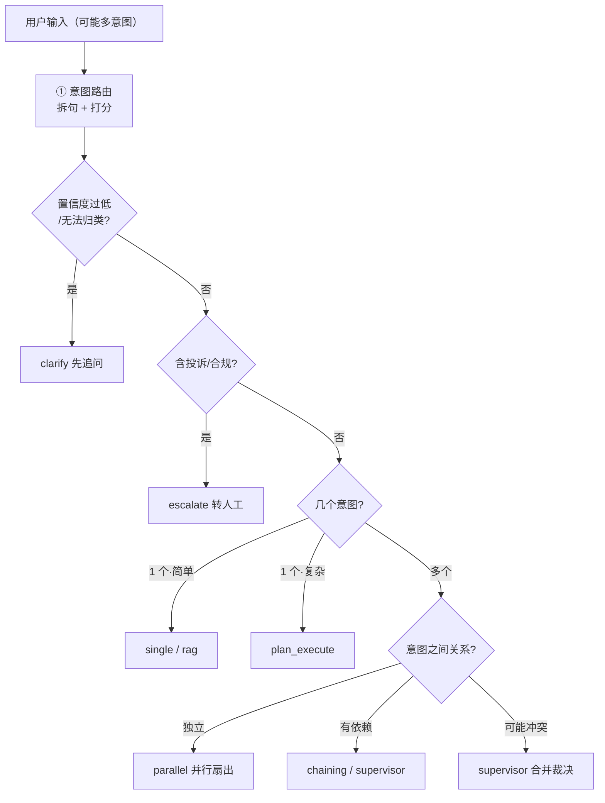

# 路由之后：选哪种拓扑执行

## 这章解决什么问题

前面讨论过：意图路由和拓扑是两件事。本章把它们接起来——**用户输入（可能多意图）→ 意图路由 → 判断该用哪种拓扑执行 → 执行**。

关键点是中间那步：**路由不该直接写死"进 Agent"或"并行"，而是根据意图的数量和关系来选拓扑**。

## 一图看懂



<p class="diagram-caption"><strong>一图看懂</strong> · 路由产出意图，拓扑由「数量 + 关系 + 风险」共同决定</p>

## 决策规则（按优先级）

| 优先级 | 条件 | 选中拓扑 | 理由 |
| --- | --- | --- | --- |
| 1 | 置信度过低 / 无法归类 / route=clarify | **clarify** | 先追问，不硬路由 |
| 2 | 含投诉、合规（高风险） | **escalate** | 转人工，不被业务埋没 |
| 3 | 单意图·简单 | **single / rag** | 一个处理器直接完成 |
| 4 | 单意图·复杂多步 | **plan_execute** | 先规划再执行 |
| 5 | 多意图·有依赖（2 个） | **chaining** | 按顺序，下游用上游结果 |
| 6 | 多意图·有依赖（>2）/ 可能冲突 | **supervisor** | 合并时裁决 |
| 7 | 多意图·相互独立 | **parallel** | 并行扇出后拼接，最快 |

**注意顺序**：clarify 在 escalate 之前（低置信时不能因为"最像投诉"就转人工）；escalate 在所有业务判断之前（投诉永远优先）。

## 跑起来

```bash
python3 -m examples.mini_agent_v9.cli --demo        # 五个典型输入
python3 -m examples.mini_agent_v9.cli --matrix      # 决策矩阵
python3 -m examples.mini_agent_v9.cli --ask "我要退款，另外查下订单A1024"
python3 -m unittest tests.test_mini_agent_v9 -v     # 20 个测试
```

`--demo` 输出：

```text
输入: 我要退款，另外订单 A1024 也帮我查一下到哪了
  意图: [refund.request/workflow/simple]  [query.order_status/workflow/simple]
  ▶ 选中拓扑: PARALLEL（多意图且相互独立：并行扇出后拼接，最快）

输入: 这个功能报错了，而且我要投诉你们服务太差
  意图: [tech.issue/rag]  [risk.complaint/human]
  ▶ 选中拓扑: ESCALATE（命中高风险意图，必须转人工）

输入: 帮我把这个月的退款整理成表格并汇总金额
  意图: [task.multi_step/agent/complex]
  ▶ 选中拓扑: PLAN_EXECUTE（单意图但需要多步）

输入: 你好
  意图: [risk.complaint/clarify]（低置信）
  ▶ 选中拓扑: CLARIFY（先追问）
```

## 三种多意图关系的区分（最容易混）

| 关系 | 判据 | 拓扑 | 例子 |
| --- | --- | --- | --- |
| **独立** | 结果可直接拼，互不依赖 | parallel | 退款 + 查订单 |
| **依赖** | B 需要 A 的结果 | chaining | 先查订单，再按订单退款 |
| **冲突** | 结论可能矛盾，需要取舍 | supervisor | 退款申请 + 政策解释（可能说不该退） |

**判错了会怎样：**
- 独立当依赖 → 白等，串行变慢
- 依赖当独立 → 并行跑，下游拿不到上游结果
- 冲突当独立 → 把矛盾原样拼给用户

## 代码结构

```text
examples/mini_agent_v9/
├── select_topology.py   选择规则 + 七种拓扑的占位执行器
├── pipeline.py          串起 v2 路由 → 选择 → 执行
└── cli.py               demo / ask / matrix
```

核心是 `select_topology(items)`：输入 `IntentItem[]`，输出 `TopologyChoice{topology, reason}`。**它只做决策，不执行业务**——执行交给 `execute()`。

```python
choice = select_topology(items)
# choice.topology ∈ {single, rag, parallel, chaining, supervisor, plan_execute, escalate, clarify}
# choice.reason   ← 为什么选它（可审计、可解释）
```

## 开发中修的两个 bug（都关于"顺序"）

### bug 一：clarify 被 escalate 抢先

最初先判高风险、再判低置信。结果「你好」的**最近意图**是 `risk.complaint`（虽然置信度只有 0.38），被误转人工。

**修复**：clarify 判断提到最前——低置信时**任何标签都不可信**，包括风险标签。

### bug 二：只看置信度，没看 route

「你好」置信度 0.38 刚好高于阈值 0.34，但它的 `route` 是 `clarify`。只按置信度判断会漏掉。**修复**：`route == "clarify"` 也直接走 clarify。

## 和前面章节的关系

- **意图路由**怎么拆多意图 → [多意图路由](/practice/multi-intent)
- **每种拓扑是什么** → [Mini Agent v4](/practice/mini-agent-v4)（拓扑）、[v5](/practice/mini-agent-v5)（模式）
- **按业务选范式** → [范式选型指南](/practice/paradigm-selection)
- **本章**：路由**之后**，按意图关系自动选拓扑

## 自检清单

- [ ] 能说出七种拓扑各由什么条件触发。
- [ ] 能解释为什么 clarify 要排在 escalate 前面。
- [ ] 能区分多意图的"独立 / 依赖 / 冲突"三种关系及对应拓扑。
- [ ] 能说出判错关系会导致什么后果。
- [ ] 能解释 `select_topology` 为什么只做决策不执行。
- [ ] 能说出"低置信时最近意图是高危"为什么不能直接转人工。
