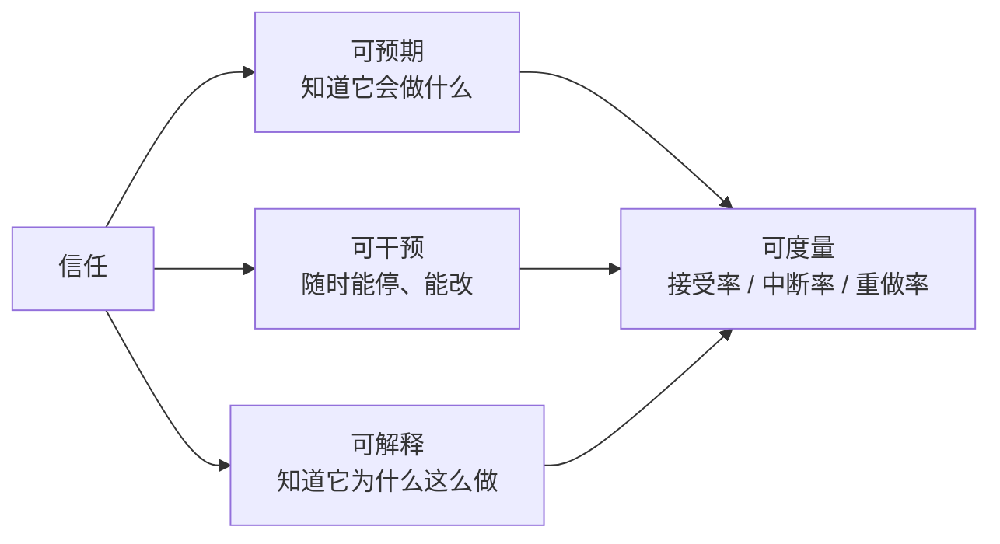
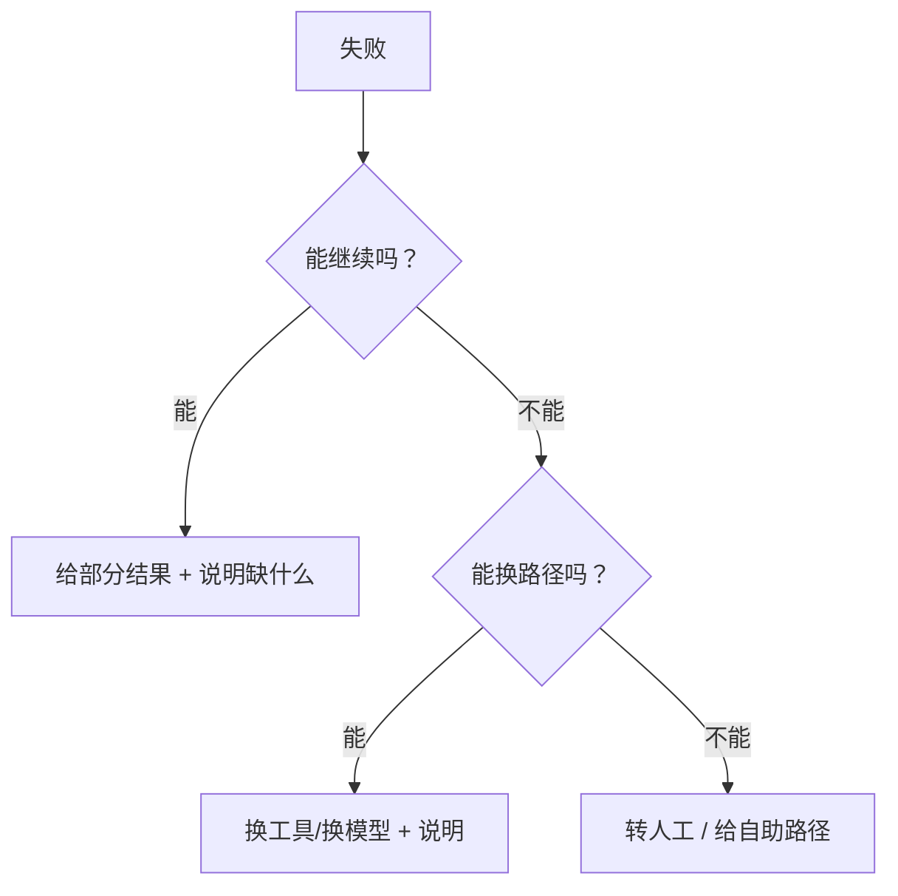

# 交互与信任设计：让用户敢用、能用、会停

Agent 的能力上限由模型决定，**可用性上限由交互决定**。同一个 Agent，把“它正在做什么”藏起来，用户会觉得不可控；把每一步都摊开，用户又会被淹没。这一层几乎不写在架构图里，却决定了产品能不能被信任。

## 一图看懂



<p class="diagram-caption"><strong>一图看懂</strong> · 信任不是“感觉”，是三个可设计的性质，而且都能度量</p>

## 一、三种交互形态

| 形态 | 时长 | 用户预期 | 界面重点 |
| --- | --- | --- | --- |
| 同步问答 | 秒级 | 立即给答案 | 首字延迟、可中断 |
| 流式执行 | 十几秒~几分钟 | 边做边说 | 步骤可见、可停止、可纠偏 |
| 长任务 | 分钟~小时 | 交给它，稍后回来 | 进度、通知、结果审阅、失败接管 |

把长任务做成同步等待，是体验灾难；把秒级问答做成“任务队列”，是过度设计。**先按任务时长选形态，再谈细节。**

## 二、可见性：不要用假进度条

用户不关心“完成了 47%”，用户关心“它在干什么、还要多久、卡在哪”。

| 差 | 好 |
| --- | --- |
| 一个转圈的 loading | “正在读取 3 个文件 → 已读取 2 个” |
| 进度条从 0 走到 90% 停住 | 阶段列表：检索 / 分析 / 生成 |
| 只显示“处理中” | 显示当前工具与目标（脱敏后） |

三条原则：

1. **进度要对应真实阶段**，不要用计时器模拟。
2. **阶段数控制在 3~5 个**，再多就没人看。
3. **卡住要说明**：是等外部系统、等审批，还是重试中。

## 三、可控性：三个按钮的真实语义

| 按钮 | 用户以为 | 应该做到 |
| --- | --- | --- |
| 停止生成 | 停止说话 | 立即断流，保留已生成内容 |
| 停止任务 | 停止一切 | 取消后续步骤，说明已完成哪些副作用 |
| 撤销 | 回到之前 | 只有可补偿的动作才能撤销，否则要如实说明 |

最容易骗用户的是“撤销”：已经发出去的邮件撤不回来。正确做法是**在动作前给预览**，而不是在动作后给假撤销。

## 四、计划先给，再执行

对多步任务，先展示计划再执行，能显著降低“跑偏”成本：

```text
我准备这样做：
1. 从 3 个来源检索近 30 天的工单
2. 按问题类型聚类，找出 Top 3
3. 生成周报草稿（不发送）

[开始执行]  [修改计划]  [只看结果]
```

代价是多一次交互。适合：写操作、外部可见动作、成本高的任务。不适合：纯查询、秒级问答。

## 五、怎么表达“不确定”

用户最常见的误解，是把模型的自信当成事实的确定。

| 做法 | 效果 |
| --- | --- |
| 给一个 87% 的置信度 | 假精确，用户无法校准 |
| 标注来源与时间 | 用户能自己判断 |
| 明确说“这条我没有找到出处” | 建立可信度 |
| 区分“事实 / 推断 / 建议” | 最有效 |

推荐用**证据等级**代替百分比：有引用、有单一来源、无来源、相互冲突。四种状态足够覆盖大多数场景，而且用户一看就懂。

## 六、失败与降级

见**图 1**：



<p class="diagram-caption"><strong>图 1</strong> · 失败处理的优先级：部分结果 &gt; 换路径 &gt; 转人工 &gt; 报错</p>

错误话术三要素：**发生了什么、影响是什么、现在能做什么。**

- 差：“系统错误，请稍后再试。”
- 好：“订单查询超时了，可能是上游系统繁忙。已拿到你的会员信息，需要我先把可用的部分整理给你吗？”

## 七、审批界面：一屏做决定

审批不是弹窗。一个好的审批卡片要在一屏内回答：

- **要做什么**：动作、参数、目标对象（可展开原文）。
- **为什么**：Agent 的理由，以及触发了哪条策略。
- **影响**：会改什么、影响谁、能不能撤回。
- **证据**：支持这个决定的关键信息。
- **选项**：允许 / 拒绝 / 修改后允许 / 转人工。

默认应该是**拒绝**，且拒绝要比允许更容易点——这是“安全默认”在交互层的体现。

## 八、信任校准

| 状态 | 表现 | 后果 |
| --- | --- | --- |
| 过度信任 | 不看引用就转发、不检查就执行 | 一次错误就会被放大 |
| 信任不足 | 每步都要确认、频繁手动改 | 效率低于自己干 |
| 校准良好 | 常规任务放手、高风险任务检查 | 真正省时间 |

产品设计的目标不是“让用户信任”，而是**让信任匹配能力**：在它擅长的场景减少摩擦，在它不可靠的场景增加摩擦。

## 九、度量

| 指标 | 含义 | 变差说明 |
| --- | --- | --- |
| 任务接受率 | 直接采用结果的比例 | 质量或表达有问题 |
| 中断率 | 用户主动停止的比例 | 过程不透明或太慢 |
| 重做率 | 同一任务重复发起的比例 | 首次结果不可用 |
| 澄清率 | 需要追问的比例 | 意图识别或提问设计有问题 |
| 人工接管率 | 转到人的比例 | 能力边界或兜底设计问题 |
| 审批修改率 | 审批时改参数的比例 | 计划或参数展示不充分 |

## 常见问题速查

**Q：把思考过程全展示出来好不好？**
不好。展示的是**决策要点与证据**，不是原始思维链。原始思维链冗长、可能自相矛盾，还会泄露内部提示。

**Q：要不要给每一步都加确认？**
不要。确认疲劳会让用户无脑点“允许”，比不确认更危险。按风险分级。

**Q：用户点“停止”后，已执行的副作用怎么办？**
如实列出。能补偿的给补偿入口，不能补偿的明确说明——这比假装没发生更可信。

**Q：Agent 主动提问是不是显得笨？**
不是。问一个关键问题，比猜错十次更专业。但要限制提问次数，并给出默认选项。

## 落地清单

- [ ] 交互形态与任务时长匹配？
- [ ] 进度对应真实阶段，卡住有说明？
- [ ] 停止/撤销的语义真实，不误导？
- [ ] 高风险任务先给计划再执行？
- [ ] 不确定性用证据等级表达，而不是假百分比？
- [ ] 失败时优先给部分结果与替代路径？
- [ ] 审批卡片一屏可决策，默认拒绝？
- [ ] 有接受率、中断率、重做率的看板？

## 练习

1. 挑一个你的 Agent 任务，画出它的三个阶段，并写出每个阶段用户应该看到什么。
2. 把“系统错误，请稍后再试”改写成符合三要素的话术。
3. 设计一个审批卡片，要求用户在不展开详情的情况下也能做出正确决定。

下一步：[优化手册](/advanced/optimization)。
