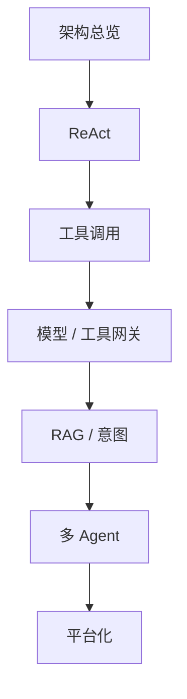

# 学习路线：从 ReAct 到 Agent 平台

## 一图看懂



<p class="diagram-caption"><strong>一图看懂</strong> · 学习路线沿着架构演进走：每一站只解决当前最痛的一个问题</p>


这条路线不是“把知识点过一遍”，而是**沿着架构演进逐级加组件**。每一级都回答四个问题：

1. 上一阶段长什么样？
2. 遇到了什么新矛盾？
3. 加了什么组件，它负责什么？
4. 这个组件又制造了什么新问题？

## 开始之前

| 你需要会 | 最低要求 | 不熟时怎么办 |
| --- | --- | --- |
| Python | 函数、类、异常、`json` | 先跑 Mini Agent 的 Lab 1 |
| HTTP / JSON | 请求、响应、状态码 | 读一遍 MDN HTTP 概览 |
| LLM 基础 | token、上下文窗口、temperature | 看[术语表](/appendix/glossary) |
| 命令行 | 运行脚本、环境变量 | 够用即可 |

不需要先学某个 Agent 框架。**框架会变，分层、循环和契约不会变。**

## 步骤 0：先看总览（约 1 小时）

读：[架构总览](/evolution/overview)。

重点不是记住六层名字，而是理解：

- **数据面**和**控制面**的区别。
- 为什么会出现 API Gateway / Model Gateway / Tool Gateway。
- 八级演进各自解决什么、引入什么。
- 复杂度守恒：每一级都把问题转移到了新地方。

**读完能回答：**

- 为什么不能把所有逻辑都写进 Agent 进程？
- Model Gateway 和 Tool Gateway 的边界在哪里？
- 什么情况下“不该上平台”？

**检查点**：用白纸画出你熟悉的某个 Agent 产品的数据面路径，标出至少三个可能出故障的边界。

## 步骤 1：ReAct，最小 Agent（约 2 小时）

读：[ReAct](/evolution/react)，配合[核心循环](/foundations/loop)。

**读完能回答：**

- ReAct 相比“一次调用”多了什么信息？
- 为什么文本协议容易崩？
- 一个没有预算和验证的循环，会怎么失控？

**动手**：

```bash
python3 -m examples.mini_agent.cli --demo
```

先只看“计算并回答”和“重复调用触发停滞检测”两个场景。

**检查点**：把 `max_steps` 改成 1，观察 `status` 和 `output` 的变化；再改成 3，观察停滞检测何时触发。

## 步骤 2：工具调用与注册（约 3 小时）

读：[工具调用](/evolution/tool-calling)，配合[工具层](/layers/tools)。

**读完能回答：**

- Function Calling 解决了 ReAct 的哪些工程问题？
- 工具描述和 schema 为什么是“给模型看的接口”？
- 工具错误应该包含哪些字段，模型才能自我修正？

**动手**：完成 [Mini Agent](/practice/mini-agent) 的 Lab 1–2，并加一个自己的工具：

- 写清 `description`、参数 schema、错误类型。
- 用 5 个测试用例验证“选对工具 + 参数合法”。

**检查点**：故意传一个越界路径，确认返回的是 `invalid_argument`，而不是 500 或堆栈。

## 步骤 3：模型网关与工具网关（约 4 小时）

读：[模型网关](/evolution/model-gateway)、[工具网关](/evolution/tool-gateway)。

**读完能回答：**

- 为什么路由不能只写 if/else？
- fallback 应该对哪些错误生效，哪些不该？
- 为什么“给 Agent 一个超级账号”是危险的？
- 能力令牌和租户隔离如何防止混淆代理？

**动手**：画一张你当前系统的网关图，标出：

- 哪些请求经过 Model Gateway，哪些直接调用模型。
- 哪些工具经过 Tool Gateway，凭证从哪里来。
- 哪些动作需要审批，哪些默认拒绝。

**检查点**：找出一条“模型能直接访问密钥”的路径，写出修复方案。

## 步骤 4：RAG 与意图识别（约 4 小时）

读：[RAG](/evolution/rag)、[意图识别](/evolution/intent)。

**读完能回答：**

- 为什么权限过滤必须发生在召回阶段？
- 什么时候用管线式 RAG，什么时候用 Agentic RAG？
- 为什么“所有请求都先跑 Agent”是错的？
- 路由的置信度阈值应该由什么决定？

**动手**：

1. 为你的知识库写一张“索引元数据表”（租户、来源、时间、ACL）。
2. 设计 5 条路由：FAQ、查单、RAG、Agent、人工，并写出每条的低置信兜底。

**检查点**：构造一个“用户无权限但语义相关”的检索用例，确认不会召回。

## 步骤 5：多 Agent（约 2 小时）

读：[多 Agent](/evolution/multi-agent)，配合[编排层](/layers/orchestration)。

**读完能回答：**

- 多 Agent 真正带来收益的三个场景是什么？
- 为什么“子 Agent 契约”比“角色提示”更重要？
- 如何避免错误传播和责任不清？

**动手**：设计一个“研究 → 写作 → 评审”的流程，写出每个子 Agent 的：

- 输入、输出 schema
- 可用工具
- 预算
- 成功标准
- 失败时如何向上返回

**检查点**：如果去掉评审 Agent，质量会下降吗？如果不会，说明这个多 Agent 可能没必要。

## 步骤 6：平台化（约 3 小时）

读：[平台化](/evolution/platform)，配合[评测](/layers/evaluation)、[安全](/layers/security)、[优化手册](/advanced/optimization)。

**读完能回答：**

- 一次模型调用要记录哪些字段，才能算清成本？
- 重试、缓存、异步任务如何避免重复计费？
- 平台安全的最小边界是什么？
- 控制面应该管哪些配置？

**动手**：为你的系统写一页“最小可用平台”清单，只保留当前真正需要的组件。

**检查点**：回答三个问题：

1. 这个月哪个租户花了多少钱？
2. 昨天失败的任务，失败在哪一层？
3. 如果模型供应商挂了，系统怎么降级？

如果答不上来，说明平台化还有缺口。

## 三条阅读路径

### 1. 快速建立整体感（半天）

```text
架构总览 → ReAct → 工具调用 → 平台化（计费/安全部分）
```

### 2. 工程师补工程能力（2–3 天）

```text
ReAct → 工具调用 → 模型网关 → 工具网关 → Mini Agent Lab 1–5 → 优化手册
```

### 3. 产品/平台负责人（1–2 天）

```text
架构总览 → 意图识别 → RAG → 多 Agent → 平台化 → 评测与安全
```

## 时间不够的速通版

如果只有 2 小时：

1. 读[架构总览](/evolution/overview)的八级演进表。
2. 读[ReAct](/evolution/react)和[工具调用](/evolution/tool-calling)。
3. 跑 `python3 -m examples.mini_agent.cli --demo`。
4. 用一张纸画出“接入 → 意图 → Agent → 模型/工具 → 沙箱”的数据面。

这不会让你成为专家，但足以让你**看懂一个 Agent 平台的架构图**，并知道每个组件为什么存在。

## 自检：你是否真的理解了演进

- [ ] 能解释为什么 ReAct 需要循环，而 workflow 不需要。
- [ ] 能说出 Function Calling 解决了什么、又让什么问题变得更重要。
- [ ] 能区分 API Gateway、Model Gateway、Tool Gateway。
- [ ] 能解释模型路由的收益和风险。
- [ ] 能设计一个带权限过滤的 RAG 检索。
- [ ] 能判断一个请求该走 FAQ、工作流、Agent 还是人工。
- [ ] 能说出多 Agent 的三个适用场景和三个失败模式。
- [ ] 能画出计费从 usage event 到账单的流水线。
- [ ] 能说出 Agent 安全的三个关键边界。

下一步：[架构总览](/evolution/overview)。
