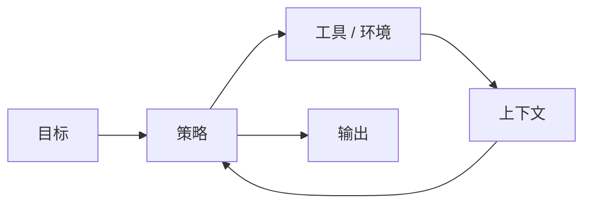
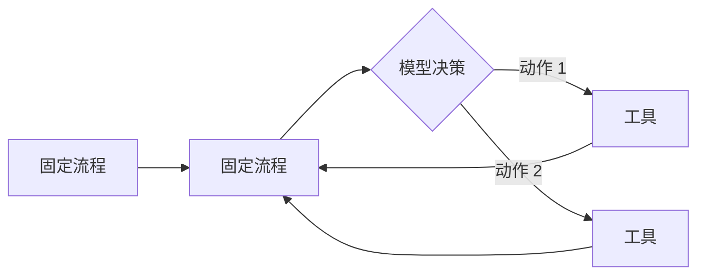
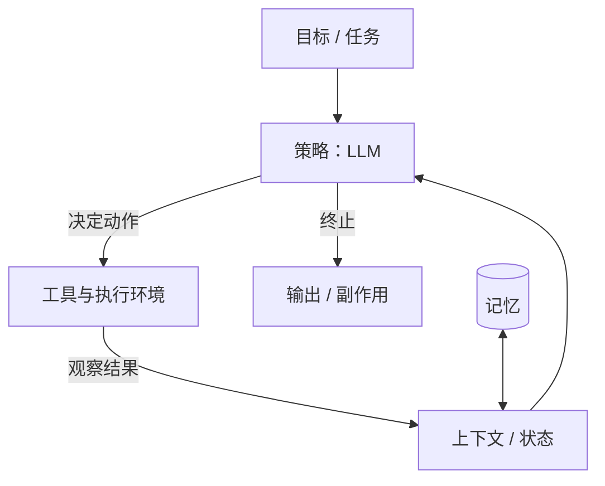

# 什么是 Agent

## 一图看懂



<p class="diagram-caption"><strong>一图看懂</strong> · Agent 的最小闭环：目标进入策略，动作作用于环境，观察回到上下文</p>


先给一个工程上够用的定义：

> **Agent 是一个以目标为输入，能自主决定下一步动作，并通过与环境交互获得反馈、持续调整策略的软件系统。**

拆开看，它至少包含四件事：

1. **目标（Goal）**：用户给的不是一条指令，而是一个需要多步完成的结果。
2. **策略（Policy）**：由模型（通常是大语言模型）决定“下一步做什么”。
3. **动作（Action）**：调用工具、读写文件、执行代码、检索、询问用户……
4. **反馈（Feedback）**：动作的结果回到系统里，成为下一轮决策的依据。

少了任何一项，它更接近“一次模型调用”或“固定流程”，而不是 Agent。

本章另有 2 张图：图 1 流程与 Agent 的分界，图 2 五个组成部分。

## 一个最小的例子

用户说：**“帮我把这个仓库里失败的测试修好。”**

一个 Agent 的循环可能是：

```text
观察：仓库路径、当前分支、用户约束（不要改公共 API）
思考：先跑测试，定位失败点
行动：执行 `pytest -q`
观察：3 个测试失败，都在 parser 模块
思考：读失败测试和实现
行动：打开 tests/test_parser.py 与 src/parser.py
观察：……
行动：修改代码
观察：重新跑测试
……直到通过，或判断需要询问用户
```

注意这里没有“一次性生成最终答案”。**答案是通过一系列动作逐步构造出来的**，而且每一步都可能改变后续计划。

## Agent 与 Workflow 的分界线

这是最容易混淆的一组概念。可以用一个问题判断：

> **下一步做什么，是代码提前写死的，还是模型根据当前观察临时决定的？**

| 维度 | Workflow（工作流） | Agent |
| --- | --- | --- |
| 控制流 | 开发者预先编排 | 模型动态决定 |
| 可预测性 | 高 | 较低 |
| 调试难度 | 低 | 高（轨迹长、分支多） |
| 适合任务 | 步骤稳定、规则清晰 | 步骤不确定、需要探索 |
| 典型形态 | 链式调用、路由、并行分支 | ReAct 循环、Coding Agent、Deep Research |

现实中大量系统是**混合体**：外层是固定工作流，某些节点内部是 Agent；或者 Agent 被限制在几个允许的动作里。

见**图 1**：



<p class="diagram-caption"><strong>图 1 · 固定流程与 Agent 的分界：谁决定下一步</strong></p>

> 不要把“用了 LLM”叫 Agent，也不要把“Agent”当成高级工作流。**自主性是一种成本**：它带来灵活性，也带来不可预测、难评测和难授权。只有在任务确实需要动态决策时才付这个成本。

## Agent 的五个组成部分

见**图 2**：



<p class="diagram-caption"><strong>图 2 · 五个组成部分：目标、策略、工具、状态、记忆</strong></p>

### 1. 策略（Policy）

通常由 LLM 承担：读当前上下文，输出下一步动作或最终答案。策略的质量取决于模型能力、提示、可用工具和上下文质量。

### 2. 上下文（Context）

模型每一步能看到的全部信息：系统提示、对话、工具定义、检索结果、执行观察、记忆片段。**上下文不是聊天记录**，而是为当前决策精心组装的“工作台”。

### 3. 工具（Tools）

Agent 改变世界或获取信息的接口。工具不只是函数，它包含：名称、描述、参数 schema、执行语义、错误格式、权限和副作用。

### 4. 状态与记忆（State & Memory）

- **状态**：这一轮任务进行到哪、已尝试什么、预算剩多少。通常是结构化数据。
- **记忆**：跨轮次保留的信息，如用户偏好、项目事实、历史经验。

### 5. 运行时（Runtime）

工具真正执行的地方：进程、容器、浏览器、虚拟机。它决定隔离性、可复现性和安全边界。

## 什么时候不该用 Agent

Agent 很酷，但以下场景通常用固定工作流更划算：

- **步骤完全确定**：如“抽取发票字段 → 校验 → 入库”。写成 pipeline 更稳、更便宜。
- **错误代价极高且不可逆**：如直接操作生产数据库。可以用 Agent 建议，但执行要有人审。
- **延迟敏感**：Agent 多轮往返，P95 延迟通常远高于单次调用。
- **无法验证结果**：如果系统无法判断动作是否成功，Agent 会在错误里越走越远。
- **任务太开放**：如“帮我赚一百万”。缺少可判定的终止条件，Agent 只会空转。

一个实用判断表：

| 问题 | 偏向 Workflow | 偏向 Agent |
| --- | --- | --- |
| 步骤是否可枚举？ | 是 | 否 |
| 是否需要根据中间结果改变计划？ | 否 | 是 |
| 是否有可靠的自动验证？ | 不一定 | 最好有 |
| 单次错误是否可逆？ | 是 | 否（需护栏） |
| 成本/延迟是否宽松？ | 否 | 是 |

## 常见误解

::: warning 误解一：Agent 就是“更长的 Prompt”
长 Prompt 只改变一次输入。Agent 的关键是**多轮反馈**：动作结果会改变后续输入和策略。
:::

::: warning 误解二：工具越多，能力越强
工具数量上升会带来选择困难、描述冲突、上下文膨胀和权限风险。能力是“工具 × 选择正确率”，不是工具数量。
:::

::: warning 误解三：Agent 会自动“记住”
默认不会。上下文窗口结束，信息就没了。记忆需要显式的写入、检索、更新和遗忘机制。
:::

::: warning 误解四：多 Agent 一定比单 Agent 强
多 Agent 增加的是并行度和角色分工，代价是通信损耗、错误传播和调试复杂度。很多任务单 Agent + 好工具更优。
:::

## 一个更有用的分类

按“自主性从哪里来”分，而不是按产品名分：

| 类型 | 自主性来源 | 例子 |
| --- | --- | --- |
| 工具增强型 | 模型选择调用哪个工具 | 带搜索/计算器的助手 |
| 流程编排型 | 代码控制流程，模型填充节点 | 客服工单处理 |
| 反馈驱动型 | 模型根据执行结果调整计划 | Coding Agent、Deep Research |
| 持续型 | 长期运行、定时触发、维护状态 | 监控/运维 Agent |
| 多体协作型 | 多个角色分工与协商 | 研究/评审/仿真 |

后文讨论架构时，这套分类比“聊天机器人/智能体”更有解释力。

## 来源

本章关于 workflow / agent 分界、组件划分与适用性判断的表述，主要依据：

- Anthropic, **Building Effective Agents**——workflow 与 agent 的分界、五种编排模式，以及“什么时候不该用 agent”的原始论证。[链接](https://www.anthropic.com/research/building-effective-agents)
- OpenAI, **A Practical Guide to Building Agents**——Agent 的组成部分（模型、工具、指令）与适用性判断。[链接](https://cdn.openai.com/business-guides-and-resources/a-practical-guide-to-building-agents.pdf)
- Schick et al., **Toolformer**（2023）——“模型自学何时调用工具”，支撑“工具 × 选择正确率”的说法。[链接](https://arxiv.org/abs/2302.04761)
- Lilian Weng, **LLM Powered Autonomous Agents**——规划、记忆、工具的三分法，本章“五个组成部分”的来源之一。[链接](https://lilianweng.github.io/posts/2023-06-23-agent/)

完整清单见[推荐来源](/appendix/sources#什么是-agent)。

## 练习

1. 选一个你常用的“AI 功能”，判断它是 Workflow 还是 Agent，依据是控制流由谁决定。
2. 为“修复失败测试”写出至少 5 个可能的动作，以及每个动作失败时 Agent 应该观察到什么。
3. 找一个“看起来像 Agent，其实不该用 Agent”的场景，说明用工作流如何实现。

::: details 参考答案与自检
**1. Workflow 还是 Agent？**
要点：只看一个问题——控制流由谁决定。回答里要能指出“下一步”是在代码里写死（分支判断、固定链路），还是由模型根据观察临时决定；混合体要分开说（外层固定、节点内自主）。
自检：如果回答里出现“因为用了大模型”“因为能多轮对话”这类依据，说明还没抓住判据。

**2. 修失败测试的 5 个动作**
要点：动作要覆盖“观察”和“修改”两类，且每个动作都要写出**失败时模型能看到什么**。例如 `pytest -q` 失败 → 应返回失败用例名、断言差异、堆栈摘要；读文件失败 → 返回 `invalid_argument` 与路径提示，而不是 `500`；修改代码后回归失败 → 返回新失败用例与上一轮对比。
自检：如果某个动作失败后模型只拿到“Error”，说明动作设计不合格——这属于[工具层](/layers/tools)的错误契约问题。

**3. “像 Agent 但该用工作流”的场景**
要点：答案要给出**可枚举的步骤**（所以不需要模型决定控制流），并说明用工作流后省掉了什么（更便宜、更稳、可测试、无需授权）。
自检：说不出“步骤怎么枚举”，只说了“工作流更简单”，属于结论正确但论证缺失。
:::

下一步：[架构总览](/evolution/overview)；如果你想先看最小实现，也可以直接读[核心循环](/foundations/loop)。
